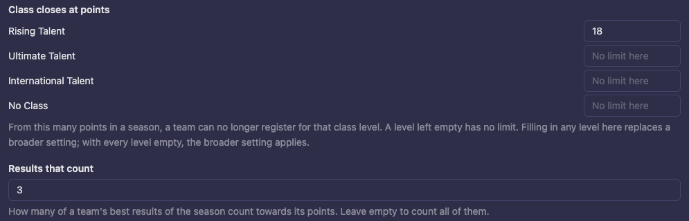
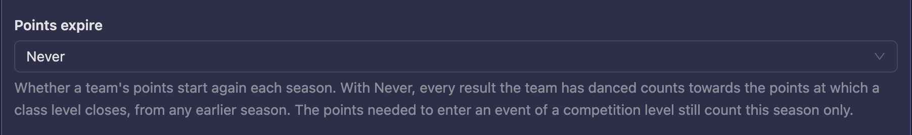
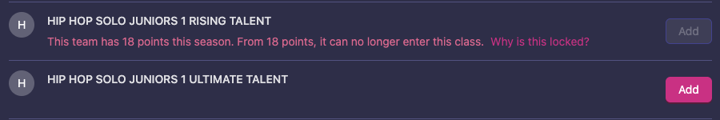
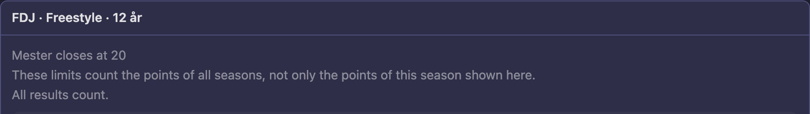
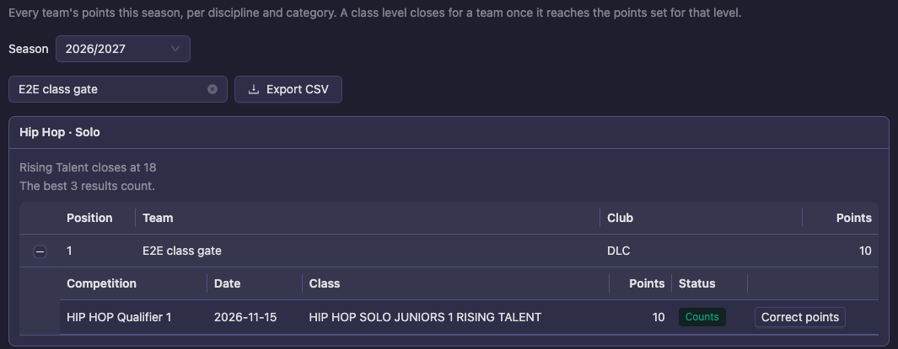
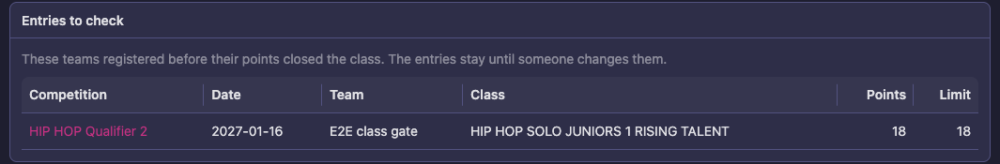
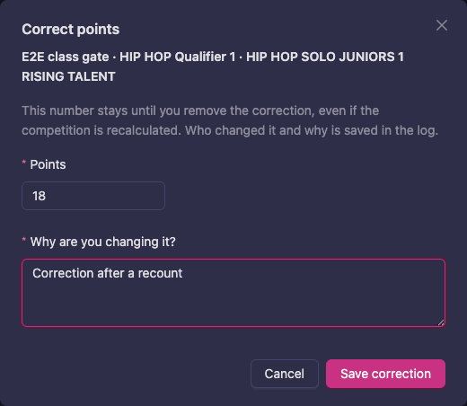

# Closing a class at points

Some federations move a team up a level once it has earned enough points in a season: a team that has reached the limit can no longer enter that class level, and goes up. This page shows how to set the limits, what dancers and event staff see, and how to follow and correct each team's points on **Season points**.

Nothing changes until you set a limit. A federation that does not use the rule sees no difference.

This page is about the **limit**. Where the points themselves come from, and how the points table pays them, is on [Promotion points](/federation/progression/).

## How a team's points are counted

A team's points are its best results of the season, in one discipline and category, added together across all age groups. The points come from the results of the competitions in the season. If your federation's points never expire, results from earlier seasons count too: see [Points that never expire](#points-that-never-expire).

- **Results that count** decides how many of the team's best results are added up. With 3, only the three highest count. Leave it empty to count every result.
- **Disqualified and cancelled entries** do not count, and neither do entries at practice events.
- **Results a competition holds back** count once the competition is **closed**. Close each competition when it is over: from then on its points count and the classes lock, and a coach cannot learn a placement early from a class that has closed.
- **Points follow the team** when its lineup changes. If your federation wants a duo with a new partner to start again from 0, set **Competitor identity change policy** to reset on a partner change, on the **Duo** categories only. Set on a group, the same rule would reset it whenever any dancer changes.

## Set the limits

1. Go to **Structure**, choose the division and open the rules of the division, a discipline or a category. A rule on a category replaces the same rule on the discipline or division.
2. Under **Class closes at points**, type the number of points for each class level. A team that has this many points in the season can no longer enter that class level. A level left empty has no limit.
3. Under **Results that count**, type how many of a team's best results count. Leave it empty to count them all.
4. Save the rules.

Filling in any level on a category, discipline or division replaces the limits set on a broader level, as a whole. If every level is empty, the broader setting applies. A category cannot opt out of a division's limits except by setting its own.

## Points that never expire

By default a team's points start again at 0 when a new season begins. Some rulebooks let points add up for as long as the team dances: a team stays in a class until it has earned enough points to leave it, however many seasons that takes. Choose **Never** under **Points expire** for that.

1. Go to **Structure**, choose the division and open the rules of the division, a discipline or a category.
2. Under **Points expire**, choose **Never**. **At the end of the season (default)** keeps the usual season count.
3. Save the rules.

With **Never**:

- **Class closes at points** and promotion to the next class count every result the team has danced, from every season, not only the current one.
- **The entry rules of a competition level still count one season.** **Points needed to enter** and **Competitions danced before entering** (see [Who may enter an event](/federation/season-ranking/#who-may-enter-an-event)) look at this season only.
- **Season points** still lists this season's results, and says under the limits that they count all seasons. See [Season points](#season-points).
- **A dancer or club registering** sees "This team has 32 points, counting all seasons. From 30 points, it can no longer enter this class."

**Starting again at 0 after a promotion.** Points are counted per discipline and category, not per class level. So a team that moves up keeps the points it earned in the class below, and with points that never expire it could reach the next limit straight away. If your rulebook says a promoted team starts again at 0 in its new class, list the class levels under **Class levels with their own points** in the division's rules (see [How results count in the ranking](/federation/season-ranking/#how-results-count-in-the-ranking)). Each of those levels then counts only the results danced in it.

## What dancers and event staff see

- **A dancer or a club registering** sees the class locked, with the reason and a **Why is this locked?** link: "This team has 18 points this season. From 18 points, it can no longer enter this class." The **Add** button is off.
- **Going up is always open.** A team that is closed out of one class level can still enter the next one up.
- **A class move** is refused in the same way when the team is moving into a class it has no longer the right to enter.
- **Event staff** are warned instead of stopped. They may still add or move the team.
- **Entries already made** stay. If a team's points rise after it has registered, the entry is not removed. It shows on **Season points** under **Entries to check**, so someone can decide what to do.

A class that fails an earlier check, such as age or licence, shows that reason instead of the points.

## Season points

**Season points** is the overview of every team's points. It is for the federation's staff.

1. Go to **Structure**, choose the division and open **Season points**.
2. Choose the **Season**. The limits shown are the ones set today, also when you look at a past season.
3. Type in **Filter by team or club** to find a team. **Export CSV** saves the lists as they are filtered now.
4. Each list is one discipline and category. Under the heading you see the limits ("Rising Talent closes at 18") and how many results count. Press the plus sign on a team to see its results: **Competition**, **Date**, **Class**, **Points** and **Status**.

When **Points expire** is **Never**, a line under the limits says "These limits count the points of all seasons, not only the points of this season shown here." The points in the list are still this season's, so a class can be closed to a team whose total here is below the limit.

The **Status** of a result is **Counts**, **Disqualified** or **Corrected**.

The page is up to date when you open it and after you correct a result. It does not change on its own when a round is confirmed, so open it again to see the latest.

### Entries to check

When teams have an entry that its points should have closed, a box **Entries to check** shows at the top. Each row shows **Competition**, **Date**, **Team**, **Class**, **Points** and **Limit**. The competition opens when you press its name.

An entry is never flagged because of a result in its own competition.

## Correct a result's points

Use this when a result has the wrong points and you cannot fix it by changing the results themselves, for example after a recount. Only federation administrators can do it.

1. On **Season points**, press the plus sign on the team and press **Correct points** on the result.
2. Type the **Points**.
3. Under **Why are you changing it?** write the reason. It cannot contain the characters <, > or \.
4. Press **Save correction**.

The corrected number stays until you remove the correction, even if the competition is closed again or [points are recalculated](/federation/progression/#recalculate-points). The result shows **Corrected**. Who changed it, and why, is saved in the [Enforcement log](/federation/members/#enforcement-log) on **Members**.

While a correction stands, the points on that entry cannot be changed by hand or by importing a file. To take it away, press **Correct points** again and choose **Remove correction**; the result goes back to the points the competition gave it.

## Good to know

- **The points table must be set first.** A limit locks nothing until the federation has a points table and results are confirmed. See [Promotion points](/federation/progression/).
- **Resetting a competition's results** also clears the points on its entries, as it does for placement and score.
