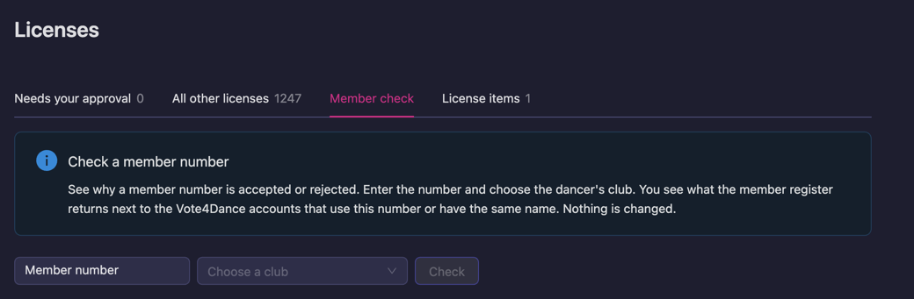
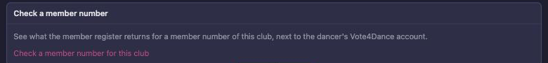

# Federation admin

`Federation → Licenses` is where federation staff handle licenses day to day: approve the applications that are waiting, issue or correct a license, suspend or cancel one, and keep the list of license items. The number on **Licenses** in the federation bar is the number of applications waiting for you.

To decide how licenses work in your federation and set them up for the first time, see [Setting up licenses](/federation/getting-a-license/).

The screen has these tabs:

| Tab | What it holds |
|---|---|
| **Needs your approval** | Applications waiting for the federation to approve or decline. Opens first. |
| **All other licenses** | Every other license: active, expired, suspended, cancelled, and applications still waiting on the club or the dancer. |
| **Member check** | A lookup in the federation's member register. Only there when a member register is connected. |
| **License items** | The licenses your federation offers. |

The screen says **Organization** for a club or school.

## Who can do what

| Task | Role needed |
|---|---|
| Read the lists | Viewer |
| Approve, decline, add, edit, suspend, cancel or remove a license, one at a time or several at once | Manager |
| Check a member number | Manager |
| Approve a club, and allow it to issue licenses | Manager |
| Move a license the federation has approved to another club, or take its club off | Administrator or Owner |
| Add, edit or remove license items | Administrator or Owner |
| Map license items to classes | Administrator or Owner |
| Connect Stripe | Administrator or Owner |

A Viewer does not see **Licenses** in the federation bar, but can open a link to it and read. Buttons you may not use are not shown. See [Federation staff roles](/federation/staff-roles/).

## Where the rest is done

| For this | Go to |
|---|---|
| Connect Stripe, so that licenses can be paid online. Payments go to the federation's own Stripe account and Vote4Dance keeps a 5% fee. | `Federation → Settings → Federation`; see [Stripe payout account](/federation/settings/#stripe-payout-account) |
| Decide whether the club, the federation or both must approve a license | The rules **Club must approve a licence** and **Federation must approve a licence**; see [Setting federation rules](/federation-rules/editor/) |
| Decide which classes accept which license items | The class's **License rules**; see [4. Map license items to classes](#4-map-license-items-to-classes) |
| Approve a club, or allow it to issue licenses | The club's page; see [6. Manage issuer role on organizations](#6-manage-issuer-role-on-organizations) |
| See everything about one dancer: licenses, class memberships and rule decisions | `Federation → Members`, [Dancers tab](/federation/members/#dancers) |
| Class memberships and progress | `Federation → Members`, [Competitors tab](/federation/members/#competitors) |
| Which club a couple or team represents | The club's **Transfers** tab; see [Club transfers](/federation/club-transfers/) |

## 1. Approve or decline what is waiting

**Needs your approval** lists the applications with status **pending** or **draft** that the federation has not approved yet. An application that still waits for its club's approval is not here: it stays in **All other licenses** with the tag **Waiting on organization** until the club has approved it.

Each row shows the person, the license item and one of three tags:

| Tag | What it means |
|---|---|
| **Ready** | All four checks pass. |
| **Waiting** | A check fails: the payment is outstanding, or today is outside the license's validity dates. |
| **Blocked** | The club named on the license is not approved by the federation. |

### Approve or decline one application

1. Open `Federation → Licenses`. **Needs your approval** opens first.
2. Click an application in the list. To the right you see the person, the license item and season, the four checks, and below them **Organization**, **License item**, **Season**, **Fee** and **Note**, as far as the license has them.
3. Read the four checks. The line next to the buttons names the first check that fails, or says "All four checks pass · ready to approve".
4. Press **Approve**. The license becomes **active** and you see "License approved". Or press **Decline**: the license is set to **cancelled** straight away, without a confirmation question, and you see "License declined".

Either way the license moves to **All other licenses**.

| Check | Passes when | When it fails |
|---|---|---|
| **Organization approved by the federation** | The club on the license is approved by the federation, or the license names no club. | "*Club* is still pending federation approval, so no license it holds can be issued." Follow **Open organization** and approve the club. |
| **Organization has approved this license** | The club has approved this application, or your federation does not require club approval. | "*Club* hasn't approved this request yet. A manager or administrator there has to approve it." |
| **Payment received** | The payment status is not **unpaid** or **invoiced**. | "Payment of *amount* is outstanding." |
| **Within the license window** | Today is between **Valid from** and **Valid to**. | "The validity window does not open until *date*." or "The validity window closed on *date*." |

**Approve** is unavailable only for a **Blocked** application. You then see **Approve the organization first**, with a link to the club.

A **Waiting** application can still be approved. Approving makes the license active and leaves its payment status as it is, so a license approved while "Payment is outstanding" is valid and unpaid. Decide that on purpose: wait for the payment, or record it first with **Edit** (see [Edit a license](#edit-a-license)).

Before you approve, check that:

- the right person holds the license, and it is the right license item
- the payment status matches the payment you have actually received
- the club is the one the dancer represents
- a license for one competition names that competition

### Approve several applications

1. Tick the applications, or tick the box above the list to take all of them.
2. Check the count in "*n* selected". If some of them are **Blocked** you also see "*n* will be skipped — the organization is not approved".
3. Press **Approve *n***. There is no confirmation question.

Blocked applications are left as they are. Applications tagged **Waiting** are approved along with the rest, so untick the ones you want to hold back. Afterwards you see "*x* of *y* licenses updated".

Declining is done one application at a time.

## 2. Issue, edit, suspend or remove a license

**Edit** and the bin are on each row of **All other licenses**, and next to **Approve** and **Decline** on an application in **Needs your approval**.

### Add a license manually

Add a license yourself when it does not come through an application: a license for an official, a license carried over from another system, or a correction. For licenses dancers and clubs apply for themselves, let them apply; see [Setting up licenses](/federation/getting-a-license/).

1. Open `Federation → Licenses` → **All other licenses** and press **Add**.
2. In **User**, type at least three characters of the person's name or email and pick the person from the list. A name you typed without picking it is not accepted: "Search for the person again and pick them from the list."
3. Choose the **License item**. When you save, the license takes its category, division and discipline from the item.
4. Choose the **Category** and the **Status**. Choose **active** for a license that is valid at once.
5. Fill in the other fields that apply; see the table below.
6. Press **Save changes**.

If the person already has a license for the same license item, category, season and competition, that license is updated. No second one is made.

A license saved as **active** counts as approved by the federation from that moment.

| Field | What it is |
|---|---|
| **User** | The person who holds the license. Required. |
| **License item** | Which of the federation's licenses this is. |
| **Category** | **dancer**, **judge**, **coach**, **scrutiny**, **supervisor**, **music**, **organizer** or **other**. Required. |
| **Season year** | The season the license is for. Choosing one sets **Valid from** and **Valid to** to that season's dates. "Leave blank for a lifetime license (officials, music, DJ, etc.)." |
| **Status** | **draft**, **pending**, **active**, **expired**, **suspended** or **cancelled**. Required. Only an **active** license counts when a dancer registers. |
| **Payment status** | What is recorded about the payment: **unpaid**, **paid**, **invoiced**, **waived** or **refunded**. Left empty, it is saved as **paid** on an active license and **unpaid** on any other. |
| **Payer type** | Who pays: **self** (the person) or **organization** (the club). Left empty, it is saved as **self**. |
| **Division**, **Discipline** | The part of the federation the license is for, when it is not for all of it. Taken from the license item when you chose one. |
| **Organization** | The club the dancer holds the license with. The list offers only clubs that are allowed to issue licenses. |
| **Payer organization** | The club that pays, when a club pays. |
| **Competition** | For a license that is valid for one competition only: that competition's ID. The license then counts for that competition and no other. |
| **Valid from**, **Valid to** | The dates the license is valid. It counts for a competition held between them. |
| **Flags JSON** | Advanced settings that can limit what the license counts for. Leave it as it is: a wrong value can stop the license from counting at registration. |
| **Note** | Your own comment. It shows in **Needs your approval** and in the CSV. |
| **Payment reference**, **Invoice reference** | Your own references for the payment and the invoice. They are in the CSV. |

### Edit a license

1. Find the license (see [8. Find and download licenses](#8-find-and-download-licenses)) and press **Edit**.
2. Change the fields. They are the same as when you add a license.
3. Press **Save changes**.

To record a payment you received outside Vote4Dance, set **Payment status** to **paid**, or **waived** when nothing is owed, and note your own reference in **Payment reference** or **Invoice reference**.

Setting **Status** to **active** here is the same decision as **Approve**. Where the club must approve first and has not, saving is refused: "This license must be approved by the organization before it can be activated."

To change the club on a license, see [5. Move a license to another club](#5-move-a-license-to-another-club).

### Suspend a license

There is no suspend button. Press **Edit**, set **Status** to **suspended** and press **Save changes**.

A suspended license does not count when the dancer registers, and neither the dancer nor the club can apply for the same license again while it is suspended. To lift the suspension, set **Status** back to **active**.

### Cancel or remove a license

These are two different things:

| | Cancel | Remove |
|---|---|---|
| How | **Edit**, set **Status** to **cancelled**, **Save changes**. On an application, **Decline** does the same. | Press the bin next to **Edit** and confirm. |
| What happens | The license stops counting and stays in the list, so the history can be read. | The license is deleted. You see "License removed". It cannot be brought back. |
| Use it for | A license that was valid and no longer is, or an application you turn down. | A license that was created by mistake. |

## 3. Manage license items

A license item is one license your federation offers, for example an annual dancer license or a license for one competition. Applicants choose from the active items, and classes say which items they accept.

The **License items** tab lists every item with its code, status, category and kind, and below that its division, **Organization required**, **Valid for**, **Maximum uses per season**, price and note. Adding, editing and removing need the Administrator role.

### Add or edit a license item

1. Open `Federation → Licenses` → **License items**.
2. Press **Add** below the list, or **Edit** on an item.
3. Fill in the fields; see the table below.
4. Press **Save changes**.

| Field | What it decides |
|---|---|
| **Name** | What applicants see. Required. |
| **Code** | Your own short code. Required. |
| **Category** | **dancer**, **judge**, **coach**, **scrutiny**, **supervisor**, **music**, **organizer** or **other**. Required. |
| **Division**, **Discipline** | The part of your structure the item is for. Leave both empty for an item that is for the whole federation. |
| **Kind** | **standard**, **guest**, **first_start**, **one_off**, **membership** or **external**. Only **external** changes how applying works: the license is checked against another federation's system, and "applicants enter their MIN / WSCID / lidnummer when applying". |
| **Organization mode** | Whether the license is held with a club: **optional**, **required** or **disallowed**. The list shows this as **Organization required**: **Optional**, **Required** or **Not allowed**. With **required**, the club must be allowed to issue licenses. |
| **Competition scope** | **season** or **single_competition**. The list shows this as **Valid for**: **Full season** or **Single competition**. For kind **external** there is nothing to choose: "External licenses are lifetime". |
| **Status** | **active** or **inactive**. Applicants are only offered active items, and only active items can be added to a class. |
| **Maximum uses per season** | How many times one person can hold this item in a season. It applies to items for a single competition. Past it, the applicant is told the item "has reached its maximum number of applications". |
| **Price**, **Currency** | What the license costs, and the three-letter currency. For a free license, see [Step 2: Define the license items](/federation/getting-a-license/#step-2-define-the-license-items). |
| **Note** | Your own comment. |

Give the items names that dancers and clubs can tell apart without help, and put the scope in the name when it matters: "Annual competition license", "One-time competition license", "Division A high license".

### Stop using a license item

Set its **Status** to **inactive**. Nobody can apply for it any more, and the licenses already issued for it stay as they are.

Removing an item with the bin ("Remove *name* (*code*)?") deletes it and takes it out of every class's **License rules**. Licenses that were issued for it then show a number where the item's name was. Remove only an item that was never used.

## 4. Map license items to classes

A class lists the license items it accepts in its **License rules**. Without that, an item exists but no class asks for it. This needs the Administrator role.

1. Open `Federation → Structure`, the division, the discipline and its **Classes**.
2. Press **License rules** in the class's **Licenses** column. The badge on the button shows how many items the class has.
3. Press **Add** and choose the **License item**. Only active items that match the class's division and discipline are offered; an item with no division and discipline is offered everywhere.
4. Tick what the license is required for: **Required at registration**, **Required at ranking** and **Required at progression**. The first two are ticked to begin with.
5. Press **Save changes**.

Each item in the list shows what it is required for as **registration**, **ranking** and **progression**. To change that, add the same item again with the ticks you want. The bin takes the item off the class.

To add an item to several classes at once, tick the classes in the list first and then press **License rules** on one of them. The title shows the number of classes, and **Add** adds the item to all of them.

A license a class accepts can still be turned away at a competition level; see [Licenses that don't count at a level](/federation/season-ranking/#licenses-that-dont-count-at-a-level).

## 5. Move a license to another club

The club on an **active** license cannot be edited in place. Choosing another club reissues the license.

1. Find the license and press **Edit**.
2. Choose the new club in **Organization** and press **Save changes**.
3. Read the question "Change organization for this license?" and press **Change organization**. You see "Organization changed".

A new active license is issued under the new club, valid from today through the old license's end date. The old license is cancelled and kept for history. The new club must be allowed to issue licenses; see [6. Manage issuer role on organizations](#6-manage-issuer-role-on-organizations).

Who may do it:

- Once the federation has approved a license, whether it is still active or not, only an Administrator or Owner can move it to another club or take its club off. For a Manager the field is locked, with the note "Moving a license the federation has approved to another organization needs a federation Administrator."
- A Manager can still correct the club on an application that was never approved, and add a club to a license that names none.

On a license that is not active, the club is simply changed, with no reissue. The club cannot be taken off an active license; it can only be replaced.

Which club a couple or team represents follows its dancers' active licenses, so for a couple, move both partners' licenses. What the move does to payment, representation and the team, the messages when it is refused, and what to do for a competitor without licenses (**Assign organization**, **Rename competitor**) are in [Moving a dancer's license to a new club](/federation/club-transfers/#moving-a-dancers-license-to-a-new-club).

## 6. Manage issuer role on organizations

The federation decides two separate things about a club, both on the club's page:

| On the club's page | What it allows |
|---|---|
| **approved** (otherwise **pending**) | Licenses that name the club can be approved. While the club is pending, its applications are **Blocked**. |
| **can issue licenses** (otherwise **cannot issue licenses**) | The club can apply for license items whose organization mode is **required**, it is offered under **Organization** when you add or edit a license, and a license can be moved to it. |

### Allow a club to issue licenses

1. Open `Federation → Members → Organizations` and click the club.
2. If the club is **pending**, press **Approve organization** first.
3. Press **Allow license issuing**. You see "License issuing enabled" and the tag changes to **can issue licenses**.

To take it back, press **Revoke license issuing** and confirm "Remove license issuing access from *club*?". **Mark pending** withdraws the club's approval.

Both need the Manager role. See [Organizations](/federation/members/#organizations).

## 7. Change several licenses at once

On **All other licenses** you can approve, decline or set the payment status of many licenses in one go.

1. Open `Federation → Licenses` → **All other licenses** and filter the list down to the licenses you mean (see [8. Find and download licenses](#8-find-and-download-licenses)).
2. Tick the licenses. Ticks are kept when you change page or filter, so check the count in "*n* selected" before you go on.
3. Press one of the buttons and confirm:

| Button | What it does |
|---|---|
| **Approve** | Sets every ticked license to **active**, whatever its status was: a suspended, expired or cancelled license becomes active again too. |
| **Decline** | Sets every ticked license to **cancelled**. |
| **Set payment status** | Sets the payment status you chose in the list next to it: **paid**, **invoiced**, **waived** or **unpaid**. |
| **Clear selection** | Unticks everything. |

Afterwards you see "*x* of *y* licenses updated". A license whose club still has to approve it is not set to active: "*n* licenses were skipped (missing organization approval or not found)."

**Approve** here looks at nothing else. It does not leave out unpaid licenses or licenses of clubs the federation has not approved, so look through the selection first.

Suspending, setting **expired** or **refunded**, and removing are done one license at a time.

## 8. Find and download licenses

**All other licenses** opens with **Only show those awaiting an organization or dancer** ticked. It then shows only the licenses that still wait for a club's approval or for a payment. Untick it to see every license, including the active ones.

To narrow the list:

- **Search dancer, organization or item** also finds a license by federation ID, note, category, status and season.
- **Filter by license status**, **Filter by license category**, **Filter by season** and **Filter by organization**.

Each row shows the person with their birth date (or **No birthdate**), the **License item**, the **Organization**, the **Season year** (or **Lifetime**), the **Status** and the **Payment status**. Pending licenses come first, then active ones, then the rest.

**Download CSV** downloads the list as you have filtered it, together with the applications in **Needs your approval**. Its columns are User, Birth date, Federation ID, License item, Category, Organization, Payer organization, Payer type, Season year, Status, Payment status, Valid from, Valid to, Payment reference, Invoice reference and Note.

### Federation ID on the list

When a license was applied for with a federation ID (the member number from the federation's own system), the ID is shown under the person's name in **All other licenses**. It is also a column in the CSV download, and the search box finds a license by it.

This CSV always uses commas, whatever your browser's language, so it reads the same way each time if you match it against your own member system or accounting. In an Excel set up for a decimal comma, as in Belgium, the Netherlands or Sweden, open it with **Data → From Text/CSV** and choose comma as the separator.

The ID is saved on the license when it is applied for and is not updated automatically if the federation changes it later. When the dancer registers for a competition, the ID is checked with the federation again. If the federation no longer recognizes the old ID, that license does not count for the registration. To fix it, the dancer (or their organization) applies again with the new ID; this updates the existing license instead of creating a second one.

### Licenses of one organization

To see which dancers of one club or school hold a license:

1. Open **Licenses** → **All other licenses**
2. In **Filter by organization**, type part of the club's name or short name and pick it from the list

The list now shows every license of that organization, together with any other filters you have set. Picking an organization unticks **Only show those awaiting an organization or dancer**, so active licenses show too; tick it again to see only the open ones. Clearing the organization puts the tick back as it was. **Download CSV** then holds only that organization's licenses. The list only offers organizations that hold at least one license: if you see *No organization with that name holds a license*, none of that club's dancers has a license yet. The search box also finds a license by the organization's name.

## 9. Check a member number

Some federations check each dancer's member number against their own member register when a license is applied for. Dansport Vlaanderen does this. When a dancer or club tells you a number "is not recognised", the **Member check** tab shows you why, without contacting Vote4Dance support. It only looks things up: nothing is changed, and nothing is sent to the dancer.

The tab is only there when your federation has a member register connected, and you need the Manager role or higher.

### Check a number

1. Open `Federation → Licenses` and choose the **Member check** tab
2. Type the **Member number** the dancer used
3. Choose the dancer's club. Each club's register login only sees that club's members, so check with the club the dancer applied with
4. Press **Check**

You see the register's answer for that club: the **Name in register**, the **Member number**, the **Birth date in register** and the **Membership status**. A short text under it says what it means.

Below that, **Vote4Dance accounts** lists the accounts that have a license with this number or the same name as in the register, with each account's **Birth date in Vote4Dance** and how it **Compared with register**. Click a name to open the dancer.

### What the result tells you

| You see | What it means | What to do |
|---|---|---|
| **Active member** | The number is valid for this club. | If the application was still rejected, look at the birth dates under **Vote4Dance accounts**. |
| **Not active** | The member is in the club's list, but the membership's status type is not ACTIVE, for example PROSPECT, even when its name says "Actief lid". | Change the membership status in the member register. |
| **Not found** | The number is not in this club's member list. | Check the number with the member. If they belong to another club, check again with that club; they must apply with that club selected. |
| **Check failed** | The register could not be reached with this club's login. | Try another club: if that works, check this club's register login on the club's page (`Teams & integration`). If no club works, the register is unavailable: try again later. |

Birth dates are compared like this:

- **Matches**: the birth dates are the same.
- **One day apart**: usually the register holds the date one day too early. Correct it in the member register. Do not ask the dancer to change their date in Vote4Dance; their account would then be wrong.
- **Different**: the dates differ by more. One of them has a typing mistake; check with the dancer which one.
- **Missing**: the dancer's account has no date of birth. They add it under their account settings.

### From a club's page

When you are already looking at a club, open its `Teams & integration` tab and press **Check a member number for this club**. The **Member check** tab opens with that club already selected.

## Troubleshooting

| What you see | What it means | What to do |
|---|---|---|
| A license you know exists is not in **All other licenses**, or the list says "No licenses to show." | The list opens showing only licenses that wait for a club or a payment. | Untick **Only show those awaiting an organization or dancer**. A pending application may also be in **Needs your approval**. |
| An application is tagged **Blocked**, with **Approve the organization first** | The club on the license is not approved by the federation. | Follow **Open organization** and press **Approve organization**; see [section 6](#6-manage-issuer-role-on-organizations). |
| An application is tagged **Waiting** | The payment is outstanding, or today is outside the license's validity dates. | Read the four checks. Wait for the payment, record it with **Edit**, or correct **Valid from** and **Valid to**. |
| A license in **All other licenses** is tagged **Waiting on organization** | The club has not approved the application yet. | A manager or administrator of the club approves it; see [Licenses for your members](/school-club/getting-a-license/#approving-what-members-applied-for-themselves). It then comes to **Needs your approval**. |
| "This license must be approved by the organization before it can be activated." | You set a license to **active** while the club's approval is still missing. | Ask the club to approve it first. |
| "*n* licenses were skipped (missing organization approval or not found)." | Some of the licenses you ticked still wait for their club. | The rest were updated. The skipped ones can be approved once their club has approved them. |
| "Moving a license the federation has approved to another organization needs a federation Administrator." | You are a Manager, and the federation has approved this license. | Ask an Administrator or Owner to move it. |
| "Organization cannot be changed on an active license. Cancel this license and issue a new one." | You took the club off an active license. That cannot be saved. | To move the license, choose the new club instead; see [section 5](#5-move-a-license-to-another-club). |
| "This organization isn't an approved issuer for this federation.", or a club is missing from the **Organization** list | The club is not allowed to issue licenses. | **Allow license issuing** on the club's page; see [section 6](#6-manage-issuer-role-on-organizations). |
| "Search for the person again and pick them from the list." | The name in **User** was typed but not picked. | Type at least three characters and click the person in the list. |
| "This license item is no longer available — it has reached its maximum number of applications." | The person already holds this item as often as **Maximum uses per season** allows. | Raise the number on the license item, or cancel a license that should not count. |
| A license shows a number where the license item's name should be | The license item was removed. | Press **Edit** and choose a current **License item**. Next time, set an item to **inactive** in place of removing it. |
| **No birthdate** under a person's name | The person's account has no date of birth. | They add it under their account settings. |
| There is no **Member check** tab | No member register is connected for your federation, or you are a Viewer. | See [9. Check a member number](#9-check-a-member-number). |
| There is no **Add** on **License items**, or in a class's **License rules** | Changing either needs the Administrator role. | Ask an Administrator or Owner. |
| Applicants cannot pay for a license | The federation's Stripe account is not connected, or the item's price or currency is wrong. | See ["Payment will not go through"](/federation/getting-a-license/#payment-will-not-go-through). |
| A dancer holds an active license but cannot register for a class | The class does not accept that license item, the competition is outside the license's dates, or the license is for another competition. | Check the class's **License rules** ([section 4](#4-map-license-items-to-classes)), and the license's **Valid from**, **Valid to** and **Competition**. |
