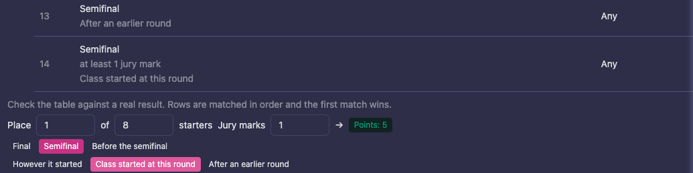
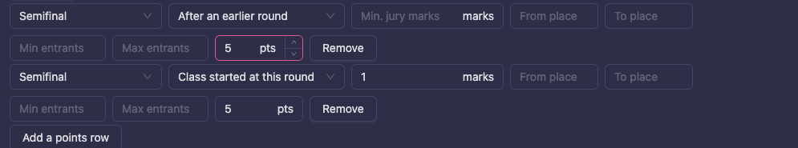
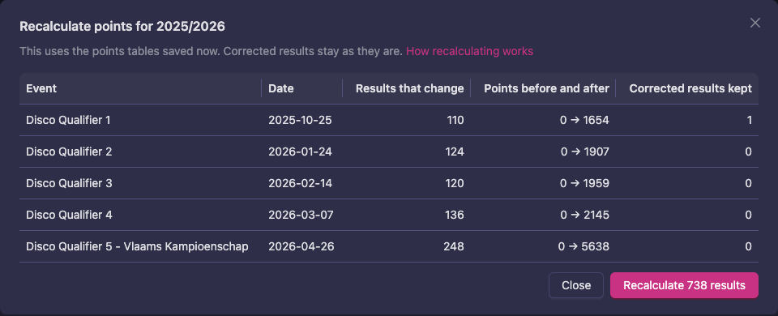
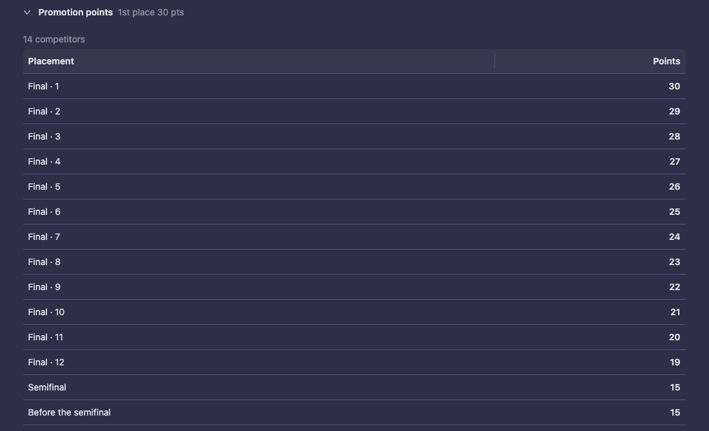

# Promotion points (U-poäng)

Promotion points move competitors up a class ladder. Vote4Dance tracks them with one simple rule: **every competition entry carries the points earned at that competition** — whether the system computed them from judged results, they arrived in an imported result file, or an official typed them in. The federation side sums those values per class membership and promotes automatically at the class threshold.

## Where a value comes from

A competition entry's promotion points ("U-points") can be written three ways, and they all count the same:

1. **Computed** — when a judged round is confirmed, the system scores the class through the federation's points table: by place, by field size and, if your table says so, by the round each dancer reached. Revoking a round's confirmation retracts its points.
2. **Imported** — the "UP" / "Points" column of a result file. **This column means *points earned at this competition***, not the couple's running total. The one exception is a couple's very first appearance: see *Opening balances* below.
3. **Entered** — an official can edit the value on any entry in Manager (the U-points field in the team editor). The computed value wins again if results are re-confirmed, so make manual corrections after the competition is closed.

## Everything happens at competition close

Closing a competition is the moment progression runs. For every entry in a federation-linked class, the system:

1. **Resolves the couple** from the entry's person numbers — creating the dance team on first sight, reusing it forever after. The entry's club tag is resolved the same way: an unknown club is created (with placeholder details for the office to complete) and approved into the federation, and the couple is named after the file, club tag included: `Name & Name (TAG)`. Dancers who already have an account and no active dancer licence receive a free bootstrap licence at that club. The name is not updated by later files, so a club change needs a rename — see [Couples created by the result import](/federation/club-transfers/#couples-created-by-the-result-import). Accuracy in result files is critical: a typo in a person number creates a phantom second couple with a split balance, and a typo in a club tag creates a duplicate club.
2. **Registers a class membership** — but only for couples that received points (earned or carried-in). Couples with nothing to record are not registered and do not appear in the division history; they are registered by whichever later competition first awards them points.
3. **Computes earned points** for judged classes (imported classes keep their entered values).
4. **Updates balances and applies promotions.** A couple reaching the class threshold is moved to the target class immediately, with the reason recorded in their history.

Historical competitions are never processed automatically — progression starts counting from each couple's first processed competition. To re-run progression for a competition (for example after importing results into an already-closed competition, or after a correction), set the competition's status to **closed** again.

## Opening balances

A couple's first processed entry opens their balance:

- On an **imported** first entry, the value is taken as their carried-in total — old result files that print running totals therefore seed transitioning couples correctly with no extra work.
- On a **judged** first entry, a pre-loaded value is preserved as their carried-in balance, and the entry itself ends up showing what they earned at that competition.
- The federation can also set or correct a carried-in balance directly (the carryover action on the division Status tab); it is added on top of everything the couple earns and survives recalculation.

**Correction rule for officials:** changes to a first-time couple's points are made *after* the competition is closed — before close, a value on a judged debut entry is read as their carried-in total, not as an earned override.

## Setting it up

Promotion points are a **federation rule**, so they are edited in the rule editor of the scope they should apply to. The usual place is the class level, because the points normally differ per level (a lower class awards fewer points than a higher one):

`Federation → Structure → (division) → Class Levels → Rules → (select the class level)`

The same rules can be set on the federation, a division, a discipline or a single federation class; the **Rulebook** lists the layers each rule accepts. A narrower scope replaces the wider one; the table is replaced as a whole, not merged row by row.

The rules involved:

- **Promotion points source** — "Points on the competition entry" (`team_up`) for the model described on this page. The other sources remain available: summary score, and placement re-derived at sync time.
- **Promotion points table** — the placement-to-points table. Each row has:
  - **Round** — *Any round*, *Final*, *Semifinal* or *Before the semifinal*. See [Pay by the round a dancer reached](#pay-by-the-round-a-dancer-reached).
  - **Final kind** — *Either final*, *Qualified for the final* (there was at least one earlier round) or *Direct final* (everyone in the class danced the final). Use it when the rulebook pays less for a direct final. The kind is derived from the class's rounds; it is not entered per competition.
  - **Min. jury marks** — only on *Semifinal* and *Before the semifinal* rows: the row pays only with at least this many jury marks in that round.
  - **From place / To place** — leave "to place" empty for no upper bound.
  - **Min entrants / Max entrants** — the field-size band; leave both empty for any field size.
  - **Points**.
  Rows are tried from the top and the first matching row wins, so put the specific rows (a direct-final variant, a small-field variant) above the general ones.
- **Promotion points reach** — *Finalists only* (default) or *All placed, including earlier rounds*. Choose the second when your rulebook pays by place alone, whichever round the place was earned in; give dancers out before the final a row for their places (for example places 7 and up). You don't need it for rows that name a round: those pay either way.
- **Awards promotion points** — turn it off on a **competition level** (`Structure → (division) → Competition levels → Rules`) to make a whole tier of competitions, such as a championship, award nothing.
- **Opening rounds count as the start of a class** — off by default. See [When a class starts directly](#when-a-class-starts-directly).
- **Ladder** — each class that promotes needs *Advance by: points*, a *target class*, and a *promotion threshold* on its class level or class rules. Leave the threshold unset if promotion is decided by hand.

Check the result on `Structure → (division) → Progression`: every class with where it promotes to, the threshold, where its points come from, and, per class, the resolved table with the scope it was inherited from and a small calculator ("place 1 of 8 starters → points"). The tab warns about configurations that would silently do nothing, such as a table without the matching source.

Note that the promotion threshold compares the **sum of everything the couple has earned since joining the class**. A rulebook that promotes on the best N results of a season cannot be expressed as an automatic threshold yet; leave the threshold unset and promote manually from the roster. Ranking standings, by contrast, can use best-N windows, see [Federation admin rankings](/federation-rankings/federation-admin/).

## A team that already holds a higher class

When **Membership policy** is **Required**, a team needs a class membership to enter a class. A team without one can still register for the bottom class of a ladder, and it is placed in that class when it registers. Higher classes stay closed until the federation places the team there or its points allow it to move up.

A team that already holds a class higher up the same ladder can't enter a lower class. Registering for the bottom class is refused with "This team already dances in a higher class, so it cannot enter this lower class." Many rulebooks say this: a couple that has danced A or B may not start in a lower class. Before, such a team was placed in the bottom class as well, and then held two classes in one ladder.

The ladder is the chain of **Target Class** settings, so this works as long as each class points to the next one up. If a team really should dance a lower class, for example after a long break, move it on `Members → Competitors` first (see [Class moves: your part](/federation/class-transfer/#manual-moves-and-corrections)).

## Pay by the round a dancer reached

Some rulebooks pay for reaching a round, whatever the place. A semifinalist may earn 5 points, while a finalist on the same place earns what the final pays. A place alone can't tell those two dancers apart, so name the round on the row.

1. Open `Structure → (division) → Class Levels → Rules` and select the class level.
2. In **Promotion points table**, set **Round** to *Final* on the rows that pay by place in the final.
3. Press **Add a points row** and set **Round** to *Semifinal*. The places empty themselves: this row pays everyone who went out in that round, whatever their place.
4. Fill in **Points** and, if the rulebook asks for it, **Min. jury marks**.
5. Press **Save class level rules**, then check a few results with the calculator on the **Progression** tab.

Vote4Dance works out the rounds from how the class was actually danced, not from what a round is called:

- **Final** is the last round of the class. A final danced in two parts counts as one final.
- **Semifinal** is the last round before the final where dancers were eliminated, whatever its name.
- **Before the semifinal** is every round before that.
- A redance or hope round belongs to the round that sent dancers to it.

A dancer who matches no row gets 0 points. So if quarterfinalists earn nothing, simply leave out a row for them. As always, rows are tried from the top and the first matching row wins.

### When a class starts directly

Some rulebooks treat a class differently if it starts at that round. On a *Semifinal* or *Before the semifinal* row, the second dropdown says which case the row pays:

- **After an earlier round** — dancers were already eliminated in an earlier round.
- **Class started at this round** — nobody was eliminated before this round.
- **However it started** — both.

For example, to pay 5 points to every semifinalist, but only with at least 1 jury mark when the class started at the semifinal, use these two rows:

| Round | How it was reached | Min. jury marks | Points |
|---|---|---|---|
| Semifinal | After an earlier round | | 5 |
| Semifinal | Class started at this round | 1 | 5 |

A round where nobody is eliminated and nobody is judged, such as a presentation or a General Look, doesn't normally count as the start. A semifinal after a presentation is still "Class started at this round", and a final after a General Look is still a *Direct final*.

If your rulebook says otherwise, turn on **Opening rounds count as the start of a class**. You can set it per class level, so a General Look and a presentation can be treated differently when each is used at its own level. A final or semifinal after such a round then counts as reached through an earlier round.

## A points table for one level of competition

A championship can pay differently from the qualifiers, even when it uses the same classes. Give it a competition level with its own table.

1. Open `Structure → (division) → Competition Levels` and add a level for the championship, if you don't have one yet.
2. Open **Rules**, select the level, and fill in **Promotion points table** the same way as above. For example: *Final* rows paying 30, 29, 28 and so on, a *Semifinal* row and a *Before the semifinal* row paying 15 each.
3. Press **Save competition level rules**.
4. Set this competition level on each event it applies to.

At events on that level, this table replaces the class tables for every class in the event, including classes that have no class level of their own. The **Progression** tab tells you which levels have their own table. Competition levels belong to a division, so each division needs its own.

## Recalculate points

Saving a table changes points for new results only. To bring results that are already in line with the tables you saved, recalculate the season.

1. Open `Structure → (division) → Season points` and choose the **Season**.
2. Press **Recalculate points**. Nothing changes yet: you see, per event, how many results would change and the points before and after.
3. Check the list. If it looks wrong, press **Close** and fix the table first.
4. Press the **Recalculate** button, which shows how many results will change. The Season points page follows by itself.

Good to know:

- **Corrected results stay as they are.** The **Corrected results kept** column counts the results where the table would give something else.
- **Only events that count on Season points are included.** Private and practice events are left out, and so are other seasons and divisions.
- **Removing a table doesn't take points back.** A class left with no table at all isn't touched, because its points may have been entered by hand. Correct those results by hand if needed.
- **Nobody moves class because of a recalculation.** Existing balances are updated, but promotions wait for the next competition to close, and no new class memberships are created.

Only federation administrators can recalculate.

## Where to see points

- **Members → Competitors** ([Competitors tab](/federation/members/#competitors)) — the roster: filter by class for every member with status and current points, or type a couple's name in the search field to find them across all classes.
- **Competitor profile** — click any couple in **Members → History** ([History tab](/federation/members/#history)) to open their page: classes with current points, membership details, and their full class history.
- **Manager teams table** — a points column appears automatically in any class where entries carry points, and a green rise icon marks couples whose result takes them past the threshold (with the target class in the tooltip).
- **Public results** — a class's results show its points table under **Promotion points**, including what a semifinal pays, so dancers can see how it works.
- **Speaker (prize ceremony)** — the placement reveal shows a "moving up" badge for couples whose result earns the promotion, switching to past tense once the promotion is applied.

## What gets logged

The federation control log records decisions with consequences: promotions applied, promotions earned but blocked by a disabled auto-promotion rule, carried-in balances set, registrations blocked. Being below a threshold is a normal state, not an event, and is never logged.
