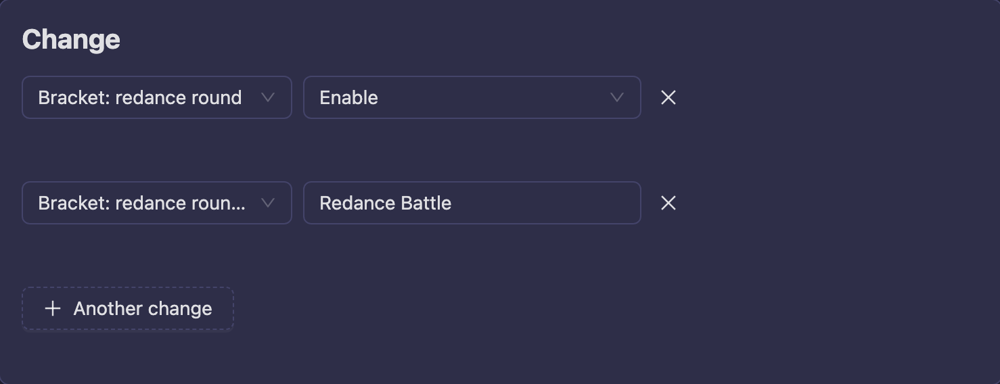

# Battle round setup

For federation administrators. Set up the round setup of a 1v1 battle discipline so that the **Round guide** in Manager creates the right rounds for a class of any size: the placing round, the battle rounds and, if your rulebook has one, a B‑final.

New to the round setup? Read [How the round setup works](/federation-rules/reference/) first. The rule editor is described in [Adding and editing round setup rules](/federation-rules/round-setup-rules/), and every condition, action and setting used below in [Round setup conditions, actions and settings](/federation-rules/round-setup-settings/).

> **Competition operators:** see [Battle bracket](/battle-bracket/) for how to seed and run the battles once the rounds exist.

> **Battles danced in several rounds** (two rounds plus a tie-break, or a final made of a gold and a bronze battle): see [Battle sub-rounds](/federation-rules/battle-sub-rounds/).

---

## What a battle class has to solve

A battle class turns a field of any size into a 1v1 knockout that ends in a final. Every rule on this page answers one of three questions:

1. **Who meets whom?** A knockout is only fair if the strongest dancers meet late. So a battle class starts with a **placing round** that ranks everyone, and the bracket is seeded from that ranking: first against last, second against second-to-last (see [Seeding](#seeding--how-it-works-automatically)).
2. **What if the field doesn't fit a bracket?** Brackets are built from pairs: 2, 4, 8, 16. A field of 5, 7 or 12 doesn't fit, so something has to give. The placing round cuts the field down to the bracket, the top seed gets a bye, or the battles are danced in **trios (crosses)** instead of pairs.
3. **How deep may the bracket go?** Whether a large field gets a round of 16 or is cut to the best 8 is a federation decision, not a technical one.

On top of that come the optional extras: a **B‑final** for third place, round names in the federation's language, and judging and music per round.

---

## Two approaches

| Approach | When to use |
|---|---|
| **Brackets mode** (recommended) | For every new battle class, and to replace a long rule set written per number of competitors. One base rule and a few rules for your federation's choices cover every class size. |
| **Rules per number of competitors** (the older way) | Only for a rule set of this kind that already exists and works. See [The older way](#the-older-way-rules-per-number-of-competitors-for-existing-rule-sets). |

Both are supported. A class uses one or the other: as soon as a rule with **Round type** **Brackets** applies to a class, the whole class is built as a bracket.

The difference is **how much the app knows**. In brackets mode it knows what a bracket is: it answers questions 1 and 2 above for every class size by itself, and your rules only state the federation's decisions: how deep, whether there is a B‑final, crosses or pairs, names, judging and music. The older way only knows a ladder of round sizes, so every class size has to be spelled out by hand: which round is the placing round, which rounds are battles, where the B‑final goes. That is why such a rule set runs to 13–17 rules and brackets mode to four or five.

---

## Brackets mode

In brackets mode one rule makes a class a bracket. The Round guide then builds the placing round, the quarterfinal, the semifinal, the final and, if you allow it, a round of 16, for any number of competitors.

### Trigger rule

This is the rule that says *"this class is a bracket"* and *"this is how deep it may go"*.

1. Open **Structure** → (division) → **Disciplines** → (discipline) → **Round setup** and press **Add rule**.
2. Under **Applies to**, pick the battle classes the rule is for, for example with **Pick some…** next to **Categories**.
3. Leave **When** on **Every round**, and leave **Action** under **Advanced** as it is.
4. Under **Change**, pick **Round type** and choose **Brackets**.
5. Press **Another change**, pick **Rounds**, and fill in one row per round from the final outward, each with its **Round size** and **Name** ([Rounds: round names and round sizes](/federation-rules/round-setup-rules/#rounds-round-names-and-round-sizes)).
6. Press **Another change**, pick **Bracket: placing round name**, and type the name of the placing round.
7. Press **Save**.

| When | Action | Change |
|---|---|---|
| **Every round** | **Modify** (left as it is) | **Round type** **Brackets**; **Rounds** with the sizes 2, 4, 8, 200 and the names Final, Semifinal, Kvartsfinal, Uttagning; **Bracket: placing round name** Uttagning |

The round sizes also set how deep the bracket may go. The largest size below 200 is the **largest bracket**:

| Round sizes | Largest bracket | Effect |
|---|---|---|
| 2, 4, 8, 200 | 8 | The quarterfinal is the first battle round. A class of 16 or more gets no round of 16: its placing round sends the top 8 on. |
| 2, 4, 8, 16, 200 | 16 | A class of 16 or more also gets a round of 16 (Åttondelsfinal). |

### What gets generated per count

Read this table as the answer to question 2, *what if the field doesn't fit a bracket?*

| Competitors | Rounds | Battles |
|---|---|---|
| 2 | Final | The final is one battle |
| 3 | Semifinal → Final | One trio, from which two go on; then the final |
| 4–5 | Placing round → Semifinal → Final | 2 in the semifinal, then the final |
| 6 | Placing round → Semifinal → Final | 3 pairs in the semifinal, or 2 trios with a rule ([below](#crosses--trio-mode-for-count-6)); then the final |
| 7 | Placing round → Quarterfinal → Semifinal → Final | 4 in the quarterfinal (one of them holds only the top seed), 2, then the final |
| 8–15, and every larger class when the largest bracket is 8 | Placing round → Quarterfinal → Semifinal → Final | 4, 2, then the final |
| 16 or more, when the largest bracket is 16 | Placing round → Round of 16 → Quarterfinal → Semifinal → Final | 8, 4, 2, then the final |

The pattern behind the rows:

- **2**: already a final; nothing to rank or cut.
- **3**: three can't be paired, so the semifinal is one trio and the top two meet in the final.
- **4–5**: the placing round ranks everyone and the top four go into the semifinal pairs; with five, the fifth is cut there.
- **6, 7 and 8**: everyone goes on from the placing round. At 7, one short of a full quarterfinal, the top seed gets a **bye** instead of someone being cut: the reward for placing first.
- **More than the bracket holds**: the placing round cuts the field to the bracket: the top 8, or the top 16 from 16 competitors when the largest bracket is 16.

[Bracket settings](#bracket-settings) change three of these rows: a final of three at 3, the top 4 at 6 and 7, and a redance round for classes a few competitors over a bracket.

### B‑final

Whether third place is decided by battle is a rulebook choice, so the B‑final is a decision, not a default: it is **not** created by itself. Add a rule on the semifinal:

| When | Action | Change |
|---|---|---|
| **The semi-final, quarter-final or another round counted from the final** → **Semi-final (2nd from the end)**; **And only when the class has** **between** 4 **and** (empty) **competitors** | **Add After** | **Round name(s)** B-final; **Num to advance** 0 (**Count**); **Round position** 3; **Judging type** a match judging type |

This keeps the B‑final optional and lets you choose which classes have one, with **Applies to**. The class size starts at 4 because in a class of 3 the round 2nd from the end is the trio, and the rule would add a B‑final for the one dancer who does not reach the final. What each setting does is in [The B‑final add rule](#the-bfinal-add-rule).

A B‑final added this way is one battle. For a bronze battle danced in several rounds, use the final with a gold and a bronze battle instead ([Battle sub-rounds](/federation-rules/battle-sub-rounds/#setup-2--final-with-a-bronze-battle-and-a-gold-battle)).

### Crosses / trio mode for count 6

Six doesn't split evenly into a bracket of pairs. Two trios do: each trio's winner advances, which gives exactly the two finalists. Whether six dance pairs or trios is a rulebook choice, so this is a rule for one class size.

By default a class of 6 gets a semifinal of 3 pairs. To dance trios (crosses) instead, add a rule:

| When | Action | Change |
|---|---|---|
| **Semi-final (2nd from the end)**; **between** 6 **and** 6 **competitors** | **Modify** | **Max on floor** 3 |

With **Max on floor** 3 the semifinal gets 2 trios, 3 competitors each with 1 advancing, instead of 3 pairs. The trios are judged with match judging like the other battle rounds: a **Judging type** that is not a match judging type is replaced on a battle round ([Bracket settings](#bracket-settings)).

A third choice for six is the bracket setting **Bracket: top 4 from the placing round at 6 and 7**.

### Customising round labels

Labels are what dancers, judges and screens see, so name the rounds in the federation's own language. The names come from the **Name** column of the **Rounds** table on the trigger rule, from the final outward. With a largest bracket of 16, for example: Final, Semifinal, Kvartsfinal, Åttondelsfinal, Uttagning.

The names are given to the rounds a class gets, counted from the final. A small class has fewer rounds than names, so its placing round would get the name of a later round, such as Kvartsfinal in a class of five. So give the placing round its own name: set **Bracket: placing round name** on the trigger rule, or name the first round with a rule of its own:

| When | Action | Change |
|---|---|---|
| **The first round**; **between** 4 **and** (empty) **competitors** | **Modify** | **Round name(s)** Uttagning |

Any other round is renamed the same way, with a rule for that round whose **Round name(s)** holds one name.

### Placing round judging and music

The placing round's job is to rank, so it is usually judged differently from the battles after it. Limit its rule to the classes that have a placing round: at 2 and 3 competitors there is none, and the first round is the final or the trio semifinal. (With **Bracket: final of 3 at 3 competitors**, a class of 3 has a placing round too.)

| When | Action | Change |
|---|---|---|
| **The first round**; **between** 4 **and** (empty) **competitors** | **Modify** | **Judging type** 10-0; **Round name(s)** Uttagning; **Max on floor** 4; **Dances** |
| **The final** | **Modify** | **Music length** 240; **Extra time** 40 |

**Music length** and **Extra time** are in seconds and together give the round's heat length, so set both on the same rule.

### Bracket settings

Some rulebook choices are switches rather than round changes. Set them on the trigger rule or on a rule of their own (they are in the **Bracket setting** group of the rule editor). The round a rule is for does not matter for a bracket setting; a class size on the rule decides which class sizes it applies to.

1. In the discipline's **Round setup** section, click **Add rule** (or **Edit** on an
   existing one).
2. Under **Applies to**, click **Pick some…** next to **Categories** and choose the battle
   category the rule is for.
3. Under **Change**, click **Another change**, pick a setting that starts with **Bracket:**, and
   set its value. The switches are **Enable** or **Disabled**.
4. Click **Save**.

| Setting | What it does |
|---|---|
| **Bracket: redance round** | When the class is a few competitors over the bracket it fills (11 is 8 + 3), the extra competitors don't drop out in the placing round. The last 2 × 3 places dance a **redance round** right after it, in battles of two, and its 3 winners take the last bracket places. The redance round is a normal round of its own, so the bracket after it is unchanged. Not used at or above the largest bracket, or when the class fills a bracket exactly. |
| **Bracket: redance round name** | The redance round's name (default "Redance Battle"). |
| **Bracket: redance round judging type** | Its judging type. Without one, it is judged like the other battles (match judging). |
| **Bracket: redance round comment** / **dances** | Its comment, and the dances its battles are made from. A battle template dance ("Battle [X]/[N]") makes one battle per pair. |
| **Bracket: placing round name** | The placing round's name. |
| **Bracket: top 4 from the placing round at 6 and 7** | At 6 and 7 competitors the placing round sends the top 4 to a semifinal, instead of trios or a round of 7 with a bye. |
| **Bracket: final of 3 at 3 competitors** | At 3 competitors the placing round sends all three to a final of three, instead of a trio and a final of two. The three dance together in one heat. |
| **Bracket: final with gold and bronze battle** | The semifinal sends all four on and the final holds two battles: gold for places 1–2 and bronze for places 3–4. It applies whenever the semifinal holds four, so not to a semifinal of six. To give the two battles names and rounds of their own, see [Battle sub-rounds](/federation-rules/battle-sub-rounds/#setup-2--final-with-a-bronze-battle-and-a-gold-battle). |

**Judging in brackets mode.** The placing round gets the federation's first select judging type
unless a rule picks another. Battle rounds, the final included, use match judging. A rule may pick
another match judging type for a round, and that choice is kept; any other judging type is replaced
by the federation's first match judging.

### Complete example — Solo Champion Vuxna (R16 enabled)

| # | When | Action | Change |
|---|---|---|---|
| 1 | **Every round** | **Modify** | **Round type** **Brackets**; **Rounds** with the sizes 2, 4, 8, 16, 200 and the names Final, Semifinal, Kvartsfinal, Åttondelsfinal, Uttagning |
| 2 | **The first round**; **between** 4 **and** (empty) **competitors** | **Modify** | **Judging type** 10-0; **Round name(s)** Uttagning; **Max on floor** 4; **Dances** |
| 3 | **Semi-final (2nd from the end)**; **between** 4 **and** (empty) **competitors** | **Add After** | **Round name(s)** B-Final; **Num to advance** 0 (**Count**); **Round position** 3; **Judging type** a match judging type |
| 4 | **The final** | **Modify** | **Music length** 240; **Extra time** 40 |

Result: classes of up to 15 get the bracket from the quarterfinal down; classes of 16 or more also get a round of 16. All handled by 4 rules instead of 13–17.

How to read it:

1. **The bracket itself**: a bracket, up to a round of 16, with the names in Swedish.
2. **The placing round**: how it is judged and danced, but only when there is one (4 or more competitors).
3. **Third place**: a B‑final beside the semifinal.
4. **The final**: longer music and extra time.

Only the placing round and the B‑final mention a class size, and only to leave out the classes of 2 and 3: the app handles every field size, and the rules only carry the federation's choices.

### Complete example — Solo Champion Barn / FDO (max 8, with crosses)

| # | When | Action | Change |
|---|---|---|---|
| 1 | **Every round** | **Modify** | **Round type** **Brackets**; **Rounds** with the sizes 2, 4, 8, 200 and the names Final, Semifinal, Kvartsfinal, Uttagning |
| 2 | **The first round**; **between** 4 **and** (empty) **competitors** | **Modify** | **Judging type** 10-0; **Round name(s)** Uttagning; **Max on floor** 6 |
| 3 | **Semi-final (2nd from the end)**; **between** 6 **and** 6 **competitors** | **Modify** | **Max on floor** 3 |
| 4 | **Semi-final (2nd from the end)**; **between** 4 **and** (empty) **competitors** | **Add After** | **Round name(s)** B-Final; **Num to advance** 0 (**Count**); **Round position** 3; **Judging type** a match judging type |
| 5 | **The final** | **Modify** | **Music length** 240; **Extra time** 40 |

Result: a class of 6 gets 2 trios (crosses) in the semifinal; every other size from 4 up dances pairs. No round of 16, whatever the class size.

Compared with Vuxna, the children's class makes three different choices: the bracket stops at 8 (no size 16 in the rounds), the placing round is danced in heats of up to 6 (**Max on floor** 6), and six competitors dance crosses (rule 3). That is the one rule for a single class size, because it is the one size where the rulebook breaks the pattern.

---

## The B‑final add rule

Applies to both approaches. The B‑final gives the two semifinal losers a battle for third place instead of sharing it. Its rule has **Action** **Add After** on the semifinal, and these settings:

| Setting | Value | Effect |
|---|---|---|
| **Round name(s)** | B-final | The name shown in the round list |
| **Num to advance** | 0 (**Count**) | Nobody advances from the B‑final |
| **Round position** | 3 | The first place the round awards: the B‑final gives places 3–4 |
| **Judging type** | A match judging type | 1v1 battle judging |

The Round guide creates the B‑final beside the semifinal, for the competitors who do not go on from it.

In the older way, the Round guide also sets the semifinal's **Round for non-qualified participants** to the B‑final, so **Assign teams** sends the semifinal losers there without anyone choosing the round by hand. Classes in brackets mode get no such links: the operator places the two losers in the B‑final ([Battle bracket](/battle-bracket/)).

---

## Seeding — how it works automatically

When an organiser runs **Assign to match** on a battle round and picks a source round, the system applies the **tournament bracket generator**:

- **From a non-battle source** (placing or qualifying round): seeds by placement rank using the standard fold: Seed 1 vs last, Seed 2 vs second-to-last, and so on. For 8 competitors this produces 1v8, 2v7, 3v6, 4v5.
- **From a battle source** (the bracket round before): collapses winners from each previous match into new pairings, preserving the bracket structure.
- **Byes** (size 7): when the fold produces a match with no second competitor, that slot is empty. The single competitor advances automatically.

No configuration is needed for seeding: it is always determined by the source round's placement results.

The fold is what makes the placing round matter: the better you place, the weaker your first opponent, and the top two seeds can only meet in the final.

---

## Validating your setup

After creating or editing rules, check the result at several class sizes. The **By class** tab of the **Round setup** section shows the rounds a class gets at any number of competitors ([Check a class](/federation-rules/round-setup-checks/#check-a-class)). To see the battles inside each round, open the **Round guide** for a class in a test competition, enter the **Number of Participants** and click **Preview**: each battle is shown as a tag on its round ([Build rounds from classes](/manager-guide/competition-setup/#step-2-build-rounds-from-classes)). Confirm:

1. The correct number of rounds is created for each class size.
2. Battle rounds show their battles, one per match.
3. The B‑final appears beside the semifinal, not after the final.
4. For 2 competitors: only a Final (no placing round).
5. For 3 competitors: a trio semifinal that sends two to the final, or a placing round and a final of three with **Bracket: final of 3 at 3 competitors**.
6. For 6 competitors with crosses: the semifinal has 2 trios (3 competitors each).
7. For 7 competitors: the quarterfinal shows 4 battles, one of which will receive only Seed 1 when seeded.
8. In brackets mode with a largest bracket of 16: classes of 16 or more get a round of 16; smaller classes do not.

---

## The older way: rules per number of competitors, for existing rule sets

Before brackets mode, a battle class was written out by hand: a ladder of round sizes for each number of competitors, and rules that turn the rounds of that ladder into battles. The Round guide still reads such rule sets, so a federation whose battle rules are written this way and work does not have to change them. For a new class, or when such a rule set needs more than a small correction, use [brackets mode](#brackets-mode). Do not use both on the same class.

Here the app only knows the ladder, not what a bracket is. It creates plain rounds, and your rules turn them into a bracket. Because the right shape differs per class size, each size gets its own rules.

### How round sizes work

The **Round sizes** of a rule are the ladder, for example 2, 4, 8, 16, 200.

Given 10 competitors and this ladder, the Round guide takes the first size that is at least as large as 10, which is 16, and builds downward: placing round (16) → quarterfinal (8) → semifinal (4) → final (2). A ladder size is the round's capacity, not its headcount: all 10 competitors dance the placing round. When no size is as large as the class, the largest size is used.

**A class that is exactly one of the sizes** starts in the round of that size: with the ladder 2, 4, 8, 21, a class of 8 starts in the quarterfinal and has no placing round. There is one exception. When a rule gives the first round a **Num to advance** of 100 **Percent** (or more), and the size is neither the smallest nor the largest of the ladder, the class starts one size higher. The class of 8 then dances a placing round first, from which all 8 go on to the quarterfinal. This is how a class of 4, 6, 7 or 8 gets its placing round in the table below.

**A ladder per class size.** To give one class size its own ladder, put the ladder on a rule of its own and limit it with **And only when the class has** **between** … **and** … **competitors**. A rule that sets round sizes can only be for **Every round**. Round sizes are added up across every rule that applies to a class at that size, so give every ladder rule a class size and leave no ladder on a rule without one.

### From-end conditions

A rule for one stage of the bracket counts the round from the final: in the rule editor, **The final**, or **The semi-final, quarter-final or another round counted from the final** with **Semi-final (2nd from the end)** or **Quarter-final (3rd from the end)**. That holds for every class size: the final is always the last round and the semifinal the one before it, however many rounds the class gets.

A rule for the quarterfinal needs one more limit, because in a small class the 3rd round from the end is the placing round. Limit the rule to the class sizes that have a quarterfinal with **between** … **and** … **competitors**, and check **Rounds this hits** in the rule editor. Older rules may carry two round conditions for this instead: the 3rd round from the end, and not the first round. The rule editor shows them as **Conditions that have no plain words** and keeps them as they are until you pick one of the plain choices.

### Rounds per number of competitors

Each row is a ladder rule limited to that class size, and the rounds the Round guide makes from it. The number in brackets after a round is how many competitors dance it.

| Competitors | Round sizes | Rounds | What your rules add |
|---|---|---|---|
| 2 | 2 | Final (2) | Nothing: a direct final, no placing round |
| 3 | 2, 3 | Semifinal (3) → Final (2) | On the first round: a select judging type, **Round name(s)** Semifinal, **Max on floor** 3 and **Num to advance** 2 (**Count**). Three can't be paired, so the first round is a trio that sends two to the final. The third is placed 3rd, so there is no B‑final. |
| 4 | 2, 4, 200 | Placing round (4) → Semifinal (4) → Final (2) | On the first round: **Judging type** 10-0 or a select judging type, and **Num to advance** 100 (**Percent**), which gives the class its placing round. A B‑final. |
| 5 | 2, 4, 200 | Placing round (5) → Semifinal (4) → Final (2) | One too many for a bracket of four, so the placing round cuts one: four go on. The same battle and B‑final rules as for 4. |
| 6 | 2, 6, 200 | Placing round (6) → Semifinal (6) → Final (2) | On the first round: **Num to advance** 100 (**Percent**). On the semifinal: a select judging type, **Round name(s)** Semifinal, **Max on floor** 3 and **Num to advance** 2 (**Count**), which makes it two trios (crosses). A B‑final. |
| 7 | 2, 4, 7, 9 | Placing round (7) → Quarterfinal (7) → Semifinal (4) → Final (2) | On the first round: **Judging type** 10-0 and **Num to advance** 100 (**Percent**). One short of eight: rather than cut anyone, the top seed gets a bye through the quarterfinal. The 9 is only there as a size above 7 for the placing round. A B‑final. |
| 8 | 2, 4, 8, 21 | Placing round (8) → Quarterfinal (8) → Semifinal (4) → Final (2) | On the first round: **Num to advance** 100 (**Percent**). A B‑final. |
| 9–20 | 2, 4, 8, 21 | Placing round (all) → Quarterfinal (8) → Semifinal (4) → Final (2) | On the first round: **Judging type** 10-0 and **Round name(s)** Placing round. The top 8 go on. A B‑final. |
| 21 or more | 2, 4, 8, 16, 200 | Qualification round (all) → Placing round (16) → Quarterfinal (8) → Semifinal (4) → Final (2) | A qualification round selects the field first, then a placing round ranks it for the bracket. On the first round: a select judging type and **Round name(s)** Qualification round. On the second round: **Judging type** 10-0 and **Round name(s)** Placing round. A B‑final. |

### Turning rounds into battles

The rounds above are plain rounds until a rule makes them battles. For each battle round (the quarterfinal, the semifinal and the final), add a rule:

| When | Action | Change |
|---|---|---|
| The round, counted from the final, and the class sizes it is for | **Modify** | **Round type** **Battle**; **Dances** with a battle dance, such as "Battle [X]/[N]"; **Judging type** a match judging type; **Round name(s)** the round's name |

**Round type** **Battle** splits the round into one battle per pair for each dance listed under **Dances**. In the dance's name, [X] becomes the battle number and [N] the number of battles: a quarterfinal of 8 gets Battle 1/4 … 4/4, and a quarterfinal of 7 gets four battles of which one holds only the top seed. Without **Dances** the round stays one plain round. The battle dance is created in the discipline's **Dances** section ([Battle sub-rounds](/federation-rules/battle-sub-rounds/#step-1--dances)).

The B‑final is added beside the semifinal with [the B‑final add rule](#the-bfinal-add-rule), limited to the class sizes that have one.
