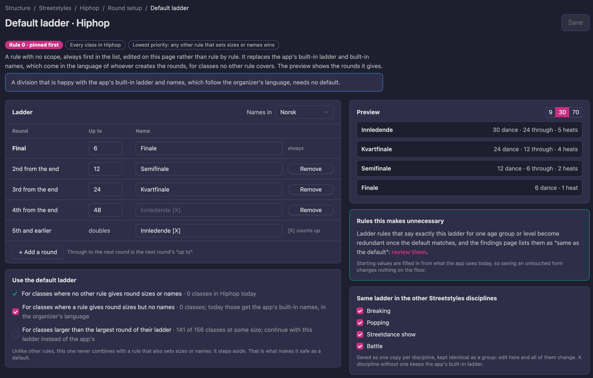

# Setting the default ladder

For federation administrators. Give a discipline one ladder, with its round sizes
and round names, for the classes that no other rule gives one, and choose which
classes use it. Ladders are explained in [How the round setup works](/federation-rules/reference/).

---

## Default ladder

The default ladder is the ladder a discipline's classes get when no other rule
gives them one: how many rounds, how big each is and what they are called.
Without it, the app's built-in ladder is used, with round names in the language of
whoever creates the rounds. It is row 0 of the list, **Rule 0 · pinned first**,
and has the lowest priority: any other rule that sets round sizes or names wins.

1. In the **Round setup** section, press **Set** (or **Edit**) on the **Default ladder**
   row. The page **Default ladder · (discipline)** opens.
2. Under **Ladder**, pick the language under **Names in** — it starts in the
   federation's language. In the table, each round has an **Up to** (the largest
   class that gets this many rounds) and a **Name**. The **Final** is always
   there; **Add a round** adds the next one, and **Remove** takes one away. The last
   row, such as **5th and earlier**, says that earlier rounds double in size and
   counts up in the name: with "Preliminary [X]", [X] becomes 1, 2, 3…
3. Under **Use the default ladder**, choose which classes use it (see below).
4. Under **Same ladder in the other … disciplines**, tick the disciplines that
   should get the same ladder. They are saved as one copy per discipline, kept
   identical: change it here and all of them change. A discipline that has its own
   different ladder says **has its own**, and you are asked to confirm before it is
   replaced.
5. Check **Preview** at 9, 30 and 70 competitors.
6. Press **Save**. **Remove default ladder** takes it away again, and classes with
   no ladder rule get the app's built-in ladder.

The three lines under **Use the default ladder** say which classes the default
applies to, and how many classes in the discipline each one concerns today:

- **For classes where no other rule gives round sizes or names** — always on.
- **For classes where a rule gives round sizes but no names** — tick it so these
  classes get the default names instead of the app's built-in names. On to begin
  with.
- **For classes larger than the largest round of their ladder** — tick it so that
  a class bigger than the ladder of its rules continues with this ladder instead of
  the app's. Off to begin with.

The default never combines with a rule that also sets sizes or names; it steps
aside. That is what makes it safe as a default. The starting values are filled in
from what the app uses today, so saving an untouched form changes nothing on the
floor; once you change something the page says how many classes get other rounds.
**Rules this makes unnecessary** points to the **Same as the default ladder**
findings: ladder rules that now say exactly the default.
