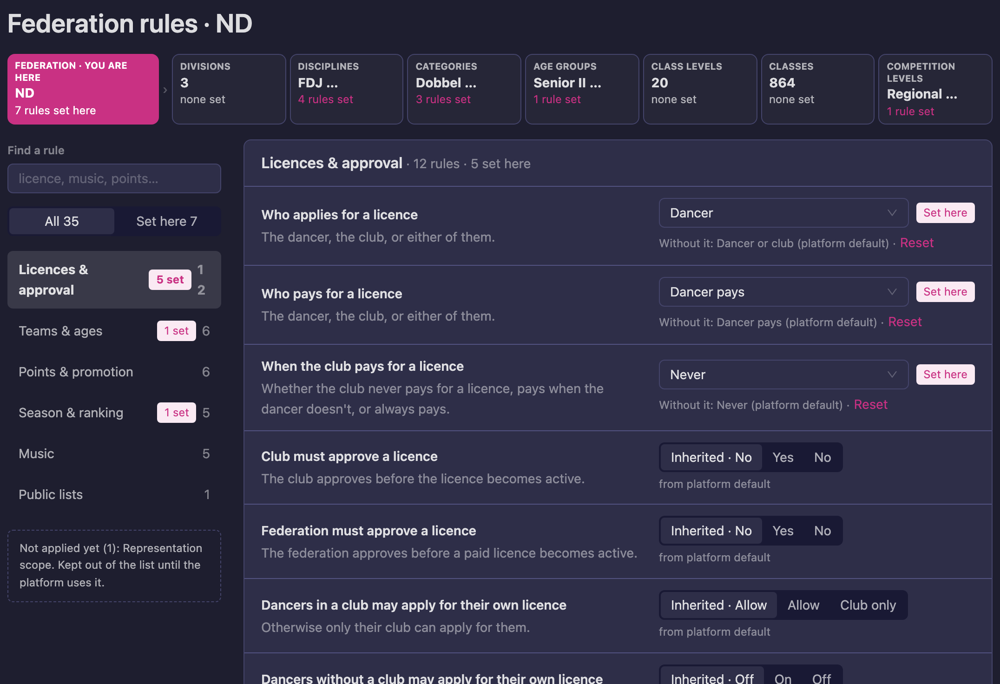
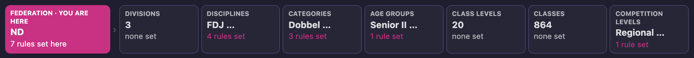
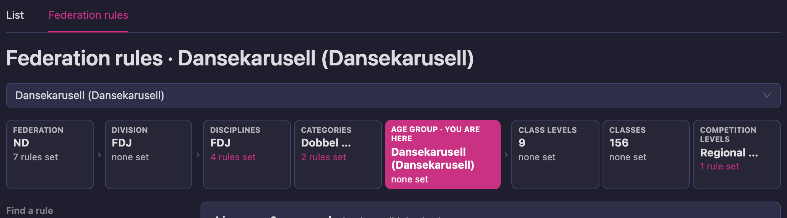
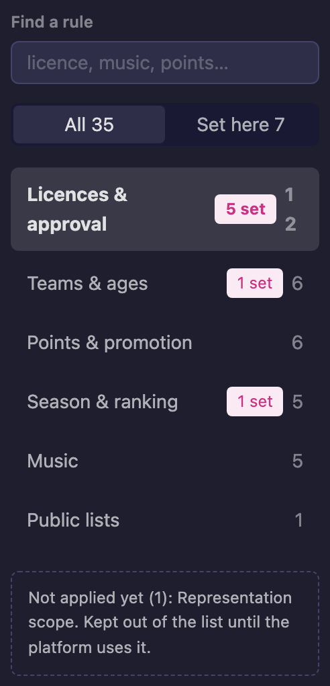
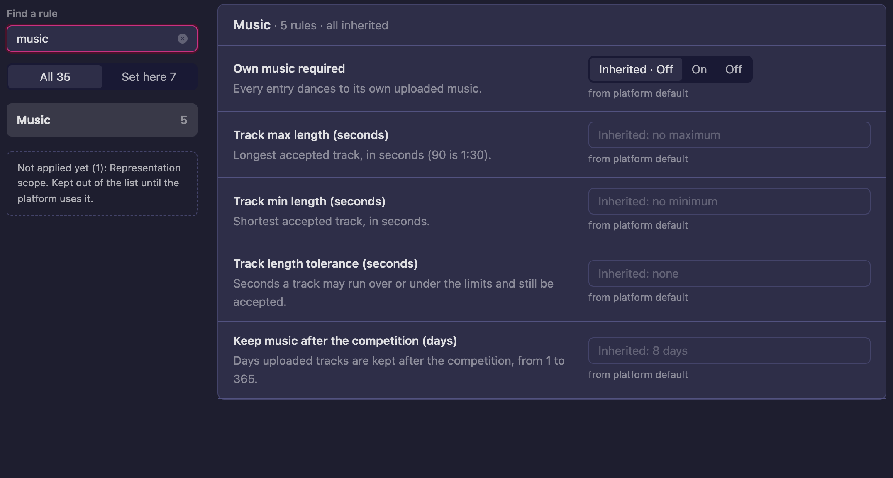
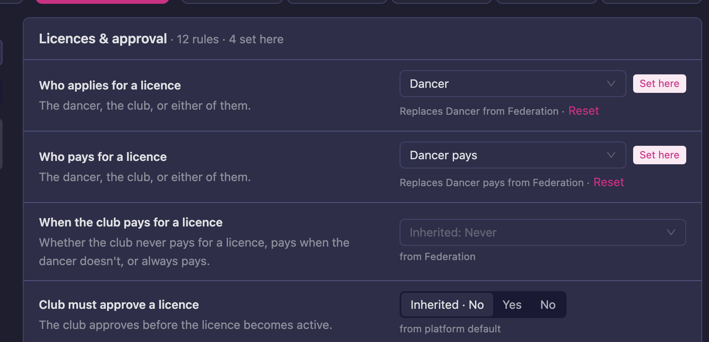
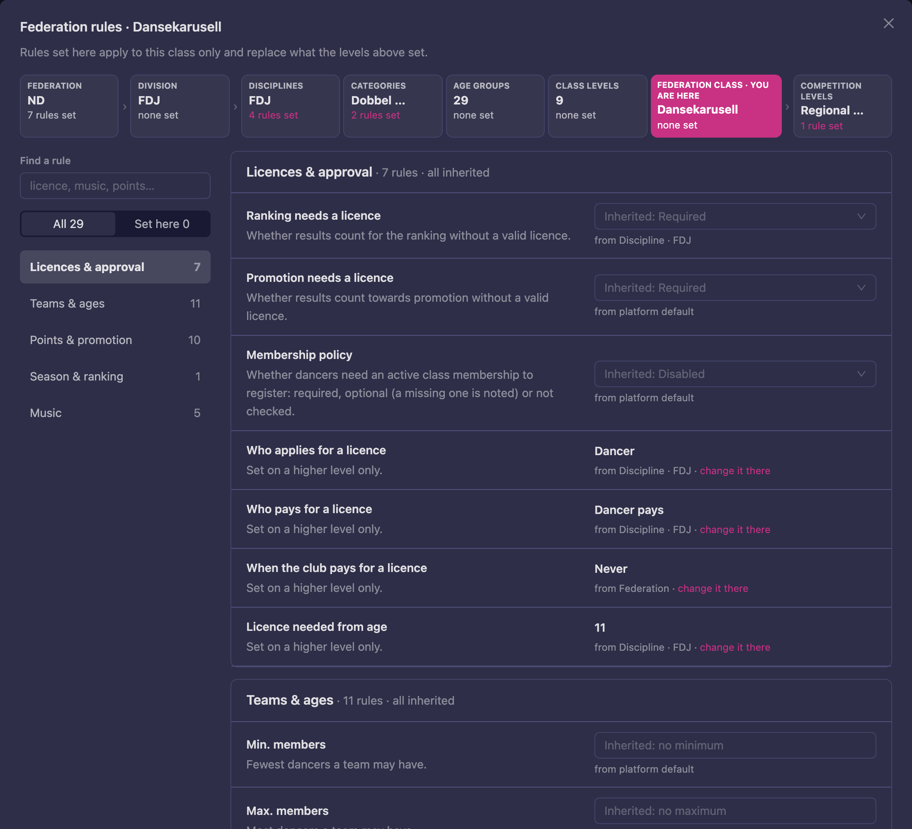

# Setting federation rules

Federation rules decide how your federation works: who applies and pays for a licence, how big a
team may be and whose age decides its age group, how promotion points are earned, when the season
starts, whether dancers bring their own music, and what the public lists show next to a team.

You set each rule once, on the widest level it applies to, and only set it again further down
where something is different. Every level has its own editor, and every editor looks the same.

```
Federation
  └── Division
        └── Discipline
              └── Category
                    └── Age group
                          └── Class level
                                └── Class  (most specific, always wins)

Competition level: applies at events of that level, whichever class is dancing
```

The most specific level that sets a rule wins. A rule nobody sets uses the **platform default**.
Not every rule can be set on every level: the editor only shows the rules that level accepts.

> Only the federation's administrators can change its rules. Other staff see the same pages
> without the controls; the **Rulebook** shows what applies.

---

## Where to find each editor

All editors live under **Structure**:

| Level | Where |
|---|---|
| Federation | **Structure** → **Federation rules** (at the top of the list on the left) |
| Division | **Structure** → (division) → **Federation rules** |
| Discipline | **Structure** → (division) → **Disciplines** → (discipline) → **Federation rules** |
| Category | **Structure** → (division) → **Categories** → **Federation rules** tab, then pick the category |
| Age group | **Structure** → (division) → **Age Groups** → **Federation rules** tab, then pick the age group |
| Class level | **Structure** → (division) → **Class Levels** → **Federation rules** tab, then pick the class level |
| Competition level | **Structure** → (division) → **Competition Levels** → **Federation rules** tab, then pick the competition level |
| Class | The **Federation rules** button on the class's row in **Classes**. It opens the editor in a pop-up. With several classes selected, the rules are saved to all of them. |

You can also jump from one level to another with the [level strip](#the-level-strip) at the top of
every editor.



---

## The level strip

The strip at the top of the editor shows every level, from the federation down to the classes, and
the competition levels at the end. The level you are editing is highlighted and says **you are
here**.



- The levels **above** yours show their name and how many rules they set, such as **7 rules set**
  or **none set**. These are the rules your level inherits.
- The levels **below** yours show how many rules are set further down, and where, such as
  **4 rules set** on the disciplines.
- Click a level to open its editor. This is the quickest way to go from a rule you see to the place
  it is set.

On a category, age group, class level or competition level, the picker above the strip chooses
which one you are editing.



---

## Find a rule

The rules are grouped by topic: **Licences & approval**, **Teams & ages**, **Points & promotion**,
**Season & ranking**, **Music** and **Public lists**. The list on the left shows each topic with
the number of rules in it, and a badge such as **5 set** when some of them are set on this level.
Click a topic to jump to it.



To find one rule:

1. Type a word in **Find a rule**, such as *licence*, *music* or *points*. Only the rules that
   match stay in the list.
2. Use **All** to see every rule this level accepts, or **Set here** to see only the rules this
   level sets itself. The numbers tell you how many there are of each.
3. Clear the search box to see everything again.



Long topics show their first rules, with **Show 1 more rule** (or **Show 2 more rules**)
below them for the rest.

Under the topics, **Not applied yet** lists rules that exist but that Vote4Dance does not use yet.
They are kept out of the editor until they work.

---

## Inherited or set here

Every rule tells you whether this level sets it or inherits it, and from where.



**Inherited.** The field shows the value that applies, greyed out, such as **Inherited: Never**,
with the level it comes from below it, such as **from Federation** or **from platform default**.
On/off rules show an **Inherited · No** choice next to **Yes** and **No**.

**Set here.** When this level sets the rule, the value is shown normally with a **Set here** tag.
The line below says what you replace, so you know what would apply without it:

- **Replaces Dancer from Federation** — a level above sets the rule too, and yours wins here.
- **Without it: Dancer or club (platform default)** — no level above sets it.

To set a rule, choose or type a value. To stop setting it here, click **Reset** (or choose the
**Inherited** option on an on/off rule). The rule then follows the level above again.

**Set on a higher level only.** Some rules can only be set on a wider level, such as the
federation or the discipline. On a narrower level they show the value that applies and where it
comes from, with **change it there** to open that level.



### A rule for one class

A class's rules apply to that class only and replace what every level above sets. Open them with
the **Federation rules** button on the class's row in **Classes**. Only set a rule on a class when
that one class is different; for a group of classes, set it on their category, age group or class
level instead.

### A rule for one kind of competition

A competition level's rules apply at every event of that level, whichever class is dancing. A
championship that awards no promotion points is set here: open **Competition Levels** →
**Federation rules**, pick the level, and turn off **Awards promotion points**.

---

## Save or discard

Your changes are not saved until you save them. As soon as you change something, a bar at the
bottom of the editor lists your changes in words, with the value before and after.


1. Change one or more rules on the level.
2. Read the bar, for example **1 change: Club must approve a licence inherited → Yes**.
3. Press **Save rules**, or **Discard** to undo every change since you last saved.

Save before you leave the page or pick another level in the strip.

---

## Example: one discipline is different

Your federation lets the dancer or the club apply for a licence, but in one discipline only the
dancer may apply.

1. Open **Structure** → **Federation rules** and check **Who applies for a licence**. It shows
   **Dancer or club**, from the federation or the platform default.
2. Click **Disciplines** in the level strip, or open **Structure** → (division) → **Disciplines** →
   (discipline) → **Federation rules**.
3. In **Licences & approval**, set **Who applies for a licence** to **Dancer**. The line below now
   says what it replaces.
4. Press **Save rules**.
5. Open **Rulebook** → **Rules**, pick a class in that discipline and check that it says **Only the
   dancer can apply for a licence.** See [What applies to one class](/federation-rules/#what-applies-to-one-class).

---

## Related

- [Federation Rules](/federation-rules/) — the Rulebook: what applies to one class, where rules are
  set, and the setup check.
- [How the round setup works](/federation-rules/reference/) — the rules that decide which rounds a
  class dances. They are set on a discipline's **Round setup**, not in this editor.
- [Promotion points](/federation/progression/) — the points table, threshold and source.
- [Age category rules](/federation-rules/age-category-rules/) — whose age decides a team's age group.
- [Own music](/federation-rules/own-music/) — the music rules.
