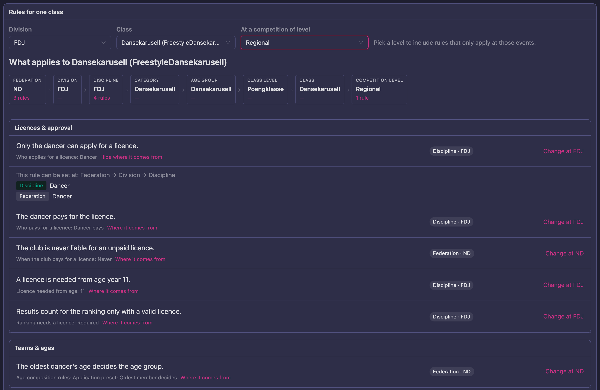
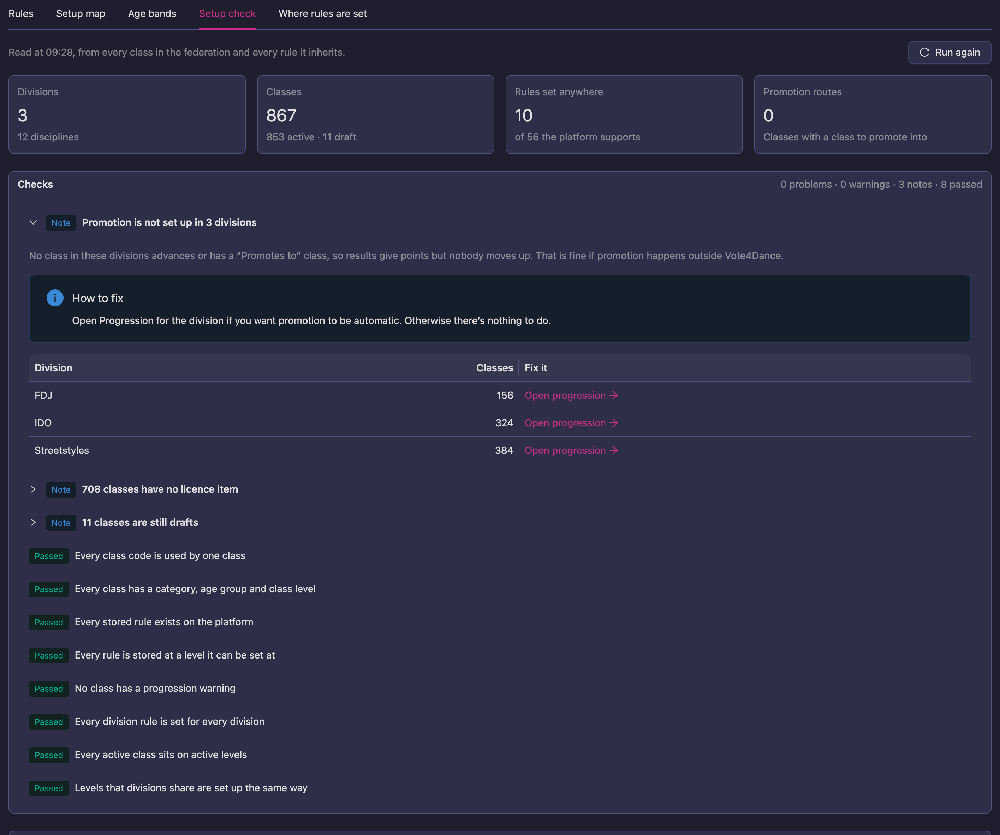
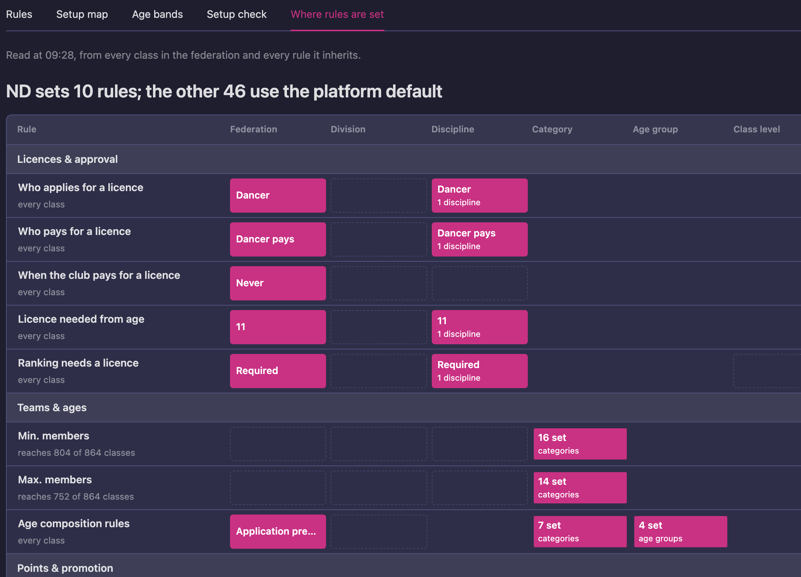

# Federation Rules

Use this section for the federation rules the system enforces automatically:
which teams may enter a class (age composition), how a class's rounds are
generated, and how battles are built. Promotion points, license requirements
and rankings are also federation rules, but each has its own guide, linked
under *Related* below.

Rules work as a **hierarchy of layers**. The broadest setting sits at the
federation level; narrower layers override it for that specific scope. Only set a
rule where it genuinely differs from the layer above — empty fields inherit.

```
Federation
  └── Division
        └── Discipline
              └── Category
                    └── Age group
                          └── Class level
                                └── Federation class  (most specific, always wins)

Competition level: applies at events of that level, whichever class is dancing
```

The most specific layer that sets a value wins. Not every rule can be set at
every layer; the **Rulebook** lists the layers each rule accepts.

Each layer has its own **Federation rules** editor under **Federation →
Structure**, and the federation itself has **Structure → Federation rules**. See
[Setting federation rules](/federation-rules/editor/). Check the result in
**Federation → Rulebook** before going live: for one class it says in plain
sentences what applies and which level set each rule. Rules nobody has set use
the platform default.

> The rules that decide which rounds a class dances are not federation rules.
> They are set on each discipline's **Round setup**; see
> [How the round setup works](/federation-rules/reference/).

## Start here

- [Setting federation rules](/federation-rules/editor/) — the editor every level
  shares: the level strip, finding a rule, inherited and set-here values, and
  saving.
- [How the round setup works](/federation-rules/reference/) — **read this first.**
  The thinking behind the round setup, a worked example, a step-by-step method, and
  a reference of every condition, action and setting.
- [Age category rules](/federation-rules/age-category-rules/) — how the age
  category is decided for solos, duos, and groups, and where to set the rules.
- [Battle round setup](/federation-rules/battle-class-rules/) — how to configure
  the round setup so the Round Guide auto-generates the correct skeleton for each
  competitor count in a 1v1 battle discipline.
- [Battle sub-rounds](/federation-rules/battle-sub-rounds/) — battles danced in
  several rounds with a tie-break, and a final made of a bronze and a gold
  battle.
- [Round templates](/federation-rules/round-setups/) — describe a ladder of rounds
  as a table instead of rules, preview it, compare it with today's rules
  and switch over.

## What applies to one class

**Rulebook → Rules** shows every federation rule that applies to one class, in
plain sentences, with the level that set it.



1. Open **Rulebook** and stay on the **Rules** tab.
2. Under **Rules for one class**, pick the **Division** and then the **Class**.
3. Read **What applies to** (the class). The strip below the title shows every
   level from the federation down to the class, with how many of the rules each
   level sets.
4. Each rule is one sentence, such as *Only the dancer can apply for a
   licence.*, grouped by topic. Under it you see the rule's name and value, and
   on the right the level that set it, such as **Discipline · FDJ**.
5. Click **Where it comes from** to see which levels can set the rule and the
   value each of them sets. The level that wins is highlighted.
6. Click **Change at** (the level) to open that level's editor and change the
   rule there.

Some rules only apply at events of one competition level, such as a
championship that awards no promotion points. To include them, pick the level
under **At a competition of level**. With **Any**, they are left out.

Rules that no level sets are not listed one by one. A line under the list says
that every other rule uses the platform default, with an example; click **Show
them** to see them all.

## Checking the whole setup

The **Rulebook** has these tabs: **Rules** ([what applies to one
class](#what-applies-to-one-class)), **Setup map**, **Age bands**, **Setup
check** and **Where rules are set**. A sixth tab, **Timed profiles**, appears
only when some rules are dated, that is, set to start or stop on a given day.
The four in the middle look at every class in the federation at once, so you do
not have to open classes one at a time. Each reads the whole setup when you
open it ("Reading every class…") and says when it was read. Press **Run again**
after you change something.

### Setup check

A list of checks over every class and every rule it inherits. The top line
counts the problems, warnings, notes and checks that passed. Each check that
finds something says what it found, why it matters, and under **How to fix**
what to do, with links such as **Open class**, **Open rules** or **Open level**
that go straight to the class or level concerned.



It checks for:

- class codes used by more than one class (retired classes are left out)
- classes missing a category, age group or class level
- stored rules the platform no longer has. Nothing reads them, and the rule
  editors do not show them, so an Administrator can remove them here with
  **Remove**. Removing one does not change how any class behaves.
- rules stored at a level they cannot be set at. The stored value still applies,
  but it is dropped the next time that level's rules are saved.
- classes with a progression warning, the same warnings the **Progression**
  panel shows per division
- divisions where promotion is not set up: no class has a **Promotes to**
  class, so results give points but nobody moves up. That is fine if promotion
  happens outside Vote4Dance; otherwise **Open progression** takes you to the
  division (see [Check promotion by cause](/federation/progression/#check-promotion-by-cause))
- rules set for some divisions only. Often deliberate.
- categories, age groups and class levels with the same name in several
  divisions that are set up differently. Often deliberate.
- active classes that sit on a division, discipline, category, age group or
  class level that is still a draft or already retired
- classes with no licence item. This only matters if dancers need a licence to
  register.
- classes that are still drafts

### Setup map

The whole federation as one picture: a column per division and a block per
discipline, sized by its number of classes. Pick what to colour the blocks by:
**Draft levels**, **Promotion** (classes that advance but have no class to move
into), **Progression warnings**, **Team size** (no member limit anywhere in the
rules), **Licence** (no licence item) or **Draft classes**. Each block shows how
many of its classes are affected. Click a block to open its classes, or a
division name to open the division. **Most affected disciplines** lists the
worst ones.

### Age bands

Every division's age groups on one age axis, so you can compare them. Use
**Highlight** to pick an age group name and see it in every division. Below the
chart the tab lists:

- **Same name, different ages**: a name that covers different ages in
  different divisions
- **Bands that partly overlap** within a division. A band that lies inside
  another is a split of it and is not counted.
- **Gaps between bands**: ages in a division that no age group covers

Age groups that are drafts or retired are drawn as an outline. See
[Age category rules](/federation-rules/age-category-rules/).

### Where rules are set

Every rule against every level it can be set at, for the whole federation, in
one table with a column per level and the rules grouped by topic. The title
says how many rules your federation sets and how many use the platform default.



- A filled cell is a level that sets the rule. It shows the value, or how many
  entries set it, such as **16 set** on the categories. Click it to open that
  level's editor.
- An outlined cell is a level that could set the rule but doesn't. A blank cell
  is a level the rule can't be set at.
- Under each rule's name you see how far it reaches: **every class**, a count
  such as *reaches 804 of 864 classes*, or the competition levels it applies at.

Use **Set somewhere** to see only the rules that are set, or **All** to see
every rule. Click a rule's name to open its details: what it does, where it can
be set, the platform default, how many classes it reaches, and every place it
is set. A rule the platform no longer has can be removed there by an
Administrator.

### Export setup

**Export setup**, in the Rulebook's header, downloads the whole setup as
a CSV file, to check in a spreadsheet. Pick one of three:

| Export | One row per |
|---|---|
| **Classes** | class: where it sits, how it advances, and every rule that applies as a column |
| **Rules by class** | class and rule: the value, the level that set it, and what it overrides |
| **Where rules are set** | rule set at each level, with how many classes it reaches |

In **Rules by class**, a rule whose value was put together from several levels,
such as an age composition set partly on the category and partly on the class,
has `merged` as the level that set it, with every contributing level named, and
no overridden value.

The file is named after the federation, the export and the date, for example
`DSF-rules-2026-09-28.csv`.

These files always use commas, whatever your browser's language, so every rule value stays exactly as it is stored. In an Excel set up for a decimal comma, as in Belgium, the Netherlands or Sweden, open them with **Data → From Text/CSV** and choose comma as the separator.

## Related

- [Promotion points](/federation/progression/) — the points source, points
  table, threshold and target class that move couples up a class ladder.
- [Age moves](/federation/age-moves/) — the season batch that moves competitors
  up an age group, checked against the age category rules.
- [License rules per class](/federation-licenses/federation-admin/) — which
  license items a class requires for registration or progression (section 4).
- [Federation admin rankings](/federation-rankings/federation-admin/) — the rule
  set behind each published ranking.
