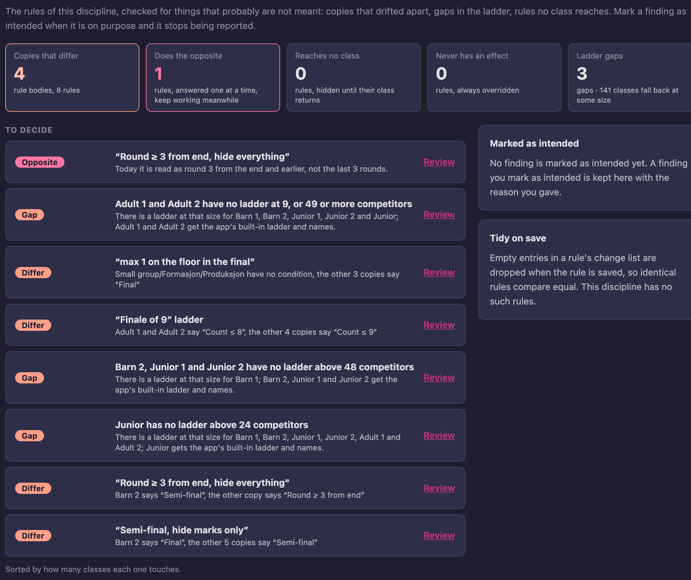
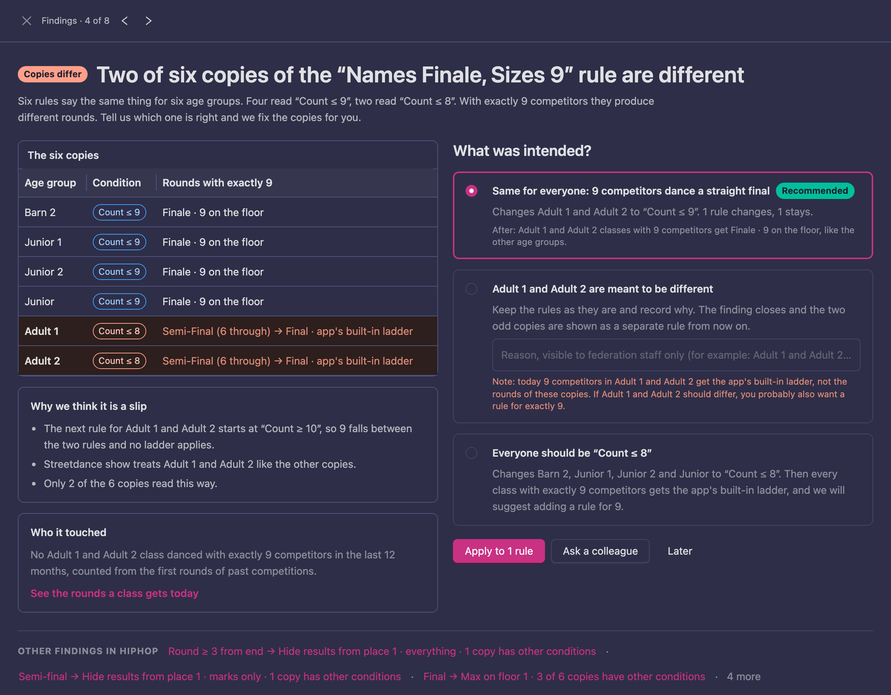
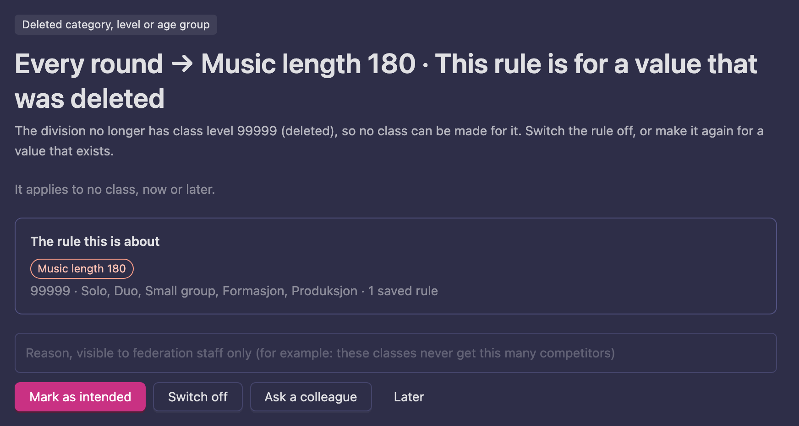
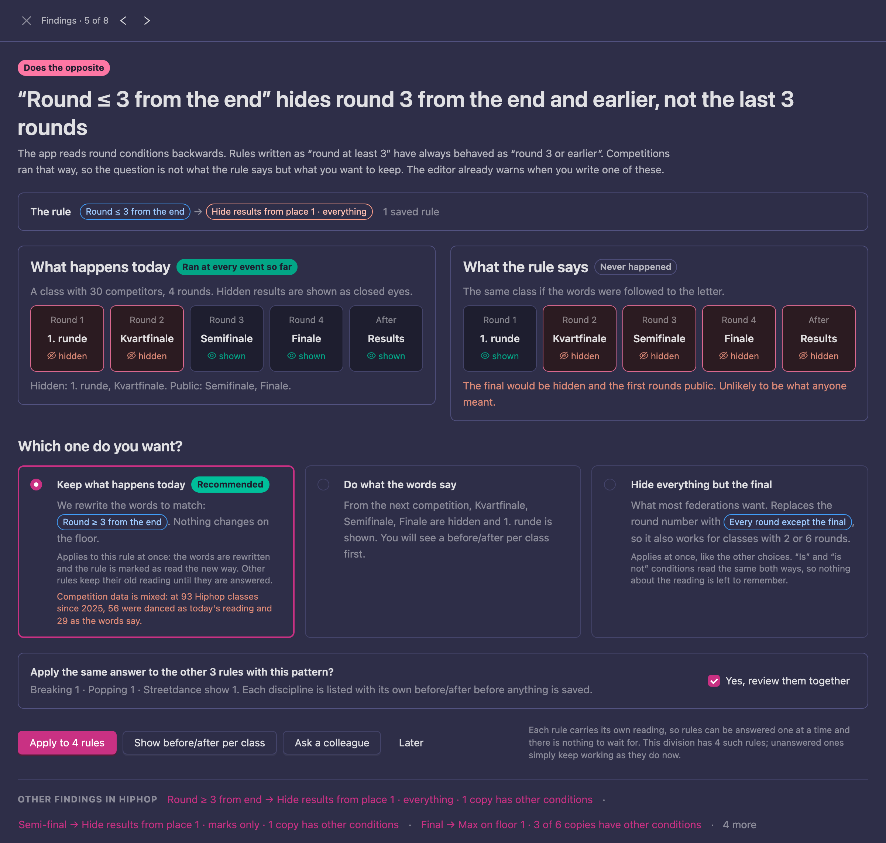
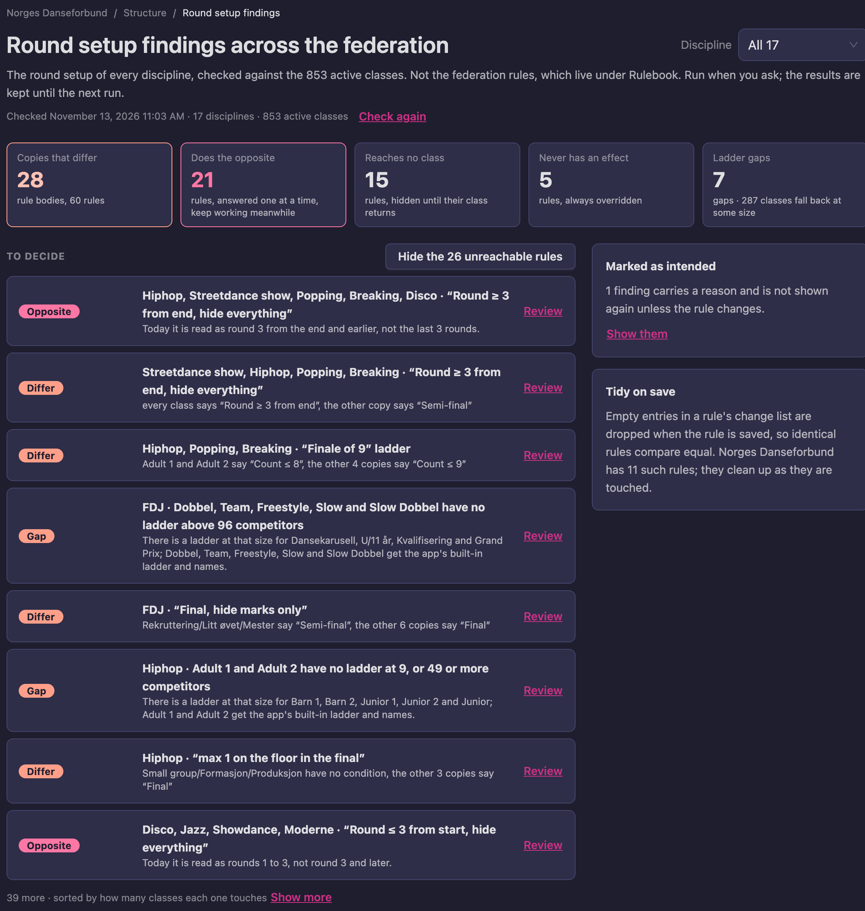
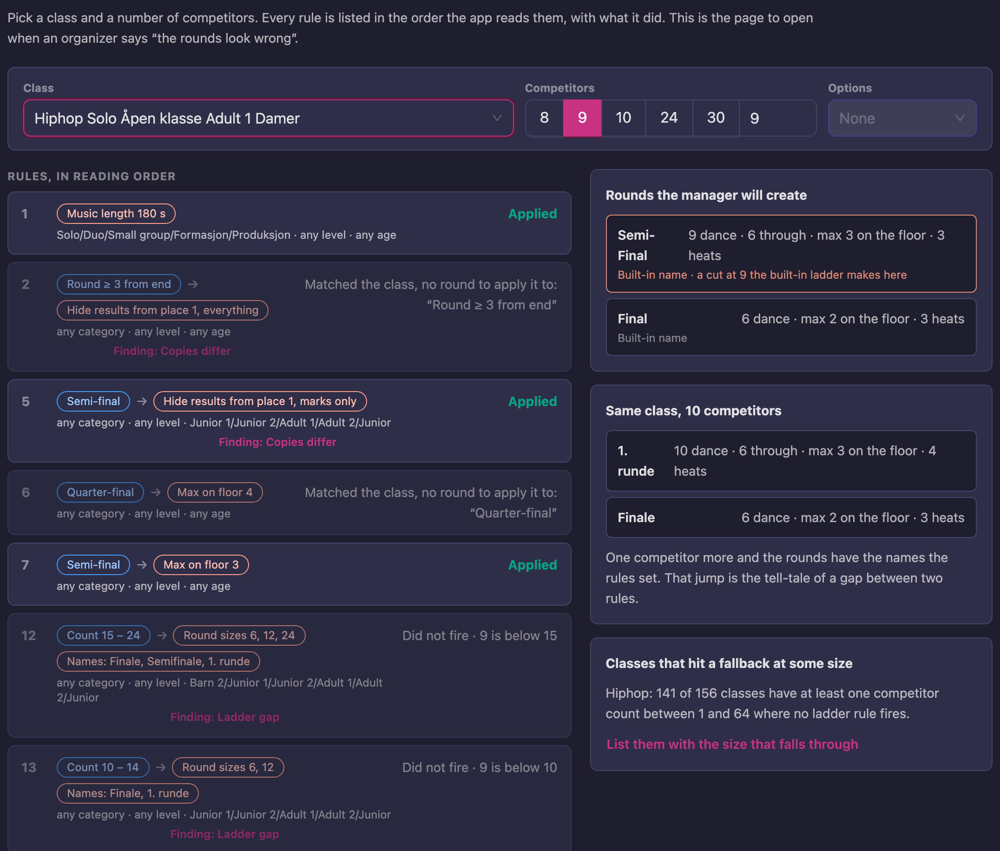

# Checking the round setup

For federation administrators, and for other federation staff who are asked why
a class got the rounds it did. Use the **Findings** tab to see what in the rules
probably is not meant and answer each finding, and the **By class** tab to see
why one class gets its rounds. Other federation staff can read both; only
federation administrators can change a rule ([How the round setup works](/federation-rules/reference/)).

---

## Findings

The **Findings** tab reads the discipline's rules and reports what probably is
not meant: copies that drifted apart, holes in the ladder, rules no class
reaches. It does not change anything by itself. The number on the tab is how many
findings there are. A federation for which findings are not available yet says
so on the tab.

At the top are tiles that count the findings by kind. Press a tile to show only
that kind (**Showing only: …**), and **Show all** to come back:

| Tile | In plain words |
|---|---|
| **Copies that differ** | Copies of the same rule that are valid under different conditions. Usually one copy drifted. |
| **Does the opposite** | A round condition that does the opposite of what it says ([Rules that read backwards](#rules-that-read-backwards)). Answered one at a time; the rules keep working meanwhile. |
| **Reaches no class** | No active class has the category, level and age group the rule is about. It applies again as soon as such a class exists. |
| **Never has an effect** | The rule matches classes but never changes anything: a later rule overrules it, or its conditions never hold. |
| **Ladder gaps** | For some numbers of competitors no rule gives a class its round sizes, so the default ladder, or the app's built-in one, is used. The tile says how many classes fall back at some size. |

Three more kinds show up in the list without a tile: **Round condition on a
ladder** (a rule that sets round sizes, names or brackets also waits for a
particular round, which can never hold), **Overlapping ladders** (two rules give
the same class a ladder at the same numbers of competitors, so their sizes are
merged and their names added after each other) and **Same as the default
ladder** or **Could be one rule** (a rule that repeats the default ladder,
or copies that together name every value of an axis).

Two kinds point at rules that cannot work at all, and are also listed without a
tile:

| Label on the card | In plain words |
|---|---|
| **Deleted value** (**Deleted category, level or age group**) | The rule is for a category, level or age group the division no longer has. No class can be made for it, so it applies to no class, now or later. |
| **Unreadable** (**Cannot be read**) | The rule's settings are not valid: its conditions or changes cannot be read. When rounds are made the rule is skipped, so it does nothing at any competition. |

Under **To decide**, the findings are listed as cards, most important first,
sorted by how many classes each one touches. Each card names the rules and says
in a line what is wrong; **Review** opens it. **Hide the N unreachable rules**
hides all the unreachable rules at once; it only hides them in your browser,
like **Hide from the list** in [the rules list](/federation-rules/round-setup-rules/#the-rules-list).

On the right, **Marked as intended** keeps the findings you have answered with
"this is on purpose", with the reason you gave, who gave it and when; **Show
them** lists them and **Unmark** makes a finding count again. **Tidy on save**
says how many rules have empty entries in their list of changes; they are cleaned
up whenever a rule is saved, so that identical rules compare equal.

### Reviewing a finding

Press **Review** on a card or on a group in the list. The review opens beside the
list. Use the arrows next to **Findings · 4 of 8** to step to the previous or
next finding, and the **Other findings in …** links at the bottom to jump to one.
Every review ends the same way: **Apply** your answer, **Ask a colleague** (it
copies a link that opens this finding), or **Later**.

**Copies differ.** You see the copies in a table, the conditions they have and
the rounds each gives at the number of competitors where they differ, with the
odd ones highlighted. **Why we think it is a slip** says what points to a mistake,
and **Who it touched** says how many classes danced at exactly that size in the
last 12 months, with a link to **See the rounds a class gets today**. Then you
answer **What was intended?**:

1. **Same for everyone** (marked **Recommended** when most copies agree): the odd
   copies get the conditions most copies have. It says how many rules change.
2. **… are meant to be different**: nothing changes, the finding closes and the
   odd copies are shown as a separate rule from now on. Write why in the box
   under it; the reason is visible to federation staff, and you can come back to
   it under **Marked as intended**. A warning tells you if the size where they
   differ then falls between two rules, so you probably want a rule for it.
3. **Everyone should be …** (the other reading): the majority is changed to
   match the odd copies, and a rule for the missing size is suggested.

Press **Apply to 1 rule** (the button says how many).

**Ladder gap.** The review lists the rules that have a ladder at that size and the
ones that do not, and what the classes get now. There is nothing to click to fix
it: add a ladder rule for the missing sizes with **Add rule**, or answer
**Mark as intended** with a reason, for example that these classes never get that
many competitors.

**Other findings.** **Reaches no class** and **Same as the default ladder** offer
**Hide these rules** (in your browser only); **Round condition on a ladder**
offers **Remove the condition**, which changes nothing because the condition
never applied; **Could be one rule** offers **Make it "any"**, which opens
the merge with every value of that axis selected. **Mark as intended**, with an
optional reason, is there for every kind except **Cannot be read**.

**Deleted value and Cannot be read.** Both reviews offer **Switch off**. A
switched-off rule stays saved, with everything it says, but no longer applies;
you can switch it on again later. To deal with one:

1. Press **Review** on the card. The review names the rules and, for a deleted
   value, which category, level or age group is gone.
2. Press **Switch off**, and confirm with **Switch off** in the question that
   follows ("Switch off this rule? It stays saved and can be switched on
   again."). **Switched off** confirms it, and the finding leaves the list.
3. If the rule is still needed, make it again with **Add rule**: for a
   deleted value, pick a category, level or age group that exists; for a rule
   that cannot be read, set its conditions and changes again in the editor.

For a deleted value you can also answer **Mark as intended** instead, for
example while the value is about to be added back. A rule that cannot be read
can only be switched off. To switch a rule on again, open it in the rule editor
and press **Enable** ([The rule editor](/federation-rules/round-setup-rules/#the-rule-editor)).

New and changed rules are checked when they are saved, so a rule whose settings
cannot be read is refused with "The rule's conditions or changes are not valid,
so it was not saved." These findings only turn up for rules saved before that
check.

### Rules that read backwards

A rule written as "round at least 3" has always behaved as "round 3 or earlier",
so competitions ran that way. The question is not what the words say but what
you want to keep, and the review shows it: **What happens today** and **What the
rule says**, as the rounds of one example class with the hidden rounds shown as
closed eyes. Under **Which one do you want?** there are three answers:

1. **Keep what happens today** (preselected, **Recommended**): the words are
   rewritten to say what the rule does, so nothing changes on the floor. Below it
   the review says what the past competitions show, such as how many classes
   since last year were danced as today's reading and how many as the words say.
2. **Do what the words say**: from the next competition the rule is read as
   written. Classes get different rounds than today, and you see a before and after
   per class first (**Show before/after per class**).
3. **Hide everything but the final** (for a rule that hides results; for other
   rules it reads "… on every round except the final"): the round condition is
   replaced with **Every round except the final**, which also works for classes with
   2 or 6 rounds.

The same pattern often exists in the division's other disciplines. **Apply the
same answer to the other 3 rules with this pattern?** with **Yes, review them
together** answers them in one go, each discipline listed with its own before and
after before anything is saved. Each rule carries its own reading, so rules can be
answered one at a time and the ones you have not answered keep working as they do
now.

### Across the federation

**Federation → Structure → Round setup findings** checks the round setup of every
discipline in turn. This is not the Rulebook, which shows the federation rules:
this page only reads the round setup. Open it from the **Round setup
findings** card on a division's Structure page, or from the Structure menu. It
reads the round setup of the whole federation, so it runs when you press **Check all
disciplines**; **Check again** runs it again after you have made changes. The
results are kept until the next run, and the line under the heading says when it
last ran and how many disciplines and active classes it covered.

The page has the same tiles, **To decide** cards and **Marked as intended** as a
discipline's tab, with the disciplines named on each card, and **Review** opens
the same review. **Discipline** at the top narrows the list to one discipline.
Further down, **Count across the federation** counts the groups of identical
copies that can be merged without changing anything, discipline by discipline;
federation administrators then get **Merge all … safe groups** for the whole
federation ([Merge all safe groups](/federation-rules/round-setup-merging/#merge-all-safe-groups)).

---

## Check a class

The **By class** tab answers "why did this class get these rounds?" — it is the
page to open when an organizer says "the rounds look wrong". It works for one
class at one number of competitors.

1. Open the **Round setup** section and then **By class** (or press **Preview a
   class**).
2. Pick the class under **Class**.
3. Set **Competitors**: press 8, 9, 10, 24 or 30, or type a number.
4. If the discipline uses setup tags, pick the **Options** to try.

On the left, **Rules, in reading order** lists every rule the Round guide reads,
with what it did:

- **Applied** — the rules that fired. A rule that fired but whose changes were
  all overruled by later rules says **Overruled by later rules, nothing it wrote
  remains**.
- **Matched the class, no round to apply it to** and **Did not fire** — rules
  that are about this class, but whose conditions did not hold at this size or
  for these rounds, with the reason, such as "9 is below 15". Often the answer to
  "why did my rule not apply?".
- **Did not match** — rules that are about other classes; open the list to check
  that the rule you expected is not among the wrong ones.
- **Fallback** — shown when no rule set the round sizes or the round names. The
  row says what was used instead: the default ladder, or the app's built-in ladder
  and names, in the language of whoever creates the rounds.
- A **Finding** label on a row that a finding is about, which opens its review.

On the right, **Rounds the manager will create** shows the rounds the Round guide
would make, with how many dance, how many go through and the floor size. How
many go through is what the round's **Num to advance** says, and the next round
shows that many dancers, even when its round size is larger: a final that holds
8 for classes that start there still shows the 6 a semifinal sends. A second
chance shows the dancers who did not go straight through, and none when everyone
goes straight on, and sends on no more than it has. Heats are the heats the round
is created with, but never more than the dancers in it. A round
that got a built-in name or a cut that no other age group dances is marked, which
is how a hole in the ladder shows up. **Same class with one more competitor**
shows the rounds one competitor higher, so you can see which rules start or stop
applying — a rule that works at 9 and not at 10 is easy to miss otherwise.
**Classes that hit a fallback at some size** counts the classes that fall back at
some size between 1 and 64 competitors, and **List them with the size that falls
through** shows them.

The check only simulates; it creates nothing.
