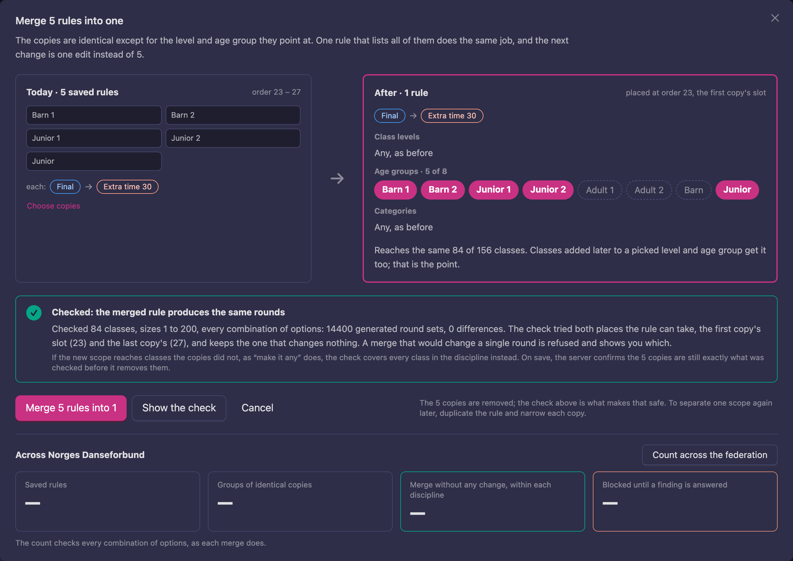
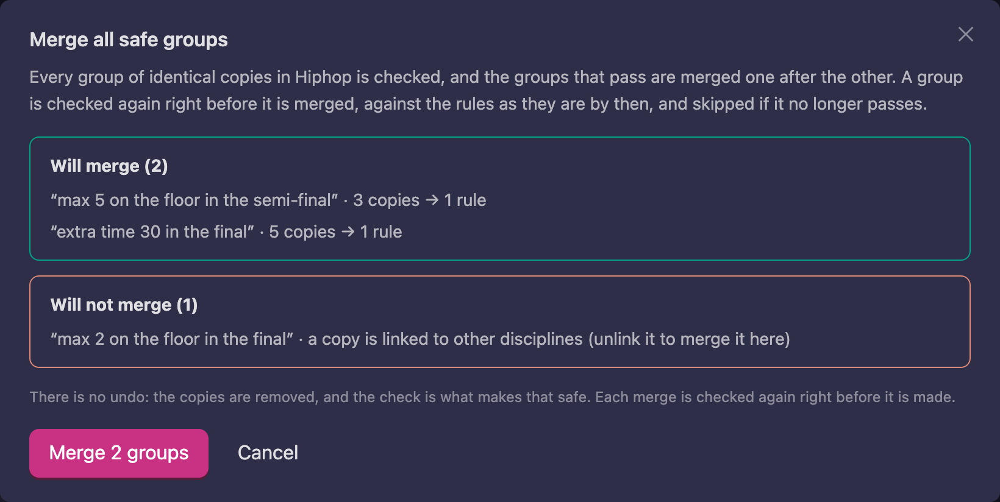
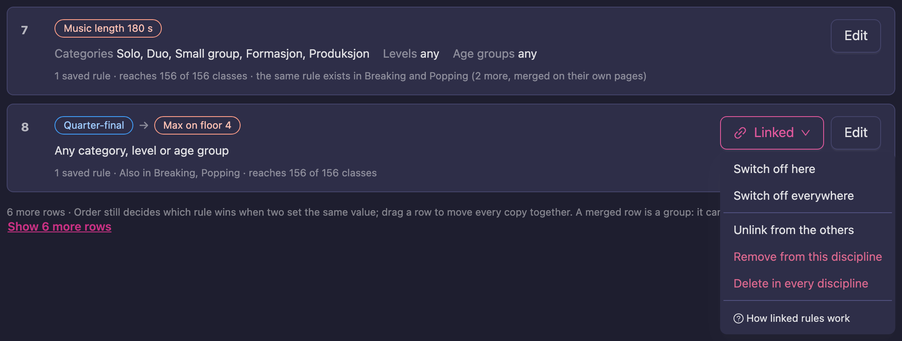
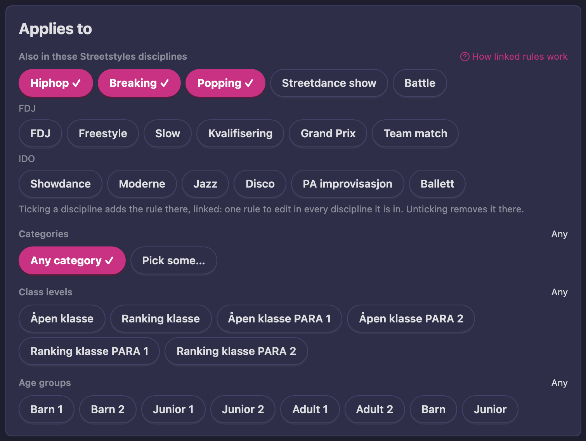
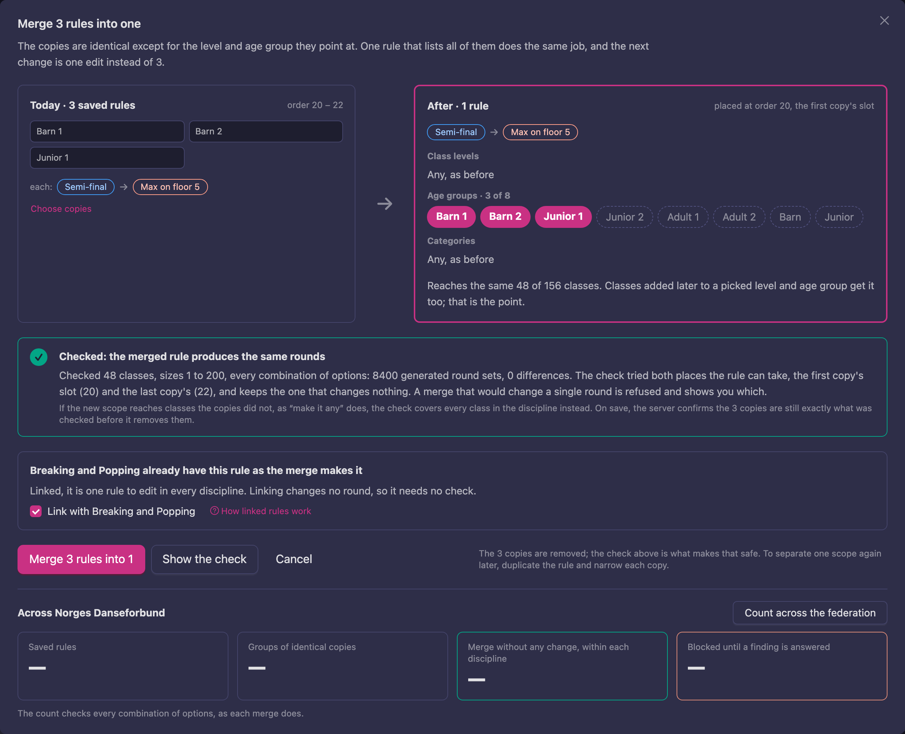
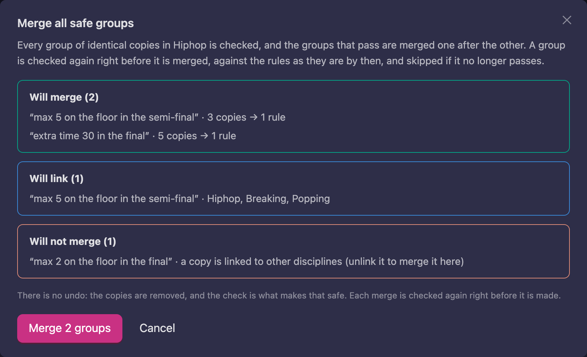

# Merging and linking round setup rules

For federation administrators who want fewer rules to keep alike. Merge the
copies of a rule in one discipline into a single rule, and link a rule that
several disciplines use, so that a change is made once. A merge cannot be undone,
so read how its check works before you start. Copies and groups are explained in
[the rules list](/federation-rules/round-setup-rules/#the-rules-list).

---

## Merging copies

When a group has two or more copies that are switched on, **Merge 5** replaces
them with one rule that applies to all their classes. The Round guide keeps
giving every class exactly the rounds it gave before. **A merge cannot be
undone**: the copies are removed. What makes it safe is the check Vote4Dance runs
first, and it merges nothing if the check finds a difference.

1. Press **Merge 5** on the group row. The dialog **Merge 5 rules into one** opens.
2. **Today** shows the copies, **After** the one rule: the levels, age groups and
   categories it will name. Press **Choose copies** to leave a copy out. Press
   **Make it any** for an axis when the rule should apply to every value of it,
   including ones added later.
3. Wait for the check. Vote4Dance runs the Round guide on every active and draft
   class the merge could touch, for 1 to 200 competitors, with the old rules and
   with the merged rule, using the options of each class, and finds the place in
   the reading order where the merged rule gives the same rounds. When it passes,
   the dialog says **Checked: the merged rule produces the same rounds**, how many
   classes it checked and **0 differences**.
4. Press **Merge 5 rules into 1** and confirm.

If the merged rule would change what some class gets, wherever it stands, the
dialog says **Not merged** and shows the first differences: the class, the size
and which round changes.

**Merge in blocks.** Some groups cover a patchwork of levels, age groups and
categories, so one rule over all of them would reach combinations no copy covered
and fail the check. The dialog then offers **Merge in blocks**: copies that fill
their combinations completely are merged as blocks, each with its own check and
marked **Passes the check: the same rounds as before**. Press **Merge in 2
blocks**. Copies that are in no block stay as they are.

What to know:

- **The copies are removed and this cannot be undone.** To split the rule again,
  open it, press **More → Copy**, press **Add rule**, press **More → Paste**,
  then narrow its category, class level or age group.
- **Identical copies can be merged while "Copies differ" is open** for a group:
  the odd copies stay separate and are not touched.
- A copy that applies to every value of an axis cannot be merged with copies that
  name some values: it would widen them. The dialog leaves it out and says so, for
  example **Left out: applies to every value of Age group, the others pick some.**
- A merged rule can reach classes the copies did not (for example when it names
  every age group). Then every class of the discipline is checked, not only the
  ones the copies reached.
- Copies with a round condition that reads backwards cannot be merged yet. The
  button says **Review before merging** and opens that finding
  ([Rules that read backwards](/federation-rules/round-setup-checks/#rules-that-read-backwards)).
- A copy that lists values to leave out cannot be merged, and neither can copies
  that read their round conditions differently.
- If the rules changed after you opened the page, the merge stops and asks you to
  reload.
- Each discipline is merged on its own page, with its own check. When sister
  disciplines have copies of the same rule, the dialog says so and links to them.
  Merged alike, they can then be linked into one rule ([Linked rules](#linked-rules)).

### Merge all safe groups

**Merge all safe groups** under the list does the same for every group at once.

1. Press **Merge all safe groups (2)** under the last row. Vote4Dance checks every
   group of identical copies in the discipline and sorts them.
2. Read the two lists: **Will merge (2)**, with each group and how many copies
   become one rule (and which block), and **Will not merge (1)**, each with the
   reason: a finding has to be answered first, a copy lists values to leave out,
   a copy is replaced by a ladder, the copies read their round conditions
   differently, every value a copy lists is gone from the division, no class uses
   the copies, the check found that the merge would change a round, or a copy
   changed since the check.
3. Press **Merge 2 groups**. The groups are merged one after the other, and each is
   **checked again right before it is merged**, against the rules as they are by
   then; a group that no longer passes is skipped.
4. The result says how many groups were merged and how many rules fewer there are,
   and lists what was skipped or refused.

There is no undo here either: the copies are removed, and the check is what makes
that safe. On the federation page, the same button for administrators handles the
disciplines one after the other and gives a result per discipline.

After the merges, the rules that have become identical across the disciplines
are linked into one rule ([Merge all safe groups links too](#merge-all-safe-groups-links-too)).

---

## Linked rules

The disciplines of a division often use the same rule. Hiphop, Breaking and
Popping may each say "max 3 on the floor in the semi-final", and until now each
discipline had a copy of its own: a change had to be made three times, and it was
easy to forget one. **Linking** turns those copies into one rule. Edit it in any
of the disciplines and the change reaches all of them, so they cannot drift
apart.

What stays per discipline:

- **Its place in the list.** Each discipline keeps the rule where it stands in
  its own reading order, so you can still move it in one discipline only.
- **Its switch.** You can switch the rule off in one discipline and keep it on
  in the others.

Where a rule can be linked:

- A rule that names categories, class levels or age groups is linked with other
  disciplines of **the same division**.
- A rule for any category, level and age group can also be linked with
  disciplines of **other divisions**, such as Disco in IDO.

Linking changes no round: the copies already say the same, so a link needs no
check.

### How a linked rule looks

In the rules list, a linked rule says where else it is:

- **Also in Breaking, Popping** names the other disciplines that have the rule.
  A discipline of another division is named with its division, such as
  **IDO: Disco**.
- **Off in Popping** names the disciplines where the rule is switched off.

A linked row has a **Linked** button with everything you can do to the link:
switch it off here or everywhere, unlink it, remove it from this discipline or
delete it everywhere. **How linked rules work** at the bottom of the menu opens
this section.

### Linking a rule from the rule editor

1. Press **Edit** on the rule's row to open the rule editor.
2. Under **Applies to**, **Also in these Streetstyles disciplines** shows the
   disciplines of the division. The ones that already have the rule are ticked.
   For a rule for any category, level and age group, the disciplines of the other
   divisions are listed too, under their division's name.

   

3. Tick a discipline to add the rule there, linked. Untick one to remove the rule
   from it.
4. Press **Save**. **Save the rule in every discipline it is in?** lists what
   saving does: **Changes the rule in …** with how many active classes each
   discipline has, **Adds it to …, linked.** and **Removes it from ….** Press
   **Save** to confirm.

Ticking a discipline that already has the same rule links that copy, so the
discipline never gets the rule twice. Otherwise the rule is added at the end of
that discipline's rules. A rule you create with **Add rule** always gets a
new copy in each discipline you tick.

Saving a change to what a linked rule says (its conditions, its changes, who it
applies to, how its round conditions are read, or its setup tag) shows the same
confirmation, so you always see which disciplines the change reaches before it
is saved. Switching the rule off in this discipline only is saved here, without
the confirmation.

What to know:

- **Edit all** on a group of copies cannot add the rule to other disciplines:
  copies edited together stay in this discipline. Open one copy with **Edit** to
  link it.
- A rule shared with another division cannot be limited to categories, levels or
  age groups. If you narrow such a rule, a note under the disciplines names the
  copies this affects, and saving asks **Unlink the other divisions and save?**.
  Press **Unlink and save**: the other divisions keep their own copy, no longer
  linked.
- Rules that belong to a round template, the default ladder and rules a round template
  has replaced stay in their own discipline and cannot be linked.
- The **Setup** tag under **Advanced** is part of the rule, so it is the same in
  every discipline the rule is linked with.

### Linking while you merge

When the other disciplines of the division already have the rule that a merge is
about to make, the merge dialog offers to link them in the same step. Merge the
copies in each discipline on its own page; the last merge links them.

1. Press **Merge 3** on the group row. The dialog **Merge 3 rules into one**
   opens and runs its check.
2. Under the check, a card says **Breaking and Popping already have this rule as
   the merge makes it**, with **Link with Breaking and Popping** ticked.
3. Leave it ticked and press **Merge 3 rules into 1**, then confirm. The copies
   are merged, and the merged rule is linked with Breaking and Popping. Untick
   **Link with Breaking and Popping** to merge without linking.

A copy that is already linked cannot be merged with the copies in its own
discipline. The dialog says **This copy is linked with …** and offers **Unlink
and merge**: unlinking keeps every discipline's copy as it is and changes no
round, and the merge is then checked as usual.

### Merge all safe groups links too

**Merge all safe groups** ([Merge all safe groups](#merge-all-safe-groups)) now
ends with a linking step. It merges first, then links the rules that have become
identical across the disciplines.

1. Press **Merge all safe groups** under the last row.
2. Next to **Will merge** (and **Will not merge**, if any), the dialog lists
   **Will link**: each rule that will be linked and the disciplines it will be
   linked across, for example "max 3 on the floor in the semi-final" · Hiphop,
   Breaking, Popping.
3. Press **Merge 2 groups**. The groups are merged one after the other, and the
   identical rules are linked last. When there is nothing to merge but something
   to link, the button says **Link 9 rules** instead.
4. The result lists **Linked** next to what was merged, and **Not linked** for any
   rule that could not be linked.

On a discipline's page, the rules are linked with the other disciplines of the
division. The same button on the federation page, which handles every discipline,
also links identical rules for any category, level and age group across the
divisions. Under **Across …**, the federation-wide count says how many groups of
identical rules would be linked after the merges.

If the merges went through but the rules could not be linked, the dialog says
**The merges stand, but the rules could not be read again to link them. Run it
again to link.** Running it again links them.

### Switching a linked rule off

Open the **Linked** menu on the row:

- **Switch off here** switches the rule off in this discipline only. It stays on
  in the others, and the row says **Off in …** in each of them.
- **Switch off everywhere** switches it off in every discipline it is linked
  with.

Either way the rule stays saved and linked. **Switch on here** and **Switch on
everywhere** bring it back. In the rule editor, the same choice is the **Switch
off here** button at the top; its arrow opens **Switch off everywhere**. **Switch
off here** in the editor is saved when you press **Save**.

### Unlinking, removing and deleting

These are in the **Linked** menu, and under **More** in the rule editor:

- **Unlink from the others** keeps the rule in every discipline, but each
  discipline then has its own copy again, and a change to one no longer reaches
  the others. It changes no round.
- **Remove from this discipline** takes the rule out of this discipline only. The
  other disciplines keep it.
- **Delete in every discipline** removes the rule from every discipline it is
  in. **There is no undo.**

Each one asks first and names the disciplines it touches.

### When linked copies differ

The disciplines of a link normally say exactly the same. If one of them no longer
does (an older version of the app wrote it, or it was fixed directly), the row
says **The copies in Breaking no longer say the same as this one** and offers
**Make all like this one**. The rule editor shows the same warning, and saving
the rule there also makes every copy like the one you saved. On the **Findings**
tab the problem is listed as **Linked copies differ**, with **Make all like this
one** on the finding.

1. Open the copy that says what the rule should say.
2. Press **Make all like this one**.
3. Confirm. The copies in the other disciplines then say what this one says: the
   same conditions, changes, categories, levels, age groups and reading. Each
   discipline keeps its own place in the list and its own switch.

Until the copies say the same again, a change that would reach them in another
way, such as linking them with one more discipline, is refused with a message to
make them all like one copy first, or to unlink them.
