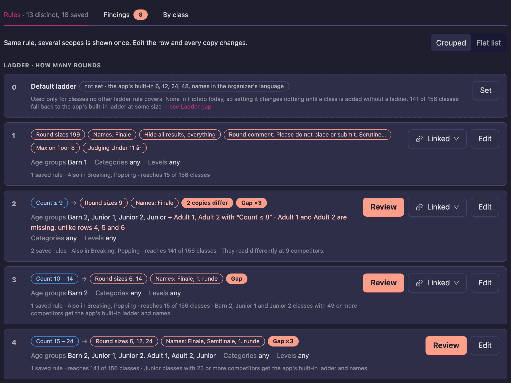
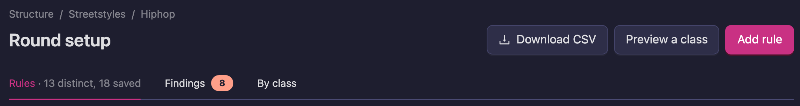
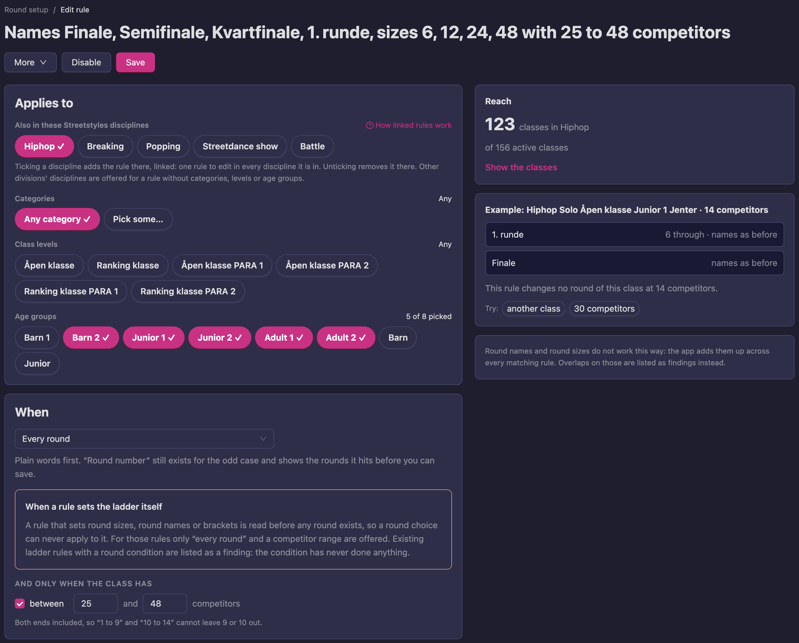
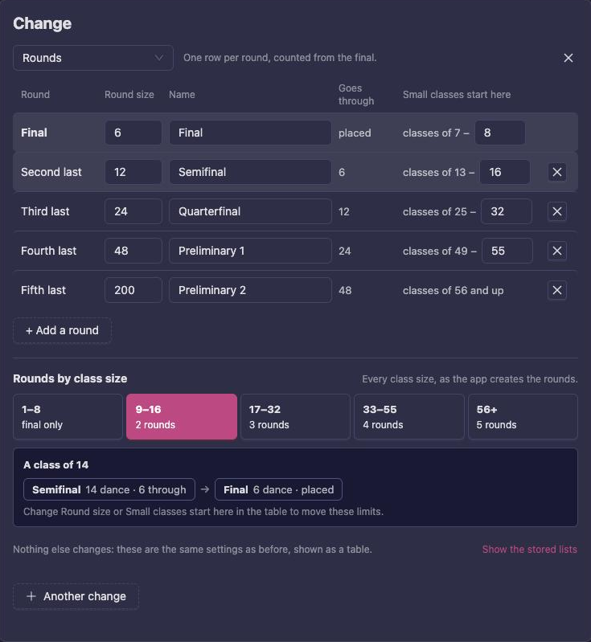
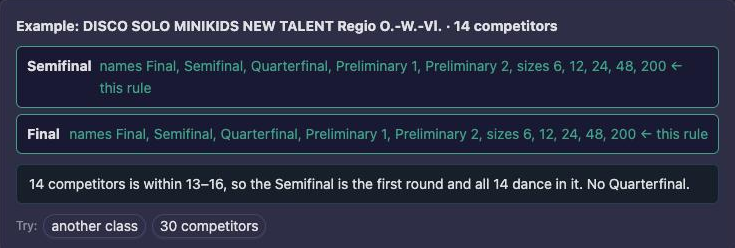
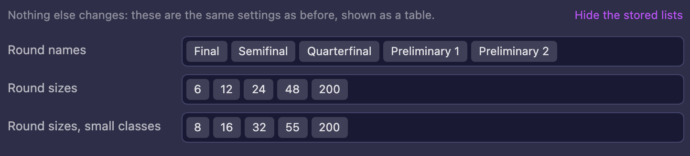

# Adding and editing round setup rules

For federation administrators who write the rules that decide which rounds a
class dances. Read, reorder and download a discipline's rules in the rules list,
and add or change a rule in the rule editor. New to the round setup? Read
[How the round setup works](/federation-rules/reference/) first.

---

## The rules list

The round setup lives per discipline under **Federation → Structure → (division) →
Discipline**, in the **Round setup** section. The section has three parts: **Rules**, the
list; **Findings**, a check of the list ([Findings](/federation-rules/round-setup-checks/#findings)); and **By class**,
which explains what one class gets ([Check a class](/federation-rules/round-setup-checks/#check-a-class)).
**Preview a class** at the top of the page opens **By class**, **Add
rule** opens the rule editor with an empty rule, and **Download CSV** saves the
whole list as a spreadsheet ([Download the rules](#download-the-rules)).

### Grouped and flat

Over the years a discipline's rules collect **copies**: the same rule
written once per class level or age group, because a rule could only name one
of each. The list folds them into **groups**. A group is every rule that does
exactly the same thing — the same conditions, the same changes, the same action
and setup tag — and differs only in where it applies.

Switch between the two views with the buttons above the list:

- **Grouped** (the default) shows one row per group: "Same rule, several scopes
  is shown once. Edit the row and every copy changes."
- **Flat list** shows every rule as it is stored, in the order the Round guide
  reads them. Use it to see a single copy.

The choice is remembered in your browser. The tab itself says how many rows the
list has: **14 distinct, 19 saved** means 14 rows for 19 switched-on rules.

Rows are numbered in the order the Round guide reads them, and the list is
divided into four sections by what the rule changes: **Ladder · how many
rounds** (round sizes and round names), **Floor and music**, **Hidden results**
and **Other**. Order decides which rule wins when two rules set the same value.
Drag a row to move it; the copies of a group always move together. A group that a
round template has replaced is locked and cannot be moved.

Each group row shows:

- **What the rule does** — small labels for its conditions (**Count ≤ 9**,
  **Final**, **Every round except the final**) and for what it changes (**Round
  sizes 6, 14**, **Names: Finale**, **Max on floor 8**, **Judging …**).
- **Where it applies**, one line per axis: the **Age groups**, **Levels** and
  **Categories** the copies name, or **any** when a copy leaves the axis open.
- **How many copies, and how far they reach**, such as **1 saved rule · reaches
  15 of 156 classes**. "Reaches" counts the discipline's active classes that at
  least one copy applies to. A rule that reaches 0 classes does nothing today. A
  note such as **1 switched off** counts copies you have turned off, and **the
  same rule exists in Breaking and Popping** tells you the other disciplines of
  the division have a copy of their own. A linked rule says **Also in Breaking,
  Popping** instead ([Linked rules](/federation-rules/round-setup-merging/#linked-rules)).
- **A finding label**, when the checks on the **Findings** tab found something
  about the group: **Gap**, **2 copies differ**, **Does the opposite**,
  **Unreachable**, **Never effective** and so on ([Findings](/federation-rules/round-setup-checks/#findings)).
  **Review** opens it.
- **Edit all** (on a group of copies, **Edit** on a single rule), **Merge 5**
  ([Merging copies](/federation-rules/round-setup-merging/#merging-copies)) and, on a group a finding blocks, **Review
  before merging**.

**Edit all** opens the rule once and saves your change on every copy. Press
**Apply to all 3 copies**: the conditions, changes, setup tag, action and
status are saved on each copy, while every copy keeps its own category, level
and age group. That is the way to fix one thing in 40 identical rules.

A group that reaches no class, or that is entirely switched off, has a button to
**Hide from the list**. Hiding is only in your browser: nothing is written to
the rule, and it still applies if a class that fits it is created later. **Show
1 hidden rule** brings hidden rows back, and **Show in the list again** undoes
it.

Under the last row, **Merge all safe groups** merges every group of identical
copies that passes the check in one go ([Merge all safe groups](/federation-rules/round-setup-merging/#merge-all-safe-groups)).

### Download the rules

To go through a discipline's rules in a spreadsheet, for example to agree
changes with the people who write your rulebook, download them:

1. Open the discipline's **Round setup** section.
2. Press **Download CSV** at the top of the page. The file is called
   **class-rules-(discipline)-(date).csv**.
3. Open it in Excel, Numbers or Google Sheets.

The file has one row per saved rule, in the order the Round guide reads them,
switched-off rules included:

- **Rule ID**, **Order** and **On** (Yes or No).
- **Categories**, **Levels** and **Age groups** the rule applies to, or **any**.
- **Condition**, in the same words as the labels in the list (**Count ≥ 10 ·
  First round**), and the **Action** for a rule that adds or removes a round.
- One column for each setting a rule changes: **Round name(s)**, **Round
  sizes**, **Max on floor**, **Music length**, **Num to advance**, **Judging
  type** and so on. A rule with a second **Round sizes** (the class sizes each
  round stretches to) fills **Round sizes (2)**.

Column titles and values are in the language you use Vote4Dance in. In a
language that writes decimals with a comma, the columns are separated by a
semicolon, so Excel opens the file in columns straight away.

The file is for reading and marking up. Changes are still made in the rule
editor: write the **Rule ID** next to a change, so it is easy to find the rule
again.

### Row 0: the default ladder

The first row, numbered 0, is the **Default ladder**: the ladder a class gets
when no other rule gives it one. When the discipline has none, it says **not set**
and what the app uses instead, such as the app's built-in 6, 12, 24, 48 round
sizes with round names in the organizer's language, and how many classes have no
ladder rule today. Press **Set** (or **Edit**) to open it ([Default
ladder](/federation-rules/default-ladder/#default-ladder)).

---

## The rule editor

**Add rule**, and **Edit** or **Edit all** on a row, open the rule editor.
It is a page of its own, with **Round setup** in the breadcrumb to go back. The
title says what the rule does in words, such as "Max 4 on the floor in the
quarter-final". **Save** stores the rule, **Disable** (or **Enable**) switches it
off without deleting it, and **More** has **Copy**, **Paste** and **Delete**.

The editor has three cards on the left and three on the right.

**Applies to.** Pick the categories, class levels and age groups the rule is for.
**Any category** and **Any** mean every value, including ones added later; **Pick
some…** lets you choose. **Also in these … disciplines** adds the rule to other
disciplines, linked, so it is one rule to edit in all of them ([Linked
rules](/federation-rules/round-setup-merging/#linked-rules)). When you edit a group, each copy keeps its own scope and
saving changes the conditions and the changes on all of them.

**When.** Which rounds, and for which class sizes, in plain words
([Round conditions in plain words](#round-conditions-in-plain-words)). Under
**Rounds this hits**, a strip shows the rounds of an example class at a number
of competitors you can change; a closed eye marks a round the rule applies to.

**Change.** What the rule writes. Each change is picked from a list grouped as
**Round setting**, **Bracket setting**, **Music and time** and **Other**, such
as **Rounds** (round sizes and names as one table, see [Rounds: round names and
round sizes](#rounds-round-names-and-round-sizes)), **Judging type**, **Num to advance**,
**Hide from position**, **Max on floor**, **Music length** or **Dances**
([Settings](/federation-rules/round-setup-settings/#settings-by-what-they-control)). **Another change** adds one more.
Under **Advanced**, **Setup** tags a rule as part of a variant that organizers
can switch on, and **Action** says what the rule does with the round: **Modify**
(the default), **Add After** or **Remove**. When **Which rounds** is **Before the
first round**, **Add After** reads **Add before the first round**.

On the right:

- **Reach** counts how many of the discipline's active classes the rule applies
  to, with **Show the classes**, and how many in the sister disciplines have
  their own copies.
- **Example** shows one class at one number of competitors and what this rule
  does to it, or says that the rule changes no round of it. Use **another class**
  and **30 competitors** to try others.
- **Also sets "…" for these classes** lists the other rules that write the same
  setting on some of the same classes, with how many classes they share and which
  rule wins: the one that comes later in the list wins. **Fine, or move it?**
  offers **Move this rule after it** or **Keep it as it is**. Round names and round
  sizes do not work this way — the app adds them up across every matching rule —
  and overlaps on those are reported as findings instead.

### Round conditions in plain words

The **When** card is set in words. For rounds, **Which rounds** offers:

- **Every round**
- **The final**
- **Every round except the final** (the usual choice for hiding results)
- **The first round**
- **Before the first round**, a round of its own danced ahead of all the others,
  such as a presentation or a warm-up ([A round before the first
  round](#a-round-before-the-first-round))
- **The semi-final, quarter-final or another round counted from the final**, with
  **Semi-final (2nd from the end)**, **Quarter-final (3rd from the end)** and so
  on
- **A range of rounds**, **From round … to round …**, counted from the start or
  from the final (rarely needed)

Under **And only when the class has**, tick **between … and … competitors** to
limit the rule to a class size. Both ends are included, so "1 to 9" and "10 to 14"
cannot leave 9 or 10 out.

A rule that sets round sizes, round names or brackets is read before any round
exists, so a round choice can never apply to it. For those rules only **Every
round** and a number of competitors are offered.

**Rules saved the old way.** Rules saved before the plain-word editor compared
the number first and the round second, so a condition such as "round at least 3"
in them means "round 3 or earlier", not "round 3 or later". Nothing was changed
in them. The list still shows the condition as it was written (**Round ≥ 3 from
end**); the editor and the **Does the opposite** finding say what it behaves as,
such as "round 3 from the end and earlier", and the finding lets you choose what
you want to keep ([Rules that read backwards](/federation-rules/round-setup-checks/#rules-that-read-backwards)). Saving a rule in the editor writes it
in plain words from then on.

### A round before the first round

Some classes dance a round before the competition starts that is not judged,
such as a presentation where every couple is shown, or a warm-up. A rule
adds it to the classes it is for, so organizers get it from the Round guide
without adding it by hand.

1. Press **Add rule** and, under **Applies to**, pick the classes the
   round is for, such as the levels that dance a presentation.
2. Under **When**, set **Which rounds** to **Before the first round**. The rule
   now adds a round: under **Advanced**, **Action** says **Add before the first
   round**.
3. If only some class sizes dance it, tick **between … and … competitors**, for
   example 2 and 6 for classes that dance a final only.
4. Under **Change**, set up the added round, for example **Judging type** with
   no judging, **Round name(s)** "Presentation", **Num to advance** 100 %, **Max
   on floor**, **Music length** and **Extra time**.
5. Check **Rounds this hits** and **Example** on the right: they show the added
   round first, at a number of competitors the rule is for. Then press **Save**.

The added round is danced by all competitors and the class's own rounds follow
it unchanged. A rule with **Which rounds** set to **Before the first round** and
**Action** **Modify** changes the round another rule adds there.

### Rounds: round names and round sizes

A rule's round names and round sizes are set together, in one table under
**Change**: **Rounds**. Each row is one round, counted from the final — **Final**,
**Second last**, **Third last** and so on — so you read the class the way it is
danced, from the end backwards, and each round's size and name sit side by side.

The example is the Disco ladder: a final of 6, a semifinal of 12, a quarterfinal
of 24 and two preliminary rounds, where classes of up to 8 dance a final only.

1. Open the rule (**Edit** on its row in the **Round setup** section), or press **Add
   rule** and pick **Rounds** under **Change**. A rule that sets round sizes
   or round names can only be for **Every round**, with or without a number of
   competitors.
2. In the **Final** row, enter the **Round size** — the most competitors the final
   holds, here 6 — and its **Name**, such as Final.
3. Fill in the rows above it in the same way: **Second last** 12 Semifinal,
   **Third last** 24 Quarterfinal, and so on. **Goes through** shows how many go
   on from each round to the next: the next round's size, or **placed** for the
   final. You do not type it.
4. Use **Small classes start here** to let a class that is only a little too big
   for a round start in it anyway. In the **Final** row, **classes of 7 –** 8 means
   a class of 7 or 8 skips the semifinal and dances straight in the final — all of
   them dance it and are placed there. In the **Second last** row, **classes of 13
   –** 16 means a class of 13 to 16 starts in the semifinal instead of dancing a
   quarterfinal first. Leave it empty when a class should start in a round only
   if it fits its **Round size**.
5. The largest round has no field there: it takes **classes of N and up**, every
   class larger than the rows below it allow, here **classes of 56 and up**.
6. To add a round, press **Add a round**: a new row is added just below the
   largest round, at double the size of the row before it. Fill in its size and
   name. To remove a round, press **×** at the end of its row; the final cannot be
   removed.
7. Check the result under **Rounds by class size** (below), then press **Save**.

**Names.** A name with [X] numbers the rounds, the first round being 1:
"Preliminary [X]" gives Preliminary 1, Preliminary 2 … and the note under the
table shows how it comes out. When a rule has fewer names than rounds, the
earlier rounds get the last name; an empty name field shows the name such a
round gets. **Not set by this rule** means the rule gives sizes but no names, so
the names come from another rule or the default ladder.

**Rounds by class size.** Below the table, a bar shows every class size as the
app creates the rounds — here **1–8 final only**, **9–16 2 rounds**, **17–32 3
rounds**, **33–55 4 rounds** and **56+ 5 rounds**. Click a part of the bar to see
it as **A class of N**: the rounds such a class dances, how many dance in each
and how many go through, for example "Semifinal 14 dance · 6 through → Final 6
dance · placed". The bar's limits follow the table: change **Round size** or
**Small classes start here** to move them.

The **Example** card on the right says the same for one real class of the
discipline, with the reason in words:

**Nothing else changes.** The table is a new way to show and edit the same
settings as before: saving stores the round names, the round sizes, and the
round sizes for small classes as three lists, exactly as rules have always been
stored, so the Round guide creates the same rounds and the **Download CSV** file
keeps its **Round name(s)**, **Round sizes** and **Round sizes (2)** columns.
Press **Show the stored lists** to see them, and **Hide the stored lists** to
close them again:

A rule whose lists cannot be drawn as one table — for example one with two lists
of round names — keeps the separate **Round name(s)** and **Round sizes**
changes, as before.
