# Round templates

A **round template** decides which rounds a group of classes dances. You fill in a table — which
rounds there are, from how many competitors each one starts, and what differs per round — and
Vote4Dance builds the rounds from it. Organizers keep using the **Round guide** in Manager exactly
as before; the rounds they get now come from your template.

You don't need to know how the round setup works to use a template. A template replaces the rules
of the round setup for its classes, and you can always switch back.

> Round templates are switched on per federation by Vote4Dance. If you don't see **New ladder** at
> the top of a discipline's **Round setup**, ask Vote4Dance to switch them on.

---

## Your first template

This example makes a template for **Hiphop Solo Beginner**: a final, a semifinal from 8 competitors, a
quarterfinal (Kvartsfinal) from 15 and an eighth-final (Åttondelsfinal) from 30.

**1. Start a new template.** Go to **Federation → Structure → (division) → Discipline** and open
**Round setup**. Click **New ladder**, type a name in **New template** and press **Create template**. The template
opens. Back in **Round setup** (**Back to round setup**), your templates are listed among the rules
under **Ladder · how many rounds**, marked **draft** until you switch them on, with **Compare and
switch on** next to each.

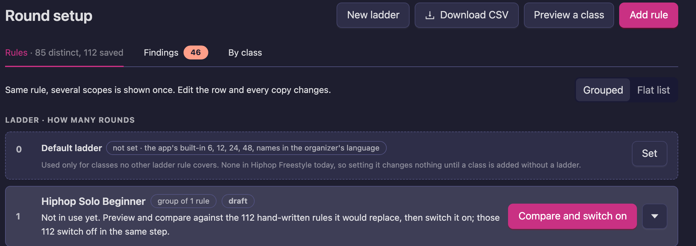

**2. Name it and choose its classes.** Pick the **Categories**, **Class Levels** and **Age Groups**
it covers. Leave a list empty to cover all of them — here, every age group. Below the lists you see
how many active classes the template covers. If your choices match no class, a warning says so before
you save.

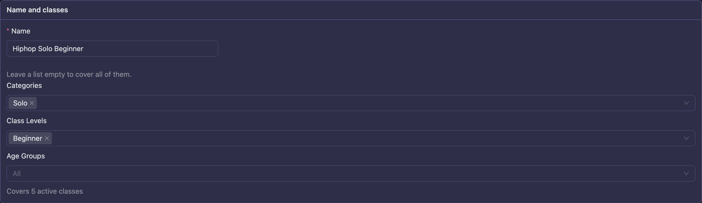

**3. Add the rounds.** The final is always there. Click **Add round** for each earlier round and
say from how many competitors it is danced.

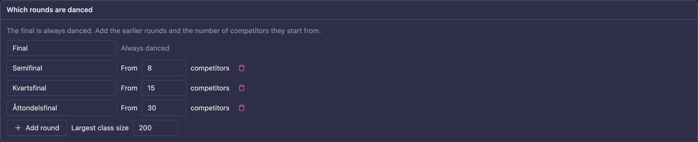

**4. Fill in what differs.** The table has a row per round and a column per class size. Click a
cell to set, for example, the judging type for small finals. Put values that apply everywhere in
**Template default**.

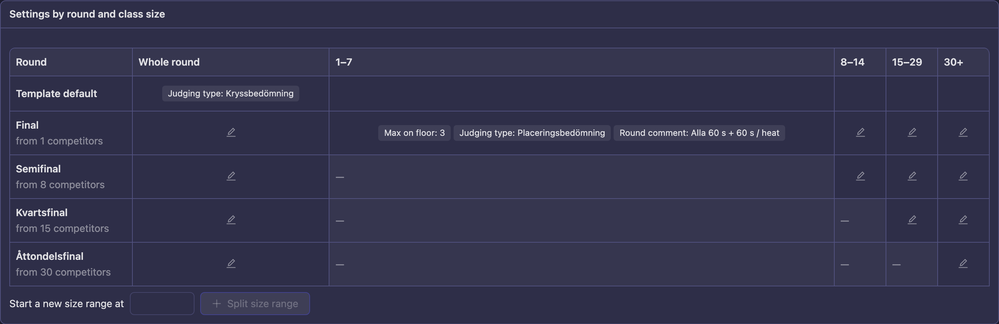

**5. Check the rounds.** On the **Preview** tab, pick a class and a number of competitors to see
the rounds it gets.

**6. Compare and activate.** On **Compare and activate**, click **Compare with current rules**,
go through the differences, and click **Activate template**. From then on, new classes get their
rounds from the template.

Save as you go with **Save changes**. If you leave the page with unsaved changes, Vote4Dance asks
first.

---

## Words used on this page

| Word | Meaning |
|---|---|
| **Template** | The table that decides which rounds a group of classes dances. |
| **Draft / Active** | A draft changes nothing for organizers. An active template is what the Round guide uses. |
| **Size range** | A column in the table, for classes of a certain size, for example 8–14 competitors. |
| **Intended** | Your mark that a difference from today's rounds is on purpose. |
| **Old rules** | The rules the template replaced. They come back if you restore them. |

---

## Filling in a template

### Which rounds are danced

Each round starts from a number of competitors: with a semifinal from 8, a class of 7 dances only
the final and a class of 8 dances a semifinal and a final.

**Largest class size** is the biggest class the template has to handle. It goes up by itself when a
round starts above it.

### Settings by round and class size

Values build on each other, and each level only holds what differs from the level above:

| Level | Applies to |
|---|---|
| **Template default** | Every round of every class in the template |
| **Whole round** | One round, at every class size |
| A size column, such as **8+** | One round, for classes of that size |

A dash means the round isn't danced at that size. Click a cell to open its panel, add what differs
with **Add round setting**, and click **Apply**.

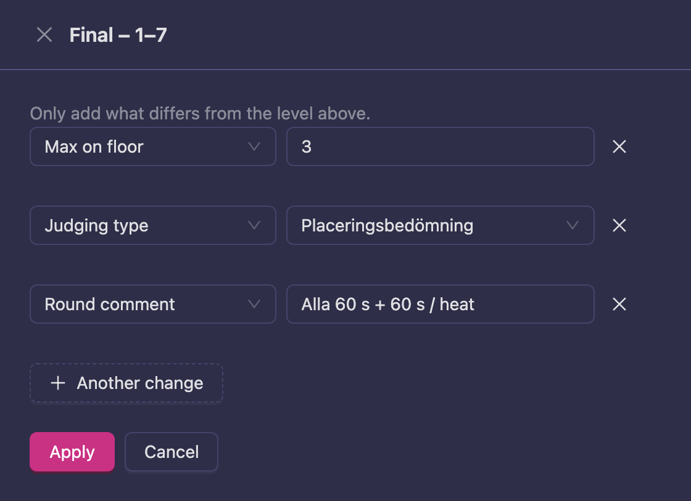

To treat some sizes differently inside a column, enter a number under **Start a new size range
at** and click **Split size range**.

Round names and round sizes come from the rounds list, and the second chance's dances from its
own section, so they can't be set in a cell.

### Extrachans

**Second chance inside the first round** (DSF's Extrachans) lets competitors who miss the first cut
dance again; the best of them join the next round. Vote4Dance switches this on for the federations
that use it.

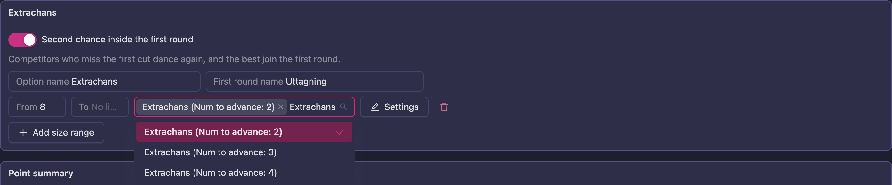

- **Option name** is what organizers tick in the Round guide.
- **First round name** renames the first round when the option is used, for example "Uttagning".
- Add a size range for each class size it applies to, with its **Dances** and **Settings**. If a
  size range sets **Music Length** or **Extra Time**, set both. A size range's **Settings** apply to
  the whole first round the extra chance sits in, not only to the extra-chance dance. When
  several dances have the same name, the list shows what tells them apart, for example
  "Extrachans (Num To Advance: 3)".

The second chance needs a round before the final, so its size ranges start at or above the size
where the round before the final begins (8 in the example).

### Point summary

**Add a point summary after the final** gives every class from the template a summary round that
totals the placement points. Vote4Dance switches this on for the federations that use it.

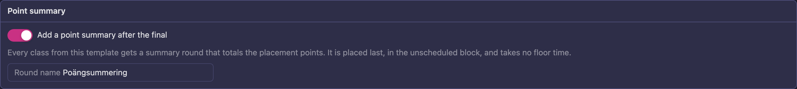

The summary is placed last in the class, in the unscheduled block, so it takes no floor time. It
counts every competitor in the class. Its points work like a summary added by hand; see
[Point summary](/point-summary/).

### Hide results

Click **Add adjustment** to hide results from a place down: choose the rounds, **From place**, and
optionally **Fewest competitors** and **Most competitors**.

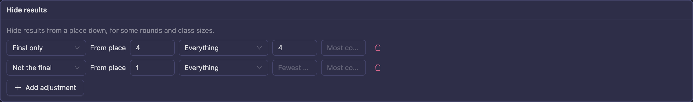

---

## Preview

Pick a class, enter the number of competitors, and tick the options organizers can choose. Each
round shows its values and where each one **Comes from** — **Template default**, a whole round, a size
column, **Extrachans** or **Hide results**. **Other rule** means a rule outside the
template.

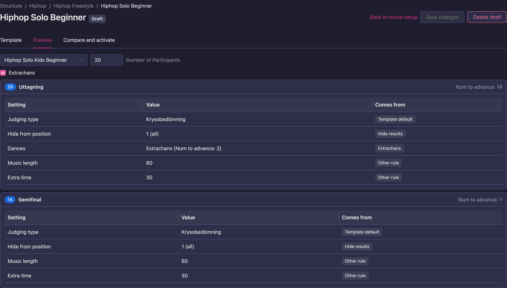

---

## Compare and activate

Before a template takes over, compare the rounds it gives with the rounds organizers get today.

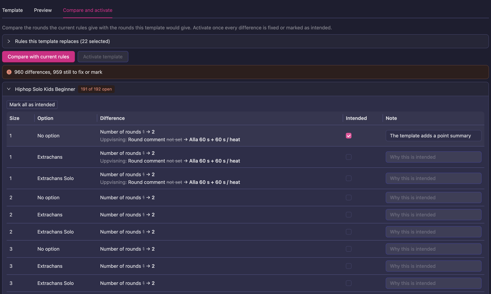

1. **Rules this template replaces.** Vote4Dance selects today's rules that only apply to the template's
   classes. A rule that also applies to other classes is marked **Outside this template's classes** and
   stays as it is.
2. **Compare with current rules.** Vote4Dance builds the rounds for every class in the template at every
   size from 1 to 64, with and without each option, and lists what is different. In the picture,
   every class gets one more round because the template adds a point summary.
3. **Fix or mark each difference.** Change the template until the difference goes away, or tick
   **Intended** and write a **Note** saying why. **Mark all as intended** marks a whole class. If a
   later change makes the same rounds differ in another way, the mark lapses and your old note is
   shown as a hint.
4. **Activate template.** You can activate once the template is saved and nothing is left open. If you
   change the template, the selected rules, the classes, dances or judging types after comparing,
   compare again.

Rounds that competitions already have are not changed.

---

## After activation

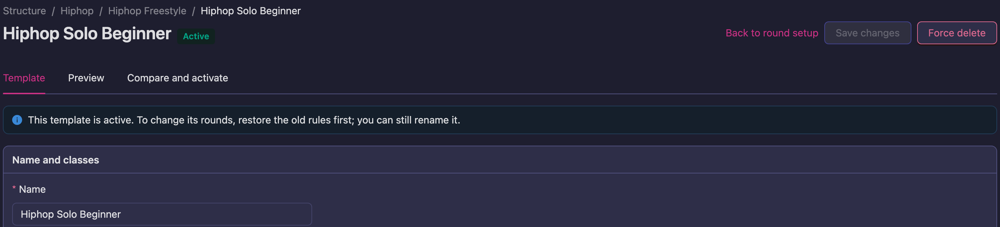

- **An active template is read-only.** To change its rounds, click **Restore old rules** on **Compare
  and activate**: the template becomes a draft and the old rules come back. Make your changes, compare
  and activate again. You can still rename an active template.

  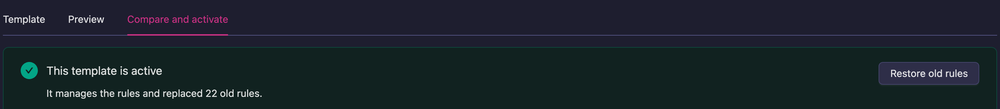

- **The template's own rules** are listed under it in the Round setup section and can't be edited there.
  The rules it replaced are listed too, switched off.
- **New rules can't compete with it.** While a template is active, a rule that would set
  round names or sizes for its classes is refused.
- **Deleting.** Delete a draft with **Delete draft**. An active template has to be restored first.
- **If Vote4Dance switches round templates off** for your federation, the templates stay listed in the
  **Round setup** section. You can still open, restore and delete them, but not change or activate them.

---

## Messages you may see

| Message | What to do |
|---|---|
| Another active template already covers some of these classes | Change the classes so the two templates don't share any, or restore the other template. |
| A rule that stays on sets round names or sizes for some of these classes | Select that rule under **Rules this template replaces**, or narrow it to other classes. |
| Restore the old rules to change the rounds of an active template | Click **Restore old rules**, then make your change. |
| Sending 100% or more through moves classes up a round | Use a number of competitors instead of a percentage of 100 or more. |
| The extra chance needs a round before the final … | Start the Extrachans size ranges where the round before the final begins. |
| An extra chance size range that sets Music Length or Extra Time must set both | Set both in the size range's **Settings**, or neither. |
| This template covers too many classes and settings at once | Split it into smaller templates. |
| A setting starts above the largest class size | Raise **Largest class size** until the setting's column shows, then change or remove it. |
| These choices match no active class in this discipline | Check the **Categories**, **Class Levels** and **Age Groups**. A level may only exist for other categories — for example battle classes, which templates don't cover yet. |

---

## For round setup experts

A template is stored as its table and turned into rules of the round setup when you activate it. Those rules come
first in the discipline's rule list. A hand-written rule that still applies to the same classes runs
after them, so it can change a value the template sets — but not the rounds themselves: activation
refuses rules that set round names or sizes for the template's classes. Battle classes are not covered
by templates yet; see [Battle round setup](/federation-rules/battle-class-rules/).

## Related

- [How the round setup works](/federation-rules/reference/)
- [Battle round setup](/federation-rules/battle-class-rules/)
- [Point summary](/point-summary/)
