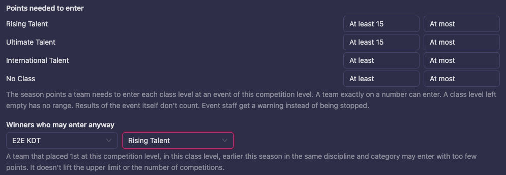
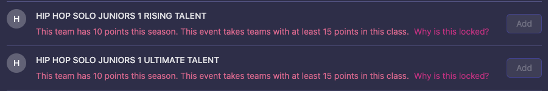
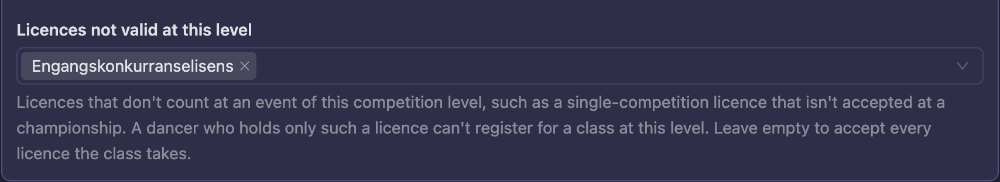
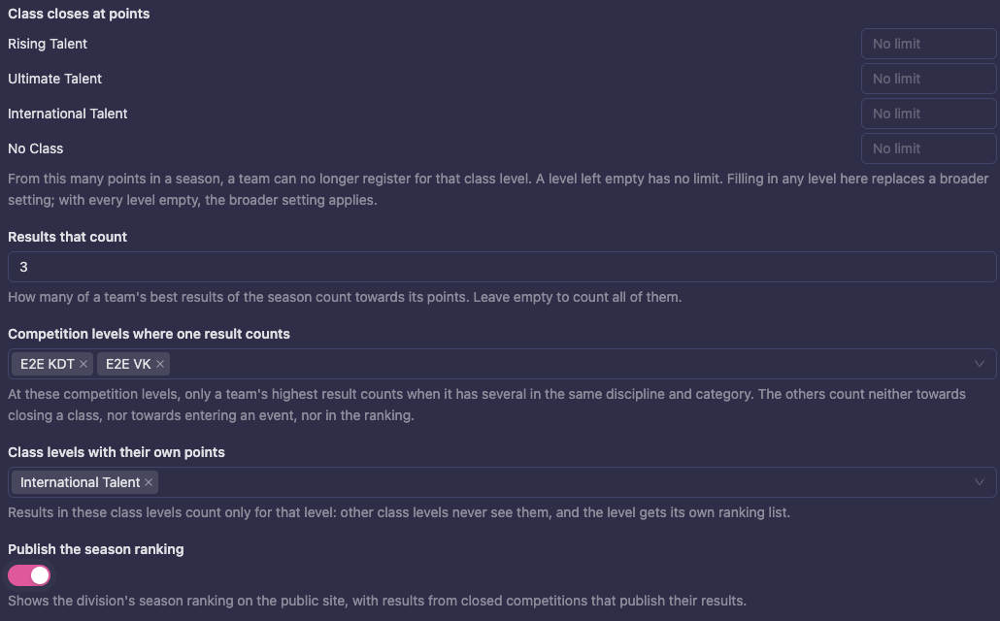
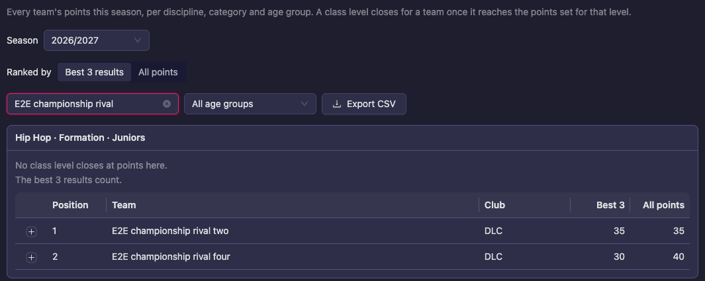
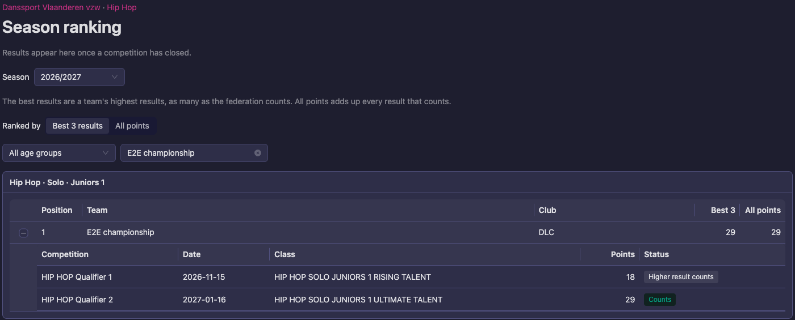

# Entry rules and the season ranking

A federation can decide who may enter an event by the team's points this season and by how many competitions it has danced, and it can publish a season ranking per age group. This page shows how to set the rules, what dancers and event staff see, and how the ranking looks on **Season points** and on the public site.

Nothing changes until you set a rule. A federation that sets none of them sees no difference.

It builds on [Closing a class at points](/federation/class-point-limits/), which explains how a team's points are counted and how a class level closes for a team. Where the points come from is on [Promotion points](/federation/progression/).

## Who may enter an event

These rules are set on a **competition level**, so they apply whenever a competition runs at that level, for example a championship.

1. Go to **Structure**, choose the division and open **Competition Levels**.
2. Choose the competition level and open its **Rules** tab.
3. Fill in the rules you need:
   - **Points needed to enter**: for each class level, **At least** and **At most**. A team with exactly that number can enter. A class level left empty has no range. "At least" cannot be higher than "At most".
   - **Winners who may enter anyway**: choose a **Competition level** and a **Class level**. A team that placed 1st at that competition level, in that class level, earlier this season in the same discipline and category may enter with too few points. It lifts only the minimum: it does not lift the upper limit or the number of competitions.
   - **Competitions danced before entering**: how many earlier competitions this season, in the same discipline and category, a team must have danced. Leave it empty for no minimum.
4. Press **Save competition level rules**.

The results of the event itself never count towards its own entry rules.

### What dancers and event staff see

A team that does not meet a rule cannot add the class, and the reason says why:

- "This team has 10 points this season. This event takes teams with at least 15 points in this class."
- "This team has 18 points this season. This event takes teams with at most 14 points in this class."
- "Competitions danced in this category this season: 1. This event requires at least 2."

Event staff get a warning instead of being stopped and may still add or move the team. Entries made before a team's points changed stay, and show under **Entries to check** on **Season points**, with the reason, for example "Too few points for this event: 10, at least 15".

The rule counts how many competitions a team has danced. It does not check who was invited to a championship, so a selection by invitation list stays with the federation. The ranking and its CSV help you pick the teams.

### Licences that don't count at a level

Some licences are meant for smaller events only. A single-competition licence, for example, may be fine at a regional competition but not at a championship. A competition level can say which licences don't count at its events.

1. Go to **Structure**, choose the division and open **Competition Levels**.
2. Open the **Rules** tab and choose the competition level.
3. Under **Licences not valid at this level**, choose the licences. The list offers the federation's active dancer licences.
4. Press **Save competition level rules**.

At an event of that level, those licences are left out of what a class accepts. A dancer who holds only such a licence can't register for the class there, and sees "This licence is not valid at this competition level." A dancer who also holds a licence the level accepts registers as usual. Leave the field empty to accept every licence the class takes.

This only matters for classes that require a licence at registration (see [Step 3: Decide which classes accept which items](/federation/getting-a-license/#step-3-decide-which-classes-accept-which-items)).

If you delete a licence item that a level lists, it shows as **Removed licence** on the level's rules. Saving the level takes it off the list.

## How results count in the ranking

These rules are set on the **division**, in its rules.

- **Competition levels where one result counts**: at these competition levels only a team's highest result counts when it has several in the same discipline and category. The others count neither towards closing a class, nor towards entering an event, nor in the ranking.
- **Class levels with their own points**: results in these class levels count only for that level. Other class levels never see them, and the level gets its own ranking list. They also stay out of the class limits and the entry rules of the other levels.
- **Publish the season ranking**: shows the division's season ranking on the public site.

## Season points per age group

On **Season points** (see [Closing a class at points](/federation/class-point-limits/#season-points)), each list is now one discipline, category and **Age group**. A team that has results in two age groups appears in both, each time with the results of that age group only.

- **Ranked by** switches the order: **Best 3 results** (the number is the one set under **Results that count**) or **All points**. The columns show both totals: **Best 3** and **All points**.
- **Age group** filters the lists to one age group. **All age groups** shows everything.
- A result that a higher one at the same competition level replaced is tagged **Higher result counts**.

## The public season ranking

When **Publish the season ranking** is on for a division, its public page has a **Season ranking** button. It opens a page with the same lists as **Season points**, for everyone, with **Season**, **Ranked by**, an age group filter and a search for a team or club.

The public page shows less than **Season points**:

- Only competitions that are **closed** or archived, that publish their results and do not hide their teams.
- No disqualified results, no correction notes and no entries to check.
- A team with no points has no position.

Results appear once a competition has closed. Switch **Publish the season ranking** off to take the page away; the button disappears and anyone who opens the address sees "This ranking isn't published."

Good to know:

- **Check the points first.** The ranking shows the points as they are saved, so make sure the points table pays what your rulebook says, and recalculate if needed ([Recalculate points](/federation/progression/#recalculate-points)), before you switch it on.
- **Switching on or off takes up to a minute** to reach a page that is reloaded, and a page left open keeps what it shows until it is reloaded.
- **A competition that is closed with a final that has not been published** can show that final's points. Publish the round before you close the competition.
