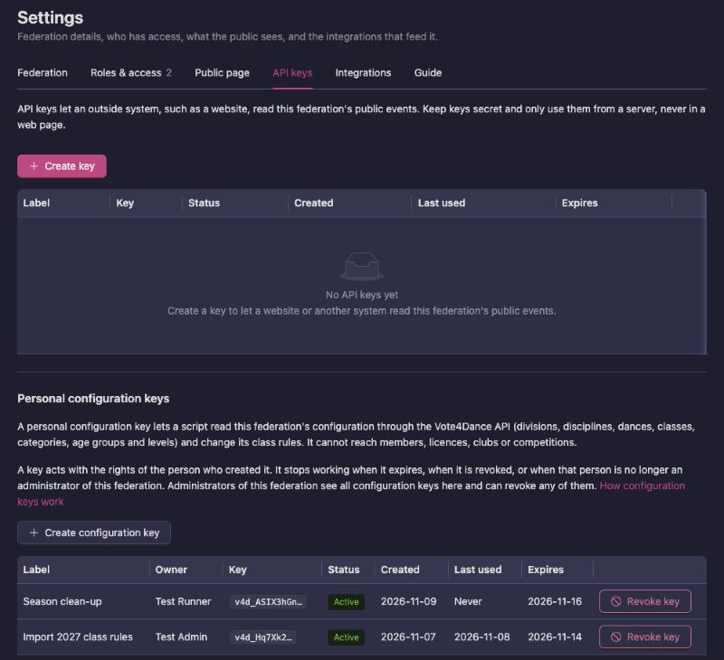
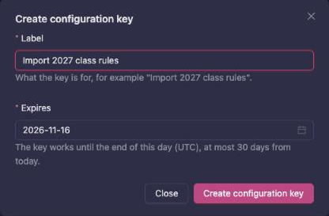
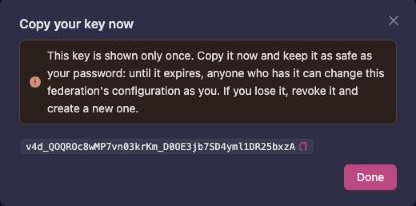

# Federation settings

**Settings** is where you change the federation's own details, decide who has access, choose what the public federation page shows, and set up API keys and integrations. Open it with **Settings** at the right end of the federation bar: `Federation → Settings`.

The screen has six tabs: **Federation**, **Roles & access**, **Public page**, **API keys**, **Integrations** and **Guide**. Each tab has its own address (`?settings=federation`, `roles`, `public`, `api`, `integrations`, `guide`), so you can bookmark or share a link to one tab.

## Who can change what

The **Settings** button is only in the bar for Administrators, Owners and Vote4Dance system administrators. A Viewer or Manager who opens the address directly sees the tabs but cannot change anything.

| Task | Who can do it |
|---|---|
| Edit the federation details, images and **Visible in public federation list** | Administrator, Owner |
| Connect, manage or clear the Stripe payout account | Administrator, Owner |
| Turn public page sections on and off | Administrator, Owner |
| Write the **Registration help** | Administrator, Owner |
| Create and revoke API keys and personal configuration keys (**API keys**) | Administrator, Owner |
| Save the NORRIQ MemberSport hosts (**Integrations**) | Administrator, Owner |
| Add staff and remove or change Viewers and Managers | Administrator, Owner |
| Change or remove Administrators and Owners, or make someone Administrator or Owner | Owner |
| Delete the federation | Vote4Dance system administrator only |
| Read the **Guide** tab | Anyone with a role in the federation |

Nobody can change or remove their own role. A Vote4Dance system administrator can do everything on this screen.

## Federation

The tab shows an **Edit federation** button. It opens **Federation details**. Without permission you see "You do not have permission to change this." instead.

| Field | Required | What it does |
|---|---|---|
| **Short letters** | Yes | The federation's short tag, for example DSF. |
| **Federation name** | Yes | The full name. It is shown in the federation bar and on public pages. |
| **Description** | Yes | Details and information about the federation. |
| **Image** | No | The federation logo. It is shown in the federation bar and in the public federation banner. |
| **Inverted image** | No | A second version of the logo for dark backgrounds. |
| **Visible in public federation list** | No | When on, the federation appears in the public federation list and its public federation page loads for visitors. When off, the federation is left out of the list and its public page shows nothing to anyone who is not a system administrator. |
| **Stripe payout account** | No | See [Stripe payout account](#stripe-payout-account). |

Press **Save changes** to save. The images are uploaded when you save, not when you pick them. To remove an image, clear it in the upload field and save.

If a required field is empty, the form shows "This is required" and does not save.

### Stripe payout account

Licence payments are paid to the federation's connected Stripe account. Vote4Dance keeps a 5% application fee. The field shows a **Connected** or **Not connected** tag and, once one exists, the Stripe account ID.

- **Connect Stripe** creates a Stripe account for the federation and sends you to Stripe to complete onboarding. When you finish, Stripe sends you back to Settings.
- **Manage Stripe connection** appears once an account exists. If onboarding is not finished, it sends you back to Stripe to finish it. If the account is already fully set up, you get the message "Stripe account is already connected".
- The red clear button next to it disconnects the Stripe account from the federation after you confirm **Clear Stripe account**.

The account counts as **Connected** only when Stripe reports that the details are submitted and charges are enabled. Vote4Dance checks this when you press **Manage Stripe connection**, so after finishing onboarding, open the dialog and press it once to update the tag. Licence checkout is refused until the account is **Connected**.

See [Federation licenses](/federation-licenses/federation-admin/) for how payments are used.

### Delete the federation

**Delete** in the dialog removes the federation. Only a Vote4Dance system administrator can do this. It is refused with "This federation has competitions" or "This federation has divisions" while the federation still has any.

## Roles & access

This tab lists every person with a role in the federation, with their name, email and role. The number next to the tab name is how many people are on the list. The **Guide to permissions** box beside the list summarises what each role can do. It is the same guide that opens when you click your role name in the federation bar, and it marks your own role **Your role**.

For what each role can do, see [Federation staff roles](/federation/staff-roles/).

### Add a person

1. Type at least three characters of a name or email address in the search box under the list.
2. Pick the person from the suggestions, or type their full email address and press **Add**.

The person gets the **Viewer** role. They must already have a Vote4Dance account; if no account has that email address, or the person is already on the list, adding fails.

### Change a role

Pick the new role in the dropdown on the person's row. It saves straight away. Hover over the dropdown to see a summary of the current role.

- An **Administrator** can change Viewers and Managers, and only to **Viewer** or **Manager**.
- An **Owner** can change anyone except themselves, to any role, including **Owner**.

Rows and roles you cannot change are greyed out.

### Remove a person

Press the red delete button on the row and confirm. The same limits apply: an Administrator can remove Viewers and Managers, an Owner can remove anyone except themselves.

## Public page

**Public page features** controls which sections the federation's public page shows. Each switch saves as soon as you flip it. A new federation has every section off.

| Switch | What it shows to the public |
|---|---|
| **Rankings** | The rankings menu item and page. It only appears once the federation has at least one active ranking. |
| **Divisions** | The divisions menu item and page. |
| **Getting started** | The getting started page. |
| **Organizations** | The list of approved organizations. |
| **Licenses** | The public licence catalog. It only appears once the federation has at least one active licence item. |

A disabled section is hidden for all visitors. Signed-in federation staff still see buttons for the hidden sections in the admin box on the public federation home page, so you can check a section before you turn it on.

If saving fails, the switch goes back to where it was and an error is shown.

See [Public rankings](/federation-rankings/public/) for what the public rankings show.

### Registration help

The **Registration help** card below the switches holds your federation's own text for people
registering. It is shown at the top of the **Registration** card on the registration page of every
competition in your federation, above the Vote4Dance registration guide. Use it to point dancers
and clubs to your own rules and documentation.

- Write it in Markdown, for example `[our rules](https://example.org/rules)` for a link. Raw HTML
  is not shown.
- Links open in a new tab.
- Press **Save changes**. You get "Registration help saved".
- To remove it, clear the text and press **Save changes**. The registration page then shows only
  the Vote4Dance guide.

Only Administrators and Owners can save it.

## API keys

The **API keys** tab is only shown to Administrators, Owners and Vote4Dance system administrators. It has two parts: **API keys**, which let another system read the federation's public events, and **Personal configuration keys**, which let a script change the federation's configuration for you.

### API keys for your website

An API key lets an outside system, such as the federation's own website, read the federation's public events from Vote4Dance. Keep keys secret: they belong on a server, never in a web page.

1. Press **Create key**.
2. Under **Label**, write what the key is for, for example the name of the website.
3. Under **Expires**, choose a day if the key should stop working then. Leave it empty for a key that does not expire.
4. Press **Create key**. The key is shown once: copy it and give it to whoever runs the website.

To stop a key, press **Revoke key** on its row, then **OK**. Systems using it stop working right away, and this cannot be undone.

### Personal configuration keys

A personal configuration key lets a script change this federation's configuration through the Vote4Dance API, instead of you clicking through the federation pages. It is useful for big, repetitive changes, such as entering a new season's round setup for every discipline. Vote4Dance support may also ask you for a key to make such a change for you.

A configuration key can:

- read the federation's divisions, disciplines, dances, classes, categories, age groups and class levels
- change the round setup: edit several rules at once, add a rule at a chosen place in the list, merge two rules into one, or delete a rule

It cannot reach members, licences, clubs, competitions, rankings or points. A change is refused when the rule was changed by someone else since the script read it, so nothing is overwritten by mistake.

The key is your own:

- It acts with your own rights. Every change it makes is recorded under your name, just as if you had made it on the page yourself.
- Every Administrator and Owner of the federation sees all configuration keys in the list, with the name of the person each key belongs to, and can revoke any of them, for example when someone leaves or loses a laptop. Only you can create a key for yourself.
- It belongs to this one federation. It cannot change any other federation, even one you also administer.
- It stops working when it expires, when you revoke it, or when you are no longer an Administrator or Owner of the federation. Changing or resetting your password revokes all your configuration keys, so a key never outlives a password change.

To create a key:

1. Open `Federation → Settings → API keys` and go to **Personal configuration keys**.
2. Press **Create configuration key**.
3. Under **Label**, write what the key is for, for example "Import 2027 round setup".
4. Under **Expires**, choose the last day the key should work. It is 7 days ahead to begin with, and can be at most 30 days from today. The key works until the end of that day (UTC).

   

5. Press **Create configuration key**.
6. Copy the key and press **Done**. It is shown only once: keep it as safe as your password, because until it expires anyone who has it can change the federation's configuration as you.

   

You can have up to 5 active configuration keys per federation. Revoked and expired keys don't count.

The list shows each key's **Label**, its **Owner**, the first characters of the **Key**, its **Status** (**Active**, **Expired** or **Revoked**), when it was **Created**, when it was **Last used**, and when it **Expires**.

When the work is done, revoke the key rather than waiting for it to expire: press **Revoke key** on its row, then **OK**. Scripts using the key stop working right away.

If you lose a key, revoke it and create a new one.

## Integrations

The only integration on this tab is **NORRIQ MemberSport**, and it is only shown for the DSV federation. Every other federation sees "No integrations are configured for this federation."

NORRIQ MemberSport is used to verify a licence holder's member number, and their birthdate, against the club's NORRIQ records.

| Field | What it is |
|---|---|
| **Auth host URL** | The NORRIQ host that issues access tokens. |
| **API base URL** | The MemberSport API host used for member lookups. |

Press **Save changes**. You get "NORRIQ settings saved." when it worked. A field you leave empty is not stored, and the platform's default host is used instead.

The client credentials are not entered here. Each club has its own **NORRIQ MemberSport credentials** card on its page (`Federation → Members → Organizations → [club]`). That card only appears once both URLs above are filled in.

## Guide

The **Guide** tab is a short map of where federation work is done. It has three cards:

- **Federation-wide** links to **Organizations** (approving clubs, issuer role and representation), **Licenses** (issued licences and licence items), **Rulebook** (the shared rules and what is still automated) and **Enforcement log** (why rules allowed, blocked, skipped or promoted someone). **Organizations** and **Enforcement log** open the matching tabs under **Members**.
- **Division work** links to **Division**, the **Structure** page, where rankings, class state, history and class licence rules are handled per division, and each discipline holds its classes and class-level licence rules.
- **Manual operations guide** says which page to use when a rule is not automated: ranking corrections for selection exceptions and ties, membership edits for manual promotion, demotion and class changes, representation history for moving a competitor between organizations, and the enforcement log to check the result afterwards.

The tab has nothing to set.

## Not in this version

- **Restrict competition creation** is not on the **Federation details** form, and saving the form turns it off.
- There is no way to transfer ownership in one step. Make the new person **Owner** from the **Roles & access** tab.
- Integrations other than NORRIQ MemberSport for DSV are not available.

## Related pages

- [Federation staff roles](/federation/staff-roles/)
- [Federation licenses: federation admin](/federation-licenses/federation-admin/)
- [Public rankings](/federation-rankings/public/)
- [Federation rules](/federation-rules/)
- [Club transfers](/federation/club-transfers/)
