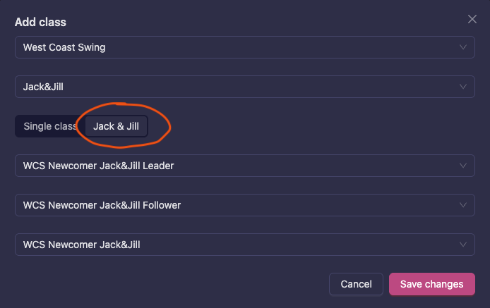
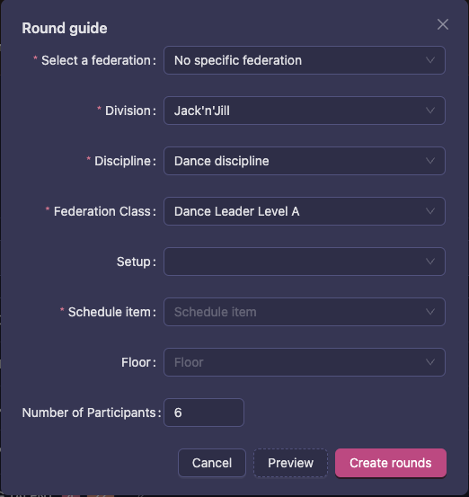
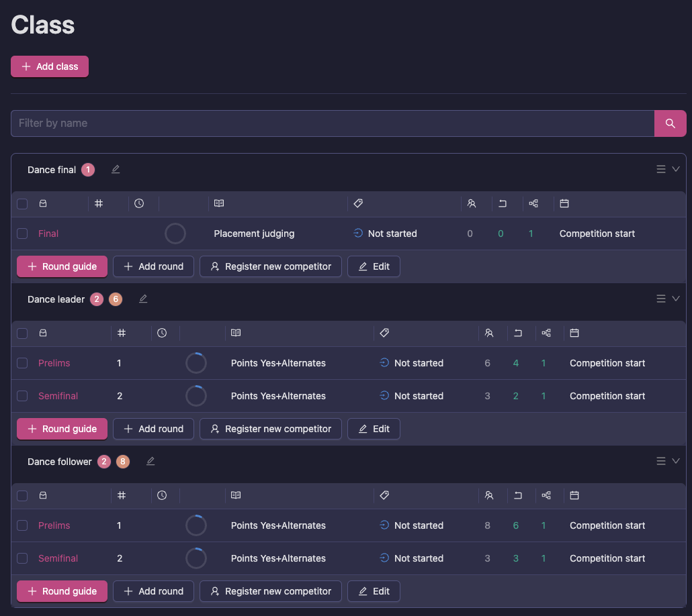
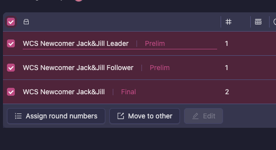
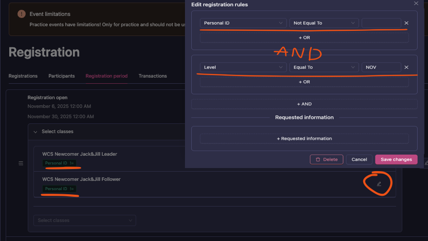
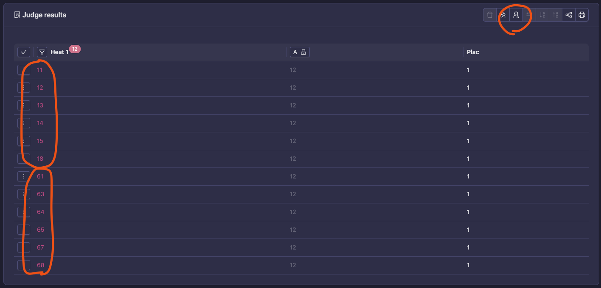

# Jack'n'Jill

In a Jack'n'Jill competition the dancers enter alone, as a leader or as a follower. The prelims
judge the leaders and the followers separately. For the final, leaders and followers are drawn
into couples, and the couples are judged.

In Vote4Dance one Jack'n'Jill is three classes: a leader class, a follower class and a final
class. The steps below set them up and run them, in the order you do it. Manager labels the
choice **Jack & Jill**.

## Prerequisites

- The event and the competition are created. See [Competition setup](/manager-guide/competition-setup/).
- You have Manager access to the event. See [Users, apps and stations](/manager-guide/users-and-stations/).
- You know how a round is run: started, closed, confirmed and published. See [Run a round](/manager-guide/live-operations/#run-a-round).

## 1. Create class triplet per category

For each category, for example Newcomer, you make three classes in one go:

1. In Manager, open **Classes** and click **Add class**.
2. Choose the **Division** and the **Discipline**.
3. Switch from **Single class** to **Jack & Jill**.
4. Three lists appear. Choose the federation's class for the **Leader**, the **Follower** and the **Final**.
5. Click **Save changes**.

You now have three classes:

1. The leader class, with **Class role** set to **Leader**.
2. The follower class, with **Class role** set to **Follower**.
3. The final class, which the two others are grouped under.

Keep all three, also when the competition only has a final.

If the classes already exist, open each leader and follower class with **Edit**, click **Group**,
choose the final class under **Group under** and set its **Class role**. See
[Step 1: Create classes](/manager-guide/competition-setup/#step-1-create-classes).

In Scrutineer (Beta), the new version of the Manager app, the three classes are made with
**Add a Jack & Jill**.

## 2. Run Round guide

Create the rounds of each of the three classes with the Round guide:

1. On **Classes**, click **Round guide** under the class.
2. Fill in **Select a federation**, **Division**, **Discipline** and **Federation Class**, the
   **Schedule item** the rounds belong to, and the **Number of Participants** you expect. A
   **Setup** and a **Floor** are optional.
3. Click **Preview** to see the rounds, then **Create rounds**.

The Round guide refuses a class that already has participants in its rounds: "Cannot create
rounds from guide if participants are already present".

When all three classes are done, the leader class and the follower class have the prelims, with
the same round names in both, and the final class has the final. Check that the leader and
follower classes have no final of their own.

Then check the last round of the leader class and of the follower class. This is the round the
finalists are drawn from:

- On the round's **Priority** tab, **Round priority setting** is **Alternates**. The round then
  marks each dancer as through or as an alternate. Without it nobody can be drawn into the final.
- Its **Judging type** is one that gives yes marks and alternates. In the picture it is "Points
  Yes+Alternates". The judging types come from your federation, so yours can have another name.

**Problems** checks this for you: that each leader and follower class has exactly one partner
class, that their rounds match, and that the last round uses **Alternates**. See
[Problems (setup checks)](/manager-guide/validator/#checks).

## 3. Build schedule and assign round numbers

1. Place the rounds on the schedule. See [Placing a round](/manager-guide/schedule/#placing-a-round).
2. On the **Schedule** page, tick the rounds.
3. Click **Assign round numbers**, enter a **Starting round number** and confirm.

The rounds are numbered in schedule order. A leader round and the follower round of the same
name that follow each other get the same number, so they are announced and danced as one. The
final gets the next number.

See [Round numbers](/manager-guide/schedule/#round-numbers).

## 4. Configure registration

Dancers enter the leader class or the follower class. Nobody enters the final class: its couples
are drawn on the day.

1. In Manager, open **Registration** and the **Registration period** tab.
2. Open the period and click **Select classes**.
3. Tick the leader class and the follower class, and add them.

For an event where a dancer's level decides which class they may enter, as in WSDC events, add a
rule to each class:

1. Click the pen on the class under **Select classes**.
2. Add a rule with the condition **Level**, for example **Level** **Equal To** `NOV`.
3. Click **Save changes**.

Vote4Dance reads the dancer's level from the federation's own register, such as the WSDC
registry, with the federation ID on the dancer's account. A dancer the rule keeps out is told
"Denied, your *role* level is *level*", with their own role and level filled in.

*The picture is from an earlier version of Manager. Its first rule, **Personal ID**, is no longer
in the list of conditions. The **Level** rule is set the same way today.*

See [Registration rules and requested information](/manager-guide/registration-periods/#registration-rules-and-requested-information).
For a WSDC competition, **Verify** on the participants compares each leader's and follower's
level with the class they entered: see [Verify entries](/manager-guide/competition-setup/#verify-entries).

## 5. Judges and run-time execution

### The panel

Use one panel for the leader class, the follower class and the final class. On the **Judges**
page, open the **Classes** tab, tick the three classes and choose the panel on one of them. See
[Classes](/manager-guide/judge-panels/#classes).

If the chief judge does not rank the dancers in the prelims, seat them as **Chief judge (out)**:
their marks do not count in the result and only break ties. See
[Chief judge](/manager-guide/judges-on-the-day/#chief-judge).

### The prelims

Run each leader and follower round as usual: **Start judging**, then **Close round** when the
judges are done. Before you confirm the last round of each class, set how many go through and how
many are alternates, and click **Update priority**: see
[Rounds that use priority](/manager-guide/live-operations/#rounds-that-use-priority). Then press
**Confirm round**.

### Draw the couples

The couples of the final are made in the Speaker app. The round page in Manager reminds you with
**Merge competitors**, "Add and merge competitors in the Speaker app", and the button **Open
Speaker app**.

1. In the Speaker app, open **Lineup** and the final.
2. The **Merge competitors** card lists the dancers who went through, under **Leader** and
   **Follower**. The alternates are under **Removed**, marked **Alt 1**, **Alt 2** and so on. To
   bring one in, for example when a finalist withdraws, add them with the plus on their row. To
   take a dancer out, use the button at the end of their row.
3. Choose how to pair, at the top right of the card:
   - **Shuffle**: the dancers are paired row by row, the first leader with the first follower.
     Click **Rotate** above a column to move that column on, as a **Circle** or as a **Line**, until
     the order is the one you want. Then click **Ok** to make the couples.
   - **Draw for Dance**: "Select a dancer and then click on partner to pair them up". Each couple
     is saved as you make it. Select the two again to undo one couple.
4. You see "Competitors merged". Each pair is now a couple in the final class.

The reset button next to **Ok** starts over. It also deletes the heats of the final, so use it
before the final is on the floor, not during it.

## 6. Judge the final and publish

1. Run the final like any other round: **Start judging**, **Close round**, **Confirm round**. The
   judges now mark the couples.
2. Press **Publish results online** on the final, and on the leader and follower rounds you want
   the public to see. See [Run a round](/manager-guide/live-operations/#run-a-round).
3. The round page of a class in a group can show a warning about the order to confirm in. Follow
   it: see [Classes in a group](/manager-guide/live-operations/#classes-in-a-group).
4. When every class of the competition is done, press **End competition** on the event overview.
   See [Close the competition](/manager-guide/post-event/#close-the-competition).
