# Point summary

Use a point summary when a class starts with a qualification round that splits the couples into
levels, and the final ranking adds up points for the level and for how far each couple got.

## 1. Run qualification round

Create the qualification round as an ordinary round. Open it, go to **Priority**, set
**Round priority setting** to **Groups** and click **Edit**.

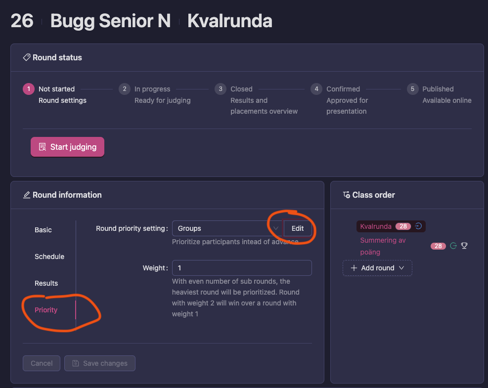

In the **Round priority setting** dialog, click **Add** for each level and fill in its
**Class name**, its **Name**, and a **Percentage** or a **Max**. Click **Ok**, then
**Save changes** on the round.

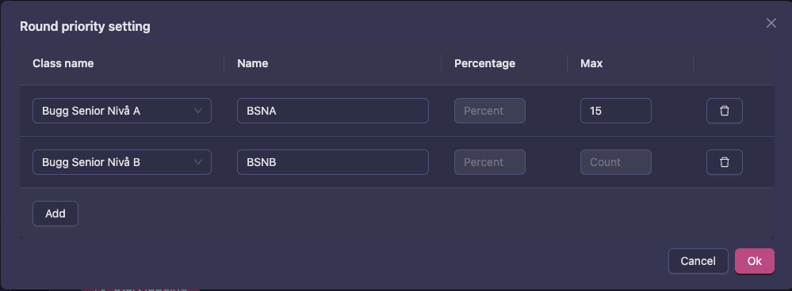

When the qualification round is **Closed**, its page shows **Update priority**, with the
placements that go to each level, for example "BSNA: Placement 1 - 12". Move the slider to change
where one level ends and the next begins, then click **Update priority**. You see "Priorities
updated, please confirm!". **Reset priority** takes the levels off the couples again.

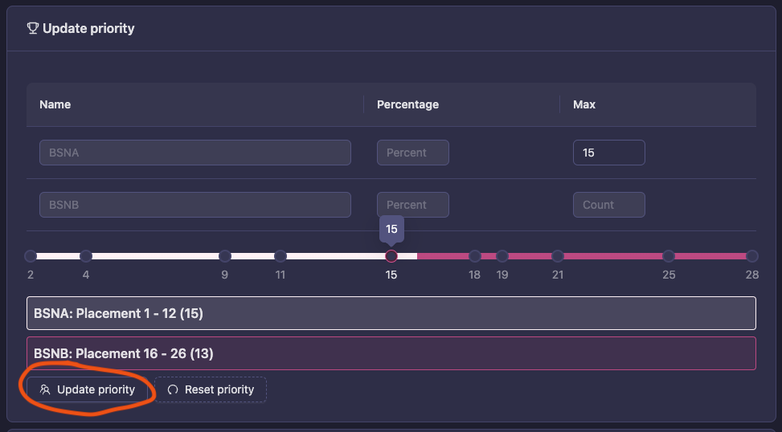

## 2. Create summarize points round

The point summary is a round of its own. On a round's page, under **Class order**, click
**Add round** and choose **Point summary**.

If your federation's [round template](/federation-rules/round-setups/#point-summary) or round setup
add a point summary, the **Round guide** creates it for you: last in the class, in the unscheduled
block, totalling the class with each round's stage read from its name. Check its group points in
step 3 as usual.

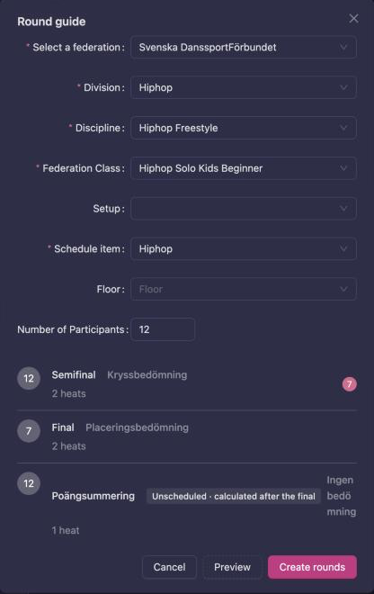

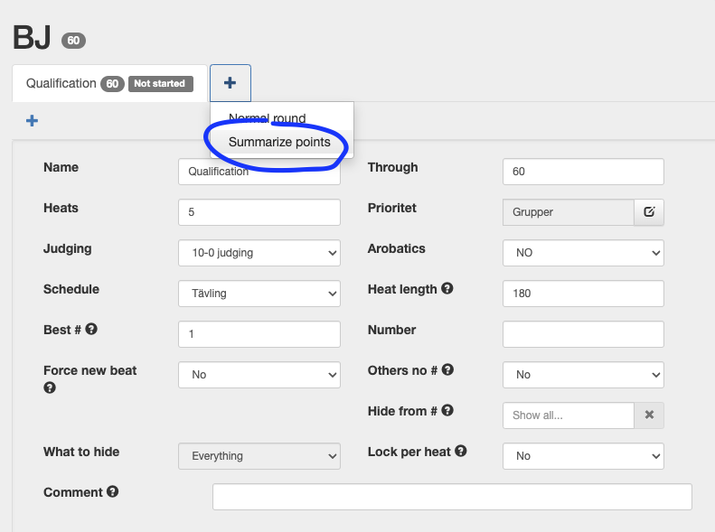

## 3. Configure group points

Open the summary round, go to **Priority**, keep **Round priority setting** on **Groups** and
click **Edit**. Give each level its **Points** and its **Multiplier**.

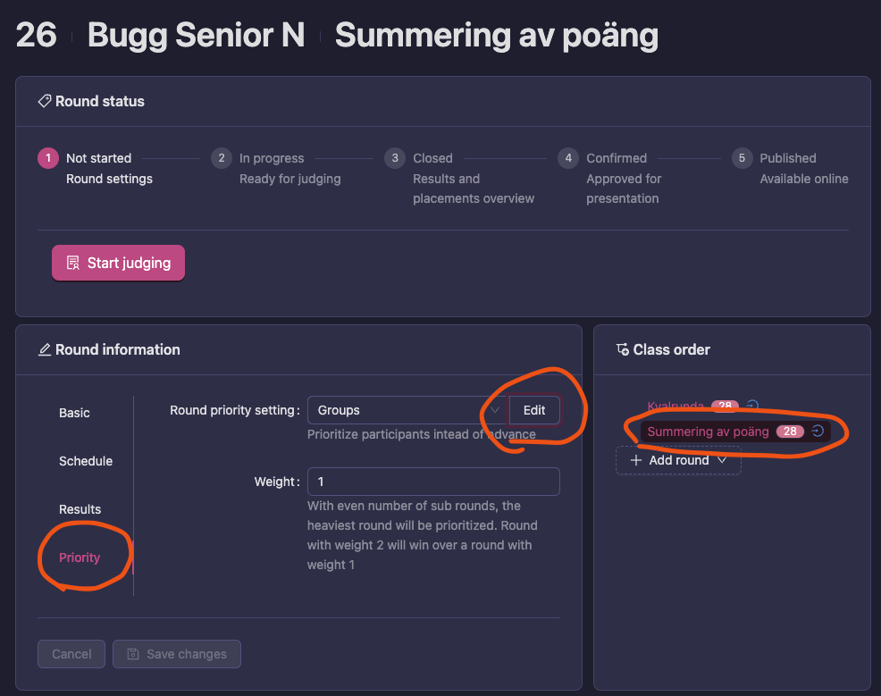

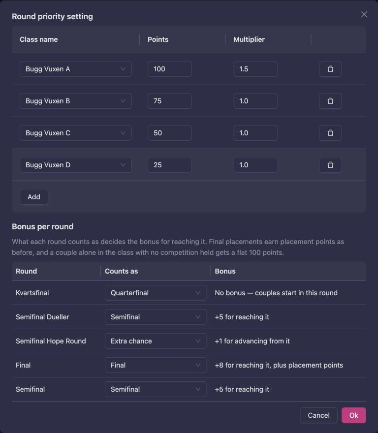

### How points are counted

Each couple gets the **Points** of its group, plus bonuses for how far it got, and the total is
multiplied by the group's **Multiplier**. The bonuses follow the DSF BRR rules:

| Result                                     | Bonus                        |
| ------------------------------------------ | ---------------------------- |
| Reaching a quarterfinal                    | +2                           |
| Reaching a semifinal                       | +5                           |
| Reaching the final                         | +8                           |
| Advancing from an extra chance round       | +1                           |
| Final placement 1 / 2 / 3 / 4 / 5 / 6 / 7+ | 10 / 8 / 6 / 4 / 3 / 2 / 1   |

- Each stage pays once, the first time a couple reaches it, and the round a couple starts in pays
  nothing.
- A round that sends every couple on selects nobody, so reaching the next round pays no bonus. A
  final after such a round, like a seeding round before a duel ladder, counts as a direct final:
  points and final placement only.
- Classes in the same summary may name their rounds differently, for example Semifinal Dueller
  in one class and Semifinal in another. Each couple gets the bonus of the stage its own round
  counts as.
- A couple that danced in more than one level of the summary is scored in the level whose rounds
  it danced first in the schedule.
- Every finalist gets its final placement, also in a final danced as duels, where a couple's place
  is the one it ended on. That includes a couple knocked out in a lucky loser round after the
  final duels, when those duels count as the final.
- A couple alone in the summary that never danced against another couple gets a flat 100 points —
  no bonus and no multiplier — as the rules give when no competition is held. A lone couple that
  did dance against someone, for example after the other couple withdrew, is scored on its result.

The summary's results show one column per bonus in the table: **Base**, **Quarterfinal**,
**Semifinal**, **Final**, **Extra chance**, **Placement** and **Multiplier**. A column no couple
earned is left out, so when every couple starts in the quarterfinal there is no Quarterfinal
column.

#### Bonus per round

Open the summary round, go to **Priority** and click **Edit** next to **Round priority setting**.
Below the groups, the **Bonus per round** table lists every round in the summary's classes.
**Counts as** decides the bonus for reaching that round, and **Bonus** shows what reaching it pays:
**No bonus** for the round couples start in, a round whose stage an earlier round already reaches,
and a round every couple reaches from the round before. A final row still pays placement points to
the couples who end in it. Each class is read on its own format, so when classes use the same round
name for different parts of their format, the name gets a row per class, with the class names below
it. Those rows share one setting: changing one changes that round name in every class.

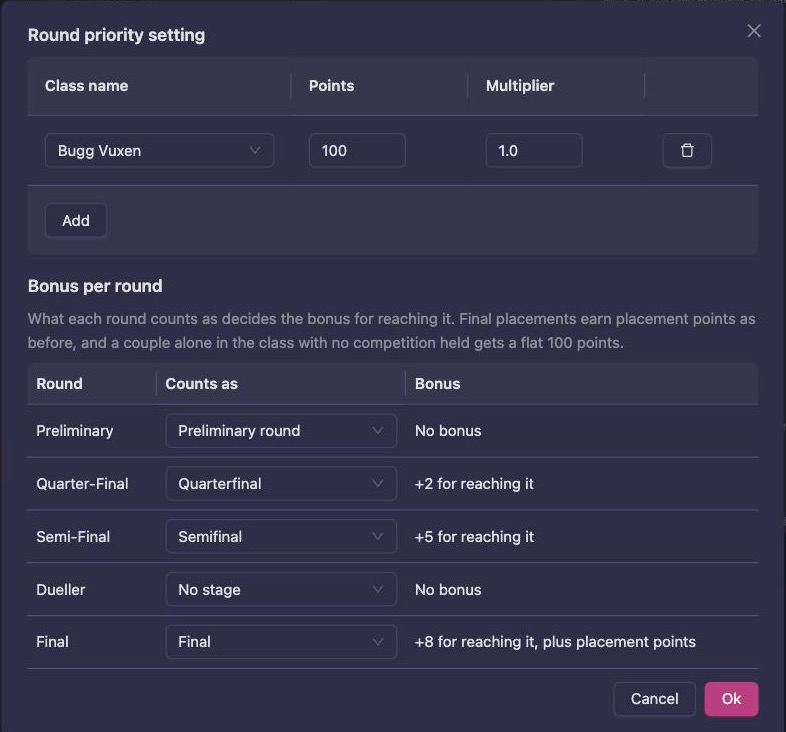

Each round starts from its name:

- Kvartsfinal or Quarter-final → **Quarterfinal**; Semifinal → **Semifinal**; Final → **Final**
- Lucky loser, Hope round, Extrachans and Extra chance → **Extra chance**; an extra chance round
  itself always counts as **Extra chance**
- A B-final that sends its winners on to the final → **Extra chance**; one that sends nobody on →
  **No stage**
- A duel round counts as the stage its name gives: Semifinal Dueller → **Semifinal**. Duels that
  name the final or no stage are the final itself when no Final round follows them (a final danced
  as a duel ladder), and **No stage** when one does (Finaldueller before Final)
- Åttondelsfinal, Uttagning, Kval and Ranking rounds → **Preliminary round**; a Ranking or Kval
  round after a quarterfinal is the next stage, so at SM the Rankingrunda after the Kvartsfinal is
  the **Semifinal**
- Any other name is placed by its order: the last round is the final, then the semifinal, the
  quarterfinal and the preliminary rounds

Change a row when your format pays differently. For example, a couple that wins the lucky loser or
hope round gets +1 for advancing from an extra chance; set that round to **No stage** and it gets
+8 for reaching the final instead.

Only the rows you change are saved. Every other row keeps following its round's name, so a round
you add or rename later is read again, and choosing a row's starting value again makes it follow
the name once more. Renaming a round keeps what you set for it. Click **Ok** in the dialog, then
**Save changes** on the round.

**Summaries made before the Bonus per round table** keep counting bonuses by round order, the way
they always have, with one result column per round. The dialog says so, and saving the settings
switches the summary to the table. Recalculating an older summary never changes its bonuses; only
a lone couple's total follows the rule above.

## 4. Validate and publish

Open the summary round and check each couple's row under **Judge results**: the points of its
level, the bonuses, the multiplier and the **Sum**. Then take the round through its steps like any
other round, ending with **Publish results online**. See
[Run a round](/manager-guide/live-operations/#run-a-round).

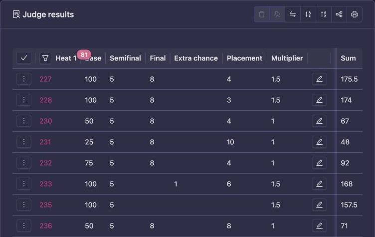

### Running it in Scrutineer (Beta)

In **Live**, Scrutineer (Beta) helps you find the point summary on the day and tells you when it
can be calculated. The summary counts a round's points once that round's judging is closed, so run
it after every round it adds up.

1. Open **Classes**. The summary always has its own link under the class's **Rounds**, after the
   other rounds. When a class has more rounds than fit on its row, click the **+** number to open
   the rounds that don't fit, and pick one.

   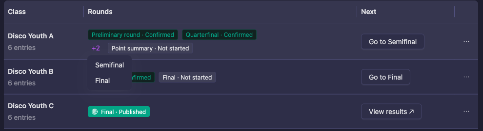

2. Wait for the rounds the summary adds up, in every class it covers. Until their judging is
   closed, the class's **Next** says how many rounds the summary waits for, for example "Point
   summary waits for 3 rounds". Point at it to see which. Once they are closed or confirmed,
   **Next** shows **Go to Point summary**.

   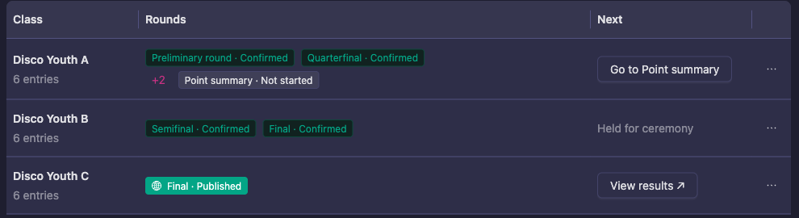

3. Open the summary. If you open it too early, its card names the rounds it doesn't count yet,
   for example "Doesn't count Disco Youth A · Semifinal yet: its points come in once it is
   closed." A point summary has no judges, so it never asks for a judging panel.

   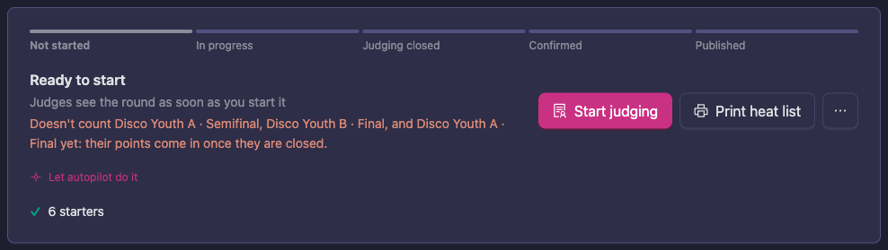

4. Click **Add participants** if the summary has none yet, then **Start judging** and
   **Close & confirm**. Check each couple's points under **Marks**, then click
   **Publish results…**.

5. At the end of the day, the competition can only be closed once every result is published. If
   the point summary isn't, the last card on the run sheet says so, for example "Left before the
   competition can close: Disco Youth A · Point summary.", with a button that takes you there.

   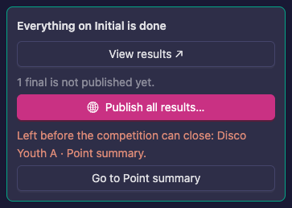
