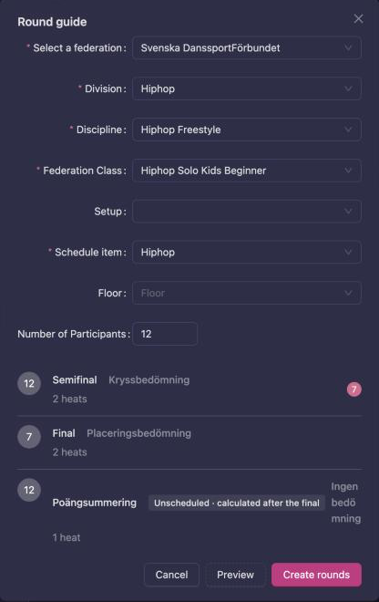
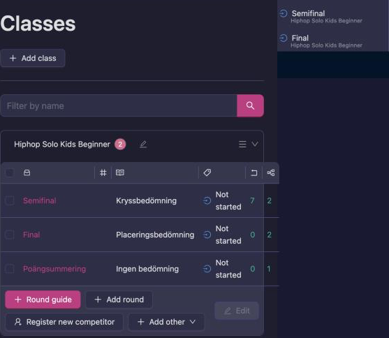
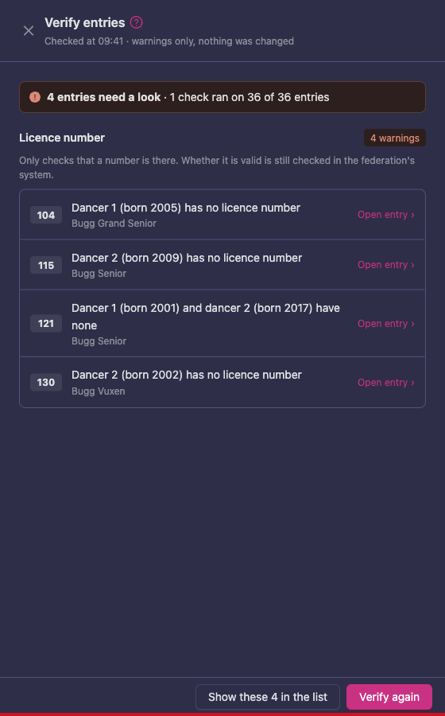
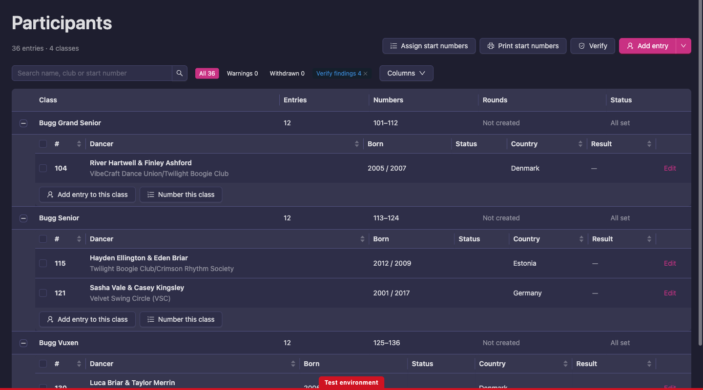

# Competition setup

This page is for the organizer who sets up a competition in Manager. When you have done the four steps, every class has its rounds, the participants are in their classes with start numbers, and the setup is checked.

Do the steps in order: classes, then rounds, then participants, then the check. Judges and panels have their own page, [Judges](/manager-guide/judges/).

## Before you start

- You can sign in, open **Manager** and select your event.
- The event's basics are done: name, date, venue and visibility. If not, do [Event setup](/manager-guide/event-setup/) first.
- You know your federation's rules for the competition: which classes it has and who needs a license.
- At least one more person can manage the event, as a backup.

## Where the work is done

Manager's sidebar is grouped the way the work is:

| Group | Contains |
|---|---|
| **Event overview** | The event's start page, and **Problems** (the automatic checks of your setup) while any check fails. See [Problems](/manager-guide/validator/). |
| **Event** | Competitions, Floor, Users, Stations, Café, Schedule |
| **Competition** | Registration, Classes, Participants, Judges, Check-in, Statistics |
| **Audience** | Notifications, Screens, Sponsors, Live results, Shop |

All four steps are done in the **Competition** group. Rounds have no sidebar item of their own: you find them inside their class, on `Competition → Classes`.

An event can hold several competitions. They are listed on `Event → Competitions`, and each one has its own classes, rounds and participants. When the event has several, choose the competition in the tabs at the top of the page before you start.

## Step 1: Create classes

A class is what participants enter. Create every class of the competition before you build rounds.

1. Go to `Competition → Classes`.
2. While the competition has no classes, the page offers two ways to start:
   - **Create classes** opens **Create classes from federation**, which lists your federation's classes by division and discipline. Tick the classes you want. Ticking a division or a discipline ticks every class in it. Then click **Create selected classes**. Each class gets the federation's name and code, and is linked to that Federation Class.
   - **Go to import**, under **Import from file**, opens [Data transfer](#data-transfer). A file of participants creates their classes too.
3. To add one more class later, click **Add class**, fill in the fields below and click **Save changes**.

To change a class, click the pencil next to its name.

A class has these fields:

| Field | What it means |
|---|---|
| **Division** | The federation's division the class belongs to. |
| **Discipline** | The dance discipline within that division. |
| **Single class** or **Jack & Jill** | Shown only when you add a class. **Jack & Jill** creates three classes in one go: one for leaders, one for followers and one for the final. See [Jack'n'Jill](/jack-n-jill/). |
| **Federation Class** | The federation's class this maps to. It carries the age and level rules, so you do not enter ages on the class yourself. |
| **Class title** | The name people read: on the public page, in registration and on printouts. |
| **Class short letter** | The short form used where space is tight, such as on screens and lists. |
| **Class role** | Only for leader/follower classes: `Leader` or `Follower`. Each such class needs exactly one partner class, and **Problems** checks that. |

Buttons at the bottom of the dialog change how classes belong together:

- **Group** shows **Group under**, where you pick the class this one belongs under, and **Class role**.
- **Merge class** shows **Merge with**, where you pick the class to merge this one with. It is refused while the other class has rounds.
- **Separate classes** splits a merged class again. It shows on a class whose short letter contains `/`, such as `BJITT/BVITT`.
- **Delete** removes the class. It is refused while the class has participants or rounds, or is part of a registration period.

If the class's short letter is one of the federation's class codes, such as `BJITT`, the class is linked to that **Federation Class** by itself when you save it, and its division, discipline and category are filled in from the federation. This also works for older codes the federation still lists, and for each class when you split a merged class such as `BJITT/BVITT`. If two of the federation's classes share the code, set the **Discipline** first so the right one is picked. A Federation Class you chose yourself is never changed.

Good to know:

- Keep the class title easy to read. It is what dancers see when they register, and it is on the printouts.
- In a competition that follows a federation's rules, use the federation's names.
- Pick the Federation Class with care. The rules follow from it.

## Step 2: Build rounds from classes

Every class needs its rounds, for example a semifinal and a final. The **Round guide** creates all rounds of a class in one go, from your federation's rules for the Federation Class and the number of participants. Use it for every class.

1. Go to `Competition → Classes` and click the class. Its rounds open under it.
2. Click **Round guide**.
3. Check **Division**, **Discipline** and **Federation Class**. They are filled in from the class.
4. Pick the **Schedule item** the rounds go on, and the **Floor**. See [Schedule and conflicts](/manager-guide/schedule/) for schedule items.
5. Enter the **Number of Participants**. If the class already has participants, their number is filled in. If not, enter the number you expect.
6. Click **Preview** to see the rounds you will get: for each round its name, how many participants dance in it, its judging type, its heats and how many go on. A point summary from the federation's rules is marked **Unscheduled · calculated after the final**.

   

7. Click **Create rounds**. The rounds are placed on the schedule item you picked. The point summary is placed last in the class, in the unscheduled block, so it takes no floor time.

   

**Setup** is only for a federation that has more than one round setup for the class. Otherwise leave it empty.

A class with three rounds can look like this:

```
Class: Junior Solo - Contemporary
	Quarterfinal: 24 go on
	Semifinal: 12 go on
	Final: nobody goes on
```

The Round guide also fills in each round's **Round for those that qualify** and **Round for non-qualified participants** (the next round, a B-final or a second chance), so the class is ready to advance as soon as results are in. If the rounds are created but some of these links could not be set, the Round guide says so, and you set those under **Qualified participants** when the round is closed. See [Check where the round sends its participants](/manager-guide/live-operations/#check-where-the-round-sends-its-participants).

For battle disciplines, the Round guide creates the whole structure: the placing round, the bracket layers and the B-final. See [Battle bracket](/battle-bracket/) for the seeding steps that follow.

In Scrutineer (Beta), the new version of the Manager app, the button is **Create rounds**, or **Create rounds again…** when the class already has rounds.

### Run the Round guide again

The Round guide replaces the rounds the class already has. So you can run it again when the number of participants has changed, for example after registration closes.

It works until participants have been put in one of the class's rounds. After that it answers "Cannot create rounds from guide if participants are already present". Then change the rounds one at a time: see [Adding rounds by hand](/manager-guide/rounds-by-hand/).

### Round settings

Click a round's name to open it. Its settings are in **Round information**, in four tabs:

| Tab | Settings |
|---|---|
| **Basic** | **Round name**, **Judging type**, **Number to advance**, **Number of heats**, **Schedule item**, **Round number** |
| **Schedule** | **Heat length**, **Lock per heat**, **Floor**, **Round comment** |
| **Results** | **Best placement**, **Hide results from position**, **What to hide**, **No placement for non-qualified**, **Judging panel** |
| **Priority** | **Round priority setting**, **Submit rules**, **Weight**, **Tolerance** |

**Number to advance** is how many participants go on to the next round. On a final it is disabled. In Scrutineer (Beta) the same field is called **How many go through**.

Change what you need and click **Save changes**. You can change a round while it is **Not started** or **In progress**. After that the form says "Round can not be edited when closed".

When a class needs a round the Round guide did not create, such as an extra round before the first round, a second chance or a B-final, see [Adding rounds by hand](/manager-guide/rounds-by-hand/).

## Step 3: Add participants

Participants are on `Competition → Participants`, listed class by class. Click a class to open its list.

One participant row can be a single dancer, a couple or a group. Some buttons still say "competitor", and Scrutineer (Beta) says "entry". They all mean a participant.

Participants get there in one of these ways:

- **From approved registrations.** This is the normal way. On `Competition → Registration`, click **Update/import participants**. See [Update/import participants](/manager-guide/registration-checkin/#updateimport-participants).
- **From a file**, for a competition without online registration. See [Data transfer](#data-transfer).
- **By hand**, for a participant who did not register. Click **Add participants**. In **Competitor information**, pick the class in **Starting in**, type the names and click **Save changes**. **Register new competitor**, under a class's list, opens the same dialog.
- **Test participants**, in a practice event only. Under a class's list, the arrow next to **Register new competitor** has **Generate random competitors**. See [Test run and venue rehearsal](/manager-guide/test-run/).

Each participant's club shows by its full name, with its short code in brackets when the name doesn't already contain it, for example Dansstudio Shake Vzw (SHAKE). A participant with no full club name on file shows the short code instead.

Do not delete participants in bulk once judging has started.

### Assign start numbers

1. On `Competition → Participants`, click **Assign start numbers** to number the whole competition. The same button under a class's list numbers only that class. The choices in the dialog are explained in [After the import](/manager-guide/registration-checkin/#after-the-import).
2. To set one number by hand, click the participant's name and change **Start number**.
3. Click **Print start number** to print the numbers.

Assign the numbers before you put participants in rounds. Once a participant is in a round, **Assign start numbers** refuses.

### Put the participants in their first round

1. Go to `Competition → Classes` and click the class.
2. Click **Add participants** on the class's first round.

The button shows only when the class has participants who are not in the round yet. A participant starts in the class's first round, unless **First round** in their details names a later round.

### Verify entries

**Verify** is in Scrutineer (Beta), the new version of the Manager app. The classic Manager does not have it. To get there from the classic Manager, press **Try new version** at the top.

After you have imported participants, **Verify** checks all of them and warns you about what looks wrong, so you can fix it before the event. It only warns: nothing is changed.

It has these checks:

- **Licence number**: when the participants have license numbers (for example after an import from the federation's system), it lists every participant where a dancer has no license number. It tells you which dancer (dancer 1, 2 or 3) and their birth year. It only checks that a number is there. Whether a license is valid is still checked in the federation's own system.
- **WSDC level** (WSDC competitions only): looks up each Jack & Jill leader and follower in the WSDC registry and compares their level with the class they entered. A dancer's points decide the lowest level they must dance, and the registry also says how far up they may go. Verify lists every dancer who is below their level ("Leader must dance Intermediate or higher · 22 points in Novice") or above it ("Follower may dance up to Novice"). A dancer the registry doesn't know may dance Newcomer and Novice. Participants without a WSDC id, and dancers the registry didn't answer for, are listed under **Not checked**. The registry shows today's points, so run it before the event.

To run it:

1. Go to `Competition → Participants`.
2. Click **Verify**, next to **Print start numbers**. The **Verify entries** panel opens. Each row shows the start number, what is missing and the participant's classes.

   

3. Click **Open entry** on a row to open that participant and fix it, for example by adding the license number.
4. To work through all findings in one go, click **Show these N in the list**. The participants list then shows only those participants, and a **Verify findings** tag appears next to the filter buttons. Click **×** on the tag to show all participants again.

   

5. When you have fixed them, click **Verify again** to run the checks again. When nothing is found, the panel says "No problems in the N entries that could be checked".

## Step 4: Check the setup

1. On `Competition → Participants`, open each class and check that the right participants are in it, and that nobody is missing a class or a start number.
2. Add the judges and give every class a panel. See [Judges](/manager-guide/judges/).
3. Open [**Problems**](/manager-guide/validator/). It checks the setup for you: start-number conflicts, invalid start numbers, the same person ID used with two different names, and participants without a placement who have no class to start in. For DSF competitions it also checks conflicting license numbers. **Problems** is in the sidebar only while a check fails.
4. [Run one rehearsal round](#run-one-rehearsal-round) from start to finish.

The setup is done when:

- All classes exist, with a title, a short letter and the right Federation Class.
- All rounds exist, with a schedule item, a floor and the right number to advance.
- Participants are imported, numbered and in their classes.
- Judges are `Active`, and every class has a panel.
- One rehearsal round has been run from start to finish.
- **Problems** shows no failed checks.

### Run one rehearsal round

Run one round at your desk before the event day. For the full rehearsal at the venue, with projector and tablets, see [Test run and venue rehearsal](/manager-guide/test-run/).

1. Pick a test class and open its first round.
2. Click **Start judging**. The round goes to **In progress**.
3. Enter marks as the judges would.
4. Close the round, confirm it and publish the test results.
5. Check the printouts: heat list, judging sheet and results.

If anything fails, fix it before you start the real rounds.

A round goes through these statuses, in this order:

| Status | What it means | Button that takes the round there |
|---|---|---|
| **Not started** | Setup. The round's settings can be changed. | |
| **In progress** | Judges can mark. | **Start judging** |
| **Closed** | Judging has ended. | **Close round** |
| **Confirmed** | Results are checked and approved for presentation. | **Confirm round** |
| **Published** | Results are visible online. | **Publish results online** |

**Previous status** steps a round back. See [Live operations](/manager-guide/live-operations/) for running rounds on the day.

## Data transfer

`Competition → Registration`, tab **Data transfer**. Use it only when you need it. It has four parts:

| Part | What it does |
|---|---|
| **Import registrations** | Imports participants, and their classes, from a CSV file. A preview shows what will be added, changed and removed before anything is saved. You can upload the same file again: participants already there are updated, participants no longer in the file are removed, and new ones are added. |
| **Download results** | **Download .csv file** downloads the results. **Download partial average** downloads the partial averages. |
| **Reset results** | Removes all results and takes the participants out of the rounds. Participants, rounds and judges are kept. |
| **Delete registrations** | Deletes all participants. Rounds and judges are kept. |

**Reset results** and **Delete registrations** cannot be undone. Use them for test data. Both work only while the event is **Hidden**. Do not delete all participants when online check-in has started.

Do not mix participants from a file and participants from registrations in the same competition. See [Update/import participants](/manager-guide/registration-checkin/#updateimport-participants).

## Troubleshooting

| What you see | Why | What to do |
|---|---|---|
| A round has no **Start judging** button. | The round has no participants yet. | Click **Add participants** on the round. See [Put the participants in their first round](#put-the-participants-in-their-first-round). |
| **Start judging** is greyed out, with "Assign a judging panel to this class or round before starting judging." | Neither the class nor the round has a judging panel. | Give the class a panel on the **Classes** tab of `Competition → Judges`. See [Judges](/manager-guide/judge-panels/#classes). |
| A participant is not in the class. | The registration is not **Approved**, or it was approved after the last import. | Approve it and click **Update/import participants** again. For a participant added by hand, check **Starting in**. |
| A participant is in the class but not in the round. | Participants are put in the first round with a button, not by themselves. | Click **Add participants** on the round. |
| The Round guide says "Cannot create rounds from guide if participants are already present". | A round of the class already has participants. | Change the rounds one at a time. See [Adding rounds by hand](/manager-guide/rounds-by-hand/). |
| A panel cannot be changed. | A panel locks once a round that uses it has scores. | See [When assignment locks](/manager-guide/judge-panels/#when-assignment-locks). |
| A file import put participants in the wrong class. | The file names the wrong class for them. | Correct the file and upload it again on **Data transfer**. The preview shows what will change. |

## Related pages

- [Adding rounds by hand](/manager-guide/rounds-by-hand/): single rounds, second chance and B-final
- [Judges](/manager-guide/judges/): judges, panels and which panel judges each class
- [Schedule and conflicts](/manager-guide/schedule/): when each round is danced
- [Registration and check-in](/manager-guide/registration-checkin/): registrations, importing participants and start numbers
- [Problems](/manager-guide/validator/): every setup check and how to fix it
- [Test run and venue rehearsal](/manager-guide/test-run/): proving the setup with real devices
