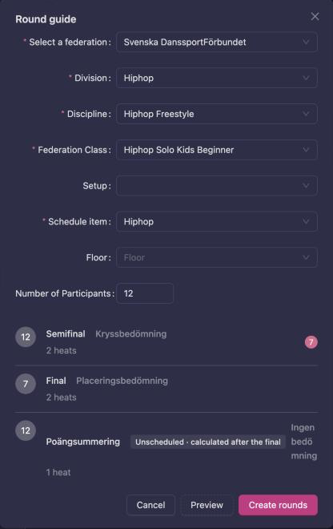
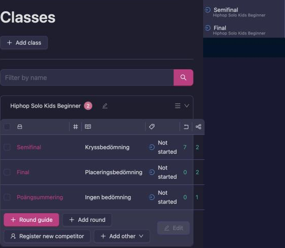
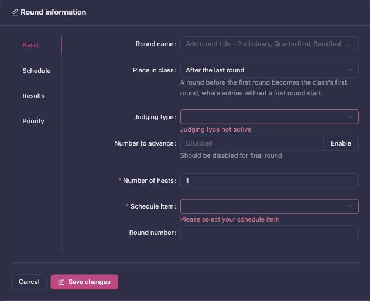
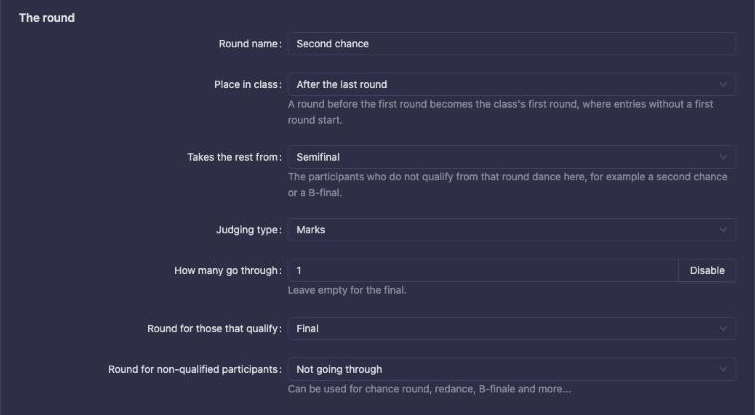
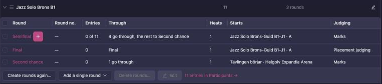
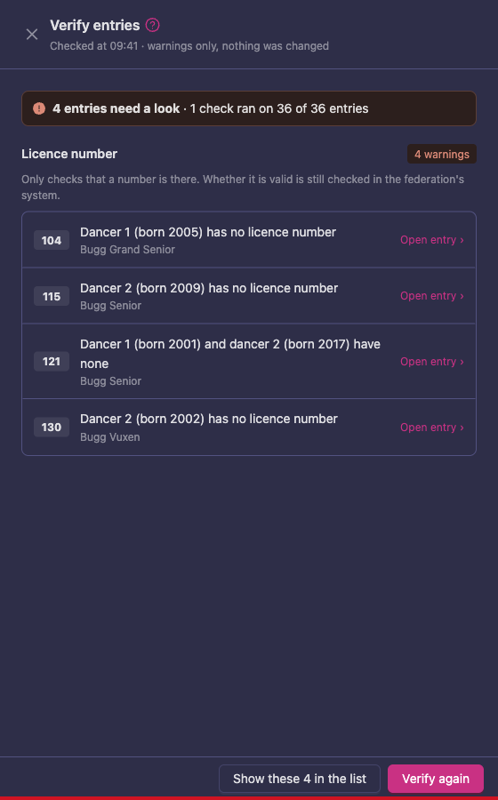
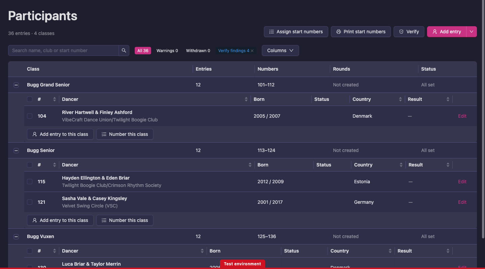

# Competition setup

This page is your execution workflow after Event setup. You will configure classes, rounds, teams, judges, and publishing readiness in the order that prevents rework.

## Before you start

Confirm these prerequisites:

- You can open Manager and access your event
- Event basics are complete (name, date, venue, visibility)
- Federation rules are known (license requirements, class structure)
- You have at least one backup admin in the event

If not, complete [Event setup](/manager-guide/event-setup/) first.

## Where to go

1. Sign in to Vote4Dance
2. Open **Manager**
3. Select your event

Manager's sidebar is grouped the way the work is:

| Group | Contains |
|---|---|
| **Event overview** | The event's start page, and **Problems** (the automatic tests over your setup) while any test fails. See [Problems](/manager-guide/validator/). |
| **Event** | Competitions, Floor, Users, Stations, Café, Schedule |
| **Competition** | Registration, Classes, Participants, Judges, Check-in, Statistics |
| **Audience** | Notifications, Screens, Sponsors, Live results, Shop |

This page works in the **Competition** group. Rounds live inside a class.

## Recommended build order

Use this order to avoid broken links between sections:

1. Create classes
2. Create round trees
3. Add participants
4. Assign start numbers and class entries
5. Add judges and build panels
6. Rehearse one full round
7. Take rounds from Not started to In progress

## Step 1: Create classes

Go to **Competitions -> Classes**.

Create every class participants can enter.

A class has these fields:

| Field | What it means |
|---|---|
| **Division** | The federation's division the class belongs to. |
| **Discipline** | The dance discipline within that division. |
| **Federation Class** | The federation's class this maps to — this is what carries the age and level rules, so you do not enter ages on the class yourself. |
| **Class title** | The name people read: on the public page, in registration and on printouts. |
| **Class short letter** | The short form used where space is tight, such as on screens and lists. |
| **Class role** | Only for leader/follower classes: `Leader` or `Follower`. Each such class needs exactly one partner class, and **Problems** checks that. |

Group classes and merged classes add their own fields (class group, merge target).

If the class's short letter is one of the federation's class codes, such as `BJITT`, the class is linked to that
**Federation Class** by itself when you save it, and its division, discipline and category are filled in from the
federation. This also works for older codes the federation still lists, and for each class when you split a
merged class such as `BJITT/BVITT`. If two of the federation's classes share the code, set the **Discipline**
first so the right one is picked. A Federation Class you chose yourself is never changed.

Tips:

- Keep the class title human-readable for registrations and printouts
- Prefer federation naming if the competition is federation-governed
- Pick the Federation Class carefully; the rules follow from it

If your system has **Round guide**, use it after classes are finalized. For battle disciplines, the Round Guide generates the complete skeleton (placing round, bracket layers, B‑final) automatically — see [Battle bracket setup](/battle-bracket/) for the seeding steps that follow.

To create a class's rounds with the Round guide:

1. Open the class under **Classes** and click **Round guide**.
2. Check the **Federation Class**, pick the **Schedule item**, and enter the **Number of Participants**.
3. Click **Preview** to see the rounds you will get. A point summary from the federation's rules is
   marked **Unscheduled · calculated after the final**.

   

4. Click **Create rounds**. The rounds are placed on the schedule item you picked; the point summary
   is placed last in the class, in the unscheduled block, so it takes no floor time.

   

The Round guide also fills in each round's **Round for those that qualify** and **Round for
non-qualified participants** (the next round, a B-final or a second chance), so the class is ready
to advance as soon as results are in. You can change a link in the round's settings before the round
starts (see [Send the rest to a second chance or a B-final](#send-the-rest-to-a-second-chance-or-a-b-final)),
or under **Qualified participants** when the round is closed. If the rounds are created but some links
could not be set, the Round guide says so and you set those by hand.

## Step 2: Build rounds from classes

Go to **Competitions -> Rounds** or open a class and click **Create Round**.

For each class, define:

| Setting group | Key settings | Example |
|---|---|---|
| Basic | Round label, method, through count | Quarterfinal, 24 through |
| Heat setup | Heat count and timing | 4 heats, 90 seconds each |
| Schedule | Day, floor, time block | Day 1, Floor A, 10:00 |
| Results | Qualifier and placement behavior | Top 12 to semifinal |

A new round goes after the class's last round. To add an extra round in front instead, for example a
preliminary when more entries came in than the first round can take:

1. Open the class and click **Add round**.
2. Under **Place in class**, choose **Before the first round**. The form then takes its values from the first round:
   **Number to advance** is twice what the first round sends on (at least 6), and the round goes in the first round's
   schedule block, just before the first round.
3. Check the values and click **Save changes**.

The new round becomes the class's first round, where entries without a starting round begin. Its **Round for those
that qualify** is the round it was placed in front of.

A round can't be added in front of a first round that has started. If the first round already has participants, set
it back to **Not started** and use **Remove participants** on it first, so nobody ends up in both rounds.



### Send the rest to a second chance or a B-final

When a round sends only some of its participants on, you can decide during setup where the others go: to a second
chance round that leads back into the next round, or to a B-final that gives them their places. The Round guide
sets this up for the rounds it creates. For a round you add yourself, set it when you add the round, in the new
Manager:

1. Open the class and click **Add a single round**.
2. Enter the **Round name**, for example "Second chance".
3. Under **Takes the rest from**, choose the round whose non-qualified participants dance here, for example the
   semifinal. The list holds the class's rounds that send participants on, whose judging is not yet closed and
   that have no round for the rest yet.
4. Set **How many go through** to the number that go on from the new round. Leave it empty for a B-final, which
   sends nobody on.
5. If you set a number, the form fills in the rest from the round you chose. **Round for those that qualify**
   becomes the round the semifinal sends its own qualifiers to, usually the final, so both rounds lead to the same
   next round. **Judging type**, **Schedule item** and **Floor** become the semifinal's, so the second chance is
   judged the same way and dances in the same block. A B-final keeps the values of the class's last round instead.
6. Check the values, change any that do not fit your class, and click **Save changes**.

   

The class's rounds now show the link on the round you chose, for example "4 go through, the rest to Second chance".
That round keeps sending its qualifiers to the same round as before.



To change where a round you already have sends its participants:

1. Open the class and click the round.
2. Under **How many go through**, set **Round for those that qualify** and **Round for non-qualified
   participants**. **Not going through** means the rest get their places from this round and do not dance again.
3. Click **Save changes**.

Good to know:

- The two fields show only while **How many go through** is set, so not on a final.
- When **Round for those that qualify** reads **The next round**, followed by a round's name, the round has no
  link of its own: its qualifiers go to the round after it in the class when it starts. Once you choose a round for
  the non-qualified, saving also fills in the round for those that qualify, so the two groups can never end up in
  the same round by accident.
- You can change both until the round's judging is closed. After that, use **Qualified participants** on the closed
  round.
- When you confirm the round on the day, the rest are sent to the round you chose, and that round's **Best
  placement** is set to the first place after those who went through unless you choose otherwise.

Typical round tree:

```
Class: Junior Solo - Contemporary
	Round 1: Quarterfinal (24 through)
	Round 2: Semifinal (12 through)
	Round 3: Final (0 through)
```

## Step 3: Add participants

Go to **Competition → Participants**. (The page is called Participants in Manager; "teams" is
the older internal word, and one participant row can be a single dancer, a couple or a group.)

Participants get there three ways:

- **Imported from approved registrations** — the normal route. See [Registration and check-in](/manager-guide/registration-checkin/).
- **Added by hand**, for entries that never went through registration.
- **Generate random competitors** — a practice-event-only action that fills a round with test
  entries, for rehearsals. See [Test run and venue rehearsal](/manager-guide/test-run/).

Each participant's club shows by its full name, with its short code in brackets when the name
doesn't already contain it, for example Dansstudio Shake Vzw (SHAKE). A participant with no full
club name on file shows the short code instead.

CSV import lives on `Competition → Registration → Data transfer`, together with the reset and
delete tools.

Do not bulk delete participants once judging is underway.

### Verify entries

After you have imported an entry list, **Verify** checks all entries of the competition and warns you about what looks wrong, so you can fix it before the event. It only warns: nothing is changed.

Today it has one check, **Licence number**. When the entry list has licence numbers (for example a list imported from the federation's system), it lists every entry where a dancer has no licence number. It tells you which dancer (dancer 1, 2 or 3) and their birth year. It only checks that a number is there. Whether a licence is valid is still checked in the federation's own system.

1. Go to **Competition → Participants**.
2. Click **Verify**, next to **Print start numbers**. The **Verify entries** panel opens. Each row shows the start number, what is missing and the classes of the entry.

   

3. Click **Open entry** on a row to open that entry and fix it, for example by adding the licence number.
4. To work through all findings in one go, click **Show these N in the list**. The participants list then shows only those entries, and a **Verify findings** tag appears next to the filter buttons. Click **×** on the tag to show all participants again.

   

5. When you have fixed entries, click **Verify again** to run the checks again. When nothing is found, the panel says "No problems in the N entries that could be checked".

## Step 4: Assign start numbers and class entries

Still in **Participants**:

1. Assign start numbers (manually or automatically)
2. Check every participant is entered in the right class
3. Verify nobody is missing a class assignment

Then open [**Problems**](/manager-guide/validator/), which checks exactly this for you: start-number conflicts, invalid
start numbers, the same person ID used with two different names, and participants without a
placement who have a class set to start in. For DSF competitions it also checks conflicting
license numbers.

## Step 5: Add judges and build panels

Go to **Competition → Judges**. The full reference is [Judges](/manager-guide/judges/).

Process:

1. Invite each judge by email, or link an existing account. **Invite new judge** checks for
   existing accounts first, so you do not create a duplicate person.
2. Assign judge letters (A, B, C…)
3. Enter each judge's needs: times away, limits, and classes or dancers they must not judge
4. On the **Panels** tab, create panels and seat judges, or let **Suggest** seat them for you
5. On the **Classes** tab, assign a panel to each class — a round can have its own panel

Each judge's row shows `Not invited`, `Invited` or `Active`, and lets you resend the invitation
in any of the app's languages, or **Reset PIN** if a judge has forgotten theirs. Judges set
their own PIN on their own device; there is no event-wide code. A judge's PIN is shared by all
competitions in the event, so **Reset PIN** clears it event-wide. **Reset PIN** is disabled
until the judge has set a PIN.

Fix anything listed above the tabs before the event. A panel locks once a round that uses it
has scores, and a panel that a round uses cannot be deleted. A judge who already has marks cannot be removed.

## Step 6: Run one rehearsal round

Before event day, execute one full dry run. This is the desk version; for the full rehearsal
at the venue with projector and tablets, see
[Test run and venue rehearsal](/manager-guide/test-run/).

1. Pick a test class
2. Open the first round
3. Press **Start judging** (the round goes to **In progress**)
4. Simulate judging input
5. Close, confirm, and publish test results
6. Verify printouts (heat list, judging sheet, results)

If anything fails, fix before opening real rounds.

## Round lifecycle you should enforce

Use this exact sequence:

1. **Not started**: setup stage, round settings editable
2. **In progress**: judges can mark (button: **Start judging**)
3. **Closed**: judge input ended (button: **Close round**)
4. **Confirmed**: results reviewed, approved for presentation (button: **Confirm round**)
5. **Published**: results visible externally (button: **Publish results online**)

**Previous status** steps a round back.

Do not skip statuses unless your federation explicitly allows it.

## Data transfer

`Competition → Registration → Data transfer`, only when needed.

Use cases:

- CSV import of participants
- Result downloads
- Reset and delete tools for test data

High risk actions:

- Reset and delete are destructive
- Never reset active competition data without a backup

## Troubleshooting

### "Start judging is refused"

Usually caused by missing judges, a missing schedule item, or unassigned participants. With no
panel, Manager says "Assign a judging panel to this class or round before starting judging."

Fix:

1. Open round validation
2. Resolve all blocking errors
3. Retry status change

### "Participants are not appearing in a class"

1. Confirm the registration is **Approved** and was imported
2. Confirm the class entry was saved
3. Confirm eligibility (the Federation Class's age and level rules, licenses)

### "Judge assignment is locked"

This often happens after results started.

1. Check round status
2. If Closed/Confirmed, use approved correction workflow
3. Log reason for any panel change

### "CSV import created wrong mappings"

1. Stop further imports
2. Export current state for audit
3. Correct mapping template
4. Re-import only corrected rows

## Competition setup done checklist

- All classes exist with a title, short letter and the right Federation Class
- All rounds exist with a schedule item, floor and advancement plan
- Participants are loaded, numbered and entered in classes
- Judges are `Active`, and every active class has a panel
- One full rehearsal round completed successfully
- **Problems** shows no failed tests

## Next step

Continue to [Test run and venue rehearsal](/manager-guide/test-run/) to prove the setup with
real devices, then to [Live operations](/manager-guide/live-operations/) for the event-day
runbook.
