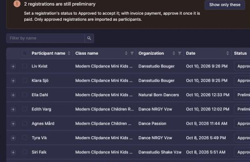
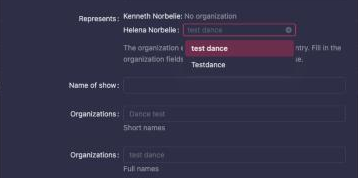
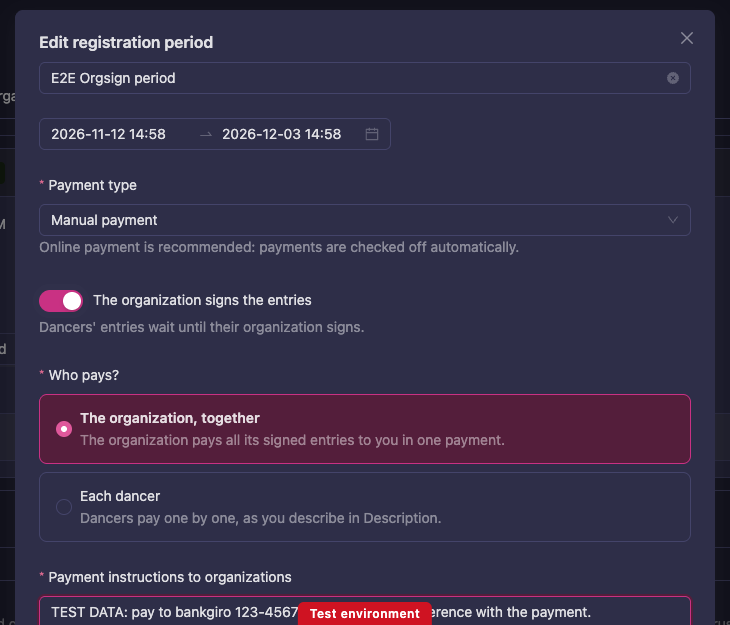
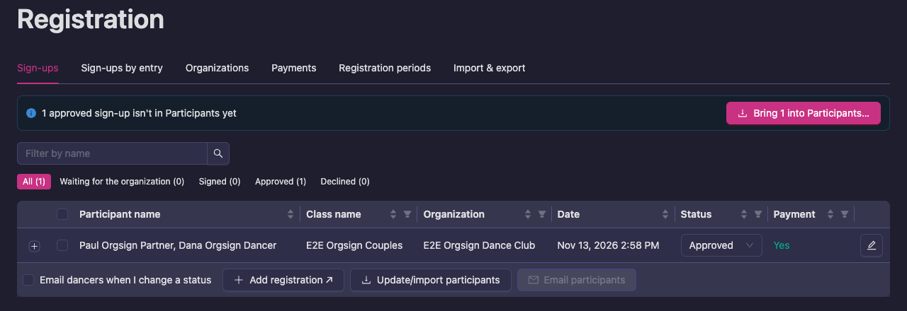
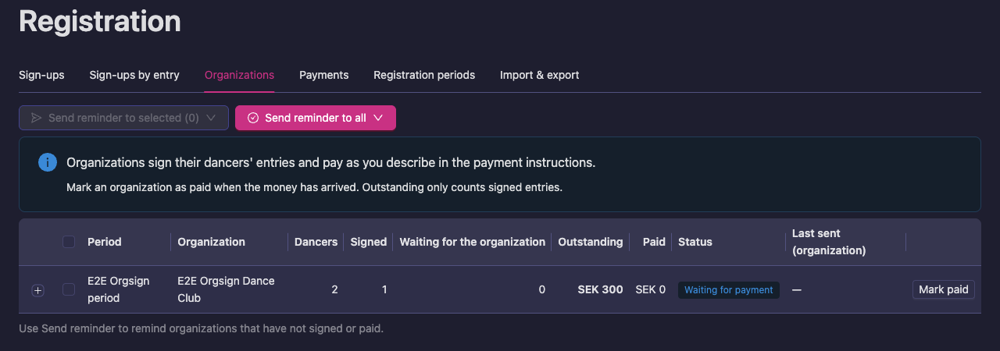
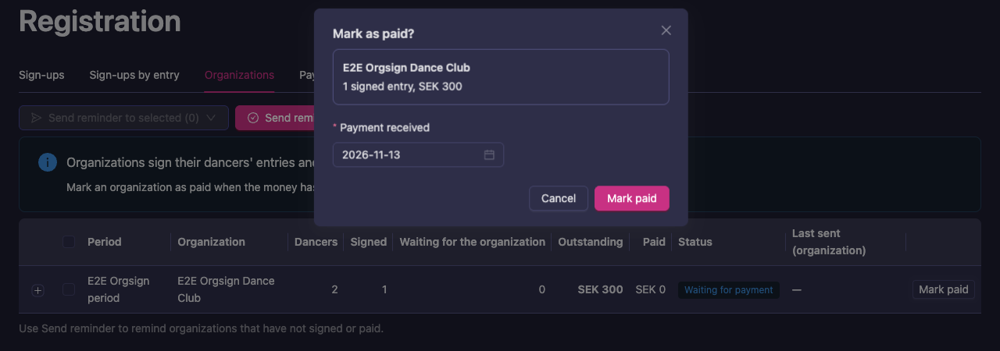

# Entries and participants

For organizers and their helpers who handle what comes in while registration is open. Here you approve, reject and correct entries, follow the organizations that sign and pay for their dancers, and import the approved entries as participants.

You do this on `Manager → Competition → Registration`, mostly on the **Registrations** tab; every tab is described on [Registration and check-in](/manager-guide/registration-checkin/#the-registration-page). Opening registration is on [Registration periods](/manager-guide/registration-periods/).

## Entries coming in

Every entry shows on the **Registrations** tab with a status. Only **Approved** entries become participants.

### Registration statuses

| Status | Meaning | How an entry gets there |
|---|---|---|
| **Preliminary** | Registered, not yet accepted. Not counted as a participant. | Automatic when the dancer or club registers in a period with **Manual** acceptance. |
| **Signed** | Normally an optional step for your own bookkeeping: never set automatically, and no email is sent for it. In a period where the organization signs the entries, **Signed** means the organization has signed the entry and it waits for payment (see [Organizations sign their dancers' entries](#organizations-sign-their-dancers-entries)). | By you, from the status list, or when the organization signs. |
| **Approved** | Accepted. This is the only status the import uses. | Automatic when the online payment is completed, when you mark an organization's signed entries as paid, when the period uses **Direct** acceptance, or when you or the check-in desk enter the entry, paid or not. Otherwise by you. |
| **Rejected** | Declined by the organizer. | By you. |
| **Cancelled** | Withdrawn by the dancer or club, or set by the organizer. The row is kept. | The dancer or club cancels from their account, or by you. |
| **Deleted** | Removed. Unpaid rows disappear; paid rows are kept and marked deleted. | By you. |

Things that regularly cause confusion:

- **The list opens on Preliminary and Approved together.** Change the filter in the **Status** column header to see cancelled, rejected or all entries. The filter is a viewing aid only.
- **Preliminary entries are counted above the list**, for example "2 registrations are still preliminary". Click **Show only these** to list just those.
- **Names in orange** are not an error. The row shows a **team name or custom name** instead of the dancers' names. Hover the name to see the dancers behind it. Every other row shows the dancers' names in the normal colour.
- **Online payments in progress are hidden** until they are paid. An entry whose checkout is abandoned is removed automatically.

### Approve, reject or cancel an entry

1. Open the **Registrations** tab and find the entry. Use **Filter by name**, the filters in the column headers, or **Show only these** in the notice about preliminary entries.
2. Decide whether the dancers get an email about the change: tick or untick **Send email on status change** below the list (see [Emails](/manager-guide/emails/#send-email-on-status-change)).
3. Open the list in the **Status** column of the row and choose the new status, for example **Approved**.

To change several entries at once, tick their rows first and then choose the status on one of them. While rows are ticked, the change applies to the ticked rows only.

**With manual payment,** approve an entry once you have received the money. To record the payment, press the pen on the row, set **Payment** to **Yes** and press **Ok**. Then set the status to **Approved** if the entry is still **Preliminary**.

**To add an entry yourself,** press **Add registration** below the list. It opens the registration form of the Check-in app in a new tab. An entry that you or the check-in desk make is **Approved** straight away, paid or not. See [Adding classes at the door](/manager-guide/the-door/#adding-classes-at-the-door).

**To write to dancers,** tick their rows and press **Email participants** below the list. See [Email participants](/manager-guide/emails/#email-participants).

### Paid twice after cancelling

A dancer who cancels a paid entry and registers for the same class again ends up with one entry, not two: the cancelled one is reused, so the dancer does not appear under **Cancelled**. If the dancer paid again, both payments belong to that entry.

1. Open the **Registrations** tab and click **+** to open the entry.
2. Click **Payment**.
3. The dialog lists every payment for the entry. Earlier ones are marked "Earlier payment (the registration was cancelled and made again)".
4. On the payment to give back, check the amount, add a description if you like and click **Refund**.

Earlier payments made before this was introduced are not listed under the entry. Refund those in Stripe.

### Which club a dancer represents

Each entry knows which club every dancer competes for. A dancer who belongs to more than one club can represent one club in one class and another club in a different class, so check this per entry, not on the dancer's profile.

To check it:

1. On the **Registrations** tab, the **Organization** column shows the club each entry represents. Press the **+** at the start of a row to see the club of every dancer in it.
2. For more detail, press the pen on the row to open **Edit registration**. Under **Represents** you see every dancer with their club and where that club comes from:
   - **Chosen at registration**: the dancer (or their club) picked it when registering, or a manager picked it. The federation asks for this when a dancer belongs to more than one club.
   - **Owning organization**: the team belongs to a club and always competes for it.
   - **Division license organization** or **License organization (no division match)**: the club on the dancer's federation license.
   - **From the dancer's profile**: the club the dancer is a member of, used when none of the above applies. A dancer who belongs to several clubs is shown with their main club.

To have a participant shown with a different club name, for example on the speaker's screen, type it in the two **Organizations** fields below **Represents** (short names and full names). They show the club in grey; leave them empty to keep it.

The club shown here is the one **Update/import participants** gives the participant. If the entry is already imported (the **Imported** check), run **Update/import participants** again after a change, so the participant gets the new club.

#### Change the club a dancer represents

In Scrutineer (Beta), a dancer who belongs to more than one club gets a list under **Represents** instead of a line of text. The classic Manager shows the club as text only. Use the list when a dancer or parent picked the wrong club when registering:

1. In Scrutineer (Beta), open **Edit registration** on the entry.
2. Under **Represents**, open the list next to the dancer and choose the club they compete for in this entry. Only clubs that have approved the dancer as a member are listed.
3. Press **Ok**.

The change applies to this entry only. If the dancer has the same mix-up in other classes, change each of those entries too. To go back to the club Vote4Dance finds on its own (for example the one on the dancer's license), clear the list with the **×** and press **Ok**.

A dancer who belongs to only one club, and every dancer in a team owned by a club, is shown as text.

## Organizations sign their dancers' entries

Some events want the club to vouch for its dancers. When you switch this on for a registration period, an entry that a dancer registers waits until the dancer's organization (club, school or other organization) has signed it. The organization can also pay all its entries together, in one payment, instead of every dancer paying separately.

Dancers who have no organization are not held up: their entries skip signing, and the dancers pay themselves.

You set this up and follow it in **Scrutineer (Beta)**, the new version of the Manager app. The classic Manager has no switch for it and no **Mark paid** button. To open Scrutineer (Beta), tap the **Scrutineer** tile marked **Beta** under **Functions** on your event page, or press **Try new version** at the top of the classic Manager.

### Set it up

1. In Scrutineer (Beta), open the competition's Registration page and the **Registration periods** tab.
2. Open the period with **Edit registration period**.
3. Pick the **Payment type**: **Online payment** (recommended) or **Manual payment**. Online payment is recommended because payments are checked off automatically.
4. Switch on **The organization signs the entries**. The text under it says: "Dancers' entries wait until their organization signs."
5. Under **Who pays?**, choose:
   - **The organization, together**: the organization pays all its signed entries in one payment. With online payment it pays by card when it signs. With manual payment it pays you in one payment.
   - **Each dancer**: dancers pay one by one, by card with online payment, or as you describe in **Description** with manual payment.
6. With **Manual payment** and **The organization, together**, fill in **Payment instructions to organizations**, for example an account number, IBAN or Swish number and what to write as the reference. Organizations see the text when they sign, together with the amount and their reference.
7. Press **Save changes**.

**Who pays?** is not shown for a period that is **Free of charge**.

*The organization signs the entries, and pays them together by manual payment.*

**In the event checklist of Scrutineer (Beta).** The payment step recommends **Take payment online (Stripe)**: payments are checked off automatically, the money goes straight to your account, and organizations get a receipt and an invoice. If you can't take payment online, choose **Take payment manually**. Then you check off each payment yourselves. If you imported your entries and take no sign-ups in Vote4Dance, you don't need a payment setup: the step is then **Optional** and the checklist moves on to the next step.

### What the organization sees

- **Online payment, the organization pays:** it presses **Sign and pay**, pays by card in the next step, and gets a receipt and an invoice made out to the organization.
- **Manual payment, the organization pays:** it signs, then sees the amount to pay, a reference (the organization's short name and the event number) and your payment instructions. It pays you outside Vote4Dance, and you mark it paid.
- **Each dancer pays:** the organization only signs. The dancers pay themselves once the entry is signed.

The guide for the club is [Signing your members' entries](/school-club/registration-for-event/#signing-your-members-entries). The dancers see **Waiting for the organization** on their entry: see [When your organization signs your entry](/dancer/my-registration/#when-your-organization-signs-your-entry).

### Follow the entries

On the **Sign-ups** tab of Scrutineer (Beta), filter by:

| Filter | Shows |
|---|---|
| **Waiting for the organization** | Entries the organization has not signed yet |
| **Signed** | Signed by the organization, not yet paid |
| **Approved** | Accepted. Payment alone approves a signed entry, so it is **Approved** once it is paid |
| **Declined** | Entries the organization declined, shown as **Declined by the organization** |

A notice above the list counts the entries waiting for their organization to sign, and the signed entries waiting for payment.

On the **Organizations** tab, each organization has one row with **Dancers**, **Signed**, **Waiting for the organization**, **Outstanding** (only signed entries count), **Paid** and a **Status** such as **Waiting for payment**.

The classic Manager has no filter for this. On its **Registrations** tab, an entry that waits for its organization is **Preliminary**, a signed one is **Signed** and a declined one is **Cancelled**. Its notice about preliminary registrations counts the waiting entries too: leave them until the organization has signed.

### Mark an organization as paid (manual payment)

With online payment, a card payment marks the entries paid on its own. With manual payment, mark them yourself when the money has arrived:

1. In Scrutineer (Beta), open the **Organizations** tab and press **Mark paid** on the organization's row.
2. In **Mark as paid?**, check the number of signed entries and the amount. Entries still waiting for the organization are not included, and the dialog says how many.
3. Set **Payment received** to the date the money arrived.
4. Press **Mark paid**.

All the organization's signed entries that are not yet paid are marked paid at once, and become **Approved**.

### Send reminders

On the **Organizations** tab of Scrutineer (Beta), press **Send reminder to all**, or tick organizations and press **Send reminder to selected**. Check the count in the confirmation and press the send button (for example **Send 3 reminders**). A reminder goes to:

- organizations that still have entries to sign, and organizations that still have to pay,
- dancers who are still waiting for their organization, who are told there is nothing for them to do.

The **Last sent (organization)** column shows when an organization was last reminded.

### If an organization declines

The entry is withdrawn. The dancers get an email, and **My registration** shows **Declined by the organization** and tells them to contact their organization. A declined entry shows under the **Declined** filter. If it was a mistake, the dancers register again, and the organization signs the new entry.

## From registrations to participants

Entries and participants are two different lists. An entry is what the dancer or club submitted. A participant is a row in the competition's lineup that rounds, start numbers, heats and results are built on. Nothing moves between them until you run the import.

### Update/import participants

The import takes **every Approved entry in the competition**, whatever filter you have set in the table.

1. On the **Registrations** tab, press **Update/import participants** below the list. When approved entries are waiting, the same button is also in a notice above the list, for example "3 approved registrations are not imported yet". The button below the list is greyed out while rows are ticked.
2. The **Import registrations** window opens. A line at the top says how many approved entries matched.
3. Read the groups. Click a group to see what is in it:
   - **Added Participants**: new participants.
   - **Changed Participants**: participants whose entry changed.
   - **Removed Participants**: participants that no longer have an approved entry.
   - **Warning Participants**: participants the import has a remark about.
   - **Added Class**: classes the import would create.
4. Every group is ticked. Untick a group you do not want applied. If you untick **Added Class**, untick **Added Participants** as well. Otherwise nothing is imported, and the message is "Some participants are in a class that isn't in the competition. Tick the new classes in the import, or untick those participants."
5. Press **OK**. "Registrations imported successfully" confirms it. Close the window.

If no entry is approved, nothing opens and the message is "No approved registrations to import yet."

What the import does:

- It creates one participant per approved entry, with the dancers' names, clubs, years of birth, federation ids and class. Start numbers are left at 0.
- It updates participants whose entry changed (a new partner, a new club, a renamed team). Only the fields the entry knows about are touched, so start numbers and check-in state survive a new run.
- Under **Changed Participants** it lists only the participants where something the import saves is different. Running the import again to add new entries leaves everyone already imported untouched, and keeps their order in the class.
- Under **Removed Participants** it lists every participant that no longer has an approved entry. That includes entries that were cancelled or rejected after an earlier import. If you leave the group ticked, those participants are deleted from the lineup.
- It does not send any email.

You can run it as often as you like. The normal rhythm is once when the period closes, and once more after late approvals or cancellations.

The **Imported** check in the list means "the entry and the lineup agree": an approved entry has its participant, or a cancelled one has none. An approved entry without the check, or a cancelled one with a participant still in place, is the signal to run the import again. The notice above the list counts the approved entries that are not imported yet, whether they came from the dancer, the club or the check-in desk on the day. Once an entry is imported, dancers can no longer edit it themselves; a manager edits it.

Things to know:

- Run the import on the **competition**, not on the parent event. A multi-day event with child competitions imports per competition.
- Do not mix CSV-imported participants and the import from registrations in the same competition. Participants that did not come from an entry are listed under **Removed Participants**.

### After the import

1. Open `Competition → Participants` and check the lineup per class. Add or correct participants by hand if needed.
2. Assign start numbers. See [Start numbers](/manager-guide/start-numbers/). Do this **before** the next step.
3. Open `Classes`, then the class and its rounds, and press **Add participants**. It puts the class's participants into the first round. The button only appears when the class has participants that are not yet in the round.
4. Plan the rounds on days, floors and times under `Event → Schedule` (see [Schedule and conflicts](/manager-guide/schedule/)). The schedule can be built before the import, but participant counts, heat counts and estimated end times only fill in once the participants exist and are in rounds.
5. Check the organizations in, then run the rounds. See [Organization check-in](/manager-guide/organization-check-in/) and [Live operations](/manager-guide/live-operations/).

## Team image upload

A couple or team can have one image. Replace or remove it as needed.

Where to upload:

- `Manager → Competition → Registration`: press the pen on the entry to open **Edit registration**, then use the **Image** field.
- `Manager → Competition → Participants`: edit the participant, then use the **Image** field.
- At the registration desk: the participant's page in the Check-in app has an **Image** field.

The file must be a JPG or PNG, smaller than 15 MB. Otherwise the upload is refused with "You can only upload JPG/PNG files!" or "Image must be smaller than 15MB!".

### A photo booth at the registration desk

1. Prepare a small booth area with stable lighting, a fixed camera distance and a clean background.
2. Use a green screen if you want easy background removal afterwards.
3. Open the couple or team on the desk's device and go to the **Image** field.
4. Press **Upload** and choose the photo. On a phone or tablet, the file picker may offer the camera.

For screens and match presentations, a PNG with a transparent background gives the best result. If you use green screen photos, remove the background before the upload and export a transparent PNG. Keep the subject centered, with head and upper body clearly visible.

## Data transfer

The **Data transfer** tab of the Registration page has four parts:

| Part | What it does |
|---|---|
| **Import registrations** | Upload a CSV file of participants: click the upload area or drag the file onto it. The preview is the same as for [Update/import participants](#updateimport-participants). You can upload the same file again: existing participants are updated, deleted ones removed and new ones added. In the preview, **Warning Participants** can say **Missing class name**, **Duplicate start number** or "Text too long, will be shortened to 128 characters". Use this for events without online registration, not together with the import from registrations. |
| **Download results** | **Download .csv file** and **Download partial average** download the results as files. See [Download the result files](/manager-guide/post-event/#download-the-result-files). The partial average file holds, for each round a participant danced, the average of the judges' scores for each part: see [What is in the partial average file](/manager-guide/post-event/#what-is-in-the-partial-average-file). |
| **Reset results** | Removes all results and takes the participants out of the rounds. Keeps participants, rounds and judges. Only available while the event is **Hidden**. |
| **Delete registrations** | Deletes all participants. Keeps rounds and judges. Only available while the event is **Hidden**. Do not use it once online check-in has started. |

## Troubleshooting

| What you see | What it means | What to do |
|---|---|---|
| "2 registrations are still preliminary" above the list | Entries are registered but not accepted. They are not imported. | Set each one to **Approved**; with manual payment, once the money has arrived. **Show only these** lists them. |
| "3 approved registrations are not imported yet" | Approved entries have no participant yet. | Press **Update/import participants**. |
| An approved entry has no **Imported** check, or a cancelled entry still has a participant | The entries and the lineup do not agree. | Run **Update/import participants** again. |
| "Some participants are in a class that isn't in the competition. Tick the new classes in the import, or untick those participants." | You unticked **Added Class** and left **Added Participants** ticked. | Tick both groups, or untick both. |
| **Removed Participants** lists participants you added by hand or by CSV | They have no approved entry, so the import wants to remove them. | Untick **Removed Participants** before you press **OK**. Do not mix the two ways of adding participants in one competition. |
| The pen and **Update/import participants** are greyed out | Rows are ticked in the list. | Untick the rows. |
| A dancer cannot change their entry: "This registration has been imported to the competition. Details can only be changed by a scrutineer." | The entry is imported. | Change it for them with the pen on the row, then import again. |
| "This entry was paid online, so it cannot be marked unpaid. An online payment can only be refunded, from the payment's details." | You set **Payment** to **No** on an entry that was paid by card. | Open the row, press **Payment** and use **Refund**. |
| In Scrutineer (Beta), entries stay on **Waiting for the organization** | The organization has not signed them. | Press **Send reminder to all** on the **Organizations** tab. See [Send reminders](#send-reminders). |
