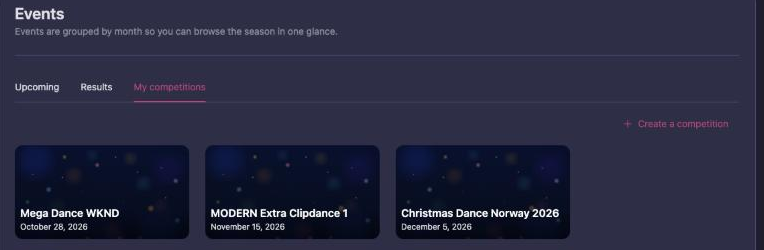

# Event setup

This page is for the organizer who is about to create an event in Vote4Dance, often for the first or second time. At the end you have an event with the right name, dates, place and timezone, its picture uploaded, and you know how to publish it when you are ready. Classes, rounds and judges come after that, in [Competition setup](/manager-guide/competition-setup/).

## Before you start

- **A Vote4Dance account, signed in.** There is no separate organizer account and no approval step: whoever creates the event gets Manager on it. See [Your organizer account](/organizer/account-creation/).
- **The name, the date or dates and the venue** of the event.
- **Practice or live.** A practice event is for trying things out and is not billed. A live competition is a real one, and needs billing information before it can be published.
- **Which federation, if any.** Its classes, rules and license checks follow from that choice. See [Running an event under a federation](/organizer/joining-a-federation/).

## What you create

An event holds one or more competitions. Classes, participants, judges and rounds all belong to a competition, not to the event. The event itself carries:

- the name, the dates, the venue, the country and the timezone
- the status, which decides whether the public can see it
- the event image and the descriptions shown on the public event page
- for a live competition, who Vote4Dance invoices

You do this once per event.

## Where to go

1. Sign in on the Vote4Dance home page.
2. Open the **My competitions** tab.
3. Click **Create a competition** at the top right.



The link is there once you have organized or taken part in a competition. If your tab is still empty, open **About** in the menu at the top of the home page and press **Create a competition** there.

Both open the **Create event** form. It belongs to Scrutineer (Beta), the new version of Manager. See [Classic Manager and the new Manager](/manager-guide/users-and-stations/#classic-manager-and-the-new-manager).

To get back to an event you have already created, open it from the **My competitions** tab.

## Step-by-step: Create your event

### Step 1: Create a new event

1. In **Event name**, type the name the audience will see. It is "Shown on the event page, tickets, prints and screens."
2. Under **When**, choose **One day** or **Several days**, then pick the date or the first and last day.
3. Under **What kind of event?**, choose one:

   | Choice | When to pick it |
   |---|---|
   | **Practice event** | "Try it out with test dancers. It's free, and results don't give federation points." The right choice for a first look and for a rehearsal. It is chosen for you when the form opens. |
   | **Live competition** | "A real competition, with federation rules, levels and points." Vote4Dance invoices you per dancer, and you add the billing details later, before you publish. |

4. In **Use classes from**, choose the federation.
   - For a practice event this is optional. Leave **No federation (I make my own classes)**, or pick a federation to try out its classes. No points are given.
   - For a live competition you must pick the federation. Its rules, classes and license checks apply. There is no approval step: picking the federation is what puts the event on the federation's [Competitions](/federation/competitions/) list.
5. For a live competition, fill in **Live competition details**:
   - **Level**: optional, a reusable level from that federation.
   - **Organizer**: the organizing club or company, as it should be shown.
   - **Contact email**: optional. "Dancers' replies to their registration emails go to this address."
   - **Venue**: where the event is held.
6. Check **Country** and **Timezone**. Both are taken from the device you are using. The timezone drives every time shown in schedules, on screens and in the app, so check it even for a local event.
7. Press **Create event**.

A **Setting up your event** window shows the event being built. Then the event opens in Scrutineer (Beta), on its overview, with a checklist of what to set up next. This guide describes the classic Manager: press **Classic manager** at the top of that overview to open the same event there.

If the form answers "Couldn't create the event", it lists the fields to check. If the window says "The event was created, but its main floor, screen or schedule could not be set up", press **Open the event anyway** and add them from the event. Do not fill in the form again: the event already exists.

**What gets created with it.** A new event does not arrive empty. You get:

- a floor called **Main floor**. See [Floors](/manager-guide/floors/).
- one screen
- four cafe products: Water, Coffee, Fruit and Candy
- a schedule with a heading for each day and the items **Doors open** and **Competition start**. On the first day they are set to 08:00 and 09:00.

Classes, rounds, judges and participants are yours to add. See [Competition setup](/manager-guide/competition-setup/).

**The classic Manager's form.** The classic Manager has a new-event form of its own, at the address `/manager-react/new`. It asks for the same things in four steps, **Federation**, **Event**, **Location** and **Finalize**, and creates the same floor, screen, cafe products and schedule. Its first question is **How do you want to start?**

| Choice | When to pick it |
|---|---|
| **Training competition with default settings** | "Best for your first event." You only give the name, the date and the country. The questions about organizer, duration, contact email, description, mode, location and billing are skipped and filled in with defaults, and the event becomes a practice event. You can change all of them afterwards on the event's details page. |
| **Competition for a specific federation** | "Use this if you already know which federation setup and classes you need." You pick the federation and go through all four steps, which have the fields described under [Step 3](#step-3-event-details-page). |

**Create** makes the event and opens its **Competitions** page with the **Setup guide**, a panel that takes you through **Event structure**, **Schedule**, **Classes**, **Participants**, **Rounds**, **Judges** and **Finish**. On a practice event you can open it again with **Open setup guide** on **Event overview**.

### Step 2: Event status

An event is **Hidden**, **Published** or **Closed**. You change the status on **Event overview**, the first item in the left menu, with one button that always offers the next status:

| Status | What it means | Button you see in this status |
|---|---|---|
| **Hidden** | Only the people who manage the event can see it. This is where it starts and where you build it. | **Publish competition** |
| **Published** | The event page is public and dancers can find the event. | **End competition** |
| **Closed** | The competition is over and Manager is read-only. For a federation event, closing is what triggers promotion-point processing. See [What closing does](/manager-guide/post-event/#what-closing-does). | **Revert to hidden** |

To change the status:

1. Open **Event overview**.
2. Press the button. A **Change status** dialog asks "Are you sure you want to change competition to published" (or closed, or hidden).
3. Confirm.

Two things stop **Publish competition**, and both are worth knowing before you promise a date:

- **No event image.** The button is greyed out, and pointing at it shows "Competition needs an image before it can be published." Upload the image first. See [Event image](/manager-guide/event-image/).
- **No billing information.** Pressing the button answers "Competition needs billing information before it can be published." While it is missing, **Event overview** has a **Billing information** button that opens the step where you add it. See [Step 3](#step-3-event-details-page).

A practice event has no billing information, so the classic Manager gives a practice event the same answer. Scrutineer (Beta) publishes a practice event without billing information.

In Scrutineer (Beta) the statuses have the same names. You change them on the overview: **Publish event…** is a button, and the status tag at the top of the page offers **Close the competition** and **Make hidden**.

There is a fourth status, **Archived**. Neither version of Manager has a button that archives an event: only Vote4Dance's own administrators can set it. An archived event is read-only, and its status button is greyed out.

Registration is **not** a status. Dancers can register while one of your registration periods is open, and they have to be able to find the event, so publish it before the period opens. See [Registration and check-in](/manager-guide/registration-checkin/).

**Timeline example:**

```
Today:              Hidden (you are building)
8 weeks before:     Published, registration period opens
Competition day:    Published (rounds run, results publish per round)
After the event:    Closed (ends the competition, triggers promotion points)
```

### Step 3: Event details page

**Event overview** shows the event's name, dates, venue and country at the top. To change any of them:

1. On **Event overview**, press **Edit event**. The **Competition details** page opens.
2. Click the step that holds the field: **Federation**, **Event**, **Location** or **Finalize**. **Next** and **Previous** move one step at a time.
3. Change the field.
4. Go to **Finalize** and press **Save changes**. You are back on **Event overview**.

| Step | Field | What it is |
|---|---|---|
| **Federation** | **Select a federation** | The federation whose rules, classes and license checks apply. |
| **Event** | **What is the name of your event** | The name the audience sees. "An event can contain multiple competitions". |
| | **Competition organizer** | The organizing club or company, as it should be shown. |
| | **Event duration** | `Single day` or `Multiple days`, then the date or date range. |
| | **Country** | Used for formats and public presentation. |
| | **Contact email** | Optional. "Dancers' replies to their registration emails go to this address." |
| | **Short description** | Maximum 150 characters. Shown on the public event page. |
| | **Event mode** | `Practice event` or `Live competition`. "Practice mode keeps the lightweight setup. Live competition mode enables reusable competition profiles and billing." |
| | **Competition level** | Optional, and only for a federation event that is not a practice event: a reusable level from that federation. Retired levels are not offered, unless the competition already uses one. |
| **Location** | **Location** | The venue. There is a **Verify on Google Maps** link under it. Use it, because this is what people navigate by. |
| | **Timezone** | Drives every time shown in schedules, on screens and in the app. |
| **Finalize** | **Billing information** | Only for live competitions; not asked for practice events. Who Vote4Dance invoices for the competition. |

**Billing information.** The step is filled in on the page itself. Your own recent customers are shown as cards, with the competition each was last used for; pick one. For anybody else's customer, search by name (type at least 4 letters; if more customers match, type more of the name). If the customer does not exist yet, choose **New customer**: pick **Club or company** or **Private person**, and fill in name, email and country. The form starts from the organizer, contact email and country of the event, and an address can be added with **Add address**. **Save changes** saves the new customer and the event in one press. A live competition cannot be saved without a customer, and cannot be published without billing information.

To turn a practice event into a live competition, change **Event mode** on the **Event** step. **Finalize** then asks for the billing information.

**Event overview** itself also holds:

- the status button. See [Step 2](#step-2-event-status).
- **Delete event**. See [Can I delete an event?](#can-i-delete-an-event)
- the event image. See [Step 4](#step-4-upload-the-event-image).
- the long description, with its own **Save changes** button. It is "Shown on the event page and linked from registration emails. A good place for your FAQ."

In Scrutineer (Beta) the same page is called **Event details**.

### Step 4: Upload the event image

Your event needs one picture. It is used on the public event page, on the event
cards, in the mobile app and in the emails sent to judges and sponsors, and an
event cannot be published without it.

1. Open **Event overview**.
2. Click the image box and choose **Upload**.
3. Select the image from your computer.

**What image to use:** a landscape **1600 × 900 JPG or PNG** with the important
part in the middle. Do not upload HEIC photos straight from an iPhone: they
cannot be processed.

See [Event image](/manager-guide/event-image/) for the full guidance, including
what gets cropped on each screen and how to convert an iPhone photo.

## Where the rest is set up

The other items in Manager's left menu each have their own page in this guide:

| In the menu | What you do there | Read |
|---|---|---|
| `Event → Competitions` | Split the event into several competitions, when each part has its own classes, judges and results. | [Competition setup](/manager-guide/competition-setup/) |
| `Event → Floor` | Add floors when you run rounds in parallel. | [Floors](/manager-guide/floors/) |
| `Event → Users` and `Event → Stations` | Decide who works the competition and which app each of them gets, and set up the shared devices. | [Users, apps and stations](/manager-guide/users-and-stations/) |
| `Event → Schedule` | Build the day. Each round is placed on a **schedule item** and, if you use them, a [**floor**](/manager-guide/floors/). That is what gives the public schedule, the speaker and the screens their times. | [Schedule and conflicts](/manager-guide/schedule/) |
| `Competition → Classes` | Create classes and their rounds. Classes belong to a competition, not to the event, and each one maps to a **Federation Class** that carries its age and level rules. Rounds live inside a class. | [Competition setup](/manager-guide/competition-setup/) |
| `Competition → Registration` | Set up registration periods. Fees are not set on the event: they belong to the **registration period**, which also decides the payment mode (free of charge, manual, or online through Stripe), the currency and the price ladder. | [Registration and check-in](/manager-guide/registration-checkin/) |
| `Audience → Screens` | Decide which views the projectors and TVs show, and in which order. | [Screens, projectors and venue technology](/manager-guide/screens/) |
| `Audience → Sponsors` | Set up sponsors and sponsor sales. | [Sponsors](/manager-guide/sponsors/) |
| `Audience → Live results` | Decide what the public sees: **Show live placement on web**, **Show judges marks on web**, **Audience voting** and **Show competitor list publicly**. | [What the audience sees](/manager-guide/live-operations/#what-the-audience-sees) |

## What you can print

Manager prints from the round and participant pages:

- Start numbers
- Heat lists
- Judging sheets
- Results
- Diplomas. See [Customizing diplomas](/manager-guide/diploma-customization/).
- The schedule
- Dressing-room lists. See [Statistics](/manager-guide/statistics/).
- The registration QR poster ("Scan to register")

## Verifying your event is set up correctly

1. **The event opens on Event overview** from your **My competitions** tab, with the right name, dates, venue and country at the top.
2. **The timezone is correct.** It drives every time shown to everyone, so check it even for a local event.
3. **The event image is uploaded.** Without it the event cannot be published.
4. **The status is what you intend:** **Hidden** while you build, **Published** when it should be public.
5. **Competitions, floors and users are complete.**
6. **The schedule is built**, and it is published only if you mean it to be.
7. **Live results** and the other pages under **Audience** are set the way you want the public to see the event.
8. **Problems is not in the left menu.** It appears under **Event overview** while a check fails. See [Problems](/manager-guide/validator/).

## Troubleshooting

### "I cannot find Create a competition"

1. Check that you are signed in.
2. On the home page, open the **My competitions** tab. The **Create a competition** link is at the top right of the tab, and only while the tab lists at least one competition.
3. If the tab is empty, open **About** in the menu at the top and press **Create a competition** there.

### "I created the event but cannot find it"

Open the **My competitions** tab on the home page. Your event is listed there, also while it is **Hidden**, and it opens from there.

Do not create it a second time. If the **Setting up your event** window stopped with an error, the event exists: press **Open the event anyway**.

### "I need to change the event name"

1. Open **Event overview** and press **Edit event**.
2. Click the **Event** step.
3. Change **What is the name of your event**.
4. Go to **Finalize** and press **Save changes**.

### "I set the wrong date"

1. Open **Event overview** and press **Edit event**.
2. Click the **Event** step.
3. Change the date. To go between one day and several, change **Event duration** first.
4. Go to **Finalize** and press **Save changes**.

Changing the date does not move the schedule. Check the day headings on `Event → Schedule` afterwards. In Scrutineer (Beta), **Schedule** warns when a page is dated outside the event's dates (see [A day outside the event's dates](/manager-guide/schedule/#a-day-outside-the-events-dates)).

### "Publish competition is greyed out, or answers with a message"

The event has no image, or no billing information. See [Step 2](#step-2-event-status).

### "Can I delete an event?"

Yes. **Delete event** on **Event overview** removes the event for good, with its classes, participants, rounds and results. Manager first asks "Are you sure you want to delete" with the event's name.

- While the event is split into competitions on `Event → Competitions`, Manager answers "You must delete all child competitions before the event can be deleted". Delete those first.
- An event with paid shop orders cannot be deleted: "The event has paid shop orders and cannot be deleted".
- The button is greyed out on a closed event.
