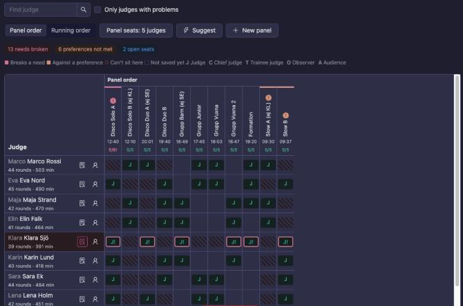
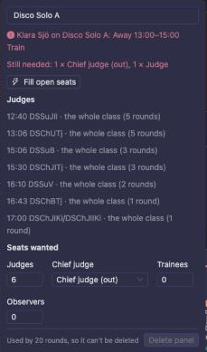
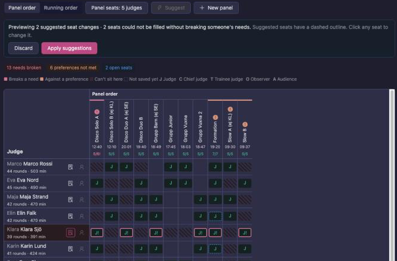
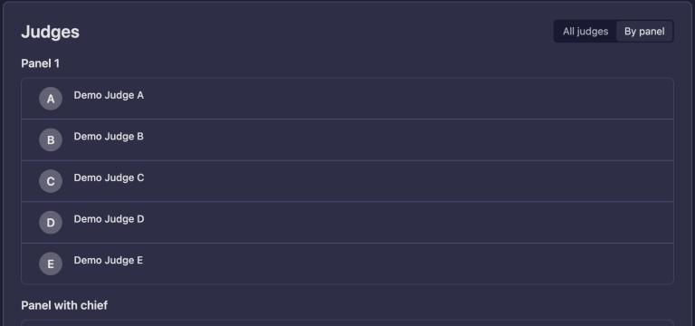
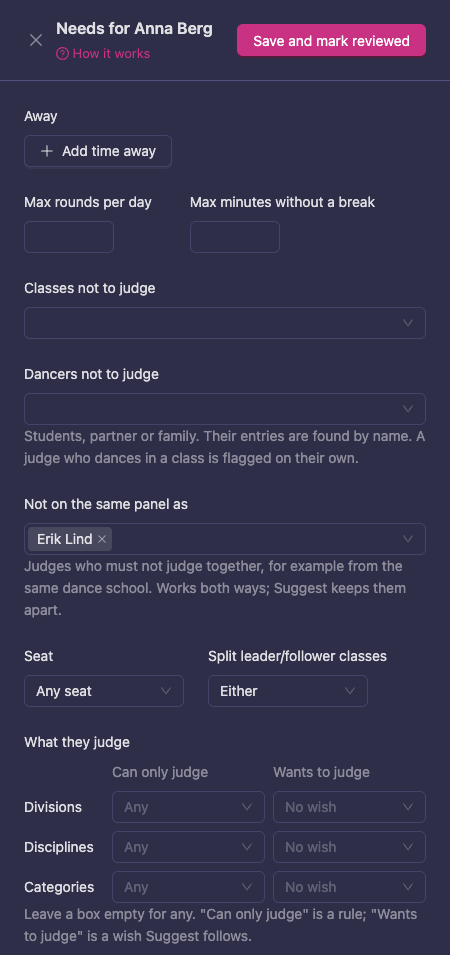
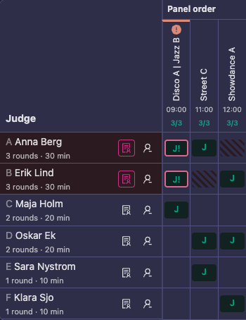
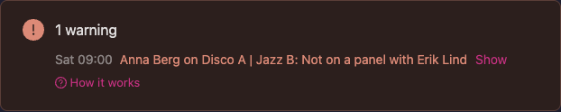
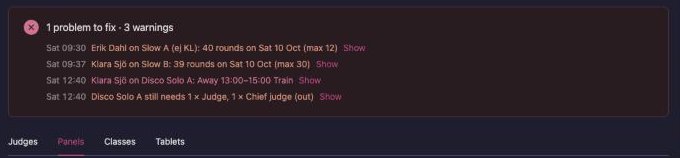
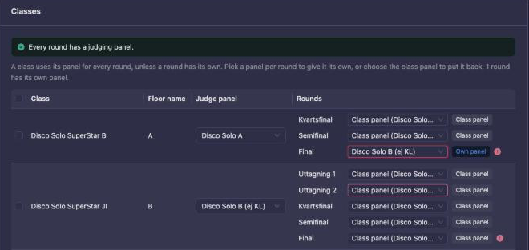

# Judge panels

For organizers and scrutineers who build the judging panels of a competition. Here you seat the judges on panels, record what each judge can and can't judge, let Vote4Dance suggest seats, and give every class and round its panel.

You do this on the **Judging panels** and **Classes** tabs of `Manager → Competition → Judges`, or of the **Judges** tab of the Supervisor app, once the judges are on the list. To add and invite them, see [Judges](/manager-guide/judges/).

## Panels

A panel is a named group of judges. Classes and rounds are judged by a panel, not by individual judges. A round cannot be started until its class or the round has a panel. **Start judging** is refused with "Assign a judging panel to this class or round before starting judging."

The **Judging panels** tab shows every judge as a row and every panel as a column. Each cell is that judge's seat on that panel. The judges are listed by letter, then by name, as on the **Judges** tab. To group judges while you build the panels, for example by hall, you can give them a temporary letter per hall on the **Judges** tab and set their real letters afterwards.

You can seat judges on a panel before it judges any class. A panel that isn't used yet has a grey column and says "Not used by any round". Set up all your panels first if you like, then give each class its panel on the [Classes](#classes) tab.

At the top of each column, under the panel's name, is how many judges the panel has out of how many it wants, for example "2/3". It is green when the panel has exactly the judges it wants, and red when it has too few, or more **Judge** or **Trainee judge** seats than it wants. Hover over a red count to see what is wrong, for example "Still needed: 1 × Judge" or "More than wanted: 1 × Judge". A new panel shows it straight away, such as "0/3", so you can see what to fill before any round uses the panel. A **Chief judge (in)** is counted in it, so 4 **Judge** seats and a **Chief judge (in)** show as "5/5".

### Seating a judge

In the **Supervisor** app and in Scrutineer (Beta), one click is enough:

1. Click the empty cell where the judge's row meets the panel's column. The judge is seated as **Judge** straight away. A judge whose **Seat** need is **Trainee** gets **Trainee judge** instead (see [Judge needs](#judge-needs)).
2. To give them another seat, click the seat, or right-click the cell, and choose **Judge**, **Chief judge (out)**, **Chief judge (in)**, **Trainee judge** or **Audience**. See [Judge types](/manager-guide/judges/#judge-types).
3. The seat is saved at once. A message at the top says, for example, "Seated Anna Berg on Panel A (Judge)", with **Undo** to take it back.

A striped cell still opens the list first, so you see why the judge can't sit there before you decide. If a list is open, clicking an empty cell only closes the list.

In the classic **Manager**, each click opens the list:

1. Click the cell where the judge's row meets the panel's column.
2. Choose the seat: **Judge**, **Chief judge (out)**, **Chief judge (in)**, **Trainee judge** or **Audience**.
3. The seat is saved at once, with the same message and **Undo**.

To take a judge off a panel, click their seat and choose **Remove from panel**.

The cell shows the seat's letter: **J** for judge, **C** for chief judge, **T** for trainee and **A** for audience. Above the grid, a legend lists these letters and explains the marks on a cell:

| Look | Meaning |
|---|---|
| Red outline and **!** | **Breaks a need**: the seat goes against something the judge can't do, such as judging while away, or judging a class their student dances in. |
| Orange outline | **Against a preference**: for example, the judge would rather sit as chief judge. |
| Striped cell | **Can't sit here**: seating the judge would break a need. You can still seat them. |
| Dashed outline | **Not saved yet**: a suggested seat in a [preview](#letting-vote4dance-suggest-seats). |

Hover over a letter in the legend to read what that [judge type](/manager-guide/judges/#judge-types) does. Click or hover over a seat to see why it is marked. The reasons are also listed at the top of the seat's menu, so they can be read on a tablet.

Under each judge's name is how much they judge in this competition, for example "6 rounds · 45 min". Rounds in the event's other competitions are not counted here. The search box finds a judge by name or letter, and **Only judges with problems** hides everyone whose seats are fine.

### Panel order and running order

**Panel order** shows the panels in the order you gave them. **Running order** sorts them by when their first round starts, grouped by day, so you see the day as it will run. A panel used on several days sits under its first day.

To change the panel order, for example to move a panel you added later next to the ones it belongs with:

1. Choose **Panel order**.
2. Drag the panel's name at the top of its column to the left or right. On a tablet, hold your finger on the name for a moment before you drag.
3. Let go where you want the panel. The column moves there with its judges, and the new order is saved at once.

A short click on the name still opens the panel's pop-up. In **Running order** the panels follow the time of their first round, so they can't be dragged.

### A panel's settings

Click a panel's name at the top of its column. The pop-up shows:

- the panel's name, which you can change;
- the panel's problems, if any, and what it still needs, for example "Still needed: 1 × Judge", with **Fill open seats**;
- **Judges**: what the panel judges, either the whole class or single rounds, such as "Novice Jack&Jill – Leaders · Semi only";
- **Seats wanted**: how many judges, which chief judge, and how many trainees the panel should have. A **Chief judge (in)** marks like the other judges, so the chief counts as one of the judges wanted: a panel that wants 5 judges and a **Chief judge (in)** is full with 4 **Judge** seats plus the chief. A **Chief judge (out)** does not count towards the judges;
- **Delete panel**, which is only possible while no round uses the panel.

**New panel** adds a panel, named "Panel 2", "Panel 3" and so on. Rename it in its pop-up. Each panel in an event needs a name of its own: if another panel already uses the name you type, the name field turns red and says so, and the name is not saved until you change it. Your typing stays in the field, so you only need to adjust it.

**Panel seats** at the top sets the seats a panel wants when it has no **Seats wanted** of its own. Vote4Dance starts from what most of your panels already have. A panel you add with **New panel** keeps the **Panel seats** shown at that moment as its own **Seats wanted**, so it does not change when you later seat other panels differently.

### Letting Vote4Dance suggest seats

**Suggest** fills seats for you, following every judge's [needs](#judge-needs) and spreading the rounds evenly:

- **Fill open seats** keeps everyone where they are and fills only what panels still need.
- **Re-plan all unlocked panels** clears every panel that has no scores yet and fills them again from the start. It asks before it does anything.

Suggest never saves straight away. The suggested seats get a dashed outline and a bar above the grid says how many seats would change. Click any seat to change it. Then choose **Apply suggestions** to save them all, or **Discard** to forget them.

Trainee seats only go to judges whose **Seat** need asks for it. If a seat can't be filled without breaking someone's needs, the bar says so; fill it yourself or change a need.

### Panels in the speaker app

The speaker can see the judges grouped by panel, which helps when presenting the panel before a class starts:

1. Open the speaker app for the event and go to **Overview**.
2. In the **Judges** card, choose **By panel**.

Each panel is listed under its competition, in the same order as on the **Judging panels** tab, with the judges seated on it. A judge on several panels appears under each of them. Judges who are not on any panel are listed last, under **Not in a panel**. Audience seats are not shown.

Choose **All judges** to go back to one list per competition. The speaker app remembers the choice on that device.

## Judge needs

Each judge can have needs that Vote4Dance checks every seat against. Open them with the needs button on the judge's row on the **Judging panels** tab, or click **Needs** on the **Judges** tab.

| Need | What it does |
|---|---|
| **Away** | Times the judge can't judge. **Add time away** for each, with a **Reason** if you like. |
| **Max rounds per day** | More rounds than this on one day breaks the need. |
| **Max minutes without a break** | Judging longer than this without at least 10 minutes off breaks the need. |
| **Classes not to judge** | Classes this judge must never judge. |
| **Dancers not to judge** | Students, a partner or family. Their entries are found by name. A judge who dances in a class themselves is found without being listed here. |
| **Not on the same panel as** | Judges who must not judge together, for example from the same dance school. See [Keeping two judges apart](#keeping-two-judges-apart). |
| **Seat** | Which seat the judge wants: **Any seat**, **Judge**, **Chief judge** or **Trainee**. |
| **Split leader/follower classes** | Whether the judge prefers to judge **Leaders**, **Followers** or **Either**. |
| **What they judge** | **Can only judge** limits the judge to some divisions, disciplines, levels, categories or age groups; other classes show as **Can't sit here**. **Wants to judge** is a wish that Suggest follows when it can. Only the kinds where your classes differ are shown. |
| **Note** | Anything else. |
| **Note for organizers** | Only organizers see this, never the judge. |

Choose **Save and mark reviewed**. Seats on the grid are checked again straight away.

### Keeping two judges apart

When two judges must not sit on the same panel, for example because they teach at the same dance school, you can tell Vote4Dance to keep them apart:

1. Open the needs of one of the two judges.
2. Under **Not on the same panel as**, choose the other judge. You can choose several.
3. Choose **Save and mark reviewed**.

It works both ways. The other judge's needs now list the first judge too, and you can remove the pair from either of them.

From then on:

- **Suggest** never puts the two on the same panel.
- On the grid, a panel where one of them already sits shows **Can't sit here** for the other. Clicking the cell still opens the seat menu, so you can seat them anyway when there is no other way.

- If the two do end up on one panel, both seats get a **!** and [Problems with the panels](#problems-with-the-panels) shows a warning. It doesn't stop you from saving or from running the round.

Only people who manage the judges see this need. The judges themselves don't see it and can't change it.

When a judge is ill or delayed on the day, or can't judge one class, see [A judge who can't come](/manager-guide/judges-on-the-day/#a-judge-who-cant-come) and [A judge who can't judge one class](/manager-guide/judges-on-the-day/#a-judge-who-cant-judge-one-class).

## Problems with the panels

Above the tabs, the page lists what is wrong with the judging, in the order it needs your attention. Problems in rounds that are running now or start within the hour come first, marked **Next hour**. Then come the rest, by start time. Problems in rounds that are over are folded away under "… more in rounds that are over".

Red problems need fixing; orange ones are warnings. **Show** takes you to the problem: a panel opens on the **Judging panels** tab, a round without a panel is highlighted on the **Classes** tab, and a judge is found in the grid.

| Problem | What to do |
|---|---|
| A round "has no judging panel" | Give the class or the round a panel on the **Classes** tab. |
| "nobody on … counts toward the result" | Seat at least one **Judge**, **Chief judge (in)** or **Audience** on the panel. |
| A group class round "should have no panel" | Remove the panel; the judges belong on the classes in the group. |
| A panel "has an even number of judges" for a round decided by majority | Make one judge a **Trainee judge**, or add or remove a judge. |
| A judge "judges two floors at the same time" | Move the judge to another panel, or run the rounds one after the other. |
| A judge is "also on another panel at the same time", but the rounds are on a whole floor and one of its sections | This is never reported: a whole floor and its own sections run one after the other. If their estimated times still overlap, the schedule is too full there; see [Schedule conflicts](/manager-guide/schedule/). Two sections of the same floor can run side by side, so an overlap between them is still reported. |
| A panel "still needs" seats (warning) | **Fill open seats**, seat someone yourself, or lower **Seats wanted**. |
| A judge on a panel who is away, on two panels at once, or judging their own entry, a named dancer or a class to avoid | Move the judge, or change their needs. |
| A judge on too many rounds, too long without a break, or outside what they judge (warning) | Move some of their seats, or change their needs. |
| Two judges on one panel who should be [kept apart](#keeping-two-judges-apart) (warning) | Move one of them, or remove the pair from their needs. |

Panels with a problem have a red or orange mark at the top of their column. The same checks, except judges' needs, are on the [Problems](/manager-guide/validator/) page.

## Classes

The **Classes** tab says which panel judges each class and round.

Choose a panel in the **Judging panel** column. The panel judges every round of that class, unless a round has its own. To give several classes the same panel, tick them first, then choose the panel on any of the ticked rows.

### Round override

A single round can be judged by a different panel, for example a final with a larger panel. In the **Rounds** column, each round has its own choice:

- **Class panel (…)** uses the class's panel. The round is tagged **Class panel**.
- Any other panel gives the round its own. It is tagged **Own panel**.
- A round whose class has no panel and that has none of its own is tagged **No panel** in red.

The change is saved at once. A problem with a round is marked next to it. You can also set a round's panel in the round's own **Judging panel** setting ("Replaces class judging panel for this round") in `Manager → Competition → Classes`, as long as the round has no marks.

On a tablet or a smaller screen, each class shows its panel and its rounds stacked under its name.

## When assignment locks

Panels lock when judging starts, so marks are not given by a panel that has changed since.

| What | Locked when | What you see |
|---|---|---|
| A panel's seats | Any round that uses the panel, from its class or as its own panel, has scores | The panel's cells can't be changed and its name shows a lock. |
| A class's panel | Any round of the class has been started | The class's **Judging panel** and tick box on the **Classes** tab are greyed out. |
| A round's own panel, in the round's settings | The round has marks | The round's **Judging panel** setting is greyed out. |

A round's panel in the **Rounds** column of the **Classes** tab does not lock. There you can still change who judges a round after judging has started, in Manager, in Scrutineer (Beta) and in the Supervisor app. If a judge who would leave the round has given marks in it, you're asked whether to remove those marks; see [Replacing a judge who has already given marks](/manager-guide/judges-on-the-day/#replacing-a-judge-who-has-already-given-marks).

A panel cannot be deleted while any round uses it.

A judge who sits on a panel with scores can't be removed from the competition either, also when they have given no marks themselves; see [When a judge can't be removed](/manager-guide/judges/#when-a-judge-cant-be-removed).

A panel used on several days locks as soon as its first round has scores. To change who judges its later rounds, give those rounds their own panel on the **Classes** tab.

## Troubleshooting

| Message | Cause | What to do |
|---|---|---|
| "Cannot delete panel with assigned classes" | A class still uses the panel. | Choose another panel for those classes, then delete. |
| "Every panel already has the seats it needs." | **Suggest** found nothing to fill. | Raise **Seats wanted** on a panel, or use **Re-plan all unlocked panels**. |
| "… seats could not be filled without breaking someone's needs." | Every free judge has a need against those seats. | Seat someone yourself, or change a need. |

## Not in this version

- Judges can't fill in their needs themselves yet; a supervisor enters them.
- Needs are only checked on the Judges page, not on the [Problems](/manager-guide/validator/) page.

## Related pages

- [Judges](/manager-guide/judges/): adding and inviting the judges, and what each judge type means
- [Judge schedules](/manager-guide/judge-schedules/): each judge's classes, made from the panels
- [Judges on the day](/manager-guide/judges-on-the-day/): replacing a judge, and separating tied positions
- [Competition setup](/manager-guide/competition-setup/): where judges and panels fit in the setup order
