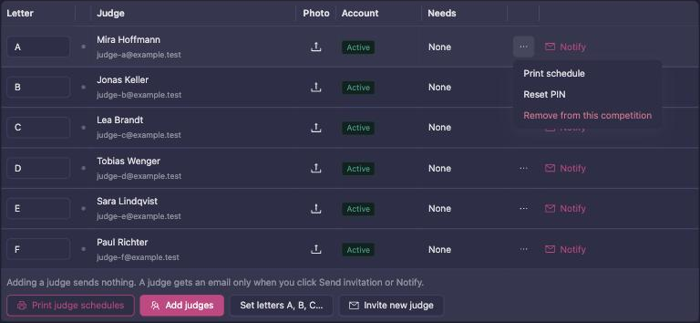
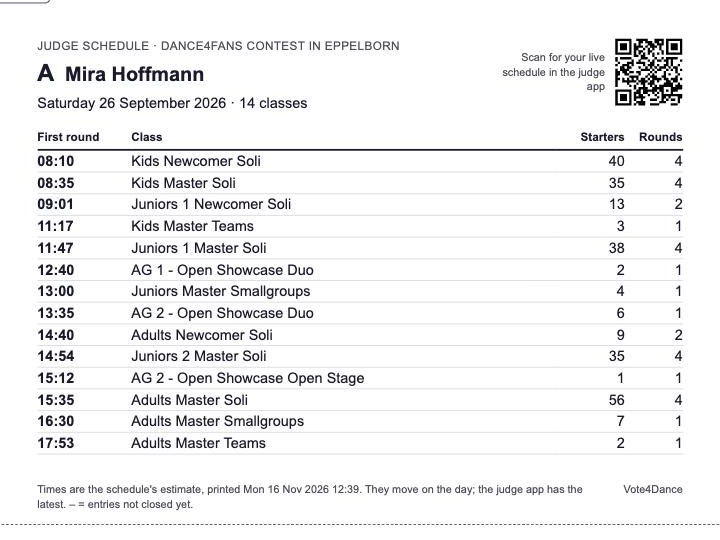
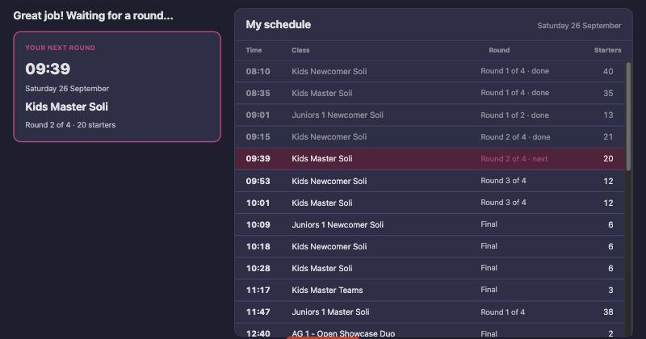

# Judge schedules

For organizers and scrutineers who want every judge to know when they judge. This page covers printing a schedule for each judge, the schedule the judge sees in the Judging app, and the class list in the invitation email.

Every judge can get a schedule of their own: the classes they judge, when the first round of each starts, and how many dancers start in it. It is the slip judges are used to from international competitions, and Vote4Dance makes it from your panels and your schedule, so there is nothing to type.

A judge's classes come from the panels they sit on: the panel of each class on the [Classes](/manager-guide/judge-panels/#classes) tab, or a round's own panel. Seat your judges and set up the [schedule](/manager-guide/schedule/) first; then the schedules are ready.

## Printing the schedules

Printing is in Scrutineer (Beta), the new version of the Manager app.

1. Open the **Judges** tab.
2. To print every judge, press **Print judge schedules** under the list. To print one judge, open the **⋯** menu on their row and choose **Print schedule**.
3. A new tab opens with one slip per judge and day, in letter order. Choose what to print in the bar at the top (see [Events over several days](#events-over-several-days)), then press **Print**. Two short slips fit on an A4 page; cut along the dashed line.

Each slip shows:

- The judge's letter and name, the date and the number of classes. When your letters are really names, as at some events, the slip shows just the name.
- One line per class, by its full name: **First round** (the estimated start time), **Class**, **Starters** and **Rounds** (how many rounds the class has).
- A QR code the judge can scan to open their live schedule in the Judging app.

Good to know:

- The times are the schedule's estimate when you print, and the footer says when that was. If the schedule moves on the day, the Judging app has the latest times.
- **Starters** shows **–** while the entries for that class are not closed yet. Print again once they are.
- When a judge sits on only some rounds of a class, their line shows the first round they judge.
- A judge with no class to judge gets no slip.
- There is no PIN on the slip. Each judge chooses their own PIN in the Judging app; see [PIN](/manager-guide/judges/#pin).
- You can print schedules for an archived event too.

## Events over several days

Each slip covers one judge on one day. For an event over several days, use the bar at the top of the print tab:

- **Day**: **All days** prints every day's slips, with each day starting on a new sheet. Pick a single day to print only that day's slips, for example each morning at the desk. The tab starts on today when your event runs today.
- **Judges from**: shown when your event has several competitions running side by side. **Whole event** gives each judge one slip per day covering every competition they judge in, with a **Competition** column. **This competition** prints only the competition you opened it from.

A short day fits on half a page. A long day takes a full A4 page, and a day that doesn't fit on one page carries on to the next with the judge's name and **continued** at the top.

## In the Judging app

While there is nothing to judge, the Judging app shows the judge's schedule instead of only "Great job! Waiting for a round...":

- **Your next round**: the time, the class, and which round it is, such as **Round 2 of 4** or **Final**, with its number of starters.
- **Today**: how many classes the judge has today, and the first and last time.
- **My schedule**: every round the judge sits on, in time order. Rounds they have finished are greyed out with **done**, and the next one is highlighted with **next**.

The list updates by itself when you change the schedule or the panels, or when a round closes. The times are estimates and move with the schedule.

At an event over several days, the list opens at today: each earlier day is folded into one line, such as "Wednesday 28 October · 22 rounds, all done", and today's finished rounds are folded too, so the next round is in view. Press **Show** to see them again. Later days follow below, and **Coming days** lists how many classes the judge has on each of them. When the judge sits in several competitions, each class shows its competition.

## In the invitation email

Every [invitation](/manager-guide/judges/#invitations) sent once the judge has classes to judge lists **Your classes**, with the same first-round times and starters as the printed slip. Send **Notify** again after you change panels or the schedule, so the judge has the latest list.

## Related pages

- [Judge panels](/manager-guide/judge-panels/): the panels a judge's classes come from
- [Schedule and conflicts](/manager-guide/schedule/): the times on the schedules
- [Judges](/manager-guide/judges/#invitations): sending the invitation, and the judge's PIN
