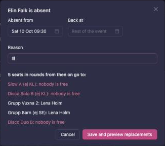
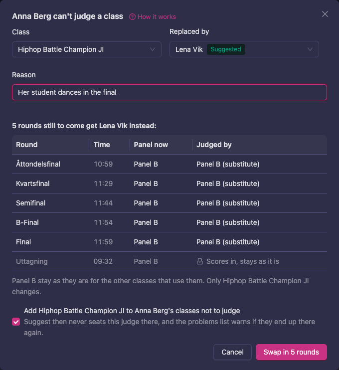
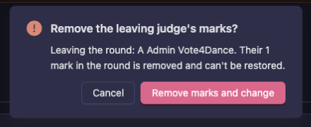

# Judges on the day

For the organizer or scrutineer at the desk while the competition runs. This page covers a judge who is ill, delayed or has to leave, a judge who can't judge one class, replacing a judge who has already given marks, and separating competitors who share a position.

Replacing a judge is done on `Manager → Competition → Judges`, or on the **Judges** tab of the Supervisor app; ties are separated on the round. A judge who has forgotten their PIN gets a new one with [Reset PIN](/manager-guide/judges/#pin).

## A judge who can't come

When a judge is ill, delayed or has to leave:

1. On the **Judging panels** tab, click the **Judge absent** button on the judge's row.
2. Set **Absent from**. It starts at the current time, or at the first round if the event hasn't started yet.
3. Set **Back at**, or leave it empty for the rest of the event. Add a **Reason** if you like.
4. The dialog lists each of the judge's seats in rounds from then on and who would take it: the best free judge for the same seat. "nobody is free" means you'll have to find someone yourself.
5. Choose **Save and preview replacements**. The time away is saved to the judge's needs, and the replacements are shown as a [preview](/manager-guide/judge-panels/#letting-vote4dance-suggest-seats) to apply or discard.

A panel that already has scores keeps the judge; the dialog lists those panels. It also lists panels whose rounds have no time yet, since Vote4Dance can't tell whether they fall in the time away; check those yourself. To change who judges the rounds still to come, give those rounds a panel of their own on the [Classes](/manager-guide/judge-panels/#classes) tab.

## A judge who can't judge one class

Sometimes a judge can still judge, just not one class, for example because their own student dances in it. In Scrutineer (Beta), the new version of the Manager app, you can swap the judge out of that class's rounds and leave everything else as it is:

1. On the **Judging panels** tab, click the **Can't judge a class…** button on the judge's row, the circle with a line through it next to **Judge absent**. If the problems list already says the judge **Must not judge** a class in a round still to come, you can also click **Swap out…** on that problem; the judge and the class are then filled in for you.
2. Choose the **Class**. Only classes where the judge has rounds still to come are listed.
3. Under **Replaced by**, the judge Vote4Dance suggests is chosen and marked **Suggested**, picked by the same rules as **Judge absent**. Choose someone else, or **Nobody** to just take the judge off. Add a **Reason** if you like.
4. The table lists the class's rounds the judge sits in, with the time, the panel judging it now and the panel that will judge it. A round that already has scores, or is closed, keeps the judge and shows **Scores in, stays as it is**.
5. Leave **Add … to … classes not to judge** ticked so that **Suggest** never seats the judge in this class again and the problems list warns if they end up there. When you start from a **Must not judge** problem the box is unticked, because that need is already set.
6. Choose **Swap in … rounds**. A message confirms who now judges the class's rounds.

When every round of the class already has scores or is closed, nothing can be swapped. The button then reads **Add to classes not to judge** and only saves that need, so the judge isn't seated in the class again.

Your panels are not changed. Each panel the judge sits on in those rounds gets a copy named after it with **(substitute)** at the end, with the replacement in the judge's seat, and the class's rounds are given that copy as their own panel. Other classes that use the same panel, and the judge's rounds in other classes and competitions, keep the judge. On the [Classes](/manager-guide/judge-panels/#classes) tab the rounds are then tagged **Own panel**. To undo it for a round that has no scores yet, choose **Class panel** for it again.

The classic Manager and the Supervisor app do not have this button. There, add the replacement to a new panel yourself and give the class's rounds that panel in the **Rounds** column of the **Classes** tab.

## Replacing a judge who has already given marks

Sometimes a judge has to leave after judging has started, for example because they fall ill. Once a round of the class has started, the class's own **Judging panel** is greyed out, and a panel with scores keeps its seats. What you can still change is the panel of each round, on the **Classes** tab of the Judges page. This works the same in Manager, in Scrutineer (Beta) and in the Supervisor app.

When the change means that a judge who has already given marks leaves the round, Vote4Dance asks first:

1. On the **Classes** tab, find the class and choose the new panel for the round in the **Rounds** column. The new panel must be another panel than the one the round has now, with the replacement seated on it; add one with **New panel** on the **Judging panels** tab if you need to.
2. **Remove the leaving judge's marks?** opens. It names the judge and how many marks they have in the round.

   

3. Choose **Remove marks and change** to remove that judge's marks and change the panel. The marks can't be restored. The other judges' marks stay, and the round's result is worked out again without the removed marks.
4. Choose **Cancel** to keep the panel and the marks as they are.

A judge who sits on both the old and the new panel stays in the round and keeps their marks. Rounds of the class that have not been judged yet change the same way, without the question.

The round's own **Judging panel** setting, in the round's settings, is greyed out once the round has marks, so use the **Classes** tab.

## Separating tied positions

When a closed round has competitors sharing a position, the round's toolbar offers ways to separate them. Each one adds a round under the main round, and the placements it decides come back to the main round with a letter showing how they were decided.

| Button | When it is shown | What happens | Letter |
|---|---|---|---|
| **Redance** | On a closed main round | The tied competitors dance again in a new round, judged by placement. | **R** |
| **Side skating** | On a closed round without sub-rounds, except partial-input rounds | Compares the judges' marks for the competitors that share a position, without anyone dancing again. | **S** |
| **Chief judge** | On a closed round whose panel has a **Chief judge (in)** or **Chief judge (out)** | The chief judge's marks from the round decide the order. Nobody dances or judges again. | **CJ** |
| **Paper redance** | On a closed partial-input round whose panel has no chief judge | All judges rank the tied competitors again on paper, without anyone dancing again. | **PR** |

**Redance**, **Chief judge** and **Paper redance** are greyed out while no position is shared, and **Side skating** while no position can be side-skated. The letter appears as a badge next to the placement in the round's results; hover over it to see how the placement was decided, for example "Placement assigned through chief judge".

### Chief judge

1. Open the closed round and click **Chief judge**.
2. Choose the tied position under **Select the position to separate:** and click **OK**. To separate another tied position, click **Chief judge** again.
3. A round named **Chief judge** appears under the round. It holds the tied competitors with the marks the chief judge already gave them in the round, and it is ranked straight away.

The competitor the chief judge marked higher gets the better placement:

| Round judged with | Ranked first |
|---|---|
| Callback marks (Yes / Alt 1 / Alt 2 / Alt 3) | Yes, then Alt 1, Alt 2 and Alt 3; a competitor without a mark comes last |
| Scores (sliders) | The higher score |
| One-to-five | 1 before 2, and so on to 5 |
| Placement | 1st before 2nd, and so on |

Competitors the chief judge marked the same stay tied. When the panel has more than one chief judge, their orders are combined by majority.

Which chief judge type to use depends on the rules:

- **Chief judge (in)** marks like the other judges and counts in the result. Use it when the head judge sits on the panel, as in DSF West Coast Swing, where the head judge breaks ties in prelims.
- **Chief judge (out)** does not count in the result; only their marks break ties. Use it when the chief judge sits outside the panel, as in WSDC Jack & Jill, where the chief judge gives every competitor a raw score in prelims. See [Jack & Jill](/jack-n-jill/#5-judges-and-run-time-execution).
- Where the rules settle a tie by dancing again, as in Norwegian (ND) semifinals, use **Redance** instead.

**To redo a chief judge decision**, open the **Chief judge** round. If it is **Closed**, use **Previous status** until it is **Not started**. Click **Remove participants**, then **Delete round**, and click **Chief judge** on the main round again. A tie separated before the fix in the [2026-10-03 release](/release-notes/2026-10/#2026-10-03) keeps the order it got then, which could rank the chief judge's lower mark first, so redo those.

## Troubleshooting

| Message | Cause | What to do |
|---|---|---|
| "Cannot change panel with results" | The change would take a judge who has given marks out of a round. | Change the round's panel on the **Classes** tab, where you are asked about the marks first; see [Replacing a judge who has already given marks](#replacing-a-judge-who-has-already-given-marks). |
| "A panel already has scores, so its seats can't change." | The panel has marks. | Give the remaining rounds their own panel on the **Classes** tab. |
| "Assign a judging panel to this class or round before starting judging." | The class has no panel and the round no override. | Choose a panel on the [Classes](/manager-guide/judge-panels/#classes) tab. |

## Related pages

- [Judge panels](/manager-guide/judge-panels/): the panels, judge needs and when panels lock
- [Judges](/manager-guide/judges/#judge-types): what **Chief judge (in)** and **Chief judge (out)** mean
- [Live operations](/manager-guide/live-operations/): starting rounds on the day
