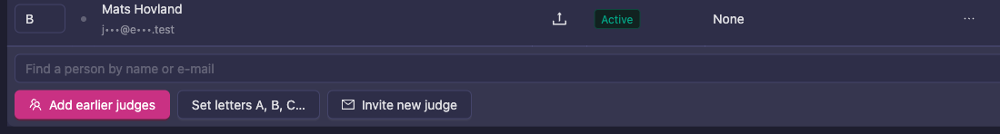
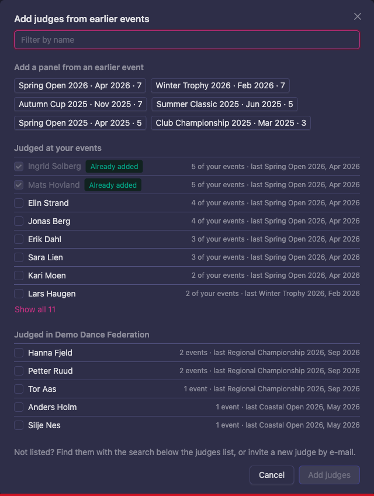
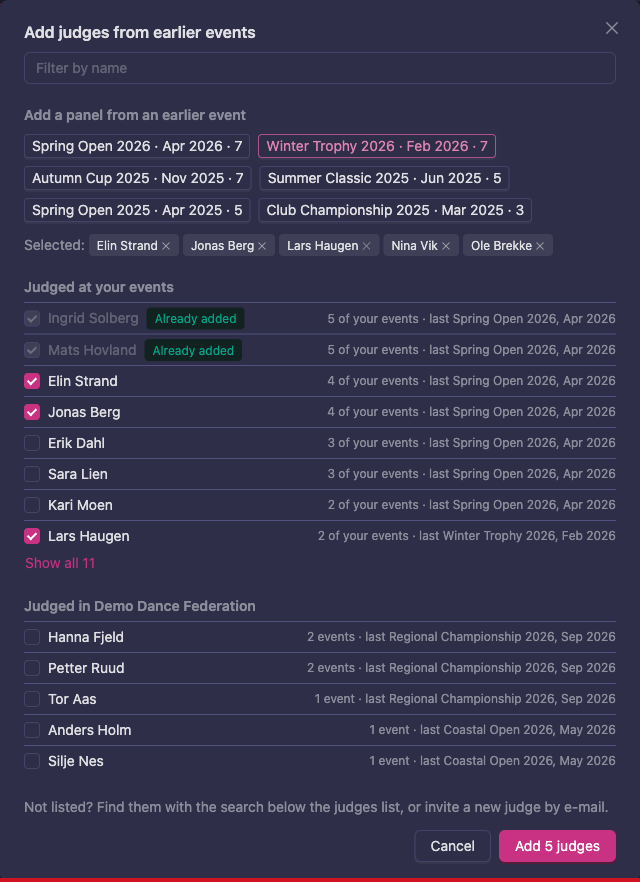
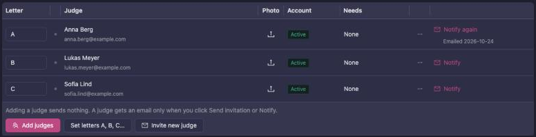
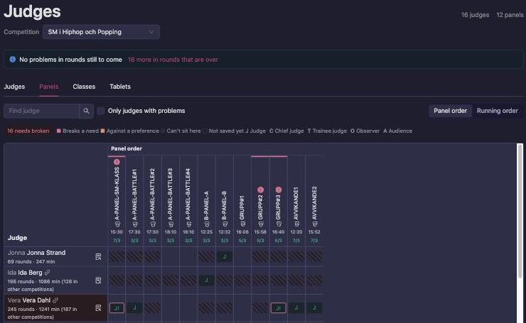

# Judges

For organizers and scrutineers who set up the judging of a competition. On the Judges page you decide who judges, which panel each judge sits on, and which panel judges each class and round.

Open it from `Manager → Competition → Judges`. People with the **Supervisor** app get the same page as the **Judges** tab of the Supervisor app.

The guide to it is on four pages:

| Page | What is on it |
|---|---|
| **Judges** (this page) | Adding and inviting judges, the judge list and letters, PINs, the demo, judge types, and removing a judge. |
| [Judge panels](/manager-guide/judge-panels/) | Seating judges on panels, judge needs, letting Vote4Dance suggest seats, problems with the panels, the panel of each class and round, and when panels lock. |
| [Judge schedules](/manager-guide/judge-schedules/) | A schedule for each judge: printed, in the Judging app and in the invitation email. |
| [Judges on the day](/manager-guide/judges-on-the-day/) | A judge who can't come or can't judge one class, replacing a judge who has given marks, and separating tied positions. |

The page has four tabs:

| Tab | What you do there |
|---|---|
| **Judges** | Add and invite judges, give them letters, reset PINs, see each judge's needs, and, in Scrutineer (Beta), print each judge's schedule. |
| **Judging panels** | Seat judges on panels in one grid, let Vote4Dance suggest seats, and handle a judge who can't come. See [Panels](/manager-guide/judge-panels/#panels). |
| **Classes** | Choose the panel for each class, and give single rounds a panel of their own. See [Classes](/manager-guide/judge-panels/#classes). |
| **Tablets** | Shared judging tablets, when they are switched on for your event. |

Above the tabs, the page lists any [problems with the judging panels](/manager-guide/judge-panels/#problems-with-the-panels).

In an event with several competitions, each competition has its own judges and panels. In Manager you are already in one competition; in the Supervisor app, pick it under **Competition** at the top of the page. See [Events with several competitions](#events-with-several-competitions).

Judges are not users in `Manager → Event → Users`, and they need no app tick there. Being on the judge list is what gives a person the Judging app for this event. See [Users, apps and stations](/manager-guide/users-and-stations/).

## Who can change judges

You need the **Manager** or **Supervisor** app on the event. Either one lets you add and remove judges, seat them on panels and choose the panel of a class or a round. The page is read-only once the event is **Closed** or **Archived**.

## Adding judges

There are two ways to add a judge. Both are at the bottom of the judge list. In [Scrutineer (Beta)](#judges-from-earlier-events) there is a third: pick the judges of your earlier events from a list.

### An existing account

Type at least three letters of the judge's name in the **Search users** box, or their whole email address. The search starts when you stop typing. Matching accounts appear with a shortened email address, such as j•••@g•••.com, and a count, such as `3x`, that shows how many competitions they have judged before. Searching by email needs the whole address. Pick one and press **Add**. The judge is added at once; no email is sent. See [Invitations](#invitations).

Disabled accounts are not listed.

### Invite by email

Use **Invite new judge** for someone who has no Vote4Dance account. The **Invite a new judge** dialog asks for:

| Field | Notes |
|---|---|
| **Email** | Required. Becomes the judge's username. |
| **First name**, **Last name** | Required. |
| **Nationality** | Required. Pre-filled with a guess from your browser. |
| **Language** | The language of the new account and of the invitation. Starts on your own Manager language. |

While you type, the dialog searches for existing accounts by email and by name under **Possible existing accounts**. This is to stop you creating the same person twice:

- If one of them is the person, press **Use this account**. They are added as a judge on their existing account.
- If the email you typed already belongs to an account, the dialog says "A user with this email already exists — pick them from the list." and will not create a new one.
- If there are matches but none of them is the person, tick "I have reviewed the list above — none of these is the person I want to invite." to go on.

**Create new judge account** creates the account and adds the person as a judge. The dialog then opens the invitation for them. The invitation is not sent until you press **Send invitation** in that dialog.

### Judges from earlier events

In Scrutineer (Beta), the new version of the Manager app, you can add the judges you usually work with without searching for them one by one. Press **Add earlier judges** at the bottom of the judge list.

The **Add judges from earlier events** dialog lists people who have judged before:

| Group | Who is in it |
|---|---|
| **Judged at your events** | Judges of earlier events where you have the **Manager** or **Supervisor** app. Those who judged at the most of your events come first, with how many and the last one, such as "4 of your events · last Spring Open 2026, Apr 2026". |
| **Judged in** your federation | Judges of the federation's other events, such as **Judged in Norges Danseforbund**. Only for events that belong to a federation, and only once you have run an event in that federation before, as **Manager** or **Supervisor**, or if you work for the federation. |

The first time you organize an event in a federation, you see only **Judged at your events**, or nothing yet; find your judges with the search below the judge list instead. Only names are shown, never email addresses. People who already judge in this competition are ticked and marked **Already added**.

To add judges:

1. Tick the people you want. A long group shows its first eight; press **Show all** to see everyone.
2. To find someone, type part of their name in **Filter by name**. The lists are filtered while you type; this is not a search, so you can use it as much as you like.
3. To use a whole panel again, press one of your recent events under **Add a panel from an earlier event**, such as "Winter Trophy 2026 · Feb 2026 · 7". Everyone who judged that event and is not added yet is ticked. The six most recent of your events are offered.
4. Check the names next to **Selected:**. Press the × on a name to leave that person out.
5. Press **Add 5 judges** (the button counts the people you ticked). The button shows "Adding 2 of 5…" while it works. The dialog can't be closed until it is done, and closes by itself when everyone is added.

The judges get the next free [letters](#letters), as when you add an existing account, and no email is sent; see [Invitations](#invitations). If someone could not be added, the dialog stays open, names them with the reason, and keeps them ticked so you can try again.

Someone who is not in the lists, such as a judge new to your events, is found with the search below the judge list, or invited with **Invite new judge**.

## Judge list

Each row has:

| Column | What it shows |
|---|---|
| Dot | Green when the judge has the Judging app open and connected; hover for battery level. |
| **Name** | The judge's name. Hover over the info icon after it to see a shortened email address, such as j•••@g•••.com, so you can tell judges with the same name apart. The full address stays private to the judge; invitations still reach it. |
| **Photo** | A photo used for this competition only, shown for the judge on screens and in judge lists. A judge without one shows a placeholder; their Vote4Dance ID photo is never shown here. |
| **Status** | See [Statuses](#statuses). |
| **Needs** | **None**, or **Set by supervisor** when the judge has [needs](/manager-guide/judge-panels/#judge-needs). Click it to open them. |
| **Letter** | The judge's letter. Type it in; it saves when you leave the field or press Enter. |
| **WDSF MIN** | Only in WDSF competitions. The judge's WDSF MIN, with a lookup button. |
| Delete | Removes the judge. See [Removing a judge](#removing-a-judge). |
| **Reset PIN** | See [PIN](#pin). |
| **Send invitation**, **Resend invitation** or **Notify** | See [Invitations](#invitations). |

### Letters

Each judge has a letter. It is shown before the name on the panels, for example `B) Anna Berg`.

How a new judge gets a letter depends on how you add them:

| You add the judge | Letter |
|---|---|
| From an existing account: with **Search users**, with **Use this account**, or from earlier events | The first letter from A to Z that no judge in the competition has. After Z it goes on with AA, AB, AC… |
| With **Create new judge account** | **A**, even when another judge already has it. |

So after you create new accounts, check that no two judges share a letter. Type a letter in the **Letter** column, or set them all at once.

**Set letters A, B, C…** under the judge list sets every judge's letter in one go:

| Option | What it does |
|---|---|
| **By firstname** | Sorts judges by first name, then last name, and gives them A, B, C… After Z it goes on with AA, BB, CC… |
| **By lastname** | The same, sorted by last name first. |
| **Use as firstname** | Sets each judge's letter to their first name. |

In Scrutineer (Beta) you are asked first: "This replaces the letters of all judges."

## Statuses

| Status | Meaning |
|---|---|
| **Not invited** | The account has no password yet, and no invitation has been sent. |
| **Invited** | The account has no password yet, and an invitation has been sent. Hover to see the date. |
| **Active** | The account has a password, so the person can sign in. |

The status describes the person's account, not this competition. A judge you add from an existing account is usually **Active** at once, even if you have never sent them anything.

## Invitations

The button at the end of each row opens the invitation dialog. Its label depends on the status:

| Status | Button | Email the judge gets |
|---|---|---|
| **Not invited** | **Send invitation** | "You have been invited to judge", with a **Set your password** button. The link expires after 7 days. |
| **Invited** | **Resend invitation** | The same email with a new link, valid for another 7 days. |
| **Active** | **Notify** | "You have been added as a judge", with a **Sign in** button and a reminder about "Forgot password". When the judge has classes to judge, the button reads **Open my schedule** and opens the Judging app. |

Once a judge has classes to judge, every invitation also lists **Your classes**: each class they judge, with the estimated time of its first round and its number of starters. See [Judge schedules](/manager-guide/judge-schedules/).

The button is greyed out if the judge has no email address.

In the dialog:

- **Language** chooses the language of the email. It starts on the judge's own account language, or English. You can choose English, Svenska, Español, Suomi, Norsk, Nederlands, Deutsch or Français.
- **Email preview** shows the subject and text exactly as they will be sent, with the competition name and picture as the heading.

Every invitation also contains the [demo link](#demo). The email comes from the same sender as other Vote4Dance emails; see [Emails and the check-in QR code](/manager-guide/emails/).

After sending, the row shows **Invited** (or stays **Active**). Send again as often as you need to; each send updates the date.

### In Scrutineer (Beta)

In Scrutineer (Beta), every judge with an email address has this button at the end of their row, **Active** judges too, so you can always email a judge from the list. Once an email has gone out, its date shows under the button: **Invited** and the date for a judge who has not set a password yet, **Emailed** and the date for an **Active** judge. An **Active** judge's button then reads **Notify again**.

**Print schedule**, **Reset PIN** and **Remove from this competition** are in the row's **⋯** menu.

## PIN

There is no event-wide judge code. Each judge sets their own four-digit PIN on their own device the first time they open the Judging app. The app asks for it again when they come back, and locks itself after 10 minutes without use or with the screen hidden.

A judge has **one PIN for the whole event**. If they judge in several competitions of the same event, the same PIN works in all of them.

If a judge forgets their PIN, press **Reset PIN** on their row and confirm. The PIN is cleared for every competition in the event, and the next time the judge opens the Judging app they set a new one. **Reset PIN** is greyed out until the judge has set a PIN.

## Demo

The judge demo lets a judge practise before the competition:

- It shows one practice round for each judging system used in the competition's rounds, filled with made-up couples. **Reset** starts a round again and **Next** moves to the next one. Nothing is saved.
- It needs a signed-in Vote4Dance account, but not a PIN.
- On the event page, a Manager who is not judging opens it with the **Judges** tile. It is also linked from every invitation email and from the **Demo** item in the Judging app's menu.

Open it yourself to see what your judges will see for the systems you have set up. It shows nothing until the competition has rounds.

## Judge types

A judge sits on a panel as one of five types. You choose the type when you seat the judge.

| Type | What it means |
|---|---|
| **Judge** | Marks the dancers; the marks count in the result. |
| **Trainee judge** | Practises by marking; the marks don't count in the result. |
| **Chief judge (in)** | Marks like the other judges and counts in the result; also breaks ties. |
| **Chief judge (out)** | Doesn't count in the result; their marks only break ties. |
| **Audience** | Scores come from public audience voting; counts toward final placements. |

The **Audience** judge follows the votes while the round is being judged and hands in by itself when the last of the other judges hands in; votes after that no longer change its result. It then shows as handed in with the other judges in the round's results. If you re-open the round and want the votes to count again, unlock the **Audience** judge there the same way as any other judge.

There is no observer type to choose.

When you seat a judge on the **Judging panels** tab, the seat menu says what each type does. The legend above the grid lists the letters used in the grid: **J** Judge, **C** Chief judge, **T** Trainee judge and **A** Audience. Hover over one of them to read what the type does. **How it works** in the menu and the legend opens this section.

The type is set per panel, so the same person can be a **Judge** on one panel and a **Trainee judge** on another.

Rounds placed by a majority of the judges need an odd number of judges. [Problems](/manager-guide/validator/#even-judge-panels) lists the rounds whose panel has an even number, counting only the types that mark the result.

## Events with several competitions

In an event with several competitions, such as a championship week, each competition has its own judges and panels. In the Supervisor app, choose the competition under **Competition** at the top of the Judges page.

When the same person judges in more than one competition of the event (the same Vote4Dance account), Vote4Dance links them:

- A link icon after their name lists the other competitions they judge in.
- Their rounds in the other competitions count too: a seat at the same time is marked, rounds per day and breaks count every competition, and Suggest takes them into account.
- Their needs are shared. Saving them in one competition saves them in all of them, except **Classes not to judge** and **What they judge**, which name one competition's classes, levels and categories and so are set in each competition. Adding or removing a judge under **Not on the same panel as** carries over to the competitions where both judges judge. **Judge absent** saves the time away everywhere and tells you how many of their rounds in the other competitions fall in that time; replace those seats on that competition's Judges page.

## Removing a judge

The delete icon on a judge's row removes them from the competition after you confirm. It also removes them from every panel and from other judges' **Not on the same panel as**.

A judge who has already given marks in this competition cannot be removed: "Cannot change judge with results".

Removing a judge does not delete their account, and it does not send them an email.

## What the judge sees

1. The judge opens the event page and taps the **Judges** tile. They must be signed in with the account you added. Anyone else gets an access-denied page.
2. The first time, they set a PIN and confirm it ("Keep this PIN private. Supervisors can reset it if needed."). After that, they enter it.
3. They see the rounds that are open for judging and that their panel judges. With nothing to judge, the screen says "Great job! Waiting for a round..." and shows their next round and their schedule; see [In the Judging app](/manager-guide/judge-schedules/#in-the-judging-app).
4. The toolbar has **Theme Light/Dark**, **Lock** (asks for the PIN again) and **Hide screen** (blanks the screen between heats).

The judge's app also has the schedule, the café and the results.

## Troubleshooting

| Message | Cause | What to do |
|---|---|---|
| "A user with this email already exists — pick them from the list." | You tried to create a new account with an email that already has one. | Press the name under the message, or pick them under **Possible existing accounts**. |
| "Already a judge in this competition" | You tried to add someone who is on the judge list already. | Nothing; find them in the list. |
| "This judge has no email address on file." | The judge's account has no email. | Invitations cannot be sent; give the judge the link yourself. |
| "Cannot change judge with results" | You tried to remove a judge who has given marks. | The judge stays on the list. To let someone else judge the rest of their rounds, see [Judges on the day](/manager-guide/judges-on-the-day/). |

## Not in this version

- No event-wide judge list: add judges to each competition separately. Their PIN is shared across the event, and a person judging in several competitions [shares their needs](#events-with-several-competitions).
- No reminder or confirmation from the judge: the status shows the account, not whether the judge has accepted.

## Moved to other pages

These sections were on this page before. Each is now on a page of its own.

### Panels

This is now on [Judge panels](/manager-guide/judge-panels/#panels).

### Letting Vote4Dance suggest seats

This is now on [Judge panels](/manager-guide/judge-panels/#letting-vote4dance-suggest-seats).

### Judge needs

This is now on [Judge panels](/manager-guide/judge-panels/#judge-needs).

### Problems with the panels

This is now on [Judge panels](/manager-guide/judge-panels/#problems-with-the-panels).

### Classes

This is now on [Judge panels](/manager-guide/judge-panels/#classes).

### Judge schedules

This is now on [Judge schedules](/manager-guide/judge-schedules/).

### A judge who can't come

This is now on [Judges on the day](/manager-guide/judges-on-the-day/#a-judge-who-cant-come).

### A judge who can't judge one class

This is now on [Judges on the day](/manager-guide/judges-on-the-day/#a-judge-who-cant-judge-one-class).

## Related pages

- [Competition setup](/manager-guide/competition-setup/): where judges and panels fit in the setup order
- [Users, apps and stations](/manager-guide/users-and-stations/): staff access, and why judges are separate
- [Emails and the check-in QR code](/manager-guide/emails/): the other emails Vote4Dance sends
- [Test run and venue rehearsal](/manager-guide/test-run/): let every judge set their PIN before the day
