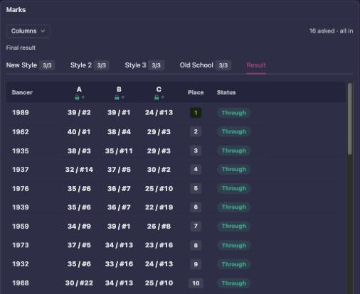
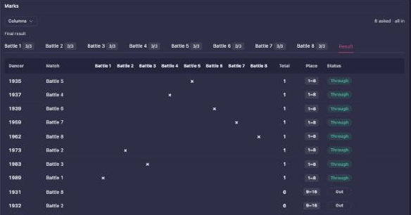
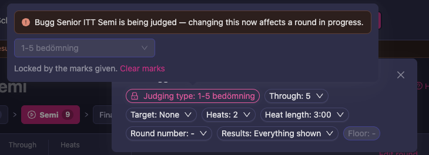

# Live operations

This is the recommended event-day runbook for managers and scrutineers.

This page assumes the setup is done and tested. If you have not yet rehearsed with the real
devices in the real hall, do that first: [Test run and venue
rehearsal](/manager-guide/test-run/).

## Pre-open checks (30-60 minutes before)

1. Open Manager and confirm [**Problems**](/manager-guide/validator/) has no failed tests
2. Confirm judges can access the judging app and enter their own PIN
3. Confirm Speaker and Screens are loading event data, and that the projector picture fills
   the display (see [Screens, projectors and venue technology](/manager-guide/screens/))
4. Confirm every station device is connected, and check their battery level
5. Confirm check-in status has been applied
6. Confirm first rounds have schedule/floor/beat assignments

## Running rounds

For each round:

1. Verify teams are loaded and heat distribution is correct
2. Press **Start judging** — the round goes to **In progress**
3. Monitor judge completion
4. Press **Close round** when judging is complete
5. **Confirm round**, then set the advancement targets — Manager warns you if you confirm
   without any ("No targets have been set from the round result") and if placements conflict
6. **Publish results online** when it should be public

## Live controls you will use most

- Round status controls: **Not started** → **In progress** (`Start judging`) → **Closed** (`Close round`) → **Confirmed** (`Confirm round`) → **Published** (`Publish results online`), plus **Previous status** to step back
- Send-through and not-through targets
- Priority assignment for alternates/group logic
- Round toolbar utilities (sort/randomize/reverse/heat count)
- Print actions (heat list, judging sheet, result, diploma)

## Reading the marks of a round

In Scrutineer (Beta), the new version of the Manager app, the round page has a **Marks** card.
It has a tab for each dance, with how many judges have submitted it (such as **3/3**), and a
**Result** tab that puts the dances together.

- **A dance tab** shows the judges' marks in that dance, and that dance's own sum and place.
- **The Result tab** adds the dances up and shows the place each couple ends up with. Its
  **Status** column says what happens to the couple next: **Through**, **Out**, or the name of
  the round it goes to when that is another round than the next one, such as a hope round or a
  B-final.
- **A couple that withdrew or was disqualified** keeps its sum and place, struck through, next to
  **Withdrawn** or **DQ**, so you can still see where it stood.
- **A total of 0** shows as 0 for a couple that danced. A dash means the couple has not been
  marked in any dance yet.

### Rounds judged with scores over several dances

In a round judged with scores (**Sum subtotal** under **Judging** on the round page) that is
danced over several dances, each judge gives every couple a score in every dance. The result
does not come from adding up dance by dance. It comes from each judge's total:

1. Each judge's scores over all dances are added up into that judge's total for the couple.
2. Each judge's totals are put in order: the couple with the judge's highest total is that
   judge's #1, the next highest #2, and so on.
3. The couples are then placed from the judges' places with the skating system, the same way as
   a final judged with places: the couple that most judges placed highest comes first.

The **Result** tab shows exactly this: one column per judge, headed with the judge's letter, with
the judge's total and the place it gives, such as **39 / #2**. Then come **Place** and
**Status**.

To check a place, read a couple's row from left to right. In the example, 1989 is #2, #1 and
#13 with the three judges, and comes first, because two of the three judges have it in their top
two.

The dance tabs still show every judge's score in each dance and the dance's own sum and place,
for checking a single mark. Partial scores show with the same number of decimals as full scores.

If the judging is set up to rank by the sum of the scores instead of by skating, each judge's
column shows only the judge's total, and a **Total** column adds the judges' totals up. The
highest total comes first.

### Battle rounds

A battle round is made of battles: each battle is a tab in the **Marks** card, with the judges'
votes in that battle. The **Result** tab shows the battles side by side:

- **Match** says which battle each starter danced in.
- Each battle has a column with **×** for the starter who won it.
- **Total** is the number of battles the starter won.
- **Place** and **Status** say who goes through.

To see how the judges voted in a battle, open that battle's tab.

Before judging starts, press **Place in battles** to put the starters into their battles. The
battles follow the bracket (**Seeded**): the placings of the round before, or the winners of the
battles before. You can also choose **Random**, or move a starter to another battle by hand.
Press **Place in battles** in the dialog to save. See [Battle bracket setup](/battle-bracket/)
for how battle rounds are built.

When you change the panel of a battle round, its battles get the same panel.

## Audience-facing coordination

During live execution:

- Use `Notifications` for official updates (see [Notifications](/manager-guide/notifications/))
- Use `Screens` for display output
- Use `Speaker` for floor-facing presentation flow
- Validate what is public via `Live` publish settings

## Handling common issues

While a round is **In progress**, the round page shows a **Stuck?** link next to the status buttons. It opens *Common problems during a round*, with a link to each of the three sections below: *Judges not finishing*, *Wrong participants in the round* and *Schedule running late*.

### Judges not finishing

- Confirm the round is **In progress**
- Check judge assignments and panel settings. If **Start judging** refuses, Manager says
  "Assign a judging panel to this class or round before starting judging." The warning links
  to **Judges**.
- Confirm network and device state

### Wrong teams in round

- Use round add/copy/clear tools in open or ready state
- Re-run send-through after correction

### Wrong judging type on a round in progress

You can change a round's judging type while it is **In progress** until the first judge gives a mark. After that the type is locked, so marks are never counted under a type they weren't given for. If you notice the type is wrong once judging has begun, for example a chance round set to 1–5 marks that should have been judged by placement, clear the marks and change the type. The couples, their heats and their starting order stay as they are, including a drawn order.

1. Open the round in **Live** and choose **Edit round…**.
2. Click the **Judging type** button. Under the type it says **Locked by the marks given.**
3. Click **Clear marks** and confirm with **Clear marks**. Every mark given so far in this round is removed.
4. Choose the right judging type. The judges' tablets open the round again, and they mark it once more.

**Clear marks** also shows under **Judging type** in the round's settings in Setup. It is only there while the round is **In progress**. To change a round whose judging is closed, open it again first.

### Schedule drift

- Update beat/time planning in schedule and round settings (see [Schedule and conflicts](/manager-guide/schedule/))
- Re-check screen/speaker timeline alignment

## End-of-day stabilization

1. Confirm all intended rounds are published
2. Run final notifications
3. Print/export required outputs
4. Prepare post-event close actions
