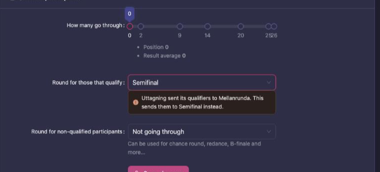
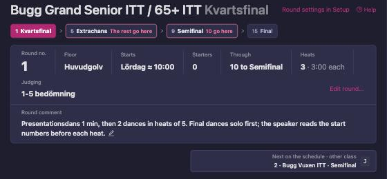
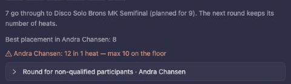
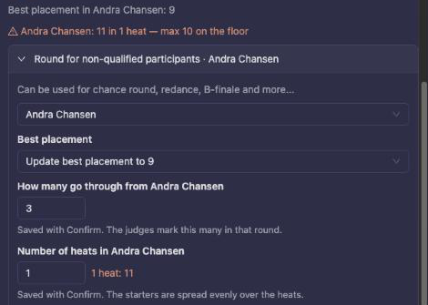
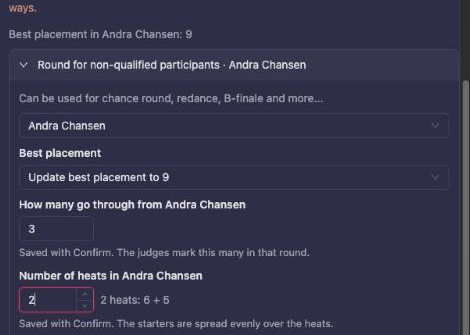
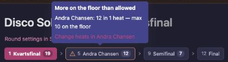
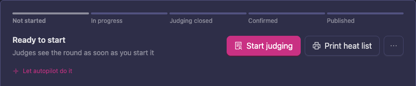
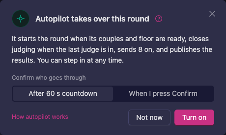
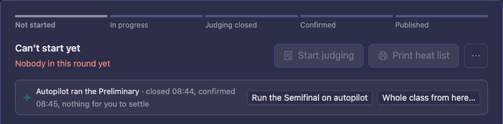
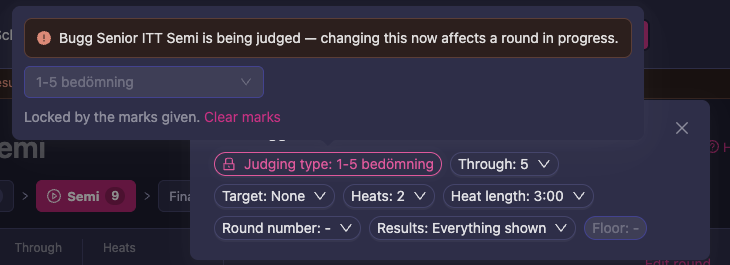

# Live operations

This is the runbook for the competition day, for the organizer and the scrutineer who run the
rounds in Manager. It covers the checks before the first round, the steps for every round, the
rounds that need something extra, and what to do when something goes wrong.

It assumes the setup is done and tested. If you have not yet rehearsed with the real devices in
the real hall, do that first: [Test run and venue rehearsal](/manager-guide/test-run/).

A **participant** here is one row on Manager's **Participants** page: a solo dancer, a couple or
a group. Some screens call the same thing a competitor, a couple, a starter or a team.

The steps describe the classic Manager. In Scrutineer (Beta), the new version of the Manager app,
the rounds are run under **Live**, and this page says where that version differs.

## Before the first round

Go through this list 30 to 60 minutes before the first round.

| Check | Where to look |
|---|---|
| The setup has no failed checks | [**Problems**](/manager-guide/validator/), at the top of the Manager sidebar. The link is only there while a check fails. |
| The judges are in the Judging app | `Manager → Competition → Judges`. The dot on a judge's row is green when the judge has the Judging app open and connected. Hover over it for the battery level. Each judge sets their own PIN the first time. See [Judge list](/manager-guide/judges/#judge-list). |
| The shared devices are connected | `Manager → Event → Stations`. The **Devices** column shows each connected device with its battery level, or **Online**, and **Offline** for a device that is not connected. See [Stations](/manager-guide/users-and-stations/#stations-shared-devices). |
| The screens and the speaker show the event | On the devices themselves: the projector picture fills the display, and Speaker opens the event. See [Screens, projectors and venue technology](/manager-guide/screens/). |
| Check-in has been applied, if the clubs check in their dancers | `Manager → Competition → Check-in`. Applying cancels every participant that an organization marked **Cancelled** when it signed, so read [What organization check-in changes](/manager-guide/organization-check-in/#what-organization-check-in-changes) first. |
| The first rounds are on the schedule | `Manager → Event → Schedule`. Open the first schedule item and check **Number**, **Floor**, **Start** and **Participants** on each round. A round without a schedule item is on the **Unscheduled** page. See [Schedule and conflicts](/manager-guide/schedule/). |
| The first rounds have participants and a judging panel | Open the first round (see [The round page](#the-round-page)). **Start judging** is not shown while the round has no participants, and is greyed out while the round has no panel. |
| What the public may see is set | `Manager → Audience → Live results`. See [What the audience sees](#what-the-audience-sees). |
| You have paper to fall back on | Printed heat lists and judging sheets from the round page (see [The round page](#the-round-page)), and the clubs' dancer lists from **Print dancer lists** on the Check-in page. |

## The round page

Everything you do to a round, you do on its page. There are two ways to open it:

- **The list on the right side of Manager.** It shows the rounds of one schedule page that are
  not yet confirmed. Choose the schedule page at the top of the list, then click a round. The
  list is not shown on a phone.
- **`Manager → Event → Schedule`**, or `Manager → Competition → Classes`: click the round's name.

In Scrutineer (Beta), a round danced as several dances, such as a bugg final in Slow and Quick,
is one line in that list when its dances follow each other. When other rounds are danced
between its dances, each part has its own line in its place in the schedule, named after the
round and its dances, such as **Final – Slow** and **Final – Quick**. An earlier part is done
once the judges have handed in its dances, and the round is closed and confirmed on its last
part. Every line opens the same round page, and **You're on it** is shown on the part being
danced.

The round page has these parts, from the top:

| Part | What it is for |
|---|---|
| **Round status** | The five statuses of the round, and the buttons that move it from one to the next. |
| **Round information** | The round's settings. They can be changed while the round is **Not started** or **In progress**. After that the card says "Round can not be edited when closed". |
| **Qualified participants** | Who goes on, and to which round. Shown only while the round is **Closed**, and not in a final. |
| **Judge results** | The participants heat by heat, with every judge's marks. Its buttons change the order and the heats, remove participants and print. To read the marks, see [Reading the marks](/manager-guide/reading-the-marks/). |

A round has one status at a time:

| Status | Manager says | What it means |
|---|---|---|
| **Not started** | "Round settings" | The round is being prepared. |
| **In progress** | "Ready for judging" | The judges on the round's panel have the round in the Judging app. They only have it while it is **In progress**. |
| **Closed** | "Results and placements overview" | Judging is over. You decide who goes on. |
| **Confirmed** | "Approved for presentation" | The participants have been sent to their next round. |
| **Published** | "Available online" | The results are public. |

The printer button in the **Judge results** card prints the heat list, the judging sheets, the
diplomas and the result.

## Run a round

Do these steps for every round. The buttons are in the **Round status** card.

1. **Open the round** from the list on the right side of Manager.
2. **Check the participants and the heats.** The **Judge results** card has one table for each
   heat, headed **Heat 1**, **Heat 2** and so on, with the number of participants in the heat.
   - If participants of the class are waiting to be put into the round, **Round status** has an
     **Add participants** button. Press it.
   - To change the order, use the buttons at the top of the card: **Randomize participants**,
     **Sort participant order** or **Reverse participants order**. **Number of heats** adds or
     removes a heat. Hover over a button to see its name. They work while the round is
     **Not started** or **In progress**.
   - To move one participant, open the menu at the start of its row and choose **Change heat**.
3. **Press Start judging.** The round goes to **In progress** and the judges get it on their
   tablets.
4. **Watch the judges submit.** In **Judge results**, every judge has a button with their letter
   at the top of a column. An open padlock means the judge is still marking. A closed padlock on
   a filled button means the judge has submitted. On a narrow screen only the letters are shown.
   In the list on the right, the round gets a check mark, **All results submitted**, when every
   judge has.
5. **Press Close round** when every judge has submitted. The round goes to **Closed**. If a judge
   has not submitted, Manager asks first: "Warning! All judges have not submitted their
   results!!"
6. **Set who goes on.** Not in a final. Under **Qualified participants**:
   - Set **Number to advance**. The slider only stops at numbers the result allows: it does not
     cut between participants that share a place. If the planned number falls between
     participants that share a place, the slider starts at the number that takes all of them.
     Move it down to leave them out. Under it you see the **Position** and the **Result average**
     at the line.
   - Check **Round for those that qualify**: see
     [Check where the round sends its participants](#check-where-the-round-sends-its-participants).
   - If the others go to a second chance round or a B-final, choose it under **Round for
     non-qualified participants**.
   - Click **Save changes**. Every row in **Judge results** now shows the round it goes to, under
     **Advance to**.
7. **Press Confirm round.** This sends the participants to the rounds you chose, and the round
   goes to **Confirmed**.
   - "Are you sure? No targets have been set from the round result." means nobody has a round to
     go to. Cancel, and do step 6 first.
   - "You have unsaved changes. Leave without saving?" means you changed **Qualified
     participants** without saving. Cancel, and click **Save changes** first.
8. **Press Publish results online** when the results may be public. The round goes to
   **Published**. Only a main round and a chance round have this button. A sub-round, such as
   one dance of a round, has none.

**Previous status** takes the round one status back. See
[A round was closed, confirmed or published too early](#a-round-was-closed-confirmed-or-published-too-early).

In Scrutineer (Beta), a round goes back with **Re-open round**, and published results are taken
offline with **Take results offline…** in the round's **⋯** menu.

### Check where the round sends its participants

Before you press **Confirm round**, check **Round for those that qualify** under **Qualified
participants**. It is filled in from the class setup, but you can change it, and a slip there
sends the participants past a round. A round can only be chosen while it is **Not started**.

The field warns you when the round you picked skips a round:

- For a second chance round, when it sends its qualifiers somewhere else than the round it takes
  the rest from does, for example "Preliminary sent its qualifiers to Quarterfinal. This sends
  them to Semifinal instead."
- For any other round, when it sends them past the next round, for example "The next round is
  Quarterfinal. Sending to Semifinal skips it."

The warning doesn't stop you: if you skip a round on purpose, for example because fewer
participants came than planned, save as usual.

When you choose a round under **Round for non-qualified participants**, and it is not a chance
round, **Best placement** is shown under it. It offers to set that round's best placement to the
first place after those who went through, for example "Update best placement to 13", or to keep
the **Previous** value. When the round you are confirming is itself a second chance, the places of
those who went straight on from the round before count too: an extra chance placed from 5 that
sends 2 on offers 7. When the round you chose is also the **Round for those that qualify**,
**Best placement** is not shown and that round keeps its own.

### Changing who goes through by hand

When the result alone doesn't decide who goes on, for example to settle a tie at the line, you
can set the round for a single participant yourself.

1. Close the round, and save **Qualified participants** as in step 6 above.
2. In **Judge results**, find the participant's row. In the **Advance to** column, choose the
   round to send it to, or **Not advanced** to keep it out. The column is not shown on a narrow
   screen.
3. The row gets a warning icon. Hover over it: **Manually changed**.
4. Press **Confirm round**.

Change the number first and the single participants after. When you click **Save changes** under
**Qualified participants** again, every participant is set from the result again.

A participant that has already been sent on cannot be changed here. See
[Wrong teams in round](#wrong-teams-in-round).

In Scrutineer (Beta), you do this on the **Result** tab of the round's **Marks** card:

1. Close the round. The status can be changed while the round is closed, before you confirm it.
2. On the **Result** tab, click the participant's **Status**.
3. Choose **Advance to** and the round to send the participant to, or **Not going through** to
   keep it out.

The participant then shows **Moved** (**Changed by hand**). When you confirm the round, the
participants you changed go as you set them, and the others go by their place and the number
going through. If you change the number going through afterwards, every participant is set from
the result again.

## Rounds that need something extra

### A tie at the line, or in a final

When participants share a place in a closed round, the **Judge results** card offers **Redance**,
**Side skating**, **Chief judge** or **Paper redance**, depending on the round and its panel. See
[Separating tied positions](/manager-guide/judges-on-the-day/#separating-tied-positions).

In a closed final, a participant that shares a place has a warning icon next to the place:
**Shared placement**. If you press **Confirm round** while places are still shared, Manager asks
first: "Warning! Some participants share a placement."

### A tie at the cut in Scrutineer (Beta)

When the number going through falls among participants who share a place, Scrutineer (Beta)
stops before the round is confirmed and opens **Settle the tie at the cut**. Each way says what
it leads to:

- **A lower number**, such as **3 to Final**: everyone who shares the place is out, and nobody
  dances again. The round is confirmed with that number at once.
- **A higher number**, such as **10 to Final**: everyone who shares the place goes through.
- **Dance again**: those who share the place dance again in a redance round of their own, for the
  places that are left. The round waits for the redance; then the planned number goes through.
- **Let the chief judge decide** or **Settle with a paper redance**, when the round's panel or
  judging has them.

**Dance again first, then the number.** Choose the redance straight away; how many go through is
settled after it. For example, a second chance should send 5 on to the final. 3 participants
have a majority of the crosses and 7 share 4th place with one cross each. **3 to Final** says
"All 7 who share the place are out, and nobody dances again": it would confirm the round with 3.
**Dance again** says "The 7 who share the place dance again for the last 2 places. This round
waits until the redance is confirmed; then 5 go to Final." To let the 7 dance for those places:

1. Under **Settle the tie at the cut**, choose **Dance again**.
2. **Where it dances** shows where the redance goes in the running order. Drag it, or use ↑ ↓,
   to move it.
3. Press **Confirm: dance again**. The redance is on the run sheet, and the round waits for it.
4. Start, judge and confirm the redance like any other round.
5. Go back to the round and confirm it. The redance's places now separate the 7, so the planned
   5 go through. If participants still share the place at the cut, Scrutineer asks again.

**If you chose the lower number by mistake**, re-open the round and settle the tie again:

1. On the round's page, open **···** and choose **Re-open round**.
2. Under **What needs fixing?**, choose **Something else**, then **Judging closed — keep the
   marks, decide the cut again**. Leave **Take those it sent on back out of the next round**
   ticked.
3. Press **Re-open round**. Then press **Settle the tie** and choose **Dance again**.

### Participants left out with a majority of the crosses

In Scrutineer (Beta), a round judged with crosses can stop when the number going through leaves
out participants who have more than half of the judges' crosses. Leaving them out is then a
choice you make, not something that passes unnoticed.

It is on in events of Norges Danseforbund, whose rules send everyone with a majority through. In
other events it is off until you turn it on (see below). It only applies to a round with crosses
that sends participants on to a next round. Manager does not ask.

When it applies, the round can't be confirmed until you have chosen:

1. After judging is closed, the round page says "Settle what is open, then confirm." In the
   marks, the participants it is about have **Decide** where the others have **Through** or
   **Out**.
2. Press **Decide**. **Left out with a majority of the crosses** lists them, each with their
   crosses, such as "4 of 7".
3. Choose one of the two ways:
   - **6 go through** (with the number that takes all of them): everyone with a majority goes on
     to the next round.
   - **Leave them out: 4 go through** (with the round's own number): they are out, although they
     have a majority.
4. Press the confirm button, which now says what you chose. The round is confirmed with it.

A tie at the cut is settled first. When everyone who is tied has a majority, taking them all
through is the suggested way, ahead of a redance. If you settle the tie by leaving them out,
this question comes next.

Autopilot stops and asks you in the same way, and never leaves participants with a majority out
by itself.

**Turn it on or off for an event.** In **Live**, open the **Autopilot** tab and press
**Settings in Setup**. Under **Event defaults**, **A majority left out** has three choices:

- **As the federation's rules say**: asks in events of a federation whose rules send everyone
  with a majority through, and nowhere else. This is the built-in choice.
- **Ask me**: every crosses round of the event stops and asks.
- **Leave them out**: no round of the event asks.

Unlike the other defaults on that page, this one counts for every round of the event, on
autopilot or confirmed by hand. A round that is on autopilot can have its own choice on the
round's **Autopilot** tab; it counts while autopilot is on for that round. A round you run by
hand follows the event's choice. A final has no such choice, since nobody is left out of it.

### Rounds that use priority

A round can give its participants a priority instead of only sending them on. This is the
**Round priority setting** in the round's settings. While such a round is **Closed**:

- With **Alternates**, the **Qualified participants** card also has **Number of alternates**, and
  its button is called **Update priority** instead of **Save changes**.
- With **Groups**, the round has an **Update priority** card instead of **Qualified
  participants**. Click **Update priority**. Manager answers "Priorities updated, please
  confirm!". **Reset priority** resets them.

Every row in **Judge results** then shows its **Priority**, which you can change for a single
participant. Then press **Confirm round**.

### Classes in a group

The round page of a class in a group shows one of these warnings. Follow it:

- "Group child rounds should NOT be confirmed until all rounds are finished and competitors have
  been sent through in group class"
- "Wait until all group child rounds are closed before confirming this round"

### Battle rounds

A battle round is run battle by battle. See [Battle bracket](/battle-bracket/) for how it is
built and judged, and [Battle rounds](/manager-guide/reading-the-marks/#battle-rounds) for how to
read its result.

### A dancer withdraws before the first round

When you withdraw a participant in its own form, with check-in, or with **Withdraw…** in the
**⋮** menu of its entry on **Participants** under **Live**, while it is only in the first round of
its class and no judge has marked it there yet, it is taken out of that round as well. This works
while the round is not started or is being judged. It gets no place in the result, and the
results file shows it as withdrawn (**S**). The **Withdraw** dialog on **Participants** says when
this will happen.

Take the withdrawal back with **Undo** in the message that confirms it, with **Undo withdraw** on
the entry, or in the participant's form. The participant goes back into the same heat, in the same
place, as long as the round is still not closed. A participant you took out of a round yourself
is not put back.

A participant you withdraw from the round itself, from the menu on its row (**Cancel
competitor**) or from the lineup, stays in the round, struck through, so you can take the
withdrawal back with **Undo cancel**. So does a participant that has already been marked, or
that is in a round that is closed or confirmed. Such a participant is placed last. To leave it
out of the result, take it out of the round before judging starts.

If you withdrew the wrong participant after its round was closed, take back the withdrawal and
add the participant to the round again.

### Round comment

A round comment is a short note about the round, such as "Presentation dance 1 min" or "Final
dances solo first". It is shown on the judging sheets and in the public app, and under the
round's name on the round page.

To change it, type it under **Round comment** in the **Round information** card and click **Save
changes**. This works while the round is **Not started** or **In progress**.

In Scrutineer (Beta), you change it right on the round's page in **Live**, for example while you
walk through the rounds before the event:

1. Open the round in **Live**. The comment is the last row of the box with the round's facts,
   under **Round comment**.
2. Click the comment. With no comment yet, click **Add round comment**.
3. Type the new comment and press **Enter**, or click somewhere else, to save it. Press **Esc**
   to leave it as it was. On a phone, tap **Save** or **Cancel**.

There, once a round is confirmed and published, its comment is still shown but can't be changed.

### Start the class's next round

In Scrutineer (Beta), once a round is confirmed you usually start the next round of the same
class straight away, so its judges have it. The confirmed round's card leads with that:

1. Confirm the round. Its card now shows **Start** and the name of the class's next round, for
   example **Start Second chance**: the class's second chance round while it is still to be
   danced, otherwise the round the participants were sent to.
2. Press it. Judging starts in that round and you stay on the confirmed round, so you can
   publish it. **Publish results…** stands beside the button.
3. To open the started round, click it in the class's rounds at the top of the page.

If that round can't start yet, for example nobody is in it or it has no judging panel, the
button is greyed out and the card says why, with a link to open the round and put it right. If
you want to change how many go through to it first, open it from the class's rounds and start it
there. The **Previous on the schedule** and **Next on the schedule** boxes under the round's facts follow the running
order of the event, whatever class comes next.

### Change how many go through

In Scrutineer (Beta), on a round's page in **Live**:

1. Click **Through** in the round's facts, at the top of the page.
2. While the round is **Not started** or **In progress**, a box opens with the number. Use
   **−** and **+**, or type it, and click **Save** (or press **Enter**). On a round being judged,
   the box warns you first.
3. Once judging is closed, **Through** opens **How many go through?** instead, where you pick the
   number from the result.

On a confirmed round the number can't be changed there: see
[A round was closed, confirmed or published too early](#a-round-was-closed-confirmed-or-published-too-early).

### When the cut puts more on the floor than allowed

When fewer participants go through than planned, the rest go to the second chance round, so it
gets bigger. A tie can also send more to the next round. Each round keeps the number of heats it
was planned with, so a heat can end up with more on the floor than the rules allow, for example
11 in one heat where the floor takes 10. In Scrutineer (Beta), **How many go through?** warns you
before you confirm:

1. Pick how many go through. If a round that gets participants from this one would have a heat
   that is too big, a warning shows above **Round for non-qualified participants**, for example
   "Andra Chansen: 11 in 1 heat — max 10 on the floor". You see it with the section closed too.

   

2. Open **Round for non-qualified participants**. Under **How many go through from** the round,
   **Number of heats in** the round shows its heats and how the participants are split over them,
   for example "1 heat: 11".

   

3. Raise the number of heats until the warning goes away. The split shows what each heat gets,
   for example "2 heats: 6 + 5".

   

4. Press **Confirm**. The new number of heats is saved with it, and the participants are spread
   evenly over the heats.

When the round the qualified go to is the one that gets too big, **Number of heats in** that
round shows below the section instead. If other rounds still send participants to it, such as
the second chance round, it says how many it counts on from them.

The most allowed on the floor comes from the federation's rules for the class (the same rules the
**Round guide** uses). When the rules don't give one, the warning compares with the round's own
plan instead, for example "planned up to 10 per heat". A final is only checked against the rules:
one more participant after a tie is a final as usual.

If you confirm without changing the heats, the round is marked in the class's rounds at the top
of the page. Point at it to see the warning, and click **Change heats in** the round to open it
and change the number of **Heats** there.

When there are more heats than needed, the **Classes** page says so: see
[Heats not needed](/manager-guide/competition-setup/#heats-not-needed).

### Where a redance dances

When you settle a tie at the line with **Redance** in Scrutineer (Beta), **Where it dances**
lists the run sheet from the tied round on. The redance starts **Up next** and can be dragged, or
moved with the arrows, to any place before the class's next round, which waits for it.

It can't go before a round that is being danced or is done: judging closed, or at least one judge
handed in. A round whose judging was started ahead of its turn, with no judge in yet, says
**started, no judge in yet** and the redance can go before it. If the redance has only one place,
the list says why instead of how to move it.

## Let autopilot run a round

In Scrutineer (Beta), autopilot can take the routine steps of a round off your hands: starting
it, closing judging, confirming who goes through and publishing the results. You don't have to
switch it on for the whole event to try it. Start with one round, see how it goes, and let it
run more rounds once you trust it.

1. Open the round in **Live**. Under the round's buttons, where the round page says what comes
   next, press **Let autopilot do it**.

   

2. A short window says what autopilot will still do in this round, for example "It starts the
   round when its couples and floor are ready, closes judging when the last judge is in, sends 8
   on, and publishes the results".
3. Under **Confirm who goes through**, choose how the round is confirmed:
   - **After 60 s countdown**: autopilot confirms by itself once the countdown runs out (the
     event's own countdown, 60 seconds unless you changed it). You can hold it before then.
   - **When I press Confirm**: autopilot does everything up to Confirm and then waits for you.
     A good choice for your first try. The sentence above then says it "waits for you to press
     Confirm".
4. Press **Turn on**. The round now has an **Autopilot** tag at the top of the page.

   

You stay in control: press any of the round's buttons yourself whenever you want. At a tie it
can't settle, autopilot stops and asks you. **How autopilot works** opens the **Autopilot** tab,
with everything autopilot is doing and has done.

**Let autopilot do it** isn't shown for a round autopilot can't start by itself: the first round
on a floor that day or after a break (a person starts it), a round that isn't on the schedule, a
round without a judge panel, or any round when the event's autopilot settings leave starting
rounds to you. Once you have started such a round, the offer comes back for the next steps. It
isn't shown either while there is something for you to decide, such as a tie, because autopilot
would hand that straight back to you.

### Let it run the next round

When autopilot has run a round of a class, the class's next round says so, with when the round
was closed and confirmed, and that there was nothing for you to settle.

- **Run the Semifinal on autopilot** (with the name of this round) opens the same short window
  for this round.
- **Whole class from here…** lists this round and the rest of the class, says step by step what
  autopilot will do in them, and switches them all on with **Switch on for 2 rounds** (with the
  number of rounds). Tick **Wait for me to press Confirm in these rounds** to keep confirming
  yourself.

## When things go wrong

While a round is **In progress**, the **Round status** card has a **Stuck?** link next to the
buttons. It opens **Common problems during a round**, with three links to this page: **Judges
not finishing** opens [Judges not finishing](#judges-not-finishing), **Wrong participants in the
round** opens [Wrong teams in round](#wrong-teams-in-round), and **Schedule running late** opens
[Schedule drift](#schedule-drift).

### Judges not finishing

Look at the judges' letters at the top of the **Judge results** card to see who has not
submitted: their padlock is open. Then check, in this order:

1. **Is the round In progress?** The judges only have a round on their tablets while it is
   **In progress**.
2. **Is the judge on the round's panel?** A judge only gets the rounds of the panels they sit
   on. If the round has no panel at all, **Start judging** is greyed out and Manager says
   "Assign a judging panel to this class or round before starting judging." The warning links to
   **Judges**. See [Classes](/manager-guide/judge-panels/#classes) on the Judges page.
3. **Is the judge's tablet connected?** The small dot, or battery, next to the padlock shows it.
   Hover over it: **Connected**, **Connected, battery 80%** (with the tablet's own level) or
   **Disconnected**. See
   [A judge's tablet loses the network](#a-judges-tablet-loses-the-network).
4. **Is the judge stuck at the PIN?** The Judging app locks itself after 10 minutes without use.
   If the judge has forgotten the PIN, press **Reset PIN** on their row in
   `Manager → Competition → Judges`. See [PIN](/manager-guide/judges/#pin).
5. **Does the app refuse to submit?** The Judging app says why, for example "Must have results
   on all participants". The judge completes the marks and presses **Submit results** again.

Other cases:

- **A judge submitted too early and needs to change a mark.** Hover over the judge's letter and
  click the judge's name. The padlock opens, and the judge has the round on the tablet again.
  This works while the round is **In progress**.
- **A judge cannot submit on the tablet.** The same click on a judge with an open padlock marks
  the judge as submitted, with the marks the judge has given so far. Manager does not check that
  the marks are complete.
- **A judge has to leave.** See
  [Replacing a judge who has already given marks](/manager-guide/judges-on-the-day/#replacing-a-judge-who-has-already-given-marks).
- **You close the round although a judge has not submitted.** Manager asks first: "Warning! All
  judges have not submitted their results!!" Avoid going on from here. Get the judge to submit, or
  mark the judge as submitted yourself, as described under
  [Judges not finishing](#judges-not-finishing), so that it is clear which marks the result is
  built on. If you closed too early, set the round back with **Previous status**.

### A judge's tablet loses the network

- The Judging app shows "Disconnected, retrying connection..." and, when it is back, "Connection
  has been re-established."
- The judge can go on marking. Marks that could not be sent are kept on the tablet, and a
  warning triangle shows next to the heat. The app tries to send them again every few seconds,
  also after the page is reloaded.
- The judge cannot submit until the marks are sent. The app says "Could not save all scores.
  Please check your connection and try again."

So get the same tablet back on the network, for example on a phone hotspot. The unsent marks
are on that tablet, not on another one.

If many devices drop at once, the fault is in the hall's network. See
[Network](/manager-guide/screens/#network).

### A judge's tablet stops working

Neither the classic Manager nor Scrutineer (Beta) lets you type in marks for a judge, for example
from a paper judging sheet. Marks are only given in the Judging app, by the judge. So when a
tablet fails:

1. Give the judge another phone or tablet. The judge signs in there, opens the Judging app and
   goes on. The marks the judge had saved before the tablet failed are still there. If the judge
   has forgotten the PIN, press **Reset PIN** on their row in `Manager → Competition → Judges`.
2. If the judge went on marking on paper meanwhile, the judge enters those marks in the Judging
   app on the new device and presses **Submit results**.
3. If the judge cannot go on at all, mark the judge as submitted with the marks given so far, as
   described under [Judges not finishing](#judges-not-finishing), or replace the judge: see
   [Replacing a judge who has already given marks](/manager-guide/judges-on-the-day/#replacing-a-judge-who-has-already-given-marks).

In Scrutineer (Beta), the judge's row on the round's page in **Live** has **Phone problem?**,
which lists the same ways out.

### Wrong teams in round

The tools are in the **Judge results** card on the round page. The menu at the start of a
participant's row works while the round is **Not started** or **In progress**.

| What is wrong | What to do |
|---|---|
| A participant is missing | Press **Add participants** in **Round status**. It is shown while participants of the class who start in this round are not in it yet. If it is not shown, check the participant's class and **First round** on `Manager → Competition → Participants`. |
| A participant withdrew | In the menu on its row, choose **Cancel competitor**. See [A dancer withdraws before the first round](#a-dancer-withdraws-before-the-first-round). |
| A participant should not be in the round | In the menu on its row, choose the delete item at the bottom, and confirm. |
| A participant is in the wrong heat | In the menu on its row, choose **Change heat**. |
| A participant is in the wrong class | In the menu on its row, choose **Change class**. This works in a main round, for a participant that has not come from an earlier round and has no round to go on to yet. |
| The whole round is wrong | Click **Remove participants** at the top of the card. It only works while the round is **Not started**. Then press **Add participants** for those who start in this round. Those who came from the round before are sent again from that round, as described below. |

If the mistake was made in the round before, correct it there: set that round back to
**Closed** with **Previous status**, save **Qualified participants** and press **Confirm round**
again. Participants that were already sent on are not sent twice.

If a round sent its participants to the wrong round, for example a second chance round that sent
them to the semifinal instead of the quarterfinal:

1. In the round they went to by mistake, use **Remove participants** while it is **Not started**.
2. Set the round that sent them back with **Previous status** until it is **Closed**.
3. Under **Qualified participants**, choose the right **Round for those that qualify**, then
   click **Save changes** and **Confirm round** again.

### Wrong judging type on a round in progress

You can change a round's judging type while it is **In progress** until the first judge gives a
mark. After that the type is locked, so marks are never counted under a type they weren't given
for.

If you notice the type is wrong once judging has begun, for example a chance round set to 1–5
marks that should have been judged by placement, clear the marks and change the type. This is
done in Scrutineer (Beta): the classic Manager has no **Clear marks**. To get there from the
classic Manager, press **Try new version** at the top. The participants, their heats and their
starting order stay as they are, including a drawn order.

1. Open the round in **Live** and choose **Edit round…**.
2. Click the **Judging type** button. Under the type it says **Locked by the marks given.**
3. Click **Clear marks** and confirm with **Clear marks**. Every mark given so far in this round
   is removed.
4. Choose the right judging type. The judges' tablets open the round again, and they mark it
   once more.

**Clear marks** also shows under **Judging type** in the round's settings in Setup. It is only
there while the round is **In progress**. To change a round whose judging is closed, open it
again first.

In the classic Manager, **Judging type** in **Round information** is greyed out as long as the
round has marks. Setting the round back to **Not started** does not remove them. The only way to
remove the marks of one round there is to empty the round, which also loses its heats and
starting order:

1. Press **Previous status** until the round is **Not started**.
2. Click **Remove participants** at the top of the **Judge results** card and confirm. The
   participants are taken out of the round, and their marks in it are deleted. This is refused
   once the round has sent participants on to another round.
3. Change **Judging type** in **Round information** and click **Save changes**.
4. Put the participants back, as described for a whole round under
   [Wrong teams in round](#wrong-teams-in-round), then press **Start judging**. The judges mark
   the round again.

### A round was closed, confirmed or published too early

**Previous status** in the **Round status** card takes the round one status back each time you
press it:

| From | To | What to know |
|---|---|---|
| **Published** | **Confirmed** | The results are taken offline. |
| **Confirmed** | **Closed** | The participants that were sent on stay in their next round. To move them, see [Wrong teams in round](#wrong-teams-in-round). |
| **Closed** | **In progress** | The judges that had submitted are still locked. Open the padlock of each judge who needs to change a mark: hover over the judge's letter and click the judge's name. |
| **In progress** | **Not started** | The judges no longer have the round on their tablets. |

### Schedule drift

Open `Manager → Event → Schedule` to see how late the day is running. Under the rounds of a
schedule item you see **Planned end** and, once the day runs late or early, **Estimated end**
and **Total delay**. The **Offset** column shows how far each round ran over its plan.

In Scrutineer (Beta) the same figures are under **Setup** → **Schedule** for every schedule item
where a round has started. Its **Live** schedule tags an item that still has rounds to run with
the same delay in whole minutes once it is 5 minutes or more, for example **5 min behind** or
**7 min ahead**. From 5 minutes Live also offers **Move start times…** for the items that follow.
Each round on the **Live** schedule shows how many start in it and, when it is danced in two or
more heats, how many heats, such as **15 starters** and **2 heats** under it.

The estimated start of the rounds that follow moves by itself, and the Speaker, the screens and
the public page show the new times. You do not have to change anything for that.

To win time back, or to change the plan:

- **Change the order.** Drag a round to another place, or select rounds and use **Move to
  other**. See [Moving and ordering rounds](/manager-guide/schedule/#moving-and-ordering-rounds).
- **Change how long a round takes.** A round takes **Heat length** × **Number of heats**, both
  in the round's settings. See [Times](/manager-guide/schedule/#times).
- **Change when a block starts.** Each schedule item has its own **Time**. Edit the item to
  change it. See [Schedule items](/manager-guide/schedule/#schedule-items).
- **Tell people.** Send a notification from `Manager → Audience → Notifications`. See
  [Notifications](/manager-guide/notifications/).

If a screen does not follow the schedule, the speaker may have put something else on it. See
[Who controls what is shown](/manager-guide/screens/#who-controls-what-is-shown).

## What the audience sees

- **Results** are public once the round is **Published**.
- **`Manager → Audience → Live results`** decides what the public sees while a round is still
  going on. Manager describes it like this: "Live results will allow the audience to follow
  judge results live while dancers are still on the floor." **Show live placement on web** can be
  **Disabled**, **Show only rounds before final** or **Show all rounds**. **Show judges marks on
  web** can be **Disabled**, **Show all marks** or **Only show marks after competition is
  closed**.
- **Notifications** send official updates to the event's followers. See
  [Notifications](/manager-guide/notifications/).
- **Screens** show the hall what is on the floor, and the **Speaker** app is what the speaker
  runs the floor from. See [Screens, projectors and venue technology](/manager-guide/screens/).

## After the last round

1. On `Manager → Event → Schedule`, check that every round you want public is published: a
   published round has a trophy icon next to its status. Hover over it: **Published**.
2. Send the last notifications.
3. Print the results and the diplomas you need, from the printer button on each round page.
4. Close the day as described in [Post-event and exports](/manager-guide/post-event/).
