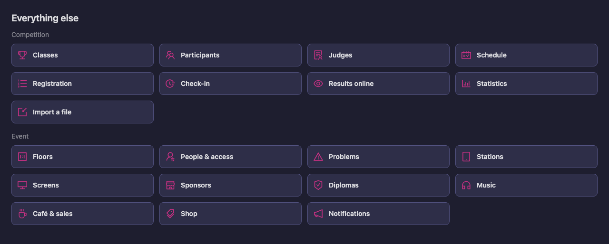
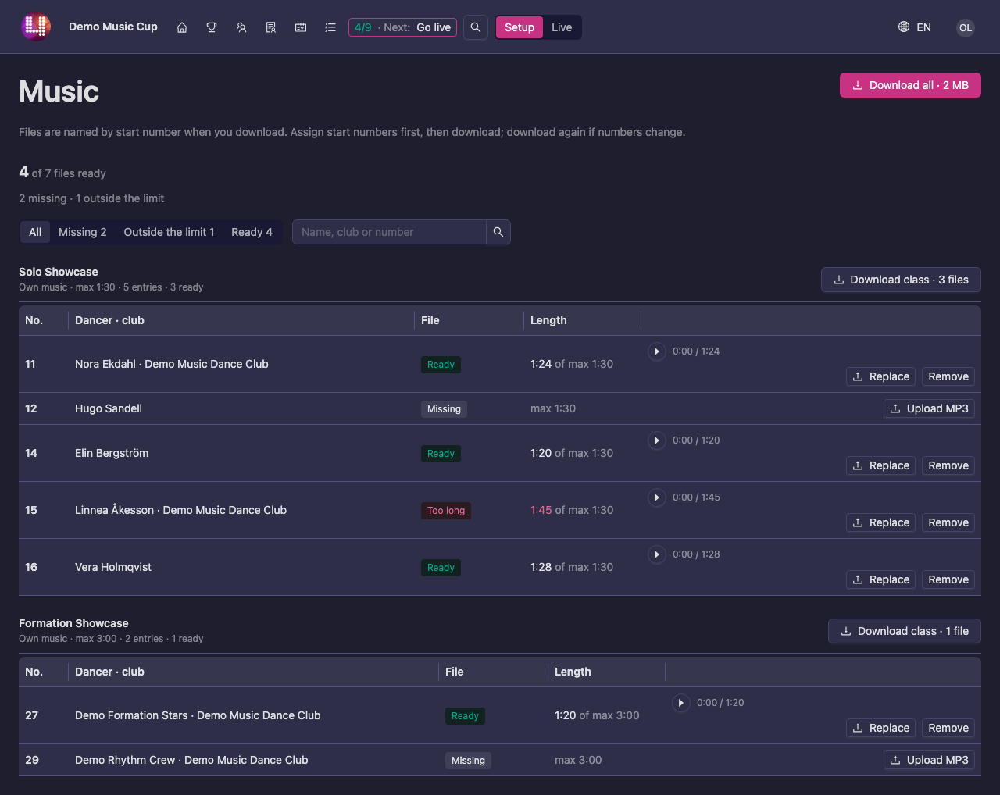
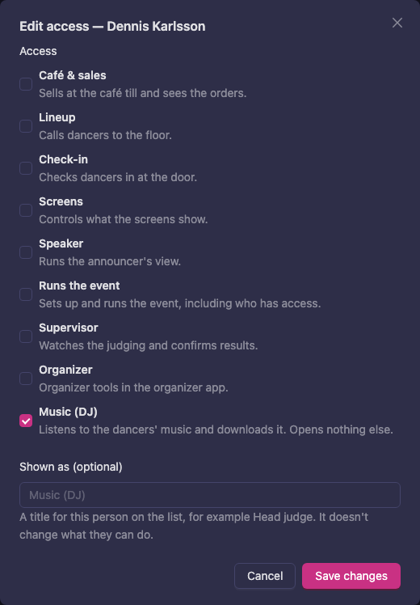
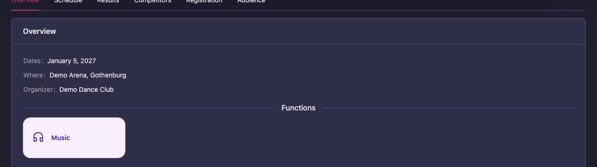
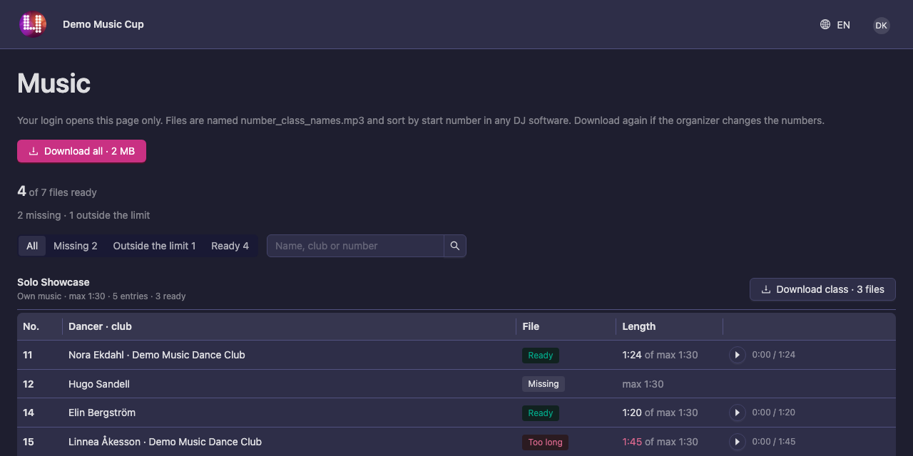

# Music from the dancers

In some classes every entry dances to its own music. The dancers upload their track themselves, on **My registration** (see [Your music](/dancer/my-registration/#your-music)). The **Music** page is where you, the organizer, follow up on those tracks and hand them to the DJ:

- see who has uploaded, who has not, and whose track is too long or too short
- listen to a track, or upload one for an entry yourself
- download the tracks of a class, or of the whole event, with every file named by start number
- give the DJ a login that opens this page and nothing else

Which classes ask for own music, and how long a track may be, is decided by the federation in its rules, not by you. See [Own music](/federation-rules/own-music/).

## Where to find the page

The Music page is in **Scrutineer (Beta)**, the new version of the Manager app. The classic Manager has no Music page.

1. Open the new version. On your event page, tap the **Scrutineer** tile marked **Beta** under **Functions**. If you are already in the classic Manager, press **Try new version** at the top instead.
2. On the overview, scroll down to **Everything else** and press **Music** under **Event**.

You can also press the search icon at the top and type "Music".

If the page says **No class of this event asks for own music. The federation sets that in its class rules.**, none of your classes asks for own music. Ask your federation to turn it on for the classes that need it (see [Own music](/federation-rules/own-music/)).

## What the page shows

At the top you see how many files are ready, for example **4 of 7 files ready**, and under it what is left: how many are **missing** and how many are **outside the limit**.

Below that, every class that asks for own music has its own list, with the limit next to the class name, for example **Own music · max 1:30**. Each entry is a row:

| Column | What it shows |
|---|---|
| **No.** | The entry's start number. A dash until the entry has one. |
| **Dancer · club** | The dancer's or the team's name, and the club. |
| **File** | Where the track stands. See the table below. |
| **Length** | The track's length against the limit, for example **1:24 of max 1:30**. It turns red when the track is outside the limit. |

| File | What it means |
|---|---|
| **Ready** | A track is uploaded and fits the limit. |
| **Missing** | Nothing has been uploaded yet. |
| **Too long**, **Too short** | The track is outside the limit of the class. The dancer has to upload a new one. |
| **Rejected** | The last upload could not be used, for example because the file was not a real MP3. |
| **Deleted after the competition** | The track has been removed, with the date. See [After the competition](#after-the-competition). |

To find what still needs attention:

- Press **Missing** or **Outside the limit** above the lists to see only those entries. **Ready** shows the ones that are done, and **All** shows everything again.
- Type a name, a club or a start number in the search box to find one entry.
- Press the play button on a row to listen to the track.

An entry marked **Locked** belongs to a class whose registration has closed. The dancer can no longer change the track, but you still can.

## Upload or change a track for an entry

Dancers normally upload their own music, and they are reminded on **My registration** and in the registration e-mail. When a dancer sends you the file instead, or needs a change after registration has closed, you can do it for them:

1. Find the entry on the Music page.
2. Press **Upload MP3**. If the entry already has a track, the button says **Replace**.
3. Choose the file. It is checked the same way as when the dancer uploads: it must be an MP3 and fit the limit of the class.

**Remove** takes the track away, and the entry says **Missing** again.

## Download the music for the DJ

1. **Assign start numbers first.** The files are named by start number, so the DJ can sort them in the running order. See [After the import](/manager-guide/registration-checkin/#after-the-import). Until then the page says **no start numbers yet**.
2. Press **Download class** on a class to get that class, or **Download all** at the top to get every class.
3. Chrome and Edge first ask where to save the file. Then wait while the download is put together: a window shows the progress, for example **File 3 of 12**. Keep the page open until it says **The zip is saved**.

You get a zip file. Inside, each track is named with the start number, the class and the names, for example `014_Solo-Showcase_Elin Bergstrom.mp3`. Letters such as å, ä and ö are written as plain a and o, so every DJ program and USB stick can read the names.

- **Download all** gives one zip with a folder for each class. In Safari and Firefox you get one zip per class instead.
- Only tracks that are uploaded are included. An entry without a track is not in the zip, so check **Missing** first.
- **If start numbers change, download again.** The names are made at the moment you download. An entry that has no number yet gets `000`.

If the zip cannot be made in your browser, a window with the list of files opens instead. Press the download button under the list to save them all, or press each file to save them one by one. Your browser may ask once whether to allow several downloads.

## Give the DJ their own login

The DJ does not need access to the rest of your event. A **Music (DJ)** login opens the Music page and nothing else.

1. Ask the DJ to create a Vote4Dance account, if they do not have one.
2. Open **People & access** (on the overview, under **Everything else**).
3. Under **Add a person**, type the DJ's name or e-mail and press **Add**.
4. Press **Edit access** on the DJ's row, tick **Music (DJ)** and press **Save changes**.

   

5. Ask the DJ to sign in to Vote4Dance and open your event page. Under **Functions** they tap **Music**.

   

You can also send the DJ the address of the Music page: open the page yourself and copy the address from your browser.

The DJ sees the same lists as you. They can listen to the tracks and download them, by class or all at once. They cannot upload, replace or remove a track.

Tell the DJ to download again if you change start numbers after their download.

## After the competition

The tracks are not kept for ever. Vote4Dance deletes them automatically some days after the competition has ended. The federation decides how many days; without a number from the federation it is 8 days. Download what you want to keep before then.

After that, the entry says **Deleted after the competition**, with the date, and the top of the page counts how many were **deleted after the competition**.
