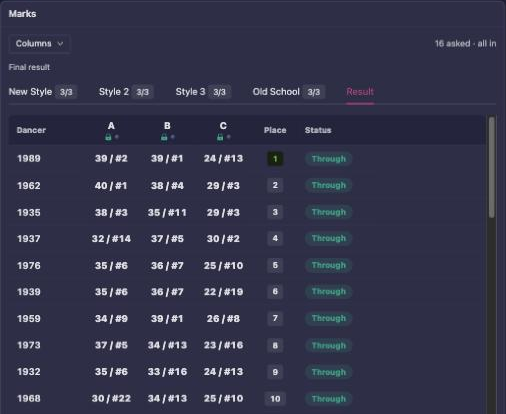
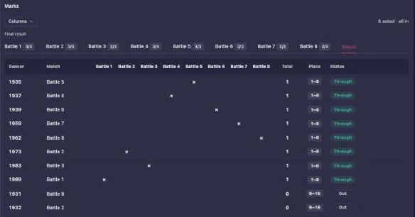

# Reading the marks

This page is for the scrutineer who wants to check a result: how to read the judges' marks of a
round, and how a place follows from them. For the steps of running a round, see
[Live operations](/manager-guide/live-operations/).

A **participant** here is one row on Manager's **Participants** page: a solo dancer, a couple or
a group. Some screens call the same thing a competitor, a couple, a starter or a team.

## The Judge results card

In the classic Manager, the marks are in the **Judge results** card on the round page. It has
one table for each heat:

- **A column for each judge**, headed with the judge's letter, holds that judge's marks. Trainee
  judges have no column.
- **A round with sub-rounds**, for example one for each dance, has a column for each sub-round
  instead. Click the sub-round's name at the top of the column to open it with its judges'
  marks.
- **Sum** and **Plac** show the participant's sum and place, for the rounds that use them.
- **A participant that withdrew or was disqualified** has its start number, sum and place struck
  through.
- **A badge with a letter next to a place** shows that the place was decided by separating a tie.
  See [Separating tied positions](/manager-guide/judges-on-the-day/#separating-tied-positions).
- **Advance to** shows the round the participant goes to. It is there once the round is
  **Closed**, in every round but a final.

## The Marks card in Scrutineer (Beta)

In Scrutineer (Beta), the new version of the Manager app, the round page has a **Marks** card.
It has a tab for each dance, with how many judges have submitted it (such as **3/3**), and a
**Result** tab that puts the dances together.

- **A dance tab** shows the judges' marks in that dance, and that dance's own sum and place.
- **A column for each judge** is headed with the judge's letter, so a judge has the same header
  in every panel. When the letters are first names, as at some events, the header shows the
  start of the name, such as **And…**. Hover over it to see the whole name. Only a judge with no
  letter is headed A, B, C… in seat order.
- **The Result tab** adds the dances up and shows the place each participant ends up with. Its
  **Status** column says what happens to the participant next: **Through**, **Out**, or the name
  of the round it goes to when that is another round than the next one, such as a hope round or
  a B-final.
- **A participant that withdrew or was disqualified** keeps its sum and place, struck through,
  next to **Withdrawn** or **DQ**, so you can still see where it stood.
- **A total of 0** shows as 0 for a participant that danced. A dash means the participant has
  not been marked in any dance yet.

To send a single participant on, or keep it out, against the result, see
[Changing who goes through by hand](/manager-guide/live-operations/#changing-who-goes-through-by-hand).

## Rounds judged with scores over several dances

In a round judged with scores (**Sum subtotal** under **Judging** on the round page) that is
danced over several dances, each judge gives every participant a score in every dance. The
result does not come from adding up dance by dance. It comes from each judge's total:

1. Each judge's scores over all dances are added up into that judge's total for the participant.
2. Each judge's totals are put in order: the participant with the judge's highest total is that
   judge's #1, the next highest #2, and so on.
3. The participants are then placed from the judges' places with the skating system, the same
   way as a final judged with places: the participant that most judges placed highest comes
   first.

In Scrutineer (Beta), the **Result** tab shows exactly this: one column per judge, headed with
the judge's letter, with the judge's total and the place it gives, such as **39 / #2**. Then come
**Place** and **Status**.

To check a place, read a participant's row from left to right. In the example, 1989 is #2, #1
and #13 with the three judges, and comes first, because two of the three judges have it in their
top two.

The dance tabs still show every judge's score in each dance and the dance's own sum and place,
for checking a single mark. Partial scores show with the same number of decimals as full scores.

If the judging is set up to rank by the sum of the scores instead of by skating, each judge's
column shows only the judge's total, and a **Total** column adds the judges' totals up. The
highest total comes first.

## Battle rounds

In Scrutineer (Beta), a battle round is made of battles: each battle is a tab in the **Marks**
card, with the judges' votes in that battle. The **Result** tab shows the battles side by side:

- **Match** says which battle each participant danced in.
- Each battle has a column with **×** for the participant who won it.
- **Total** is the number of battles the participant won.
- **Place** and **Status** say who goes through.

To see how the judges voted in a battle, open that battle's tab.

Before judging starts, press **Place in battles** to put the participants into their battles.
The battles follow the bracket (**Seeded**): the placings of the round before, or the winners of
the battles before. You can also choose **Random**, or move a participant to another battle by
hand. Press **Place in battles** in the dialog to save. See
[Battle bracket](/battle-bracket/) for how battle rounds are built.

When you change the panel of a battle round, its battles get the same panel.
