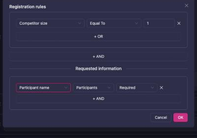
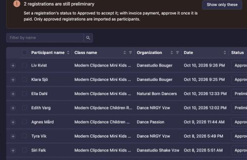
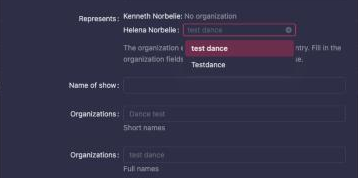
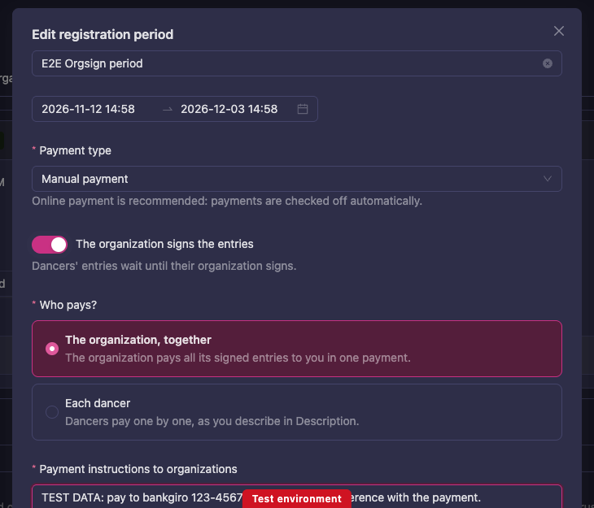
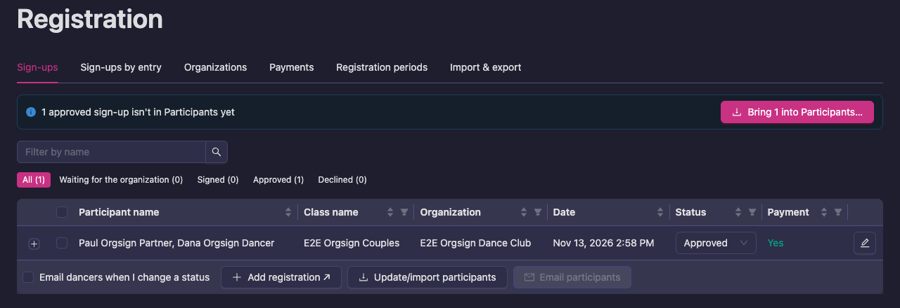
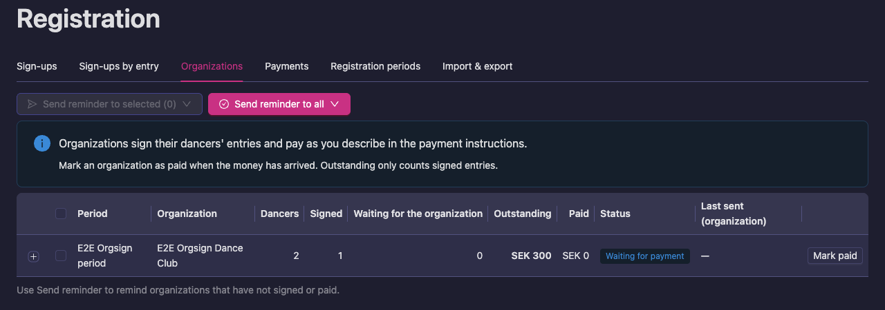
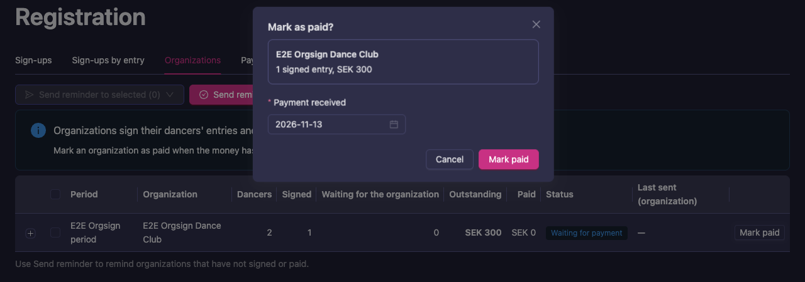
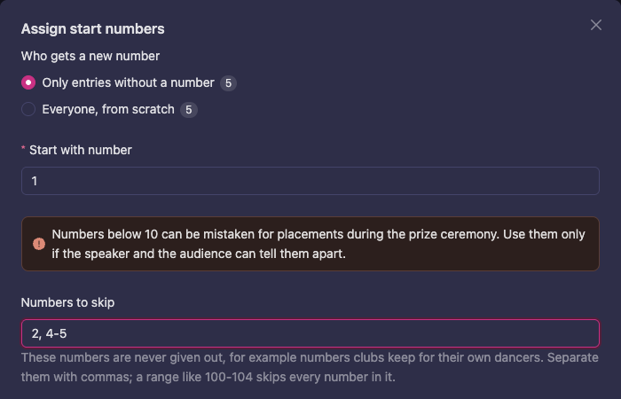

# Registration and check-in

For organizers and their helpers: the people who open registration, approve what comes in, turn it into participants, hand out start numbers and check the organizations (clubs) in on the day.

The path from an online registration to a dancer on the floor:

1. [Open a registration period](#registration-periods): its dates, the payment, the prices and the classes.
2. [Entries come in](#entries-coming-in) on the **Registrations** tab. Approve the ones that should dance.
3. [Import the approved entries](#updateimport-participants). The import makes a participant of each one.
4. [Assign and print start numbers](#start-numbers), before the participants go into rounds.
5. [Add the participants to their first rounds and plan the schedule](#after-the-import).
6. [Check the organizations in](#check-in) on the day, and apply their answers before the first round.

An **entry**, or **registration**, is what a dancer or club submits. A **participant** is a row on the **Participants** page in Manager, made from an approved entry by the import. Rounds, start numbers, heats and results are built on participants, never on entries.

Emails, the check-in QR code and how to test them are on [Emails and the check-in QR code](/manager-guide/emails/). Scanning at the entrance, arrivals and tickets are on [At the door](/manager-guide/the-door/). What to prepare and test before you open registration is on [Setting up registration for your event](/organizer/registration-for-event/).

## The Registration page

`Manager → Competition → Registration` has six tabs. In Scrutineer (Beta), the new version of the Manager app, some of them have another name.

| Tab | Name in Scrutineer (Beta) | What it is for |
|---|---|---|
| **Registrations** | **Sign-ups** | Every entry in the competition, with its status, payment and the **Imported** check. Here you approve, reject, email and import. |
| **Participants** | **Sign-ups by entry** | The entries counted per class and status. It is **not** the participant list: that is `Competition → Participants`. |
| **Organizations** | **Organizations** | The entries grouped by who pays them, with what is still owed and the payment reminders. |
| **Finances** | **Payments** | Expected, paid and outstanding totals per currency and period, and who still owes what. |
| **Registration period** | **Registration periods** | The registration windows: dates, payment, acceptance, prices, rules, form and classes. |
| **Data transfer** | **Import & export** | CSV import of participants, result downloads, and the reset and delete tools. Not an export to another system. |

While the competition has no registration period, the page opens on **Registration period**. After that it opens on **Registrations**.

**On the Registrations tab:**

- Click a column header such as **Participant name** to sort. The name column sorts by the team name, or by the dancers' names when the entry has no team name.
- Type in **Filter by name** above the table to find an entry by its team name or any dancer's name. It combines with the class, status and payment filters in the column headers.
- When the entries carry clubs, an **Organization** column shows the club each entry represents (see [Which club a dancer represents](#which-club-a-dancer-represents)). Sort on it, or use its filter to list one club's entries. Long class and club names are cut short; hover to read them in full.
- Click a row, or the **+** at its start, to open it. You see the dancers, the answers they gave, the history of the entry and, when it has a payment, the **Payment** button.
- The pen at the end of a row opens **Edit registration**.

**On the Participants tab,** each class shows its number of entries per status: **Approved**, **Signed** (only when the event uses it) and **Preliminary**. Where dancers chose a role, the brackets show the number of **Leader**, **Follower** and **No role** dancers; a couple adds one of each. In classes split into a lead class and a follow class, the class's own count is the number of leaders or followers. A **Total** line at the top sums the entries of all listed classes. Counts are entries per class, so a dancer in several classes counts in each. Use the tab to see the balance of leaders and followers in each class, and how many entries are approved or still preliminary (the waiting list). Classes whose entries are all preliminary are listed too. Open a class to list its approved, signed and preliminary entries.

**On the Organizations tab,** each payer has one row per registration period: an organization, or **Self-pay** for dancers who pay for themselves. The row shows **Dancers**, **Entries**, a **Status** such as **Paid** or **Partially paid**, and what is **Outstanding**.

- To remind payers of what they still owe, press **Send all (ready)**, or tick rows and press **Send selected**, which shows the number of ticked rows. Then choose **Email the organization**, **Email each dancer** or **Email both**. A message says how many emails were sent and how many rows were skipped. The payers pay with **Pay now** on their registration list. **Last sent (organization)** and **Last sent (dancer)** show when a row was last reminded.
- A red tag such as **1 cancelled (paid 300 SEK)** means entries were cancelled after they had been paid, which you may need to refund. Hover it to see which ones. Entries cancelled before anyone paid are not shown, since they change nothing the payer owes.
- The dancer counts on this tab are per payer. For the number of different dancers per organization, see [Dressing rooms](/manager-guide/statistics/#dressing-rooms) in Statistics.

**On the Finances tab,** the totals are **Expected total**, **Marked paid** and **Outstanding**, followed by a table per registration period and one **By payer**. The tab says "These figures are estimates": the amounts are worked out from each period's price list and the entries registered now. Only the refunded amount is exact.

## Registration periods

A registration period is one window in which dancers and clubs can register. It decides when they can register, how they pay, what it costs and which classes they can enter. You can have several periods, for example an early one and a late one at different prices. An entry can be made from the period's start time to its end time.

### Create a registration period

1. Open `Manager → Competition → Registration` and the **Registration period** tab.
2. Press **Add registration period** below the list of periods.
3. Type a name for the period in the first field.
4. In the date field, pick the start date and time, then the end date and time.
5. Choose the **Payment type**: **Free of charge**, **Manual payment** or **Online payment**.
6. Choose the **Registration acceptance**: **Manual** or **Direct**.
7. Unless the period is free of charge, choose the **Currency** and what the **Price per** is, and type the price. **Add price** adds a price line.
8. If you like, write a **Description**, for example how to pay with manual payment.
9. Press **Save changes**.
10. Add the classes. A new period has no classes, and nobody can enter a class that is not in it. See [Choose the classes](#choose-the-classes).

Each period in the list has a mark after its name: an orange clock while it has not started, a green check while it is open, and a red cross when it has ended.

### What each choice means

| Field | Choices |
|---|---|
| **Payment type** | **Free of charge**: nothing to pay; the currency and price fields are hidden. **Manual payment**: dancers pay you outside Vote4Dance, and you record each payment yourself. **Online payment**: dancers pay by card through Stripe, and payments are checked off automatically. Online payment is recommended. The dialog says "Cost for online payment is 5%" plus Stripe's own fee. |
| **Registration acceptance** | **Manual**: an entry starts as **Preliminary** and you approve it. **Direct**: an entry is **Approved** without you; with online payment, once it is paid. **Auto** is greyed out and cannot be chosen. |
| **Currency** | **SEK**, **EUR**, **USD** or **NOK**. |
| **Price per** | **Person, per class**: each dancer pays for each class they enter. **Person, whole competition**: each dancer pays one price for the whole competition; more classes and teams are free. **Registration**: the price is for an entry, a couple or team in one class, however many dancers it has. |
| Price lines | With one price line, that price is charged for each class (or each entry). With several lines, **1 or more** is the total for one class, **2 or more** the total for two, and so on; the last line also covers every higher number. Example: 200 on the first line and 300 on the second means one class costs 200, and two or more classes cost 300 in total. |
| **Description** | A text about the period. Scrutineer (Beta) says of the same field that it is shown to dancers. |

**Online payment needs Stripe.** If the event's Stripe account is not connected, the dialog shows a **Connect Stripe account** warning and **Save changes** stays greyed out. Connect the account under the list of periods on the **Registration period** tab, then save the period.

A club that registers entries pays them with **Pay now** on its registration list.

### Choose the classes

1. On the **Registration period** tab, click the period's name to open it.
2. Click **Select classes**.
3. Open the **Select classes** list and tick the classes dancers can enter in this period, or press **Select all**.
4. Press **Add**. The button shows how many classes you ticked.

The classes are listed under **Select classes**, each with its own rules. The pen on a class edits that class's rules; the red **Delete** button in that dialog takes the class out of the period. A dancer who tries a class that is not in the period is told "This class isn't open for registration in the chosen registration period."

### Registration rules and requested information

**Registration rules** on a period opens the rules for all its classes. The pen on a class under **Select classes** opens the rules of that one class. The dialog has two parts:

- **Registration rules**: conditions an entry must meet. The conditions are **Age**, **Birth year**, **Age span in years**, **Registration count**, **Competitor size**, **Country**, **Level**, **Dance role** and **Organization selection**.
- **Requested information**: questions the dancer answers when registering. A question is a **Text**, **Textarea**, **Number** or **Checkbox** field with a label you write, or one of the **Participants** fields: **Participant name**, **Name of show** and the two **Organizations** fields. Each is **Required** or **Optional**.

Press **OK** to save the period's rules, or **Save changes** when you edit one class.

### Team names

Dancers can give their team a name of its own. That name is used in group and formation classes, and in classes that ask for one. Solo and couple entries, and entries in classes that are not linked to a federation class, are shown under the dancers' names and not under a nickname.

To collect team names in a class that doesn't use them, for example a crew class at an event without a federation:

1. On the **Registration period** tab, open the period and click **Registration rules** to cover all its classes, or open **Select classes** and edit the rules of one class.
2. Under **Requested information**, add a field, choose **Participants** and pick **Participant name**.

   

3. Click **OK**. Dancers registering for the class are now asked for the name, and it shows on the **Registrations** list and on the start list after the import.

A name you type on an entry yourself always shows and is imported. If the start list shows a team under its dancers while the **Registrations** list shows its name, import again: the import updates the participants already on the start list. Asking for **Name of show** collects a show title and doesn't turn team names on. A federation can switch team names on or off for its categories; where it switches them off, the start list always shows the dancers.

The **Registrations** list shows the dancers who dance the entry, with lineup changes applied, not the team's whole roster.

### Change, reorder or delete a period

- **Change:** open the period and press **Edit registration period**. Change the fields and press **Save changes**. To close a period early, set an end time that has passed.
- **Reorder:** drag a period up or down in the list. This is the order the periods are shown in.
- **Delete:** press the red **Delete** button in the **Edit registration period** dialog. A period that has entries or classes cannot be deleted; the message is "Cannt delete registration period with competitors or classes".

Under the list of periods is a QR code, **Scan to register**, that leads to the competition's registration page. **Print** opens a printable version.

## Entries coming in

Every entry shows on the **Registrations** tab with a status. Only **Approved** entries become participants.

### Registration statuses

| Status | Meaning | How an entry gets there |
|---|---|---|
| **Preliminary** | Registered, not yet accepted. Not counted as a participant. | Automatic when the dancer or club registers in a period with **Manual** acceptance. |
| **Signed** | Normally an optional step for your own bookkeeping: never set automatically, and no email is sent for it. In a period where the organization signs the entries, **Signed** means the organization has signed the entry and it waits for payment (see [Organizations sign their dancers' entries](#organizations-sign-their-dancers-entries)). | By you, from the status list, or when the organization signs. |
| **Approved** | Accepted. This is the only status the import uses. | Automatic when the online payment is completed, when you mark an organization's signed entries as paid, when the period uses **Direct** acceptance, or when you or the check-in desk enter the entry, paid or not. Otherwise by you. |
| **Rejected** | Declined by the organizer. | By you. |
| **Cancelled** | Withdrawn by the dancer or club, or set by the organizer. The row is kept. | The dancer or club cancels from their account, or by you. |
| **Deleted** | Removed. Unpaid rows disappear; paid rows are kept and marked deleted. | By you. |

Things that regularly cause confusion:

- **The list opens on Preliminary and Approved together.** Change the filter in the **Status** column header to see cancelled, rejected or all entries. The filter is a viewing aid only.
- **Preliminary entries are counted above the list**, for example "2 registrations are still preliminary". Click **Show only these** to list just those.
- **Names in orange** are not an error. The row shows a **team name or custom name** instead of the dancers' names. Hover the name to see the dancers behind it. Every other row shows the dancers' names in the normal colour.
- **Online payments in progress are hidden** until they are paid. An entry whose checkout is abandoned is removed automatically.

### Approve, reject or cancel an entry

1. Open the **Registrations** tab and find the entry. Use **Filter by name**, the filters in the column headers, or **Show only these** in the notice about preliminary entries.
2. Decide whether the dancers get an email about the change: tick or untick **Send email on status change** below the list (see [Emails](/manager-guide/emails/#send-email-on-status-change)).
3. Open the list in the **Status** column of the row and choose the new status, for example **Approved**.

To change several entries at once, tick their rows first and then choose the status on one of them. While rows are ticked, the change applies to the ticked rows only.

**With manual payment,** approve an entry once you have received the money. To record the payment, press the pen on the row, set **Payment** to **Yes** and press **Ok**. Then set the status to **Approved** if the entry is still **Preliminary**.

**To add an entry yourself,** press **Add registration** below the list. It opens the registration form of the Check-in app in a new tab. An entry that you or the check-in desk make is **Approved** straight away, paid or not. See [Adding classes at the door](/manager-guide/the-door/#adding-classes-at-the-door).

**To write to dancers,** tick their rows and press **Email participants** below the list. See [Email participants](/manager-guide/emails/#email-participants).

### Paid twice after cancelling

A dancer who cancels a paid entry and registers for the same class again ends up with one entry, not two: the cancelled one is reused, so the dancer does not appear under **Cancelled**. If the dancer paid again, both payments belong to that entry.

1. Open the **Registrations** tab and click **+** to open the entry.
2. Click **Payment**.
3. The dialog lists every payment for the entry. Earlier ones are marked "Earlier payment (the registration was cancelled and made again)".
4. On the payment to give back, check the amount, add a description if you like and click **Refund**.

Earlier payments made before this was introduced are not listed under the entry. Refund those in Stripe.

### Which club a dancer represents

Each entry knows which club every dancer competes for. A dancer who belongs to more than one club can represent one club in one class and another club in a different class, so check this per entry, not on the dancer's profile.

To check it:

1. On the **Registrations** tab, the **Organization** column shows the club each entry represents. Press the **+** at the start of a row to see the club of every dancer in it.
2. For more detail, press the pen on the row to open **Edit registration**. Under **Represents** you see every dancer with their club and where that club comes from:
   - **Chosen at registration**: the dancer (or their club) picked it when registering, or a manager picked it. The federation asks for this when a dancer belongs to more than one club.
   - **Owning organization**: the team belongs to a club and always competes for it.
   - **Division license organization** or **License organization (no division match)**: the club on the dancer's federation license.
   - **From the dancer's profile**: the club the dancer is a member of, used when none of the above applies. A dancer who belongs to several clubs is shown with their main club.

To have a participant shown with a different club name, for example on the speaker's screen, type it in the two **Organizations** fields below **Represents** (short names and full names). They show the club in grey; leave them empty to keep it.

The club shown here is the one **Update/import participants** gives the participant. If the entry is already imported (the **Imported** check), run **Update/import participants** again after a change, so the participant gets the new club.

#### Change the club a dancer represents

In Scrutineer (Beta), a dancer who belongs to more than one club gets a list under **Represents** instead of a line of text. The classic Manager shows the club as text only. Use the list when a dancer or parent picked the wrong club when registering:

1. In Scrutineer (Beta), open **Edit registration** on the entry.
2. Under **Represents**, open the list next to the dancer and choose the club they compete for in this entry. Only clubs that have approved the dancer as a member are listed.
3. Press **Ok**.

The change applies to this entry only. If the dancer has the same mix-up in other classes, change each of those entries too. To go back to the club Vote4Dance finds on its own (for example the one on the dancer's license), clear the list with the **×** and press **Ok**.

A dancer who belongs to only one club, and every dancer in a team owned by a club, is shown as text.

## From registrations to participants

Entries and participants are two different lists. An entry is what the dancer or club submitted. A participant is a row in the competition's lineup that rounds, start numbers, heats and results are built on. Nothing moves between them until you run the import.

### Update/import participants

The import takes **every Approved entry in the competition**, whatever filter you have set in the table.

1. On the **Registrations** tab, press **Update/import participants** below the list. When approved entries are waiting, the same button is also in a notice above the list, for example "3 approved registrations are not imported yet". The button below the list is greyed out while rows are ticked.
2. The **Import registrations** window opens. A line at the top says how many approved entries matched.
3. Read the groups. Click a group to see what is in it:
   - **Added Participants**: new participants.
   - **Changed Participants**: participants whose entry changed.
   - **Removed Participants**: participants that no longer have an approved entry.
   - **Warning Participants**: participants the import has a remark about.
   - **Added Class**: classes the import would create.
4. Every group is ticked. Untick a group you do not want applied. If you untick **Added Class**, untick **Added Participants** as well. Otherwise nothing is imported, and the message is "Some participants are in a class that isn't in the competition. Tick the new classes in the import, or untick those participants."
5. Press **OK**. "Registrations imported successfully" confirms it. Close the window.

If no entry is approved, nothing opens and the message is "No approved registrations to import yet."

What the import does:

- It creates one participant per approved entry, with the dancers' names, clubs, years of birth, federation ids and class. Start numbers are left at 0.
- It updates participants whose entry changed (a new partner, a new club, a renamed team). Only the fields the entry knows about are touched, so start numbers and check-in state survive a new run.
- Under **Changed Participants** it lists only the participants where something the import saves is different. Running the import again to add new entries leaves everyone already imported untouched, and keeps their order in the class.
- Under **Removed Participants** it lists every participant that no longer has an approved entry. That includes entries that were cancelled or rejected after an earlier import. If you leave the group ticked, those participants are deleted from the lineup.
- It does not send any email.

You can run it as often as you like. The normal rhythm is once when the period closes, and once more after late approvals or cancellations.

The **Imported** check in the list means "the entry and the lineup agree": an approved entry has its participant, or a cancelled one has none. An approved entry without the check, or a cancelled one with a participant still in place, is the signal to run the import again. The notice above the list counts the approved entries that are not imported yet, whether they came from the dancer, the club or the check-in desk on the day. Once an entry is imported, dancers can no longer edit it themselves; a manager edits it.

Things to know:

- Run the import on the **competition**, not on the parent event. A multi-day event with child competitions imports per competition.
- Do not mix CSV-imported participants and the import from registrations in the same competition. Participants that did not come from an entry are listed under **Removed Participants**.

### After the import

1. Open `Competition → Participants` and check the lineup per class. Add or correct participants by hand if needed.
2. Assign start numbers. See [Start numbers](#start-numbers). Do this **before** the next step.
3. Open `Classes`, then the class and its rounds, and press **Add participants**. It puts the class's participants into the first round. The button only appears when the class has participants that are not yet in the round.
4. Plan the rounds on days, floors and times under `Event → Schedule` (see [Schedule and conflicts](/manager-guide/schedule/)). The schedule can be built before the import, but participant counts, heat counts and estimated end times only fill in once the participants exist and are in rounds.
5. Check the organizations in, then run the rounds. See [Check-in](#check-in) and [Live operations](/manager-guide/live-operations/).

## Organizations sign their dancers' entries

Some events want the club to vouch for its dancers. When you switch this on for a registration period, an entry that a dancer registers waits until the dancer's organization (club, school or other organization) has signed it. The organization can also pay all its entries together, in one payment, instead of every dancer paying separately.

Dancers who have no organization are not held up: their entries skip signing, and the dancers pay themselves.

You set this up and follow it in **Scrutineer (Beta)**, the new version of the Manager app. The classic Manager has no switch for it and no **Mark paid** button. To open Scrutineer (Beta), tap the **Scrutineer** tile marked **Beta** under **Functions** on your event page, or press **Try new version** at the top of the classic Manager.

### Set it up

1. In Scrutineer (Beta), open the competition's Registration page and the **Registration periods** tab.
2. Open the period with **Edit registration period**.
3. Pick the **Payment type**: **Online payment** (recommended) or **Manual payment**. Online payment is recommended because payments are checked off automatically.
4. Switch on **The organization signs the entries**. The text under it says: "Dancers' entries wait until their organization signs."
5. Under **Who pays?**, choose:
   - **The organization, together**: the organization pays all its signed entries in one payment. With online payment it pays by card when it signs. With manual payment it pays you in one payment.
   - **Each dancer**: dancers pay one by one, by card with online payment, or as you describe in **Description** with manual payment.
6. With **Manual payment** and **The organization, together**, fill in **Payment instructions to organizations**, for example an account number, IBAN or Swish number and what to write as the reference. Organizations see the text when they sign, together with the amount and their reference.
7. Press **Save changes**.

**Who pays?** is not shown for a period that is **Free of charge**.

*The organization signs the entries, and pays them together by manual payment.*

**In the event checklist of Scrutineer (Beta).** The payment step recommends **Take payment online (Stripe)**: payments are checked off automatically, the money goes straight to your account, and organizations get a receipt and an invoice. If you can't take payment online, choose **Take payment manually**. Then you check off each payment yourselves. If you imported your entries and take no sign-ups in Vote4Dance, you don't need a payment setup: the step is then **Optional** and the checklist moves on to the next step.

### What the organization sees

- **Online payment, the organization pays:** it presses **Sign and pay**, pays by card in the next step, and gets a receipt and an invoice made out to the organization.
- **Manual payment, the organization pays:** it signs, then sees the amount to pay, a reference (the organization's short name and the event number) and your payment instructions. It pays you outside Vote4Dance, and you mark it paid.
- **Each dancer pays:** the organization only signs. The dancers pay themselves once the entry is signed.

The guide for the club is [Signing your members' entries](/school-club/registration-for-event/#signing-your-members-entries). The dancers see **Waiting for the organization** on their entry: see [When your organization signs your entry](/dancer/my-registration/#when-your-organization-signs-your-entry).

### Follow the entries

On the **Sign-ups** tab of Scrutineer (Beta), filter by:

| Filter | Shows |
|---|---|
| **Waiting for the organization** | Entries the organization has not signed yet |
| **Signed** | Signed by the organization, not yet paid |
| **Approved** | Accepted. Payment alone approves a signed entry, so it is **Approved** once it is paid |
| **Declined** | Entries the organization declined, shown as **Declined by the organization** |

A notice above the list counts the entries waiting for their organization to sign, and the signed entries waiting for payment.

On the **Organizations** tab, each organization has one row with **Dancers**, **Signed**, **Waiting for the organization**, **Outstanding** (only signed entries count), **Paid** and a **Status** such as **Waiting for payment**.

The classic Manager has no filter for this. On its **Registrations** tab, an entry that waits for its organization is **Preliminary**, a signed one is **Signed** and a declined one is **Cancelled**. Its notice about preliminary registrations counts the waiting entries too: leave them until the organization has signed.

### Mark an organization as paid (manual payment)

With online payment, a card payment marks the entries paid on its own. With manual payment, mark them yourself when the money has arrived:

1. In Scrutineer (Beta), open the **Organizations** tab and press **Mark paid** on the organization's row.
2. In **Mark as paid?**, check the number of signed entries and the amount. Entries still waiting for the organization are not included, and the dialog says how many.
3. Set **Payment received** to the date the money arrived.
4. Press **Mark paid**.

All the organization's signed entries that are not yet paid are marked paid at once, and become **Approved**.

### Send reminders

On the **Organizations** tab of Scrutineer (Beta), press **Send reminder to all**, or tick organizations and press **Send reminder to selected**. Check the count in the confirmation and press the send button (for example **Send 3 reminders**). A reminder goes to:

- organizations that still have entries to sign, and organizations that still have to pay,
- dancers who are still waiting for their organization, who are told there is nothing for them to do.

The **Last sent (organization)** column shows when an organization was last reminded.

### If an organization declines

The entry is withdrawn. The dancers get an email, and **My registration** shows **Declined by the organization** and tells them to contact their organization. A declined entry shows under the **Declined** filter. If it was a mistake, the dancers register again, and the organization signs the new entry.

## Start numbers

Assign start numbers after the import and **before** you add participants to rounds. Once a participant of the class is in a round (for the whole competition: any participant), numbering is refused with the message "Cannot delete participant - it has already been added to the competition. Please delete participants from the rounds in question first."

1. Open `Manager → Competition → Participants`.
2. Press **Assign start numbers** at the top of the page to number the whole competition, or **Assign start numbers** in the footer of a class to number that class only. The button in a class is greyed out while participants are ticked.
3. Set the options.
4. Press **Apply**.
5. Press **Print start number** at the top of the page. The print page opens in a new tab.

| Option | What it does |
|---|---|
| **Start with number** | The first number given out. 10 by default. It can be as low as 1; below 10 the dialog warns that single-digit numbers can be mistaken for placements at the prize ceremony. |
| **Start each class on an even ten** | **Enable** by default: every class after the first jumps up to the next ten. |
| **Free numbers between classes** | Numbers left unused before the next class starts. 3 by default; 0 to 100. |
| **Reuse numbers** | **Enable** by default: a dancer keeps the same number across classes. |
| **Randomize order** | **Enable** by default: the participants of a class get their numbers in a random order. |

To number the whole competition in one unbroken series, set **Start each class on an even ten** to **Disabled** and **Free numbers between classes** to 0. With **Reuse numbers** still on **Enable**, participants who already have a number keep it, so the series will not be continuous; the dialog warns about this. Delete the start numbers first, or set **Reuse numbers** to **Disabled**. The red **Delete** button in the dialog deletes the start numbers of the class, or of the whole competition.

A cancelled participant gets no start number. If it had one, numbering takes it away.

In Scrutineer (Beta), **Assign start numbers** also has **Numbers to skip**: numbers that are never given out, for example numbers a club keeps for its own dancers. Separate them with commas; a range such as `100-104` skips every number in it, so `13, 66, 100-104` leaves out 13, 66 and 100 to 104. The numbers line at the bottom of the dialog shows the result before you confirm. A participant who already has one of these numbers keeps it. If the round ten a class would start on is in the list, the class starts on the next round ten that isn't. The field is empty each time you open the dialog, so type the list again for every competition in the event. The classic Manager has no such field.

## Check-in

There are three check-in mechanisms, and they are independent:

- **Organization check-in** (`Manager → Competition → Check-in`): each organization says which of its participants dance today and which have withdrawn, and signs. You then apply the signed answers to the competition. This is what cancels participants.
- **The Vote4Dance ID**: every dancer has a personal QR code, in the app, on their account page and in the approval email. Check-in desk staff scan it in the Check-in app to find the dancer, hand out the start number, see payment status and mark them **Arrived**. See [At the door](/manager-guide/the-door/).
- **Tickets**: what the audience shows. Sold from the event's Tickets page or at the desk, see [Shop](/manager-guide/shop/). Dancers do not need one unless the organizer says so.

For a paper list of every organization's dancers at the entrance, in case the network goes down, click **Print dancer lists** on the Check-in page. See [Dancer lists](/manager-guide/statistics/#dancer-lists).

### What organization check-in changes

Organization check-in works on participants, so run [Update/import participants](#updateimport-participants) first. It has two halves.

**1. The organization answers and signs.** For each of its participants it chooses **Participating** or **Cancelled**, and then signs. This changes nothing in the competition yet.

**2. You press Import check-in.** For every organization that has signed, each participant it marked **Cancelled** is cancelled in the competition, with the reason the organization gave. A cancelled participant that is only in the first round of its class, and has not been judged there, is also taken out of that round.

What this means on the day:

- Participants marked **Participating** stay as they are.
- Participants of an organization that has **not signed** are not changed. They stay in the competition until the organization signs and you import again.
- **Arrived** at the desk protects nobody. A participant its organization marked **Cancelled** is cancelled when you import, however many of its dancers walked through the door. Arrival and organization check-in are different things.
- A couple with dancers from two organizations is cancelled as soon as one organization that has signed marked it **Cancelled**. If both have signed with different answers, the import stops with "Different status" and changes nothing.

Do not import while organizations are still working, and read the **Cancellations** list before you do: it shows exactly who will be cancelled.

### Organization check-in controls

The Check-in page has three parts:

- **Settings**: the check-in window, the time during which organizations can answer and sign.
- **Cancellations**: the participants that signed organizations have marked **Cancelled** and that are not applied yet, with start number, name, class, organization and status. A participant two organizations answered differently for is marked **Different status** in red.
- **Check-in**: the buttons **Import check-in**, **Reset check-in** and **Delete signatures**, and one row per organization.

The row of an organization shows:

| Column | Shows |
|---|---|
| **Status** | Empty: not signed yet. A red warning sign: signed, with cancellations that are not applied yet. A green check: signed with nothing waiting, or already applied. |
| **Organizations** | The organization. |
| **Cancelled** | How many of its participants are cancelled or marked **Cancelled**. |
| **Participants** | How many participants it has. |
| **Name**, **Time**, **Phone** | Who signed, when, and the phone number they gave. |

Click a row to see the organization's participants and their answers.

In Scrutineer (Beta), each organization is shown with its full name and its short name, for example **Föreningen Olands Bugg & Swing (OLAND)**. A club whose dancers only dance with partners from other clubs takes its name from those couples. A club with no full name in the entries is shown by its short name only. The classic Manager lists the organization by the short name on its participants. The buttons in Scrutineer (Beta) are **Apply … signed clubs to entries…**, **Undo applying** and **Delete all signatures**.

### Open the check-in window

1. Open `Manager → Competition → Check-in`.
2. Under **Settings**, press **Activate check-in** and confirm.
3. Pick the opening date and time and the closing date and time.
4. Press **Save changes**. Nothing is saved until you do.

The line under the dates says "Checkin is open" or "Checkin is closed". To move the window, press **Edit**, change the dates and press **Save changes**. **Disable check-in** removes the window.

While the window is open, each organization's team leader answers and signs in the Check-in app, under **Organization check-in**. There, **Mark all** sets every participant that is not cancelled to **Participating** at once, and **Sign** asks for a phone number. The club's own guide is [Confirm your roster on the day](/school-club/registration-for-event/#step-5-confirm-your-roster-on-the-day). Outside the window, only managers and check-in staff can answer and sign.

### Check an organization in yourself

A manager can answer and sign for an organization at any time, also when the window is closed.

1. On the Check-in page, under **Check-in**, click the organization's row.
2. For each participant, press **Participating** or **Cancelled**. **Cancelled** asks for the reason: **Sickness**, **Work/studies**, **Participants ceased**, **Private** or **Other**. Choose one and press **Ok**.
3. Press **Sign** below the participants and confirm. **Sign** is greyed out until every participant has an answer.

Once an organization has signed, its answers are locked. To change them, press **Unlock** below its participants and confirm, change the answers and sign again. **Unlock** is greyed out once the check-in has been imported.

### Apply the check-in

1. Look at the **Status** column under **Check-in**. An empty status means the organization has not signed. Chase those organizations, or [check them in yourself](#check-an-organization-in-yourself).
2. Read the **Cancellations** list. These are the participants that will be cancelled. Sort out any row marked **Different status** first: unlock one of the two organizations, correct the answer and sign again.
3. Press **Import check-in** and confirm. "Successfully imported check-in" confirms it.

**Import check-in** is greyed out when no organization has signed since the last import. When more organizations sign later, press it again: it picks up the new ones.

### Undo an applied check-in

- **Reset check-in** undoes the whole import. The participants it cancelled get back the state they had before, and every organization's signature is removed. Their answers are kept, so each organization only has to **Sign** again, and then you import again. A participant that the import took out of its first round is not put back: add it to the round again with **Add participants**.
- **Delete signatures** removes every organization's signature and leaves the cancellations as they are. It does not undo anything.

Both buttons are greyed out until a check-in has been imported.

To bring back one participant, do not reset. Open the participant on `Competition → Participants`, set **Cancelled** to **Participating** and save. Then add it to its round again if the import took it out.

### The Arrived today column

Once anybody has been marked arrived at the desk, the **Registrations** list gets an **Arrived today** column: `n/m` of the entry's dancers arrived today. Its filter has **Everyone arrived**, **Some arrived** and **Nobody arrived**. It is a live view of the entrance, not a check-in.

### Dancer admission

Whether an entry also lets a dancer *through the door* is a separate setting: every day of the event, only on the days they dance, or only with a ticket. It is on the Shop page and is explained on [At the door](/manager-guide/the-door/).

## Team image upload

A couple or team can have one image. Replace or remove it as needed.

Where to upload:

- `Manager → Competition → Registration`: press the pen on the entry to open **Edit registration**, then use the **Image** field.
- `Manager → Competition → Participants`: edit the participant, then use the **Image** field.
- At the registration desk: the participant's page in the Check-in app has an **Image** field.

The file must be a JPG or PNG, smaller than 15 MB. Otherwise the upload is refused with "You can only upload JPG/PNG files!" or "Image must be smaller than 15MB!".

### A photo booth at the registration desk

1. Prepare a small booth area with stable lighting, a fixed camera distance and a clean background.
2. Use a green screen if you want easy background removal afterwards.
3. Open the couple or team on the desk's device and go to the **Image** field.
4. Press **Upload** and choose the photo. On a phone or tablet, the file picker may offer the camera.

For screens and match presentations, a PNG with a transparent background gives the best result. If you use green screen photos, remove the background before the upload and export a transparent PNG. Keep the subject centered, with head and upper body clearly visible.

## Data transfer

The **Data transfer** tab of the Registration page has four parts:

| Part | What it does |
|---|---|
| **Import registrations** | Upload a CSV file of participants: click the upload area or drag the file onto it. The preview is the same as for [Update/import participants](#updateimport-participants). You can upload the same file again: existing participants are updated, deleted ones removed and new ones added. In the preview, **Warning Participants** can say **Missing class name**, **Duplicate start number** or "Text too long, will be shortened to 128 characters". Use this for events without online registration, not together with the import from registrations. |
| **Download results** | **Download .csv file** and **Download partial average** download the results as files. See [Data exports](/manager-guide/post-event/#download-the-result-files). |
| **Reset results** | Removes all results and takes the participants out of the rounds. Keeps participants, rounds and judges. Only available while the competition is private. |
| **Delete registrations** | Deletes all participants. Keeps rounds and judges. Only available while the competition is private. Do not use it once online check-in has started. |

## Troubleshooting

| What you see | What it means | What to do |
|---|---|---|
| "2 registrations are still preliminary" above the list | Entries are registered but not accepted. They are not imported. | Set each one to **Approved**; with manual payment, once the money has arrived. **Show only these** lists them. |
| "3 approved registrations are not imported yet" | Approved entries have no participant yet. | Press **Update/import participants**. |
| An approved entry has no **Imported** check, or a cancelled entry still has a participant | The entries and the lineup do not agree. | Run **Update/import participants** again. |
| "Some participants are in a class that isn't in the competition. Tick the new classes in the import, or untick those participants." | You unticked **Added Class** and left **Added Participants** ticked. | Tick both groups, or untick both. |
| **Removed Participants** lists participants you added by hand or by CSV | They have no approved entry, so the import wants to remove them. | Untick **Removed Participants** before you press **OK**. Do not mix the two ways of adding participants in one competition. |
| The pen and **Update/import participants** are greyed out | Rows are ticked in the list. | Untick the rows. |
| A dancer cannot change their entry: "This registration has been imported to the competition. Details can only be changed by a scrutineer." | The entry is imported. | Change it for them with the pen on the row, then import again. |
| "This entry was paid online, so it cannot be marked unpaid. An online payment can only be refunded, from the payment's details." | You set **Payment** to **No** on an entry that was paid by card. | Open the row, press **Payment** and use **Refund**. |
| A period cannot be saved, and the dialog shows **Connect Stripe account** | **Online payment** needs the event's Stripe account. | Connect the account under the list of periods, or choose another **Payment type**. |
| "Cannt delete registration period with competitors or classes" | The period has entries or classes. | Keep the period. To close it, set an end time that has passed. |
| A dancer is told "This class isn't open for registration in the chosen registration period." | The class is not in the period. | Add it under **Select classes**. See [Choose the classes](#choose-the-classes). |
| "Cannot delete participant - it has already been added to the competition. Please delete participants from the rounds in question first." when you assign start numbers | Participants are already in a round. | Assign start numbers before you add participants to rounds. For a late participant, type the **Start number** on the participant itself. |
| In Scrutineer (Beta), entries stay on **Waiting for the organization** | The organization has not signed them. | Press **Send reminder to all** on the **Organizations** tab. See [Send reminders](#send-reminders). |
| An organization cannot answer or sign, and the Check-in page says "Checkin is closed" | The check-in window is not open now. | Change the window under **Settings**, or [check the organization in yourself](#check-an-organization-in-yourself). |
| An organization cannot change its answers | It has signed. | Press **Unlock** below its participants. After an import, use **Reset check-in** first. |
| **Import check-in** is greyed out | No organization has signed since the last import. | Wait for an organization to sign, or sign for it. |
| "Different status" when you press **Import check-in** | Two organizations gave different answers for the same couple. Nothing was changed. | Find the couple in **Cancellations**, unlock one of the organizations, correct the answer, sign and import again. |
| A dancer is in the hall, marked **Arrived**, but the participant is cancelled | The organization marked the participant **Cancelled** and the check-in was imported. | Open the participant on `Competition → Participants` and set **Cancelled** to **Participating**. See [Undo an applied check-in](#undo-an-applied-check-in). |
