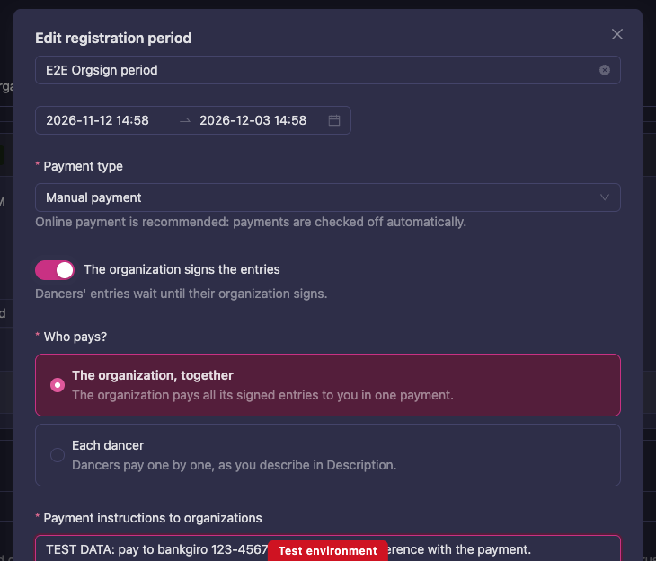
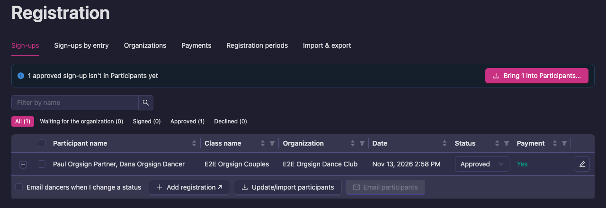
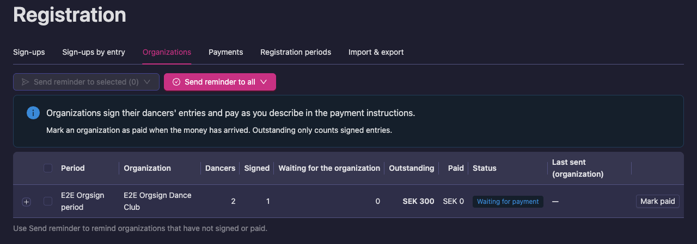
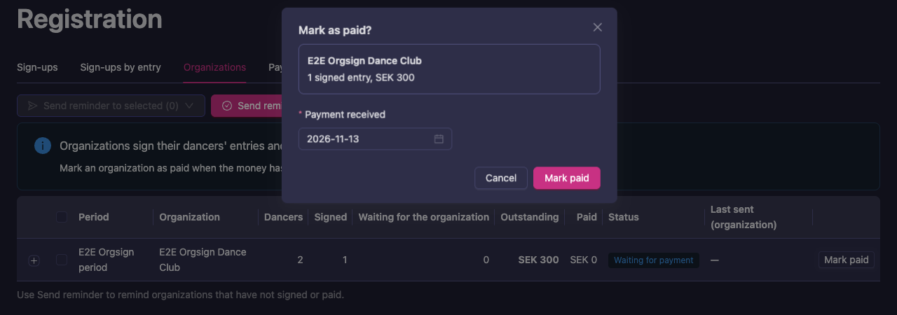
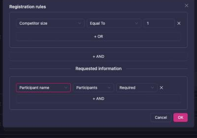
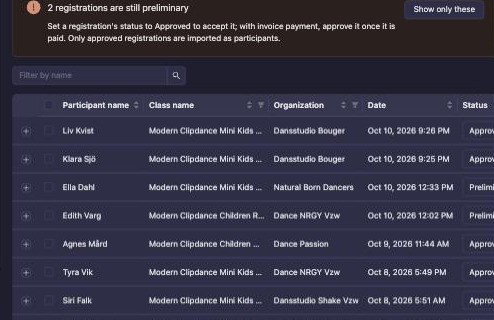
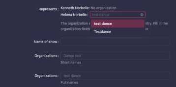
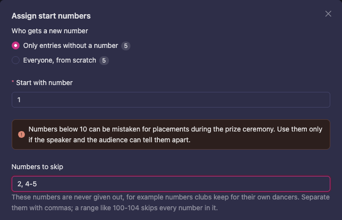

# Registration and check-in

This page covers the whole path from an online registration to a participant on the floor: the registration tabs, what each status means, how approved registrations become participants, and what to do next.

Emails, the check-in QR code and how to test them are on [Emails and the check-in QR code](/manager-guide/emails/). Scanning at the entrance, arrivals and tickets are on [At the door](/manager-guide/the-door/).

## The Registration page

`Manager → Competition → Registration` has six tabs:

| Tab | What it is for |
|---|---|
| `Registrations` | Every registration in the competition, with status, payment and the **Imported** check. This is where you approve, reject, email and import. Click a column header such as **Participant name** to sort. Type in **Filter by name** above the table to find a registration by its team name or any dancer's name; it combines with the class, status and payment filters. When the registrations carry clubs, an **Organization** column shows the club each entry represents (see [Which club a dancer represents](#which-club-a-dancer-represents)); sort on it, or use its filter to list one club's entries. |
| `Participants` | The registrations grouped by class, with how many are Approved, Signed (only when the event uses it) and Preliminary. A read-only view of what will be imported. It is **not** the participant list itself — that lives under `Competition → Participants`. |
| `Organizations` | Registrations grouped per club, with what each club still owes and the payment reminders. Use **Send** to remind clubs or dancers of what they still owe; they pay with **Pay now** on their registration list. When the period has the organization sign the entries, it also shows how many entries each organization has signed, how many wait for it, and has a **Mark paid** button (see [Organizations sign their dancers' entries](#organizations-sign-their-dancers-entries)). A red tag such as **1 cancelled (paid 300 SEK)** means entries were cancelled after they had been paid, which you may need to refund; hover it to see which ones. Entries cancelled before anyone paid are not shown, since they change nothing the club owes. |
| `Finances` | Expected, paid and outstanding totals per currency and period, and who still owes what. |
| `Registration period` | The registration windows: dates, payment mode, acceptance mode, prices, rules and form. |
| `Data transfer` | CSV import of participants, result downloads, and the reset and delete tools. Not an export to another system. |

On the `Participants` tab, each class shows its number of registrations per status. Where dancers chose a role, the brackets show the number of **Leaders**, **Followers** and dancers with **No role**; a couple adds one of each. In classes split into a lead class and a follow class, the class's own count is the number of leaders or followers. A **Total** line at the top sums the registrations of all listed classes. Counts are entries per class, so a dancer in several classes counts in each. Use it to see the balance of leaders and followers in each class and how many are approved versus still preliminary (the waiting list). Classes whose registrations are all preliminary are listed too, and opening a class lists its approved, signed and preliminary registrations.

### Registration periods

For each period define:

- Name and start/end timestamps
- Payment mode: **Free of charge**, **Manual payment**, or **Online payment** (Stripe). Online is recommended: payments are checked off automatically
- Whether the organization signs the entries, and who pays (see [Organizations sign their dancers' entries](#organizations-sign-their-dancers-entries))
- Acceptance mode: manual or direct
- Currency and price ladder
- Rule/form configuration
- Allowed classes

You can reorder periods to control display order.

### Organizations sign their dancers' entries

Some events want the club to vouch for its dancers. When you switch this on for a registration period, an entry that a dancer registers waits until the dancer's organization (club, school or other organization) has signed it. The organization can also pay all its entries together, in one payment, instead of every dancer paying separately.

Dancers who have no organization are not held up: their entries skip signing, and the dancers pay themselves.

#### Set it up

1. Open `Manager → Competition → Registration`, then the **Registration periods** tab (**Registration period** in the classic Manager).
2. Open the period with **Edit registration period**.
3. Pick the **Payment type**: **Online payment** (recommended) or **Manual payment**. Online payment is recommended because payments are checked off automatically.
4. Switch on **The organization signs the entries**. The text under it says: dancers' entries wait until their organization signs.
5. Under **Who pays?**, choose:
   - **The organization, together**: the organization pays all its signed entries in one payment. With online payment it pays by card when it signs. With manual payment it pays you in one payment.
   - **Each dancer**: dancers pay one by one, by card with online payment, or as you describe in **Description** with manual payment.
6. With **Manual payment** and **The organization, together**, fill in **Payment instructions to organizations**, for example an account number, IBAN or Swish number and what to write as the reference. Organizations see the text when they sign, together with the amount and their reference.
7. Press **OK**.

*The organization signs the entries, and pays them together by manual payment.*

**In the event checklist.** The payment step recommends **Take payment online (Stripe)**: payments are checked off automatically, the money goes straight to your account, and organizations get a receipt and an invoice. If you can't take payment online, choose **Take payment manually**. Then you check off each payment yourselves.

#### What the organization sees

- **Online payment, the organization pays:** it presses **Sign and pay**, pays by card in the next step, and gets a receipt and an invoice made out to the organization.
- **Manual payment, the organization pays:** it signs, then sees the amount to pay, a reference (the organization's short name and the event number) and your payment instructions. It pays you outside Vote4Dance, and you mark it paid.
- **Each dancer pays:** the organization only signs. The dancers pay themselves once the entry is signed.

The guide for the club is [Signing your members' entries](/school-club/registration-for-event/#signing-your-members-entries). The dancers see **Waiting for the organization** on their entry: see [When your organization signs your entry](/dancer/my-registration/#when-your-organization-signs-your-entry).

#### Follow the entries

On the **Sign-ups** tab (**Registrations** in the classic Manager), filter by:

| Filter | Shows |
|---|---|
| **Waiting for the organization** | Entries the organization has not signed yet |
| **Signed** | Signed by the organization, not yet paid |
| **Approved** | Accepted. Payment alone approves a signed entry, so it is **Approved** once it is paid |
| **Declined** | Entries the organization declined, shown as **Declined by the organization** |

A notice above the list counts the entries waiting for their organization to sign, and the signed entries waiting for payment.

On the **Organizations** tab, each organization has one row with **Dancers**, **Signed**, **Waiting for the organization**, **Outstanding** (only signed entries count), **Paid** and a **Status** such as **Waiting for payment**.

#### Mark an organization as paid (manual payment)

With online payment, a card payment marks the entries paid on its own. With manual payment, mark them yourself when the money has arrived:

1. Open the **Organizations** tab and press **Mark paid** on the organization's row.
2. In **Mark as paid?**, check the number of signed entries and the amount. Entries still waiting for the organization are not included, and the dialog says how many.
3. Set **Payment received** to the date the money arrived.
4. Press **Mark paid**.

All the organization's signed entries that are not yet paid are marked paid at once, and become **Approved**.

#### Send reminders

On the **Organizations** tab, press **Send reminder to all**, or tick organizations and press **Send reminder to selected**. Check the count in the confirmation and press **Send** (for example **Send 3 reminders**). A reminder goes to:

- organizations that still have entries to sign, and organizations that still have to pay,
- dancers who are still waiting for their organization, who are told there is nothing for them to do.

The **Last sent** column shows when an organization was last reminded.

#### If an organization declines

The entry is withdrawn. The dancers get an email, and **My registration** shows **Declined by the organization** and tells them to contact their organization. A declined entry shows under the **Declined** filter. If it was a mistake, the dancers register again, and the organization signs the new entry.

### Team names

Dancers can give their team a name of its own. That name is used in group and formation classes, and in classes that ask for one. Solo and couple entries, and entries in classes that are not linked to a federation class, are shown under the dancers' names and not under a nickname.

To collect team names in a class that doesn't use them, for example a crew class at an event without a federation:

1. On the **Registration period** tab, open the period and click **Registration rules** to cover all its classes, or open **Select classes** and edit the rules of one class.
2. Under **Requested information**, add a field, choose **Participants** and pick **Participant name**.

   

3. Click **OK**. Dancers registering for the class are now asked for the name, and it shows on the **Registrations** list and on the start list after the import.

A name you type on a registration yourself always shows and is imported. If the start list shows a team under its dancers while the **Registrations** list shows its name, import the registrations again: the import updates the entries already on the start list. Asking for **Name of show** collects a show title and doesn't turn team names on. A federation can switch team names on or off for its categories; where it switches them off, the start list always shows the dancers.

## Registration statuses

| Status | Meaning | How a registration gets there |
|---|---|---|
| **Preliminary** | Registered, not yet accepted. Not counted as a participant. | Automatic when the dancer or club registers in a period with **manual** acceptance. |
| **Signed** | Normally an optional step for your own bookkeeping: never set automatically, and no email is sent for it. In a period where the organization signs the entries, **Signed** means the organization has signed the entry and it waits for payment (see [Organizations sign their dancers' entries](#organizations-sign-their-dancers-entries)). | Manually, from the status dropdown, or when the organization signs. |
| **Approved** | Accepted. This is the only status the import uses. | Automatic when the online payment is completed, when you mark an organization's signed entries as paid, when the period uses **direct** acceptance, or when you or the check-in desk enter the registration, paid or not. Otherwise manually. |
| **Rejected** | Declined by the organizer. | Manually. |
| **Cancelled** | Withdrawn by the dancer or club, or set by the organizer. The row is kept. | The dancer/club cancels from their account, or manually. |
| **Deleted** | Removed. Unpaid rows disappear; paid rows are kept and marked deleted. | Manually. |

Things that regularly cause confusion:

- **The list opens on Preliminary and Approved together.** Change the status filter to see cancelled, rejected or all registrations. The filter is a viewing aid only.
- **Preliminary registrations are counted above the list**, for example "2 registrations are still preliminary". Set a registration's status to **Approved** to accept it; with manual payment, approve it once you have received the payment. Click **Show only these** to list just the preliminary ones.
- **Names in orange** are not an error. The row shows a **team name or custom name** instead of the dancers' names. Hover the name to see the dancers behind it. Every other row shows the dancers' names in the normal colour.

To change a status, use the dropdown on the row. If you have ticked rows with the checkboxes, the change applies to all ticked rows. "Send email on status change" at the bottom controls whether the dancers are emailed about the change (see [Emails](/manager-guide/emails/)).

Online payments in progress are hidden until they are paid. A registration whose checkout is abandoned is removed automatically.

### Paid twice after cancelling

A dancer who cancels a paid registration and registers for the same class again ends up with one registration, not two: the cancelled one is reused, so the dancer does not appear under **Cancelled**. If the dancer paid again, both payments belong to that registration.

1. Open the **Registrations** tab and click **+** to expand the registration.
2. Click **Payment**.
3. The dialog lists every payment for the registration. Earlier ones are marked **Earlier payment**.
4. On the payment to give back, check the amount, add a description if you like and click **Refund**.

Earlier payments made before this was introduced are not listed under the registration. Refund those in Stripe.

## From registrations to participants

Registrations and participants are two different lists. A registration is what the dancer or club submitted. A participant is a row in the competition's lineup that rounds, start numbers, heats and results are built on. Nothing moves between them until you run the import.

### Which club a dancer represents

Each registration knows which club every dancer competes for. A dancer who belongs to more than one club can represent one club in one class and another club in a different class, so check this per registration, not on the dancer's profile.

To check it:

1. On the `Registrations` tab, the **Organization** column shows the club each entry represents. Press the **+** at the start of a row to see the club of every dancer in it.
2. For more detail, press **Edit** (the pen) on the row. Under **Represents** you see every dancer with their club and where that club comes from:
   - **Chosen at registration**: the dancer (or their club) picked it when registering, or a manager picked it here. The federation asks for this when a dancer belongs to more than one club.
   - **Owning organization**: the team belongs to a club and always competes for it.
   - **Division license organization** or **License organization (no division match)**: the club on the dancer's federation license.
   - **From the dancer's profile**: the club the dancer is a member of, used when none of the above applies. A dancer who belongs to several clubs is shown with their main club.

#### Change the club a dancer represents

A dancer who belongs to more than one club gets a list under **Represents** instead of a line of text. Use it when a dancer or parent picked the wrong club when registering:

1. Press **Edit** (the pen) on the registration.
2. Under **Represents**, open the list next to the dancer and choose the club they compete for in this registration. Only clubs that have approved the dancer as a member are listed.
3. Press **Ok**.

The change applies to this registration only. If the dancer has the same mix-up in other classes, change each of those registrations too. To go back to the club Vote4Dance finds on its own (for example the one on the dancer's license), clear the list with the **×** and press **Ok**.

A dancer who belongs to only one club, and every dancer in a team owned by a club, is shown as text. To have such a participant shown with a different club name, for example on the speaker's screen, type it in the two **Organizations** fields below (short names and full names). They show the club in grey; leave them empty to keep it.

If the registration is already imported (the **Imported** check), run **Update/import participants** again so the participant gets the new club.

The club shown here is the one **Update/import participants** gives the participant.

### Update/import participants

On the `Registrations` tab, press **Update/import participants**.

1. The button collects **every Approved registration in the competition**, regardless of the filter you have set in the table. A message tells you how many matched.
2. A preview opens with four groups: **Added**, **Changed**, **Removed** and **Warnings**. Every row is pre-ticked. Untick anything you do not want applied.
3. Press OK to apply.

What the import does:

- Creates one participant per approved registration, with the dancers' names, clubs, years of birth, federation ids and class. Start numbers are left at 0.
- Updates participants whose registration changed (a new partner, a new club, a renamed team). Only the fields the registration knows about are touched, so start numbers and check-in state survive a re-run.
- Lists under **Changed** only the participants where something the import saves is different. Running the import again to add new registrations leaves everyone already imported untouched, and keeps their order in the class.
- Lists as **Removed** every participant that no longer has an approved registration. That includes registrations that were cancelled or rejected after an earlier import. If you leave the row ticked, the participant is deleted from the lineup.

You can run it as often as you like. The normal rhythm is once when the period closes, and once more after late approvals or cancellations.

The **Imported** check in the registrations list means "the registration and the lineup agree": an approved registration has its participant, or a cancelled one has none. An approved registration without the check, or a cancelled one with a participant still in place, is the signal to run the import again. Above the list, a banner counts the approved registrations that are not imported yet (for example "3 approved registrations are not imported yet"), whether they came from the dancer, the club or the check-in desk on the day, with the **Update/import participants** button beside it. Once a registration is imported, dancers can no longer edit it themselves; a manager edits it instead.

Things to know:

- Run the import on the **competition**, not on the parent event. A multi-day event with child competitions imports per competition.
- Do not mix CSV-imported participants and registration import in the same competition. Participants that did not come from a registration are shown as Removed by the registration import.
- The import does not send any email.

### After the import

The next steps, in the order the system expects them:

1. `Competition → Participants` — check the lineup per class. Add or correct participants by hand if needed.
2. **Assign start numbers** (button on the Participants page, or per class in the class footer). This has to happen **before** participants are added to rounds; afterwards the button refuses. The dialog asks:
   - **Start with number** (10 by default). It can be as low as 1; below 10 the dialog warns that single-digit numbers can be mistaken for placements at the prize ceremony.
   - **Numbers to skip**: numbers that are never given out, for example numbers a club keeps for its own dancers. Separate them with commas; a range such as `100-104` skips every number in it, so `13, 66, 100-104` leaves out 13, 66 and 100 to 104. The numbers line at the bottom of the dialog shows the result before you confirm. A participant who already has one of these numbers keeps it. If the round ten a class would start on is in the list, the class starts on the next round ten that isn't. The field is empty each time you open the dialog, so type the list again for every competition in the event.

     
   - **Start each class on an even ten** (on by default): every class after the first jumps up to the next ten.
   - **Free numbers between classes** (3 by default): numbers left unused before the next class starts.
   - **Reuse numbers**: a dancer keeps the same number across classes.
   - **Randomize order**.

   To number the whole competition in one unbroken series, turn **Start each class on an even ten** off and set **Free numbers between classes** to 0. With **Reuse numbers** still on, competitors who already have a number keep it, so the series will not be continuous; the dialog warns about this. Delete the start numbers first, or set **Reuse numbers** to disabled.
3. **Print start numbers** from the same page.
4. `Classes` → open the class and its rounds → **Add participants** puts the class's participants into the first round. The button only appears when the class has participants that are not yet in the round.
5. `Event → Schedule` plans the rounds on days, floors and times (see [Schedule and conflicts](/manager-guide/schedule/)). The schedule structure can be built before the import, but participant counts, heat counts and estimated end times only fill in once the participants exist and are in rounds.
6. Check-in, then live rounds. See [Live operations](/manager-guide/live-operations/).

## Data transfer

The `Data transfer` tab (also `Competition → Data`) contains:

- **Import registrations** — upload a CSV of participants. The same preview as above; the file can be re-uploaded to update. Use this for events without online registration, not together with registration import.
- **Download results** — result CSV files.
- **Reset results** — removes results and empties the rounds, keeps participants, rounds and judges. Only available while the competition is private.
- **Delete registrations** — deletes all participants. Keeps rounds and judges. Do not use once online check-in has started.

## Team image upload

Team images can be uploaded from both manager and functionary workflows.

Where to upload:

- `Manager -> Competition -> Registration -> Edit registration -> Image`
- `Manager -> Competition -> Participants -> Edit participant -> Image`
- `Name registration (functionary app) -> Edit registration -> Image`

Accepted files and limits:

- Formats: `JPG`, `JPEG`, `PNG`, `HEIC`, `HEIF`
- Max size: `25 MB`
- One image per team (replace or remove as needed)

## Functionary photo booth workflow

Recommended event-day flow for a registration desk "photo booth":

1. Prepare a small booth area with stable lighting, fixed camera distance, and a clean background.
2. Use a green screen if you want easy background removal after capture.
3. Open the registration app from event overview (`Name registration`) and edit the team registration.
4. In the `Image` field, press `Upload` and select a photo (on mobile/tablet, camera capture may be available in the file picker).
5. Save the registration update.

Recommended image style for screens and match presentations:

- Best result: upload a `PNG` with transparent background.
- If you use green screen photos, remove the background before upload and export transparent PNG.
- Keep the subject centered with head and upper body clearly visible.

## Check-in

There are three check-in mechanisms, and they are independent:

- **Organization check-in** (`Manager → Competition → Check-in`): each club confirms its whole roster for the day and signs. The manager opens a check-in window, follows the cancellation report, and applies the check-in to the competition. This is what decides who dances.
- **The Vote4Dance ID**: every dancer has a personal QR code, in the app, on their account page and in the approval email. Check-in desk staff scan it in the Check-in app to find the dancer, hand out the start number, see payment status and mark them **Arrived**. See [At the door](/manager-guide/the-door/).
- **Tickets**: what the audience shows. Sold from the event's Tickets page or at the desk — see [Shop](/manager-guide/shop/). Dancers do not need one unless the organizer says so.

For a paper list of every club's dancers at the entrance, in case the network goes down, click **Print dancer lists** on the Check-in page. See [Dancer lists](/manager-guide/statistics/#dancer-lists).

### The Arrived column

Once anybody has been marked arrived at the desk, the registrations list gains an **Arrived** column: `n/m` of the registration's members arrived today, with a filter for everyone, some or nobody. It is a live view of the entrance, not a check-in — an unconfirmed club is still cancelled when check-ins are applied, however many of its dancers walked through the door.

### Organization check-in controls

- Configure the check-in open/close window
- Track organization-level check-in status
- Mark team attendance/cancellation reasons
- Capture signed check-in submissions
- Apply/unapply check-in to competition state

### Recommended check-in sequence

1. Open the check-in window in settings
2. Let organizations mark teams and sign
3. Monitor the cancellation report
4. Apply check-in once submissions are complete
5. Unapply only if corrections are required

**What applying does, and why the timing matters:** teams the club has **not** confirmed are
**cancelled** when check-ins are applied. Do not apply while clubs are still working, and chase
the clubs that have not signed before you do — otherwise you cancel dancers who are standing in
the hall. Dancers marked **Arrived** at the desk are not protected by it either; arrival and
organization check-in are different things.

### Dancer admission

Whether a registration also lets a dancer *through the door* is a separate setting — every day
of the event, only on the days they dance, or only with a ticket. It lives on the Shop page and
is explained on [At the door](/manager-guide/the-door/).

## Registration and check-in done checklist

1. Registration periods and rules are published correctly
2. Every registration that should dance is **Approved**; the rest are rejected or cancelled
3. **Update/import participants** has been run and every approved registration shows the Imported check
4. Start numbers are assigned and printed
5. Participants are added to the first rounds and the schedule is planned
6. The check-in window is active at the right time
7. Signed check-ins are applied before live rounds
