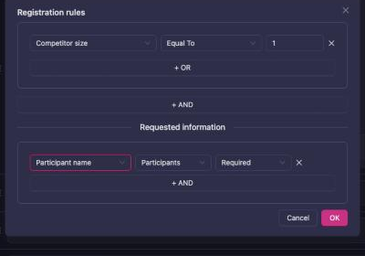

# Registration periods

For organizers who open registration for a competition. Here you create the registration periods, choose how dancers pay and what it costs, pick the classes they can enter, and decide what the registration form asks for.

You do this on the **Registration period** tab of `Manager → Competition → Registration`. The whole path, from the first period to check-in on the day, is on [Registration and check-in](/manager-guide/registration-checkin/). To have clubs sign their dancers' entries and pay for them together, see [Organizations sign their dancers' entries](/manager-guide/entries-and-participants/#organizations-sign-their-dancers-entries).

A registration period is one window in which dancers and clubs can register. It decides when they can register, how they pay, what it costs and which classes they can enter. You can have several periods, for example an early one and a late one at different prices. An entry can be made from the period's start time to its end time.

## Create a registration period

1. Open `Manager → Competition → Registration` and the **Registration period** tab.
2. Press **Add registration period** below the list of periods.
3. Type a name for the period in the first field.
4. In the date field, pick the start date and time, then the end date and time.
5. Choose the **Payment type**: **Free of charge**, **Manual payment** or **Online payment**.
6. Choose the **Registration acceptance**: **Manual** or **Direct**.
7. Unless the period is free of charge, choose the **Currency** and what the **Price per** is, and type the price. **Add price** adds a price line.
8. If you like, write a **Description**, for example how to pay with manual payment.
9. Press **Save changes**.
10. Add the classes. A new period has no classes, and nobody can enter a class that is not in it. See [Choose the classes](#choose-the-classes).

Each period in the list has a mark after its name: an orange clock while it has not started, a green check while it is open, and a red cross when it has ended.

**A period is open by its dates alone.** The event does not have to be **Published**. On a **Hidden** event, anyone who has the link to the registration page, or the **Scan to register** QR code, can register while the period is open. A hidden event is not in the public lists of events, so publish the event when dancers should find it by themselves.

## What each choice means

| Field | Choices |
|---|---|
| **Payment type** | **Free of charge**: nothing to pay; the currency and price fields are hidden. **Manual payment**: dancers pay you outside Vote4Dance, and you record each payment yourself. **Online payment**: dancers pay by card through Stripe, and payments are checked off automatically. Online payment is recommended. The dialog says "Cost for online payment is 5%" plus Stripe's own fee. |
| **Registration acceptance** | **Manual**: an entry starts as **Preliminary** and you approve it. **Direct**: an entry is **Approved** without you; with online payment, once it is paid. **Auto** is greyed out and cannot be chosen. |
| **Currency** | **SEK**, **EUR**, **USD** or **NOK**. |
| **Price per** | **Person, per class**: each dancer pays for each class they enter. **Person, whole competition**: each dancer pays one price for the whole competition; more classes and teams are free. **Registration**: the price is for an entry, a couple or team in one class, however many dancers it has. |
| Price lines | With one price line, that price is charged for each class (or each entry). With several lines, **1 or more** is the total for one class, **2 or more** the total for two, and so on; the last line also covers every higher number. Example: 200 on the first line and 300 on the second means one class costs 200, and two or more classes cost 300 in total. |
| **Description** | A text about the period. Scrutineer (Beta) says of the same field that it is shown to dancers. |

**Online payment needs Stripe.** If the event's Stripe account is not connected, the dialog shows a **Connect Stripe account** warning and **Save changes** stays greyed out. Connect the account under the list of periods on the **Registration period** tab, then save the period.

A club that registers entries pays them with **Pay now** on its registration list.

**Manual acceptance with online payment.** The dancer does not pay when registering. The button is **Send registration**, the dancer reads "Registration completed - pay later", and the entry is **Preliminary** and unpaid. When you have set it to **Approved**, the dancer's own page for the event has a button to pay, **Pay for your classes** or **Pay** with the amount, and the dancer pays by card there. Until then that page says "Waiting for the organizer to approve your registration", and a payment is refused with "Registration must be approved before payment".

## Choose the classes

1. On the **Registration period** tab, click the period's name to open it.
2. Click **Select classes**.
3. Open the **Select classes** list and tick the classes dancers can enter in this period, or press **Select all**.
4. Press **Add**. The button shows how many classes you ticked.

The classes are listed under **Select classes**, each with its own rules. The pen on a class edits that class's rules; the red **Delete** button in that dialog takes the class out of the period. A dancer who tries a class that is not in the period is told "This class isn't open for registration in the chosen registration period."

## Registration rules and requested information

**Registration rules** on a period opens the rules for all its classes. The pen on a class under **Select classes** opens the rules of that one class. The dialog has two parts:

- **Registration rules**: conditions an entry must meet. The conditions are **Age**, **Birth year**, **Age span in years**, **Registration count**, **Competitor size**, **Country**, **Level**, **Dance role** and **Organization selection**.
- **Requested information**: questions the dancer answers when registering. A question is a **Text**, **Textarea**, **Number** or **Checkbox** field with a label you write, or one of the **Participants** fields: **Participant name**, **Name of show** and the two **Organizations** fields. Each is **Required** or **Optional**.

Press **OK** to save the period's rules, or **Save changes** when you edit one class.

### What each condition checks

A condition is one of the names below, a comparison such as **Less Than** or **Equal To**, and a value. A class's own rules are added to the rules of its period.

| Condition | What is compared with your value |
|---|---|
| **Age** | The age of each dancer on the competition date. Every dancer of the entry has to pass, and a dancer without a date of birth does not. |
| **Birth year** | The year each dancer was born. Every dancer has to pass. |
| **Age span in years** | The difference in age between the oldest and the youngest dancer of the entry. |
| **Registration count** | The number of registrations the class already has, whatever their status. With **Less Than** and 20, the class takes registrations until it has 20. This one is checked on the registration page, when the dancer picks classes. |
| **Competitor size** | The number of dancers in the entry. |
| **Country** | The country on each dancer's profile. Every dancer has to pass, and a dancer without a country does not. |
| **Level** | The level the class is for, written as the federation's own registry writes it. The registration page looks the dancer up in that registry, for example WSDC's, and does not let a dancer enter whose level there requires or allows another level. |
| **Dance role** | With **All have a role**: every dancer of the entry has a dance role. With **Leader and follower**: the entry has both a leader and a follower. |
| **Organization selection** | With **Required**: each dancer has to choose the organization they represent in the class, among the organizations where they are an approved member. |

An entry has to pass every condition, also the ones you add with **+ OR**. An entry that does not pass is refused, and nothing is saved. The dancer reads why, for example "A dancer in this lineup doesn't meet the class's age requirements. Edit the lineup to skip or replace them.", "This lineup has more dancers than the class allows. Edit the lineup to skip dancers for this competition." or "This team doesn't meet the organizer's requirements for this class."

## Team names

Dancers can give their team a name of its own. That name is used in group and formation classes, and in classes that ask for one. Solo and couple entries, and entries in classes that are not linked to a federation class, are shown under the dancers' names and not under a nickname.

To collect team names in a class that doesn't use them, for example a crew class at an event without a federation:

1. On the **Registration period** tab, open the period and click **Registration rules** to cover all its classes, or open **Select classes** and edit the rules of one class.
2. Under **Requested information**, add a field, choose **Participants** and pick **Participant name**.

   

3. Click **OK**. Dancers registering for the class are now asked for the name, and it shows on the **Registrations** list and on the start list after the import.

A name you type on an entry yourself always shows and is imported. If the start list shows a team under its dancers while the **Registrations** list shows its name, import again: the import updates the participants already on the start list. Asking for **Name of show** collects a show title and doesn't turn team names on. A federation can switch team names on or off for its categories; where it switches them off, the start list always shows the dancers.

The **Registrations** list shows the dancers who dance the entry, with lineup changes applied, not the team's whole roster.

## Change, reorder or delete a period

- **Change:** open the period and press **Edit registration period**. Change the fields and press **Save changes**. To close a period early, set an end time that has passed.
- **Reorder:** drag a period up or down in the list. This is the order the periods are shown in.
- **Delete:** press the red **Delete** button in the **Edit registration period** dialog. A period that has entries or classes cannot be deleted; the message is "Cannt delete registration period with competitors or classes".

Under the list of periods is a QR code, **Scan to register**, that leads to the competition's registration page. **Print** opens a printable version.

## Troubleshooting

| What you see | What it means | What to do |
|---|---|---|
| A period cannot be saved, and the dialog shows **Connect Stripe account** | **Online payment** needs the event's Stripe account. | Connect the account under the list of periods, or choose another **Payment type**. |
| "Cannt delete registration period with competitors or classes" | The period has entries or classes. | Keep the period. To close it, set an end time that has passed. |
| A dancer is told "This class isn't open for registration in the chosen registration period." | The class is not in the period. | Add it under **Select classes**. See [Choose the classes](#choose-the-classes). |
