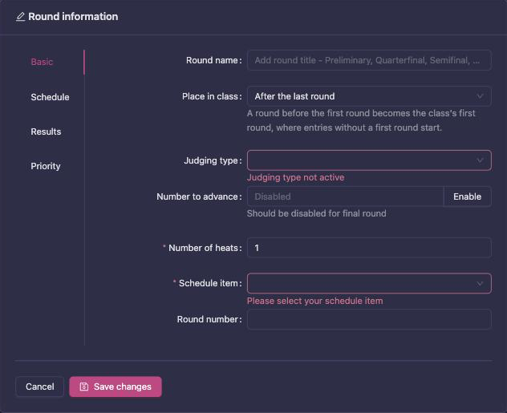
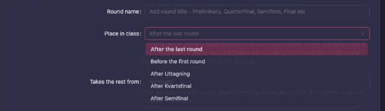
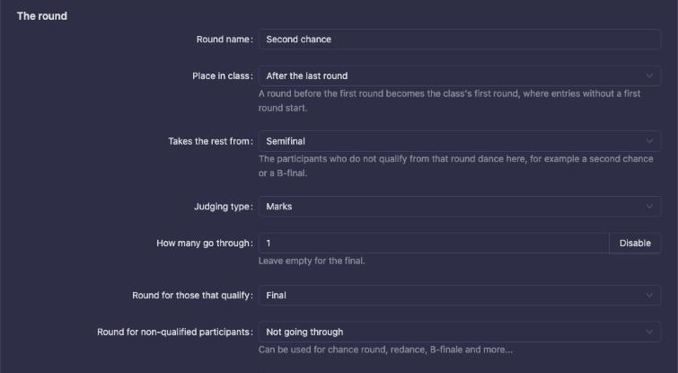
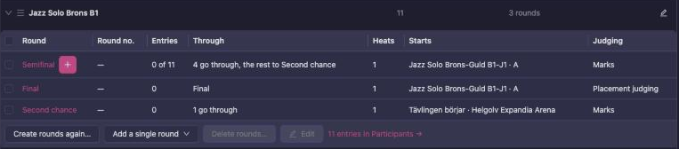

# Adding rounds by hand

This page is for the organizer whose class needs a round that the **Round guide** did not create: one more round, an extra round before the first round or between two rounds, a second chance or a B-final. When you are done, the class has the extra round and every round sends its participants to the right place.

Most classes never need this. The Round guide builds all rounds of a class in one go: see [Build rounds from classes](/manager-guide/competition-setup/#step-2-build-rounds-from-classes).

## What you can do where

The classic Manager and Scrutineer (Beta), the new version of the Manager app, do not offer the same things here. To open Scrutineer (Beta) from the classic Manager, press **Try new version** at the top.

| What you want | Classic Manager | Scrutineer (Beta) |
|---|---|---|
| [Add a round after the last round](#add-a-round) | Yes | Yes |
| [Add a round before the first round](#add-a-round-before-the-first-round) | Yes | Yes |
| [Add a round between two rounds](#add-a-round-between-two-rounds) | No | Yes |
| [Send the rest to a second chance or a B-final](#send-the-rest-to-a-second-chance-or-a-b-final) | When the round is closed | During setup |

Two things have different names in the two:

| Classic Manager | Scrutineer (Beta) |
|---|---|
| **Add round** (button) | **Add a single round** |
| **Number to advance** (field) | **How many go through** |

## Add a round

1. Go to `Competition → Classes` and click the class. Its rounds open under it.
2. Click **Add round**. The **Add Round** page opens.
3. Enter the **Round name**, for example "Final".
4. Check the values the form has filled in. A new round goes after the class's last round and starts from that round's settings: half its **Number to advance**, half its **Number of heats**, and the same **Judging type**, **Schedule item** and **Floor**.
5. A final sends nobody on, so **Number to advance** must be disabled there. If it holds a number, click **Disable** next to it.
6. Click **Save changes**.

See [Round settings](/manager-guide/competition-setup/#round-settings) for what each setting is called and where it is.

To add a point summary, click **Add other** and choose **Point summary**. The button shows when your federation uses point summaries. See [Point summary](/point-summary/).

## Add a round before the first round

Use this when more participants came in than the first round can take, and the class needs a preliminary round in front.

1. Open the class and click **Add round**.
2. Under **Place in class**, choose **Before the first round**. The form then takes its values from the first round: **Number to advance** is twice what the first round sends on (at least 6), and the round goes in the first round's schedule item, just before the first round.
3. Check the values and click **Save changes**.

The new round becomes the class's first round, where participants without a first round of their own start. Its **Round for those that qualify** is the round it was placed in front of.

A round can't be added in front of a first round that has started. If the first round already has participants, set it back to **Not started** and use **Remove participants** on it first, so nobody ends up in both rounds.

## Add a round between two rounds

This is done in Scrutineer (Beta). The classic Manager places a new round only after the last round or before the first round.

When a class needs an extra round in the middle, for example a quarterfinal between the preliminary and the semifinal, add it in its place instead of at the end:

1. Open the class and click **Add a single round**.
2. Enter the **Round name**, for example "Quarterfinal".
3. Under **Place in class**, choose **After** and the round it should follow, for example **After Preliminary**. The form then takes its values from the round it goes in front of, so it is not set up as a final.
4. Check the values and click **Save changes**.

The new round takes over the link of the round before it: the preliminary now sends its qualifiers to the quarterfinal, and the quarterfinal sends them on to the semifinal. If the preliminary has a second chance round, that round now leads to the quarterfinal as well.

Good to know:

- If the round before sends its qualifiers somewhere other than the next round, for example straight to the final, that link stays as it is. Check its **Round for those that qualify** afterwards if it should go to the new round.
- An **After** choice is greyed out when the round before would not send anyone to the new round, with the reason under it: the round has started, it sends nobody on (a final), or it sends its qualifiers to a round picked for it.
- **Place in class** is only on the form when you add a round. A round that already exists can't be moved to another place in the class, so if a round ended up in the wrong place, delete it and add it again with the right **After** choice. Deleting a round links the round before it to the round after it.
- A second chance round can only be added **After the last round**. Where it sits in the class doesn't change where its participants go.

## Send the rest to a second chance or a B-final

When a round sends only some of its participants on, you decide where the others go: to a second chance round that leads back into the next round, or to a B-final that gives them their places. The Round guide sets this up for the rounds it creates. For a round you add yourself, you set it by hand.

Setting it during setup is done in Scrutineer (Beta). In the classic Manager, add the round with **Add round**, and choose it under **Round for non-qualified participants** in **Qualified participants** when the judging of the round before it is closed. See [Check where the round sends its participants](/manager-guide/live-operations/#check-where-the-round-sends-its-participants).

In Scrutineer (Beta):

1. Open the class and click **Add a single round**.
2. Enter the **Round name**, for example "Second chance".
3. Under **Takes the rest from**, choose the round whose non-qualified participants dance here, for example the semifinal. The list holds the class's rounds that send participants on, whose judging is not yet closed and that have no round for the rest yet.
4. Set **How many go through** to the number that go on from the new round. Leave it empty for a B-final, which sends nobody on.
5. If you set a number, the form fills in the rest from the round you chose. **Round for those that qualify** becomes the round the semifinal sends its own qualifiers to, usually the final, so both rounds lead to the same next round. **Judging type**, **Schedule item** and **Floor** become the semifinal's, so the second chance is judged the same way and dances in the same block. A B-final keeps the values of the class's last round instead.
6. Check the values, change any that do not fit your class, and click **Save changes**.

   

The class's rounds now show the link on the round you chose, for example "4 go through, the rest to Second chance". That round keeps sending its qualifiers to the same round as before.

### Change where a round sends its participants

In Scrutineer (Beta), for a round you already have:

1. Open the class and click the round.
2. Under **How many go through**, set **Round for those that qualify** and **Round for non-qualified participants**. **Not going through** means the rest get their places from this round and do not dance again.
3. Click **Save changes**.

Good to know:

- The two fields show only while **How many go through** is set, so not on a final.
- When **Round for those that qualify** reads **The next round**, followed by a round's name, the round has no link of its own: its qualifiers go to the round after it in the class when it starts, passing over its own second chance round or B-final. A second chance round without a link goes to the round after the round it takes the rest from.
- Once you choose a round for the non-qualified, saving also fills in the round for those that qualify, so the two groups can never end up in the same round by accident.
- You can change both until the round's judging is closed. After that, use **Qualified participants** on the closed round.
- When you confirm the round on the day, the rest are sent to the round you chose, and that round's **Best placement** is set to the first place after those who went through unless you choose otherwise. A best placement of the round's own does not change that: a quarterfinal placed from 14 that sends 7 on sets its second chance to 8.
- When the round is itself a second chance, the places of those who went straight on from the round before count too. For example, four went from the first round to the final and the rest to an extra chance placed from 5: when the extra chance sends 2 on, the round its rest go to is set to 7.
- When the round you chose for the non-qualified is also the round for those that qualify, its **Best placement** is left as it is.

## Add a child round or a chance round

A child round is a round under another round, for example one dance of a round that is danced in several dances. The steps describe the classic Manager.

1. Go to `Competition → Classes`, click the class and click the name of the round the new round belongs under.
2. In the **Class order** card, next to **Round information**, click **Add child round**. It is under the list of the class's rounds, beside **Add round**. It is greyed out when the round you have open is not an ordinary round, for example a chance round or a point summary.
3. Choose what to add:

   | Choice | What you get |
   |---|---|
   | **Child round** | A round under the round you have open. Once a round has child rounds, its **Judging type** says how they are added up: **Don't summarize**, **Sum marks**, **Sum placements** and so on. |
   | **Chance round - without placements** | A second chance round under the round you have open. It is named "Chance round" until you give it another name. |
   | **Match Race (Round Robin)** | A list with one match for every pair of participants in the round you have open, shown by their start numbers. Drag the matches into the order they are danced and save. Each match becomes a child round named after the two start numbers. |

4. For a child round or a chance round, the form for a new round opens, filled in from the round you have open. Check the values and click **Save changes**. If the round you have open already has participants, the new round gets the same participants when you save it.

Participants are sent to a chance round like to any other round: choose it under **Round for non-qualified participants** when the round before it is closed. See [Check where the round sends its participants](/manager-guide/live-operations/#check-where-the-round-sends-its-participants). A chance round gives no places of its own. A participant who does not go on from it keeps the place from the round it came from. Unlike other child rounds, a chance round has its own **Publish results online** button.

## Delete a round

1. Open the class and tick the round in the list.
2. Click **Delete round** and confirm. In Scrutineer (Beta) the button is **Delete rounds…**.

A round with participants cannot be deleted. Use **Remove participants** on it first.

When you delete a round, the round before it now sends its qualifiers to the round after it.

## Related pages

- [Competition setup](/manager-guide/competition-setup/): classes, the Round guide and round settings
- [Live operations](/manager-guide/live-operations/): sending participants on when a round is closed
- [Schedule and conflicts](/manager-guide/schedule/): where a round sits in the day
- [Battle bracket](/battle-bracket/) and [Point summary](/point-summary/): rounds of their own kind
