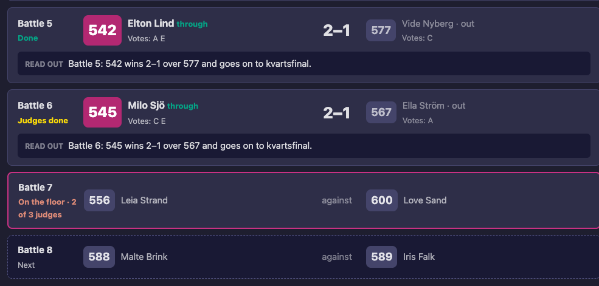
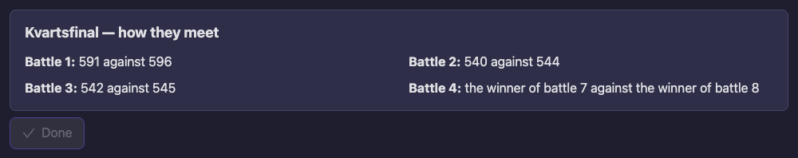
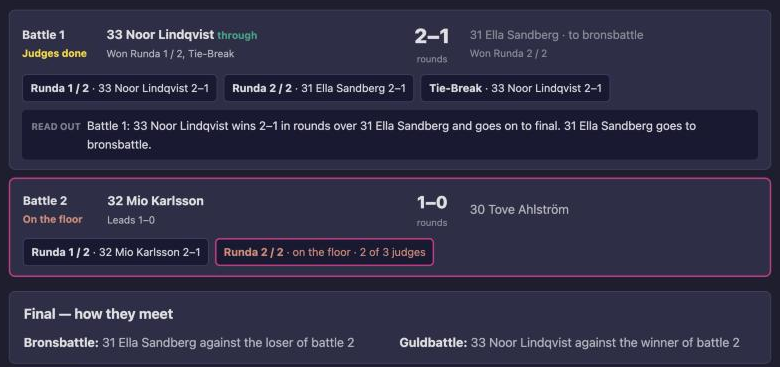
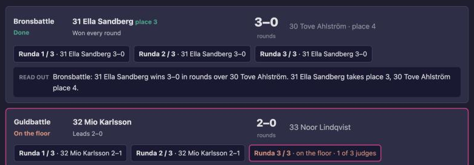
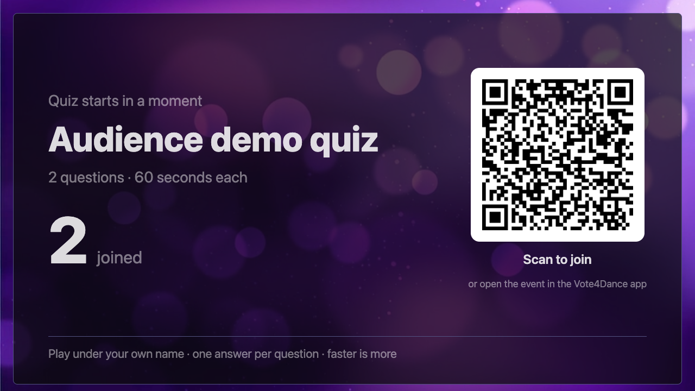
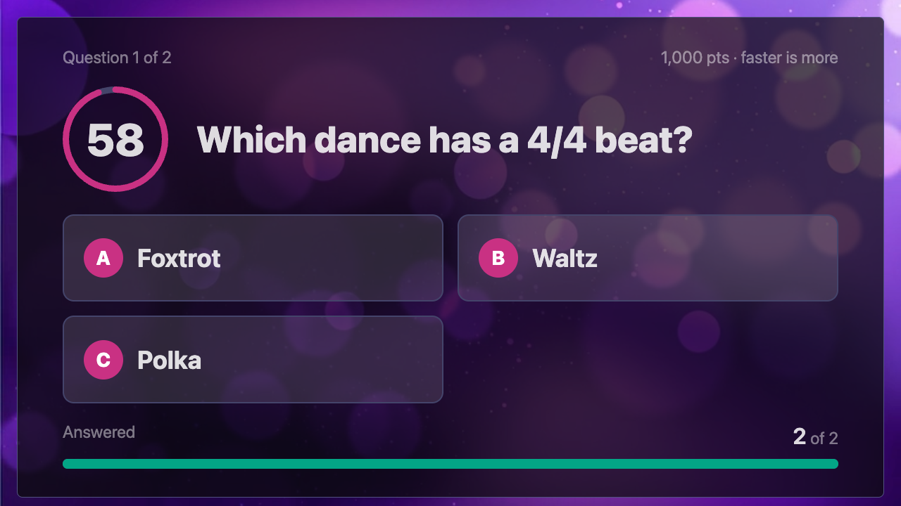
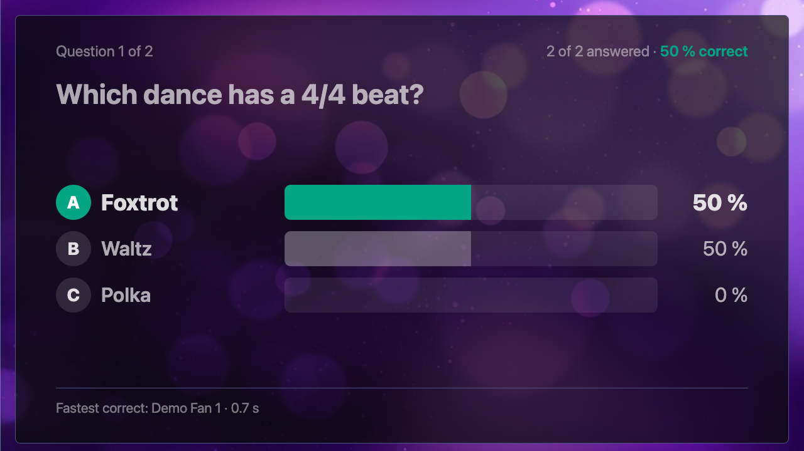
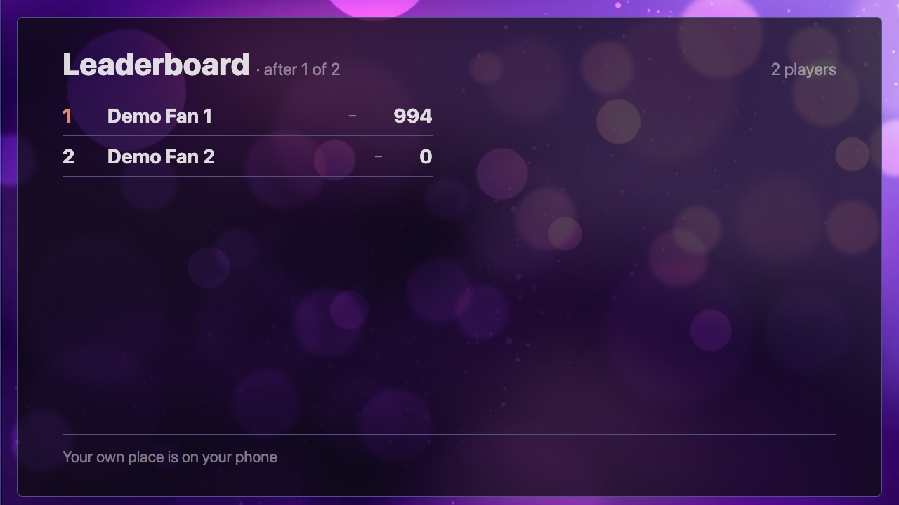
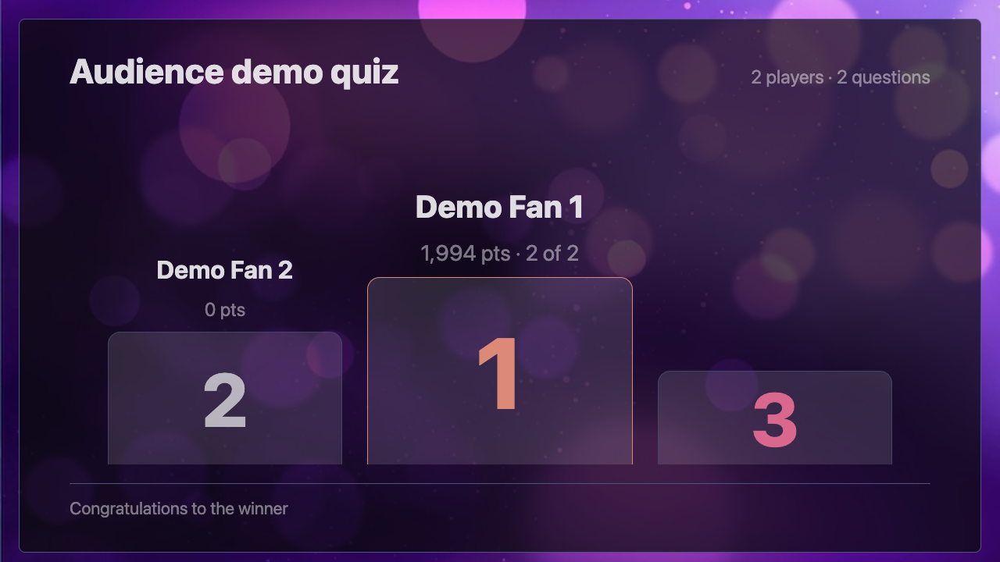

# Screens, projectors and venue technology

Everything the audience and the floor see — lineups, heats, live results, the prize
ceremony, the schedule, sponsors — comes out of the **Screens** app. This page covers how
a projector or TV gets its picture, what it can show, who controls it, and what to agree with
the venue's technician before the day. Two sections near the end are for the day itself:
how the speaker follows a round of [battles](#battles-in-the-speaker-app), and what a screen
shows during a [quiz](#quiz-screens).

## What Vote4Dance drives, and what it does not

| The venue's equipment | Does Vote4Dance drive it? |
|---|---|
| Projector, LED wall, TVs | **Yes** — through a computer or tablet running the Screens app, connected like any other picture source. |
| Sound system and microphones | No. Your DJ and the speaker use the venue's sound. Vote4Dance shows the running order; it does not play music or route audio. It can collect the dancers' own tracks for the DJ to download: see [Music from the dancers](/manager-guide/music/). |
| Stage lighting | No. |
| Streaming / camera mixer | No, but a screen output can be fed into a mixer like any other HDMI source, and the blank/green-screen views exist for exactly that. |

So the only cable that matters for Vote4Dance is the one from your display computer to the
venue's picture input.

## How a screen gets its picture

A "screen" in Vote4Dance is two things: a **screen record in Manager** (`Manager → Audience →
Screens`), and **a device showing the Screens app in fullscreen**, plugged into the projector
or TV. There is no separate box and nothing to install. In Scrutineer (Beta), **Screens** is
on the overview under **Everything else**.

### In Manager: create the screen

`Manager → Audience → Screens` → **Create screen**. Each screen has:

| Field | What it does |
|---|---|
| **Label** | The screen's name, for example "Main projector" or "Foyer TV". This is how the device and the speaker identify it, so name it after where it hangs. |
| **Background** | `Normal background`, `Green screen (TV)`, `Custom background` or an animated background (`V4D` or `Blue`). Green screen is for streaming and camera mixers; on green screen and blank, the federation/branding image is hidden. |
| **Floor** | `All floors`, or one specific floor. A screen in a hall with two floors should be set to its own floor. See [Floors](/manager-guide/floors/). |
| **Show** | What the screen starts on — see [the Show options](#what-a-screen-can-show) below. |
| **Settings** | `Hide name before finals`, `Spotlight duration (podium)` (default 5s), `Spotlight duration (outside podium)` (default 3s), `Winner flag only`. |

Each screen card also has a **connection dot**, so the desk can see at a glance whether that
screen is still alive.

### On the device: point it at the screen

1. Decide which device drives each display. A laptop or a small computer with an HDMI output
   is the reliable choice for the main projector. A tablet can drive a TV, but a computer is
   easier to keep awake and in fullscreen.
2. Connect the device to the venue's input (usually HDMI; bring a USB-C or Mini-DisplayPort
   adapter if your laptop has no HDMI port).
3. Give the device access to the Screens app — either sign in as a user who has **Screens**
   ticked, or let the device join a **Screens station** by scanning its QR code. A station is
   the better choice for a machine that stays in the hall all weekend: no personal login, and
   you can revoke it afterwards. See [Users, apps and stations](/manager-guide/users-and-stations/).
4. The Screens app shows **one card per screen you created in Manager**. Press **Show** on the
   card for this display. That is the device's only choice — the floor, the background and
   what is shown all come from Manager and from what the speaker pushes.
5. Put the browser in **fullscreen**.
6. If the text is too large or too small, use the **browser zoom hotkey, usually Ctrl +/-**.
   The screen layouts are built for a resolution of **1280 × 720** and scale from there; the
   app states all three of these hints on its own start page.

Several devices can join the same station and open the same screen — that is how you get the
same picture on several TVs.

**One screen device shows one thing at a time.** For two displays showing different content,
create two screens in Manager and use two devices — or, on a computer with two picture
outputs, two browser windows, each opened on its own screen card and dragged onto its own
display. A single window cannot feed two projectors with different content.

## What a screen can show

### The Show setting in Manager

`Manager → Audience → Screens → Show` has seven options. This is what the screen displays on its
own, without anyone touching it:

| Show | Shows |
|---|---|
| **Heat** | The running heat. Names appear when the field is small, and a single-couple heat can show a picture. |
| **Lineup** | Who is on the floor next, per heat, with start numbers. |
| **Schedule (no heats)** | One card per schedule block with its rounds and their live estimated start times — good for a foyer TV. |
| **Result** | The result of the round, with podium, advancement marking and the prize-ceremony spotlight. |
| **Round number** | The round number only, large. |
| **Results (last 6)** | The six most recently published rounds, for the hall between rounds. |
| **Judge presentation** | The panel: judges one at a time, or one pinned. |

There is no separate "prize ceremony" setting: **the podium and the spotlight are part of
Result**, and the spotlight durations are the screen's own settings.

### What the speaker pushes

During the competition the **Speaker** app overrides what a screen shows, with **Show on
screen** buttons. The speaker picks which screen to drive, then sends it:

| From | What goes on the screen |
|---|---|
| Overview | `Show competition name`, `Show blank screen`, `Round number`, `Results (last 6)`, `Lineup`, `Schedule` |
| Schedule | A specific schedule item |
| Lineup | A round, its teams, a single team in a heat, a group's dancers, a redance/rotation draw |
| Results | A round's result, or the open judging for one team |
| Judges | One judge, or all judges in turn. The speaker can list the judges [by panel](/manager-guide/judge-panels/#panels-in-the-speaker-app) |
| Sponsors | A sponsor, or the sponsor rotation |

The screen fades over about a second when it changes. Audience voting and the live-placement
view are variants of the heat screen and appear on their own when they apply.

The speaker sends a round's result from the **Results** page of the Speaker app. A round is
listed there once it is **Confirmed**; a round danced as battles is listed as soon as its first
battle has started. In a final, each place has a **Show** button, and that place appears on the
screen when the speaker presses it. The speaker's **Done** button publishes the round.

The speaker also sends the quiz to a screen: see [Quiz screens](#quiz-screens). A round danced
as battles has its own view in the Speaker app: see
[Battles in the speaker app](#battles-in-the-speaker-app).

## Who controls what is shown

| Who | What they can do |
|---|---|
| **Screens** (the screen device itself) | Nothing beyond choosing which screen it is. It is display only. |
| **Speaker** | The floor console. Has **Show on screen** buttons — a team, a judge, a schedule item, the result reveal for the prize ceremony. This is the app your MC drives the hall from. |
| **Supervisor** | Chooses the floor and controls the screens, without being able to change the setup. |
| **Manager** | The screens themselves: label, background, floor, the `Show` setting and the spotlight/name settings. |

Agree before the day who has the screens: normally the speaker, with the desk as backup.

## Projector practicalities

These are the things that actually go wrong in a hall:

- **Aspect ratio.** The screen layouts are built for 16:9, at a reference resolution of
  1280 × 720, and scale up from there. A 1080p projector is fine. On a 16:10 or 4:3 projector
  expect black bars, and check that nothing is cut off at the edges.
- **Overscan and edge cropping.** Some projectors cut a few percent of the picture. Adjust
  with the **browser zoom hotkey (Ctrl +/-)** rather than fighting the projector.
- **Text size.** Browser zoom is also how you make names and start numbers bigger for a deep
  hall, or smaller when a long start list is being cut off.
- **Sleep, screensaver and updates.** Disable sleep, screensaver and automatic updates on
  the display computer, and keep it on mains power. A screen that goes dark mid-final is
  almost always a power-saving setting.
- **Fullscreen and the mouse pointer.** Use the browser's fullscreen mode and move the
  pointer off the display, or it sits in the middle of the projection all day.
- **Cable length.** HDMI over 10–15 metres often needs an active cable or an extender. This
  is the venue's problem to solve, but you need to raise it early.
- **Test with the real cable, in the real seat.** A picture that works on your desk can fail
  on a 20-metre run through a stage box.

## Network

Every screen, tablet and judge device is a live client talking to the Vote4Dance cloud.

- Reliable internet for the whole event is a requirement, not a nice-to-have.
- Wi-Fi must not have a captive portal, a browser login or a forced timeout — those kill
  screens and judge devices mid-round.
- Wire the main display computer if the venue has an Ethernet port. It is the one device
  that must never blink.
- Have a backup path: a second router, or a phone hotspot you have actually tested.
- Count your devices and make sure the venue's access point can carry them.

Full list: [Technical requirements](/requirements/).

## What to ask the venue technician

Send this list to the venue before your visit. It is written to be forwarded as it is.

**Picture**

1. Which input does the projector take, and where is the socket we plug into (stage, desk, booth)?
2. Is it HDMI? What length is the cable run, and is an extender in place?
3. Which resolution and aspect ratio does the projector run at?
4. Can we see the picture from the scrutineering desk as well, or only from the floor?
5. Are there other screens (foyer TV, stage monitor) we can feed, and from where?
6. Can we leave our computer connected and powered in one place all day?

**Internet**

7. Is there Wi-Fi in the hall, and does it cover the floor, the desk and the judges' positions?
8. Does the Wi-Fi require a login or a portal page, and does it time out?
9. Is there a wired network port near the display computer?
10. Roughly how many devices can the network carry at once?

**Power and space**

11. Power at the desk, at the display computer and at the check-in desk?
12. Table space and chairs for the desk and the judges?
13. Can the judges' tablets be charged during the day?

**People and access**

14. When can we get in to set up, and who from the venue is present?
15. Who is our contact during the event if the picture or network fails?

## Battles in the speaker app

A round danced as battles has its own view in the Speaker app. This is what the speaker sees while the round runs, before its result goes on a screen.

When a round is danced as battles, the speaker's **Results** page lists every battle in order and follows the floor while the round runs. The round appears as soon as its first battle has started. Each battle shows where it stands:

| Status | Meaning |
|---|---|
| **On the floor** | The battle is being danced. It also shows how many judges have handed in, for example "2 of 3 judges". |
| **Judges done** | All judges have handed in and the winner is known. This is the same moment the venue screen reveals the winner. |
| **Tie — waiting for the secretariat** | The judges tied, and the secretariat has to settle it. |
| **Done** | The battle has been confirmed. |
| **Next** | The battle that is danced next. |

Once a battle has a winner you see:

- The winner with a big start number, the name and **through**.
- The score, for example 2-1, and which judges voted for whom.
- The loser, marked **out**.
- A **Read out** line to say into the microphone, such as "Battle 1: 591 wins 2-1 over 583 and goes on to quarter-final."

Under the battles, the speaker sees who meets whom in the next round, so the next battle can be called up before that round has started.

The **Done** button, which publishes the round, stays disabled until the round has been confirmed. A final or B-final danced as one battle shows the usual winner list; a final made of best-of battles is listed battle by battle (see [Best-of battles](#best-of-battles)). The venue screen in Live mode is not changed: it follows the floor battle by battle, as before.

To show a battle round's result on a screen, see [What the speaker pushes](#what-the-speaker-pushes). The audience reads the same round as a tree on the website: see [Battle results as a tree](/spectator/following-the-schedule/#battle-results-as-a-tree).

### Best-of battles

At some events a battle is won over several rounds: best of 2 with a **Tie-Break** if it ends 1–1, or best of 3. The **Results** page then shows each battle with its rounds under it, so the speaker can follow the battle round by round:

- The big score is **rounds** won, for example 2–1, not judges' votes.
- Under the dancers, each round shows who won it and the judges' vote, such as "Runda 1 / 2 · 33 Noor Lindqvist 2–1". The round being danced is framed and shows how many judges have handed in, for example "on the floor · 2 of 3 judges".
- While the battle runs, the dancer ahead shows **Leads 1–0**.
- **Judges done** comes when every round has been decided and one dancer has won more rounds. At 1–1 the battle shows **Level — waiting for a tie-break** until the secretariat adds the tie-break round.
- The **Read out** line gives the rounds won, for example "Battle 1: 33 Noor Lindqvist wins 2–1 in rounds over 31 Ella Sandberg and goes on to final. 31 Ella Sandberg goes to bronsbattle."

When the final is a gold battle and a bronze battle, for example **Guldbattle** and **Bronsbattle**, the speaker follows the final the same way. The battles are named by their round, and the **Read out** line also gives the places, for example "31 Ella Sandberg takes place 3, 30 Tove Ahlström place 4." Under the semifinal, **Final — how they meet** shows who goes to which battle: the winners to the gold battle and the losers to the bronze battle. Once the final is confirmed, the usual list of places follows under the battles.

### Who is already through, on Lineup

A final or B-final is often not drawn until the whole semifinal is done. On **Lineup** (and **Live**) the speaker still sees who is already through: as soon as a battle feeding the round is confirmed, its winner or loser shows with a label such as "Winner of Battle semi 1". A place still to be danced for shows as a "?" with the battle and its two dancers, for example "Winner of Battle semi 2 (542 against 556)", and the heat says **Waiting for Battle semi 2**. The speaker can call up the final dancers early, and the list matches what the secretariat sees.

Once the round is drawn, **Lineup** shows it as usual.

## Quiz screens

During a quiz, the screen takes the hall through five views in turn. This is what the audience sees.

When the speaker runs a quiz (see [Running a quiz from the speaker app](/manager-guide/speaker-quiz/)), the screen shows it. It follows the same steps as the speaker:

1. **Lobby**: "Quiz starts in a moment", the number of questions and seconds each, how many have **joined**, and a QR code, **Scan to join**, so the hall can play in the app.

   

2. **Question**: the question with its answers, a countdown, and how many players have **Answered**. The correct answer is never shown before the question closes.

   

3. **Reveal**: how the answers split with the right answer highlighted, the share who were right, and who was **Fastest correct**. For a question answered with a number, the screen says **Correct answer** and the number.

   

4. **Leaderboard**: the top 10 after each question. Players see their own place on their phone.

   

5. **Podium**: the top three with **Congratulations to the winner**.

   

With no quiz on, a screen that was sent to the quiz says **No quiz on right now**. Players take part in the app, see [Quizzes](/spectator/quizzes/).

## Troubleshooting

### The projector shows nothing

1. Check the projector is on the right input.
2. Check the computer is actually mirroring/extending to it (display settings).
3. Swap the cable before you doubt the app.

### The screen shows the wrong floor or the wrong content

The floor and the `Show` setting belong to the screen record in Manager, not to the device.
Open `Manager → Audience → Screens`, check the screen's **Floor** and **Show**, and confirm the
device opened the right screen card. If the speaker has pushed something onto it, the speaker
decides what it shows until they send it something else.

### Edges are cut off, or content looks too small

Use the browser zoom hotkey (Ctrl +/-) to fit the picture, and confirm the output is 16:9.

### The screen froze or went dark

Reload the page. If it went dark, power saving is the usual cause. Check the screen's
connectivity in Manager to see whether the device dropped off the network.

### Results are not appearing

Check the round's status in Manager first:

- **A result the speaker sends with Show on screen.** The round must be **Confirmed**: only
  then is it on the speaker's **Results** page. In a final, a place stays hidden until the
  speaker presses **Show** on it.
- **Results (last 6).** This view shows only rounds that are both **Confirmed** and
  **Published**. A round that is confirmed but not yet published is not in it.

### The screen shows a practice warning

The event is a practice event. Every app, screens included, shows "Practice events have
limitations! Only for practice and should not be used for live competitions." It disappears
when you run a live competition — see [Test run and venue rehearsal](/manager-guide/test-run/).

## Related pages

- [Users, apps and stations](/manager-guide/users-and-stations/) — access per app and shared devices
- [Test run and venue rehearsal](/manager-guide/test-run/) — prove the whole chain at the venue
- [Technical requirements](/requirements/) — devices, network, browser
- [Live operations](/manager-guide/live-operations/) — the event-day runbook
