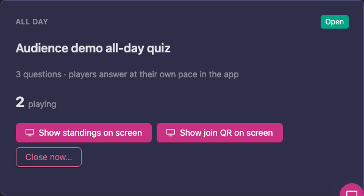
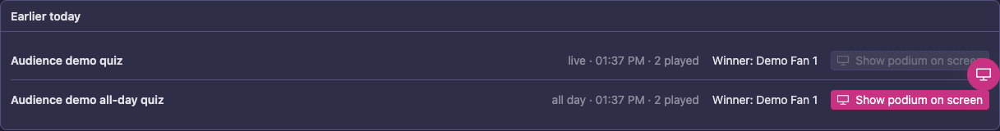
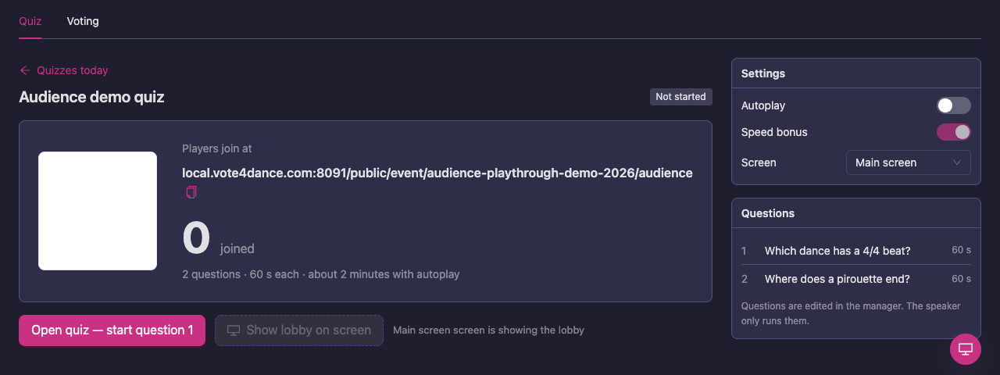
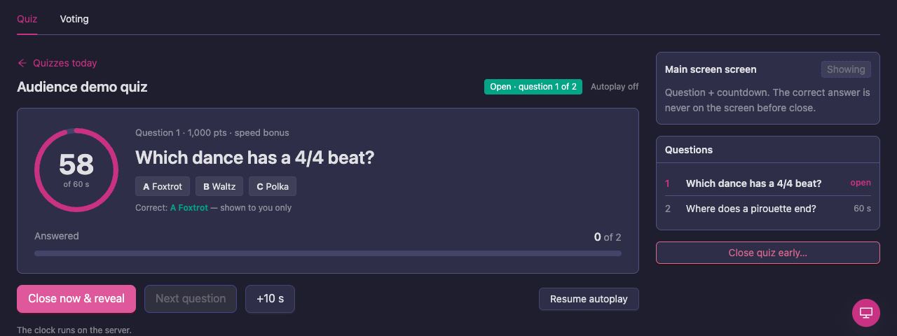
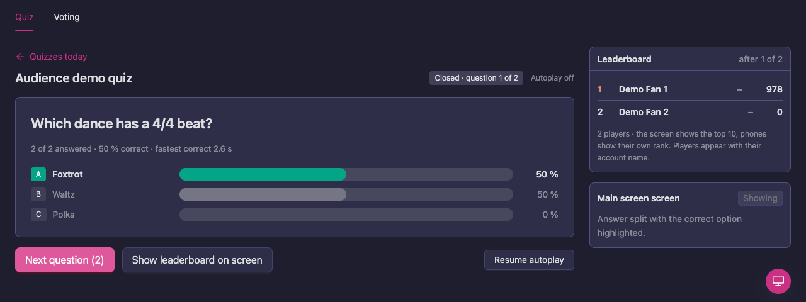

# Running a quiz from the speaker app

The speaker runs the audience's quiz from the **Audience** page of the Speaker app, and puts the lobby, the questions and the standings on the screens in the hall. The organizer sets up the quizzes beforehand; the speaker only runs them. Players take part in the Vote4Dance app, see [Quizzes](/spectator/quizzes/).

The **Audience** page has a **Quiz** tab and a **Voting** tab.

## Overview

**Quizzes today** lists the day's quizzes:

- a **LIVE · RUN FROM HERE** quiz, the one you run, with its number of questions, seconds per question and about how long it takes with autoplay
- an **ALL DAY** quiz, which players play at their own pace in the app, with **Show standings on screen** and **Show join QR on screen**
- **Earlier today**: finished quizzes with the winner and **Show podium on screen**

If a live quiz has a planned start time, it says **planned for** and the time. With no quiz, the page says that quizzes are set up in the manager.

An all-day quiz runs by itself. Its card shows how many are **playing**. Points are counted when it closes, at the time the organizer set or when you tap **Close now…** and confirm. **Top right now** shows the leaders once questions have been scored.

Once it has closed, the quiz moves to **Earlier today** with its winner. **Show podium on screen** puts its top three in the hall.

## Run a live quiz

1. Tap **Open lobby**. The lobby goes on the screen that follows the floor, with a QR code players scan to join.
2. Wait for the players to join: **Players join at** shows the address and a count of how many have **joined**. **Show lobby on screen** puts it up again if the screen has changed.
3. Tap **Open quiz — start question 1**.

   

4. The question is on the phones and, with its countdown, on the screen. You see how many have answered and the correct answer, which is not on the screen. Tap **+10 s** (or the number shown) if players need more time.

   

5. Tap **Close now & reveal** to close early, or let the clock close it. The answer split with the correct option highlighted goes on the screen.

   

6. Tap **Show leaderboard on screen** for the top 10 and how they moved. Tap **Next question** for the next one.
7. After the last question, tap **Finish quiz**. The podium with the top three goes on the screen.

**Autoplay** does steps 5 and 6 by itself: it closes each question when the time is out, shows the leaderboard and starts the next question. **Pause autoplay** and **Resume autoplay** let you take over. **Speed bonus** is shown on the lobby.

You can **Close quiz early…** at any time. Once an answer is revealed there is no reopen: that is on purpose, so players cannot be asked again after the answer is out.

## Call it

**Call it** is the audience's game of calling who goes through and who wins. Vote4Dance makes it by itself, so there is nothing to set up or run:

- Every competition day has its own Call it, named after the day, for example **Call it · Saturday 7 Nov**. It appears once the schedule is published, from 18:00 the evening before the day.
- It has a call on each of the day's finals with at least four couples, a few questions about the day in numbers, and a call on every other round of the day as it goes on the floor.
- A round's calls open while the round is on the floor and lock when the judges are done. They are settled when the round's results are published, and the players get their points then.
- The day's Call it ends when that day's last final is published. If that never happens, it ends at 12:00 the next day.

On the **Quiz** tab, Call it shows as an **ALL DAY** quiz. Like any all-day quiz, you can put its standings or its join QR code on a screen.

To switch Call it off for a day:

1. In Manager, open the event's **Quiz** page.
2. On that day's **Call it** row, click **Hide** and confirm.

Hiding removes that day's Call it with the calls the players made, and it is not made again for that day.

## Sending to a screen

Each step has **Show on screen** next to the name of the screen it goes to. If you have several screens, pick which one to drive.

## The Voting tab

The **Voting** tab is the speaker's page for the audience's hearts in the rounds on the floor; it shows when voting is on for the event. Hearts open by themselves while a round is on the floor. See [Screens, projectors and venue technology](/manager-guide/screens/) for the screens.

## Good to know

- The quiz clock runs on the server, so a speaker reload does not stop it.
- The screen never shows the correct answer before the question is closed.
- Players appear with their account name.
- Quizzes and hearts never change the judges' results.

See also [Live operations](/manager-guide/live-operations/).
