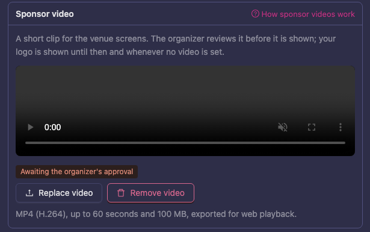
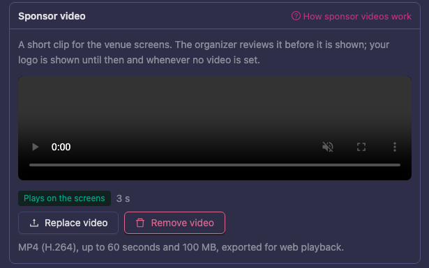
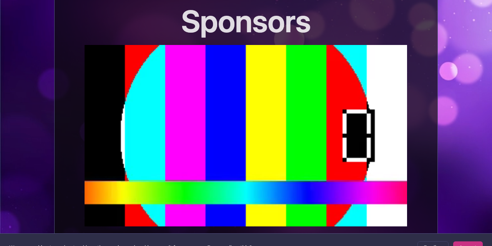
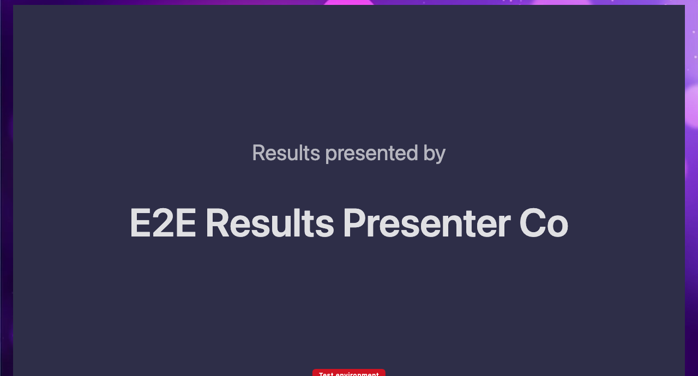
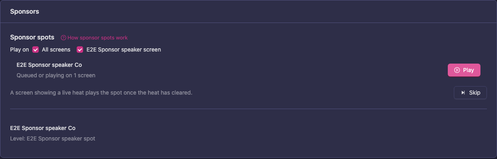

# Sponsor videos and spots

A sponsor can add a short video to their sponsor page. The venue screens show it where the sponsor's package says it should appear, and the speaker can play it on the screens as a sponsor spot. A sponsor without a video is shown with their logo, so nothing is missing on the screens.

This page is for three groups:

- **Sponsors**: [upload a video](#uploading-a-video) on your sponsor page.
- **Organizers and screen operators**: see [what the venue screens show](#what-the-venue-screens-show).
- **Speakers**: [play and skip a sponsor spot](#playing-and-skipping-a-sponsor-spot).

The organizer reviews and approves the video before it plays. Until then the sponsor's logo is shown.

## Uploading a video

A sponsor gets a link to their sponsor page after paying for a package (see [Sponsors](/manager-guide/sponsors/)). The same page is where you add your company name, website and logo.

What the video needs:

- MP4 (H.264), exported for web playback.
- At most 60 seconds long.
- At most 100 MB.
- The venue screens play the video without sound, so make sure the clip works silent.

To upload your video:

1. Open the link in your sponsor e-mail. The page is called **Sponsor Profile**.
2. Find the **Sponsor video** box below the **Company logo** box.
3. Click **Upload video** and choose your MP4 file.
4. Wait while the file is checked and uploaded. The box shows **Checking the file…** and then **Uploading…** with a percentage. When it is done you see **Video uploaded**.
5. Check the preview and the status next to it:
   - **Awaiting the organizer's approval**: your video is uploaded and waits for the organizer to approve it. Your logo is shown until then.
   - **Plays on the screens**: the organizer has approved it.
   - **Upload in progress**: the upload has not finished yet. Keep the page open.

To replace the video, click **Replace video** and upload a new file. The new video goes through the organizer's approval too, and the old one keeps playing until then. To take the video away, click **Remove video** and confirm. The screens go back to showing your logo.

If the upload is refused, the page tells you why:

| Message | What to do |
| --- | --- |
| Only MP4 video can be uploaded. | Export the clip as MP4. |
| The video must be smaller than 100 MB. | Export it again with a lower bitrate. |
| The video must be 60 seconds or shorter. | Cut the clip. |
| The file could not be read as a video. | Export it again as MP4 (H.264). |

## What the venue screens show

Where a sponsor appears depends on the package they bought. The screens are set up as described in [Screens](/manager-guide/screens/). A sponsor with an approved video is shown as a clip, and otherwise as the logo card. If a clip cannot be played, for example because the screen has lost its connection, the screen shows the logo card instead. A clip never holds up the screen.

Screens download the approved videos in advance. While a screen is getting them ready, a small **Sponsor videos** counter in the corner shows how many are done.

### Sponsors screen and break screen sponsors

The **Sponsors** screen loops through the event's sponsors. Sponsors with a **Break screen** package get a page of their own in the loop. If the sponsor has an approved video, the page plays the clip and stays up for as long as the clip runs.

### Results presented by

When the result of a final comes up on the **Result** screen, the sponsor with the **Results presented by** package covers the screen with a card headed **Results presented by**. The card shows once, for a few seconds, and then the results are in view.

### Final intro

When a final starts, the sponsor with the **Final intro** package is shown in a card along the bottom of the heat screen, before the first heat of the final. With an approved video, the card plays the clip, for at most 15 seconds. Without one it shows the logo for a few seconds. It is shown once per final, not for every dance of it.

## Playing and skipping a sponsor spot

A sponsor spot is a sponsor with a **Speaker spot** package. The speaker decides when it plays, for example in a break, and it fills the whole screen: the sponsor's video, or the logo card for a few seconds if there is no video.

To play a spot:

1. Open the speaker app for the event and go to the **Overview**.
2. In the **Sponsors** card, find **Sponsor spots**. It is shown when at least one sponsor has a spot.
3. Under **Play on**, choose the screens. **All screens** is selected to begin with.
4. Click **Play** next to the sponsor.
5. A message tells you how many screens it was sent to, and the sponsor shows **Queued or playing on 1 screen**.

A screen that shows a live heat waits and plays the spot once the heat has cleared, so a spot never covers a dance. When the spot is over, the screen goes back to the page it showed before.

To end a spot early, click **Skip**. Every screen that is showing a spot goes back to its page, and a message says **Ended on 1 screen**. **Skip** is greyed out when no screen is showing a spot.

If a screen could not be switched, you see **Could not switch 1 screen**. Click **Play** again. If the event has no screens yet, **Sponsor spots** says so; set them up under [Screens](/manager-guide/screens/).
