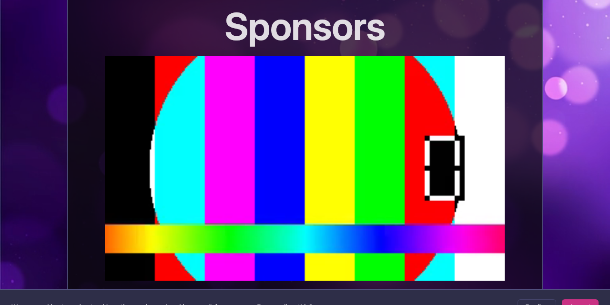
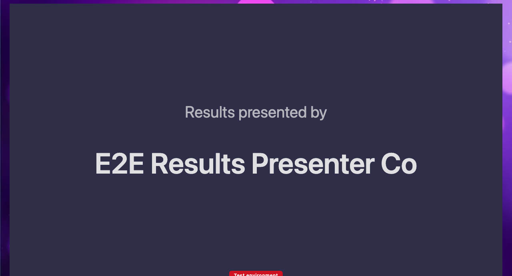
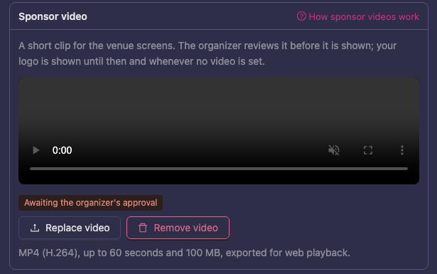
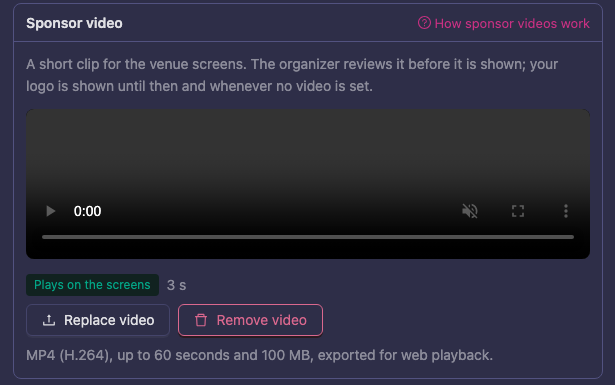
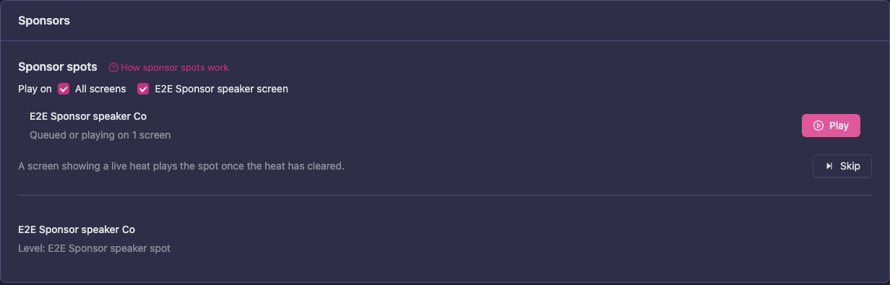

# Sponsor videos and spots

A sponsor can add a short video to their sponsor page. The venue screens play it in the places that belong to the sponsor's offer, and the speaker can play it on the screens as a sponsor spot. The organizer approves the video before it plays. A sponsor without an approved video is shown with their logo, so nothing is missing on the screens.

A video is played for sponsors who bought one of these offers: **Break screen**, **Results presented by**, **Final intro** or **Speaker spot**. With every other offer the sponsor is shown with the logo, also when they have uploaded a video. The four offers are described under [What the venue screens show for sponsors](/manager-guide/sponsors/#what-the-venue-screens-show-for-sponsors).

| If you are | You do this | Read |
|---|---|---|
| The organizer | Approve the sponsor's video and know where the screens show it | [If you are the organizer](#if-you-are-the-organizer) |
| The sponsor | Upload your video | [If you are the sponsor](#if-you-are-the-sponsor) |
| The speaker | Play a sponsor spot on the screens, and skip it | [If you are the speaker](#if-you-are-the-speaker) |

## If you are the organizer

Sponsor videos are handled in Scrutineer (Beta). The four offers above are created there, and a video is approved there. The classic Manager has no place to see or approve a sponsor's video. How to open Scrutineer (Beta) is described under [Classic Manager and the new Manager](/manager-guide/users-and-stations/#classic-manager-and-the-new-manager).

### Approving a sponsor's video

A video that a sponsor uploads does not play until you have approved it. Manager does not tell you when a sponsor has uploaded a video, and the list of purchases does not show it. Ask your sponsors to tell you when they have uploaded, or open each sponsor as described here.

1. Open the event in Scrutineer (Beta) and go to **Sponsors**.
2. Open the **Purchases** tab.
3. Click **Edit sponsor info** on the sponsor's row.
4. Look under **Sponsor video**. A video that waits for you has the status **Awaiting the organizer's approval**.
5. Play the video in the preview and check that it is suitable for your event.
6. Click **Approve for the screens**. You see the message **Video approved**, and the status changes to **Plays on the screens**.

| You want to | Do this |
|---|---|
| Upload a video for a sponsor | Click **Upload video** under **Sponsor video** and choose the file. A video that you upload yourself is approved at once. |
| Change the video | Click **Replace video** and choose the new file. |
| Take a video off the screens | Click **Remove video** and confirm. The screens show the sponsor's logo again. |

If the sponsor uploads a new video while you are looking at the old one, the approval is refused with **The video was changed at the same time. Try again.** Close the window, open **Edit sponsor info** again and look at the new video before you approve it.

When a sponsor replaces an approved video, the new one waits for your approval too. The old video keeps playing until you approve the new one.

### What the venue screens show

Where a sponsor appears depends on the offer they bought. The screens are set up as described in [Screens](/manager-guide/screens/). A sponsor with an approved video is shown as a clip, and otherwise as the logo card. The screens play the clip without sound. If a clip cannot be played, for example because the screen has lost its connection, the screen shows the logo card instead. A clip never holds up the screen.

Screens download the approved videos in advance. While a screen is getting them ready, a small **Sponsor videos** counter in the corner shows how many are done.

#### Sponsors screen and break screen sponsors

The **Sponsors** screen loops through the event's sponsors. Sponsors with a **Break screen** offer get a page of their own in the loop. If the sponsor has an approved video, the page plays the clip and stays up for as long as the clip runs.

In the picture, the clip plays under the heading **Sponsors**. The clip here is a test picture.

#### Results presented by

When the result of a final comes up on the **Result** screen, the sponsor with the **Results presented by** offer covers the screen with a card headed **Results presented by**. The card shows once and then the results are in view. With an approved video, the card plays the clip. Without one it shows the logo and the name for a few seconds.

In the picture, the card has the heading at the top and the sponsor's name below it.

#### Final intro

When a final starts, the sponsor with the **Final intro** offer is shown in a card along the bottom of the heat screen, on the first heat of the final. With an approved video, the card plays the clip, for at most 15 seconds. Without one it shows the logo for a few seconds. It is shown once per final, not for every dance of it.

## If you are the sponsor

### Uploading a video

You add the video on your sponsor page, which is called **Sponsor Profile**. You come to this page right after you have paid for your sponsor offer. It is the same page where you add your company name, website and logo. Save the address of the page, for example as a bookmark, so that you can come back to it. If you have lost the address, ask the organizer. They can upload the logo and the video for you.

What the video needs:

- MP4 (H.264), exported for web playback.
- At most 60 seconds long.
- At most 100 MB.
- The venue screens play the video without sound, so make sure the clip works silent.

To upload your video:

1. Open your **Sponsor Profile** page.
2. Find the **Sponsor video** box below the **Company logo** box.
3. Click **Upload video** and choose your MP4 file.
4. Wait while the file is checked and uploaded. The box shows **Checking the file…** and then **Uploading…** with a percentage. When it is done you see **Video uploaded**.
5. Check the preview and the status under it:

| Status | What it means |
|---|---|
| **Awaiting the organizer's approval** | Your video is uploaded and waits for the organizer to approve it. Your logo is shown until then. |
| **Plays on the screens** | The organizer has approved it. |
| **Upload in progress** | The upload has not finished yet. Keep the page open. |

After the upload, the box shows the preview with the status **Awaiting the organizer's approval** under it, and the buttons **Replace video** and **Remove video**.

When the organizer has approved the video, the status changes to **Plays on the screens**. The length of the video is shown next to it.

To replace the video, click **Replace video** and upload a new file. The new video goes through the organizer's approval too, and the old one keeps playing until then. To take the video away, click **Remove video** and confirm. The screens go back to showing your logo.

If the upload is refused, the page tells you why:

| Message | What to do |
| --- | --- |
| Only MP4 video can be uploaded. | Export the clip as MP4. |
| The video must be smaller than 100 MB. | Export it again with a lower bitrate. |
| The video must be 60 seconds or shorter. | Cut the clip. |
| The file could not be read as a video. | Export it again as MP4 (H.264). |
| The video must be H.264. HEVC and AV1 do not play on the screens. | Export it again and choose H.264 as the video format. |
| Export the MP4 for web playback (fast start) and upload it again. | Export it again with the setting for web playback, often called "fast start" or "web optimized". |

Your video is played if your offer is **Break screen**, **Results presented by**, **Final intro** or **Speaker spot**. With another offer the screens show your logo.

## If you are the speaker

### Playing and skipping a sponsor spot

A sponsor spot is a sponsor with a **Speaker spot** offer. You decide when it plays, for example in a break, and it fills the whole screen: the sponsor's video, or the logo card for a few seconds if there is no approved video.

To play a spot:

1. Open the speaker app for the event and go to the **Overview**.
2. In the **Sponsors** card, find **Sponsor spots**. It is shown when at least one sponsor has a spot.
3. Under **Play on**, choose the screens. **All screens** is selected to begin with.
4. Click **Play** next to the sponsor.
5. A message tells you how many screens it was sent to, and the sponsor shows **Queued or playing on 1 screen**.

In the picture, **Play on** and the screens are at the top, **Play** is to the right of the sponsor, and **Skip** is below it.

A screen that shows a live heat waits and plays the spot once the heat has cleared, so a spot never covers a dance. When the spot is over, the screen goes back to the page it showed before.

To end a spot early, click **Skip**. Every screen that is showing a spot goes back to its page, and a message says **Ended on 1 screen**. **Skip** is greyed out when no screen is showing a spot.

| You see | What it means | What to do |
|---|---|---|
| **Could not switch 1 screen** | A screen could not be switched. | Click **Play** again. |
| **This event has no screens yet.** | The event has no screens to play on. | Ask the organizer to set them up. See [Screens](/manager-guide/screens/). |
| No **Sponsor spots** in the **Sponsors** card | No sponsor has bought a **Speaker spot** offer, or the offer is not active. | Ask the organizer. |
