# Sponsors

On the **Sponsors** page of an event you set up what companies can buy as sponsors, and you follow who has bought. A sponsor pays by card through Vote4Dance. After the payment, the sponsor's name and logo are shown on the event page, in the Vote4Dance app and on the venue screens.

One thing a company can buy is called a **sponsor offer**, for example **Main Sponsor**. Some buttons in Manager call it a sponsor item. It is the same thing.

## How sponsors work

1. You create the sponsor offers in Manager and set a price for each.
2. You send a company the link to the sponsor page, or to one offer.
3. The company fills in its details and pays by card.
4. The sponsor is shown in the places that belong to the offer it bought. You do not place sponsors by hand.

A sponsor is shown only when the sponsorship was bought through Vote4Dance. You cannot add a sponsor yourself without a purchase. The **Offers** tab repeats this in the box **Important sponsor rules**.

## Before you start

| You need to know | Details |
|---|---|
| Stripe must be connected | You cannot create sponsor offers until the event has a connected Stripe account. The **Offers** tab shows **Connect Stripe account** until it is connected, and **Connected to Stripe!** when it is. |
| Prices are without VAT | The page says **All prices exclude VAT.** The sponsor sees the same text. At the payment, Stripe adds the tax on top of the price. Vote4Dance sets no VAT rate: which tax is added, if any, follows the tax settings of your own Stripe account. |
| Fees | Each purchase includes a 5% Vote4Dance fee, plus Stripe's own fees. |
| Currency | SEK, EUR, USD or NOK. You choose it for each offer. |
| Lowest price | 500 SEK, or 50 in EUR, USD or NOK. |

## Create the sponsor offers

1. In Manager, open **Sponsors**. It is under **Audience** in the menu.
2. On the **Offers** tab, if you see **Connect Stripe account**, click it and finish the steps at Stripe. If the tab says **Your event need billing information to connect**, the event has no billing details yet, and they must be added before Stripe can be connected. Add them on the event's details page, in the **Finalize** step, under **Billing information**: see [Step 3: Event details page](/manager-guide/event-setup/#step-3-event-details-page). The step only asks for them on a live competition, not on a practice event. When they are saved, the **Offers** tab shows **Connect Stripe account**.
3. Click **Create sponsor items**. You see the message **Default sponsor items created**.

Manager creates these four offers. Each one is created **Active**, which means it can be bought at once.

| Offer | Total slots | Starting price |
|---|---|---|
| **Main Sponsor** | 1 | 8000 SEK |
| **Featured Sponsor** | 2 | 4000 SEK |
| **Competition Sponsor** | 99 | 1000 SEK |
| **Bonus Sponsor** | 99 | 500 SEK |

**Total slots** is how many sponsors can buy the offer.

The starting prices are only a suggestion. Change them to fit your event, for example higher for a large event with many screens and lower for a small local one. If you are not ready to sell an offer yet, switch **Active** off on it, as described under [Hide or delete an offer](#hide-or-delete-an-offer).

In Scrutineer (Beta), **Create sponsor items** creates four more offers for the venue screens. See [What the venue screens show for sponsors](#what-the-venue-screens-show-for-sponsors).

## Edit an offer

1. On the **Offers** tab, click **Edit** on the offer. The **Edit offer** window opens.
2. Change the fields in the table below.
3. Click **OK**. You see the message **Offer updated**. In Scrutineer (Beta) the button is **Save changes**.

| Field | What to fill in |
|---|---|
| **Title** | The name the sponsor sees. |
| **Description** | A text about the offer. The sponsor sees it under the title. |
| **Classes** | Only on a class sponsor offer. The classes the sponsor is shown with. |
| **Currency** | SEK, EUR, USD or NOK. |
| **Amount** | The price without VAT. The window shows the lowest price you can set, for example **Minimum amount is 500 SEK**. |
| **Total slots** | How many sponsors can buy the offer. You can change it for **Competition Sponsor** and **Bonus Sponsor**. It is locked at 1 for **Main Sponsor**, 2 for **Featured Sponsor** and 2 for **Class Sponsor**. |
| **Active** | On: the offer is on the sponsor page and can be bought. Off: see [Hide or delete an offer](#hide-or-delete-an-offer). |
| **Offer image** | A picture for the offer. The sponsor sees it at the top of the page where they fill in their details. |

To change the order of the offers, drag them in the list. The sponsor page shows them in the same order.

## Add a class sponsor

A class sponsor is shown together with one or more classes, for example on the class's result page. It is not created by **Create sponsor items**, because you must choose the classes first.

1. On the **Offers** tab, find the **Class sponsors** box and click **Add class sponsor**.
2. In **Classes**, choose the classes this offer is for. You must choose at least one.
3. Set **Title**, **Description**, **Currency** and **Amount**. The starting price is 2000 SEK.
4. Click **OK**. You see the message **Offer created**.
5. To add a picture, click **Edit** on the new offer and upload it under **Offer image**. A new offer has to be saved before it can have a picture.

Add as many class sponsor offers as you need. One offer has 2 slots, and a class can have at most 2 class sponsors in total. If you put a class in a second class sponsor offer, Manager does not save it and shows **Slot Class Sponsor only allows 2 sponsors for class** followed by the name of the class.

## Hide or delete an offer

| You want to | Do this | What happens |
|---|---|---|
| Stop selling an offer | Click **Edit**, switch **Active** off and click **OK**. | The offer gets the tag **Inactive**. It leaves the sponsor page and cannot be bought. |
| Remove an offer nobody has bought | Click **Delete offer** and confirm. | The offer is deleted. |
| Remove an offer that has been bought | Click **Delete offer** and confirm. | The offer is not deleted. It becomes **Inactive**, and its purchases stay on the **Purchases** tab. |
| Get a deleted standard offer back | Choose it in **Select sponsor item to add back** and click **Add back sponsor item**. | The offer is created again with its starting price. |

Sponsors of an inactive offer are no longer shown on the event page, with their classes or as sponsor cards on the heat, result and schedule screens. Keep an offer **Active** for as long as its sponsors should be shown. When all slots of an offer are bought, the offer gets the tag **Sold out** and stays on the sponsor page, where it can no longer be bought.

## What the sponsor sees and buys

The sponsor page lists all active offers. To open it, click **Open public sponsor site** at the top of the **Sponsors** page. In Scrutineer (Beta) the button is called **Open sponsor page**. The page has the heading **Sponsor Opportunities**.

Each offer on the sponsor page shows:

- the title and the description
- **Price**
- **Available slots**, as the number left and the total, for example 1 / 2
- the sponsors who have already bought it, with logo and company name
- **See coverage**, which opens drawings of where the sponsor is shown. They are the same drawings as under [Where each sponsor is shown](#where-each-sponsor-is-shown). The four extra offers in Scrutineer (Beta) have no drawings.

A sold-out offer shows **This sponsor offer is sold out.**

This is how a sponsor buys:

1. The sponsor clicks **Continue** on an offer. The page **Sponsor Signup** opens. It can be opened without signing in.
2. The sponsor fills in **Company name** and **Contact email**, and can add **Company website**.
3. The sponsor clicks **Continue to payment** and pays by card at Stripe.
4. After the payment the sponsor comes to the page **Sponsor Profile**. Here the sponsor can correct the company details, upload a logo under **Company logo**, and add a video under **Sponsor video**.

Ask the sponsor to save the address of the **Sponsor Profile** page, for example as a bookmark. It is the sponsor's own page for changing the logo and the details later. If the sponsor cannot do it, you can fill in the details yourself, as described under [After a purchase](#after-a-purchase).

A sponsor who has lost the address cannot get it back from Vote4Dance. The sponsor is sent to the page once, right after the payment. Vote4Dance sends no e-mail with the address, the page has no sign-in, and Manager does not show the address to you either. Change the sponsor's details and logo yourself with **Edit sponsor info** instead.

A sponsor's video has to be approved before the screens play it. See [Sponsor videos and spots](/manager-guide/sponsor-videos/).

## Sell an offer to a sponsor yourself

You and your staff can send one offer straight to a company, or let the company pay on its own phone at the venue.

1. Open the sponsor page. From Manager, click **Open public sponsor site**. Staff who are signed in also find it as the **Sponsors** tile under **Functions** on the event's page, when there is at least one offer to buy.
2. Find the offer and click **Send information**. The window **Sell sponsor package** opens. It shows the payment link for this offer and a QR code with the heading **Scan to pay**.
3. Choose how the sponsor gets the link:

| You want to | Do this |
|---|---|
| Send the link yourself, for example in a chat | Click **Copy payment link** and paste it into your message. |
| Let the sponsor pay on their own phone | Let them scan the QR code in the window. For a large QR code, close the window and click the QR icon next to the offer's title. |
| Let Vote4Dance send an e-mail | Type the address in **Recipient email**, read the text under **Email preview** and click **Send offer email**. The e-mail has the event name, the name of the offer and the payment link. Only people with Manager access to the event see this part of the window. |

The link opens **Sponsor Signup** for that offer, and the sponsor continues from step 2 under [What the sponsor sees and buys](#what-the-sponsor-sees-and-buys).

## After a purchase

Open **Sponsors** in Manager and go to the **Purchases** tab. Each purchase is one row.

| Column | What it shows |
|---|---|
| **Company** | The company name, the contact e-mail and the company's link. |
| **Image** | The sponsor's logo, or a dash if the sponsor has not uploaded one. |
| **Offer** | The offer the sponsor bought. |
| **Amount** | The amount of the purchase. The **Total** row at the bottom adds up all purchases, one sum for each currency. |
| **Actions** | **Edit sponsor info** and **Delete purchase**. |

A sponsor is shown with the company name and the logo. On the event page, a sponsor with a link also gets a button that opens the company's website. Check before the event day that every sponsor has a correct name, link and logo.

| You want to | Do this |
|---|---|
| Correct a sponsor's name, e-mail or link | Click **Edit sponsor info**, change **Company name**, **Contact email** or **Company link** and click **Save changes**. |
| Upload or change the logo for a sponsor | Click **Edit sponsor info** and upload the picture under **Company image**. |
| Move a sponsor to another offer | Click **Edit sponsor info** and choose the other offer in **Sponsor offer**. The other offer must be active and have a free slot. The amount of the purchase does not change. |
| Remove a sponsor | Click **Delete purchase** and confirm. The sponsor is no longer shown anywhere, and the slot is free again. This cannot be undone. |

**Delete purchase** does not pay the money back. Manager has no refund button for sponsor purchases. The payment is in your own Stripe account, so make the refund there.

In Scrutineer (Beta), the **Purchases** tab also has a **Sponsor info** column with **Filled in** or **Waiting for sponsor**, and **Edit sponsor info** has a **Sponsor video** part where you approve the sponsor's video. See [Approving a sponsor's video](/manager-guide/sponsor-videos/#approving-a-sponsors-video).

## Where each sponsor is shown

Where a sponsor is shown depends on the offer it bought. The drawings below are the ones the sponsor sees under **See coverage**. They are drawings of the layout, with "Sponsor Name" where the company's name will be.

| Offer | Event page and app | Venue screens |
|---|---|---|
| **Main Sponsor** | Large card at the top of the **Sponsors** part of the event page | Card at the bottom of the result and schedule screens, and a page of its own on the Sponsors screen |
| **Featured Sponsor** | Highlighted card under the main sponsor | Card at the bottom of the heat screen, and a wide row on the Sponsors screen |
| **Class Sponsor** | In the sponsor list, and with its classes on the result page, the list of participants and the heat list | Card at the bottom of the heat screen while its class is danced, and a row in the list on the Sponsors screen |
| **Competition Sponsor** | In the sponsor list | A row in the list on the Sponsors screen |
| **Bonus Sponsor** | In the sponsor list | A row in the list on the Sponsors screen |

The Sponsors screen loops through the event's sponsors. The speaker puts it on a screen with **Show sponsors** in the **Sponsors** card of the speaker app. See [What the speaker pushes](/manager-guide/screens/#what-the-speaker-pushes).

### Main Sponsor

One sponsor for the whole event.

On the event page, the main sponsor has a large card under the event's banner, with the logo, the title of the offer and the company name.

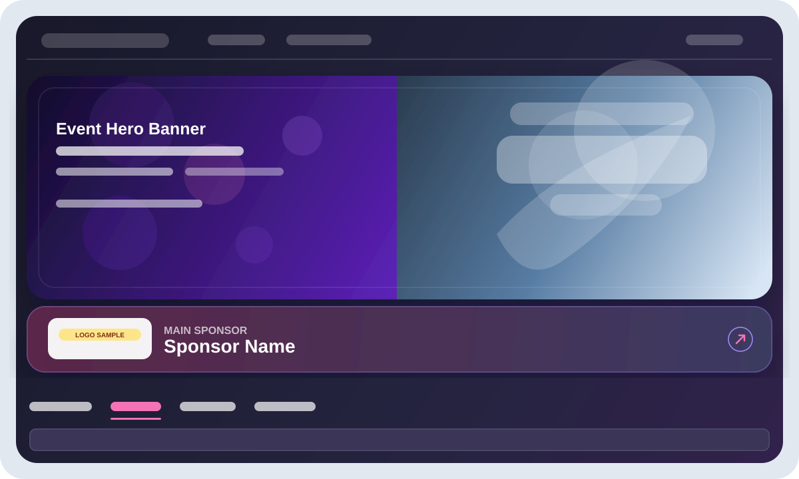

In the Vote4Dance app, the same card is on the event's first page.

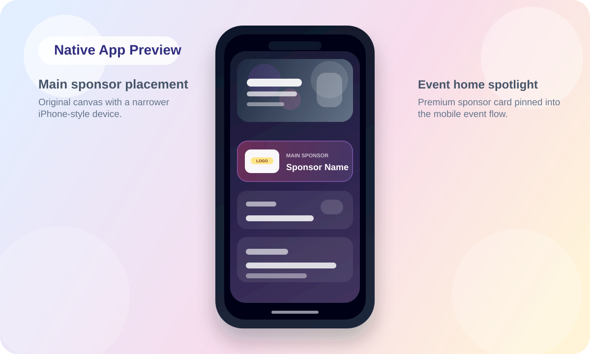

On the **Result** screen, the main sponsor's card comes up along the bottom edge for a few seconds.

The schedule screen shows the same card along the bottom edge.

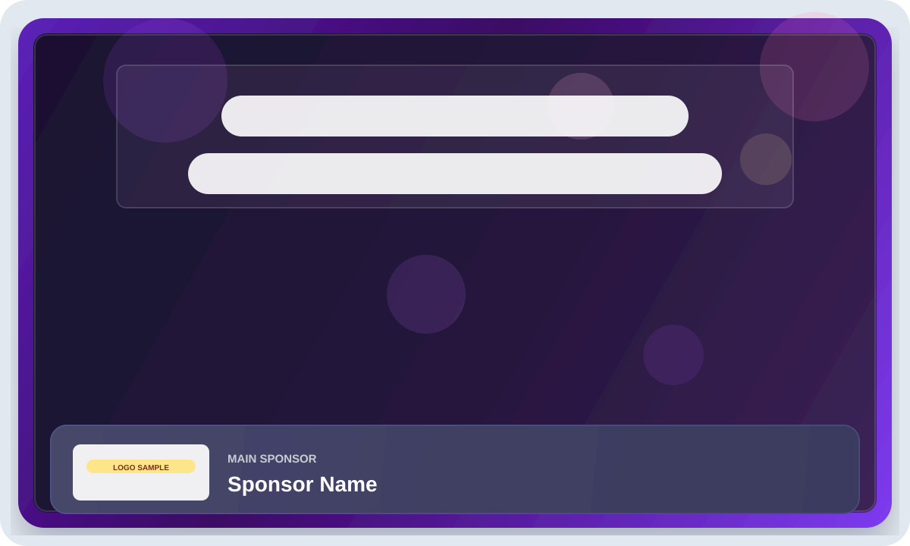

On the Sponsors screen, the main sponsor fills a page of its own, with a large logo and the company name.

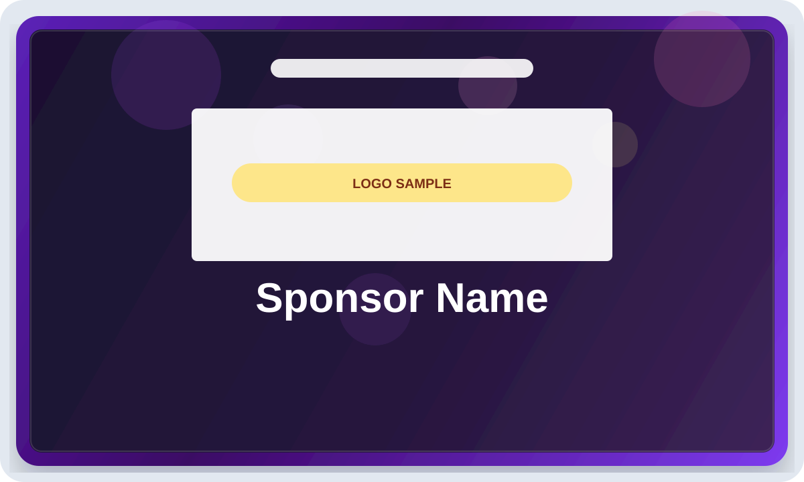

### Featured Sponsor

At most two sponsors for the whole event.

On the event page, the featured sponsors have highlighted cards side by side, under the main sponsor.

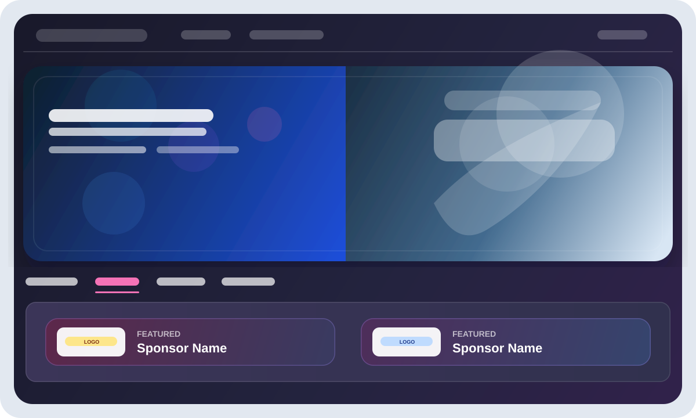

The Vote4Dance app shows the two cards in the same way.

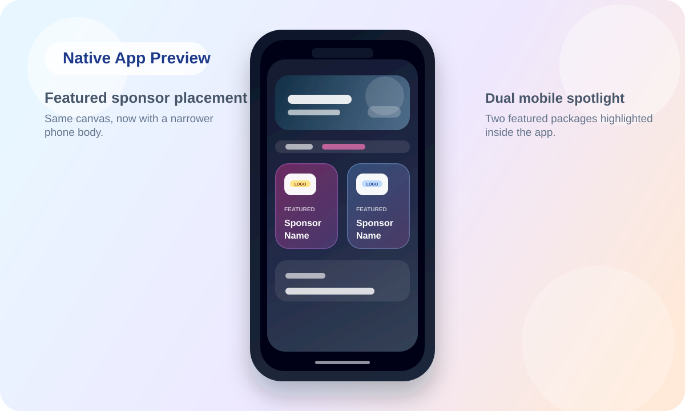

On the heat screen, a card with the featured sponsor's logo and name comes up along the bottom edge while a heat is shown. A class sponsor is shown with the same kind of card.

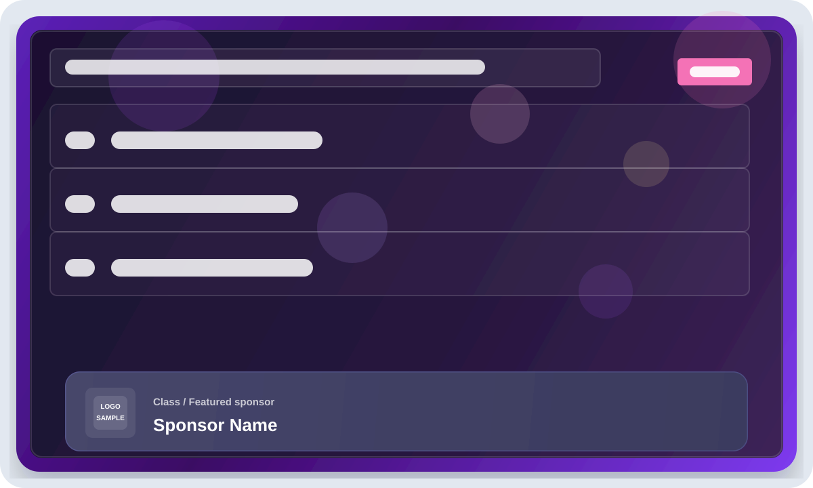

On the Sponsors screen, the two featured sponsors share one page, each with logo and name.

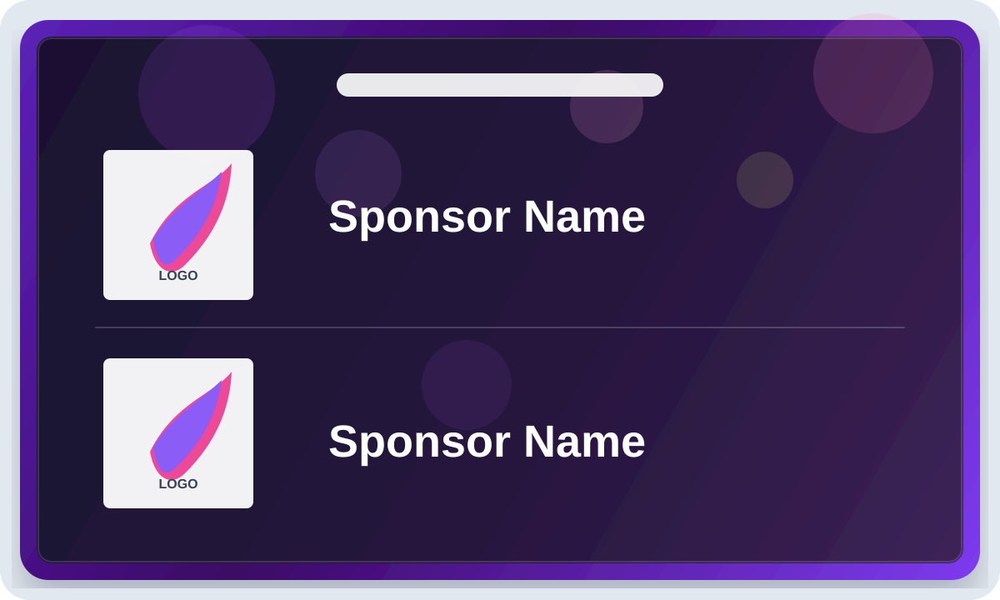

### Class Sponsor

At most two sponsors for each class.

On the event page, a class sponsor is one row in the sponsor list. Competition sponsors and bonus sponsors are shown in the same list.

On the result page of the class, the class sponsors are shown above the results, side by side.

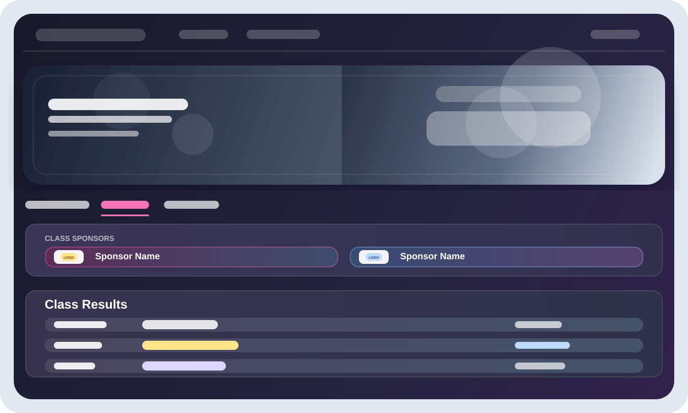

In the Vote4Dance app, the sponsor list shows each sponsor as a row with logo and name.

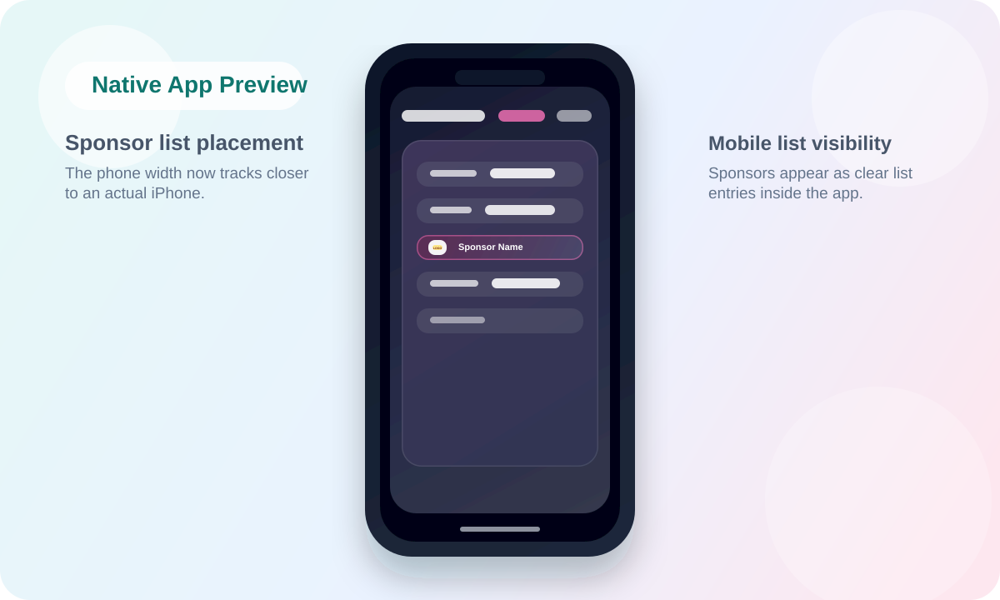

The app also shows the class sponsors above the results of the class.

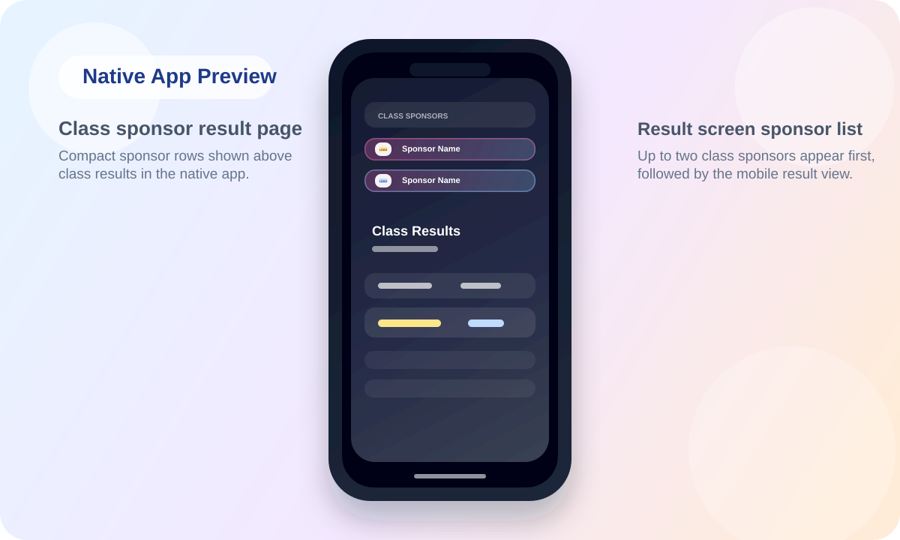

On the Sponsors screen, class sponsors are rows in a list. Competition sponsors and bonus sponsors are shown in the same kind of list.

While the class is danced, the heat screen shows the class sponsor's card along the bottom edge, as in the drawing of the heat screen under [Featured Sponsor](#featured-sponsor).

### Competition Sponsor

As many sponsors as you set in **Total slots**.

A competition sponsor is a row in the sponsor list on the event page and in the app, and a row in the list on the Sponsors screen. The drawings of these lists are under [Class Sponsor](#class-sponsor).

### Bonus Sponsor

As many sponsors as you set in **Total slots**.

A bonus sponsor is a row in the sponsor list on the event page and in the app, and a row in the list on the Sponsors screen. The drawings of these lists are under [Class Sponsor](#class-sponsor).

## What the venue screens show for sponsors

Four more offers put a sponsor on the venue screens at a certain moment. They exist only in Scrutineer (Beta). The classic Manager does not create them, but once they exist you see them in its **Offers** list and can edit them there.

To add them, open the event's **Sponsors** page in Scrutineer (Beta):

- If the event has no offers yet, click **Create sponsor items**. The four offers are created together with the others.
- If the event already has offers, find **Add a standard item**, choose the offer in **Select a standard sponsor item** and click **Add sponsor item**.

How to open Scrutineer (Beta) is described under [Classic Manager and the new Manager](/manager-guide/users-and-stations/#classic-manager-and-the-new-manager).

| Offer | Total slots | Starting price |
|---|---|---|
| **Results presented by** | 1 | 4000 SEK |
| **Final intro** | 1 | 2000 SEK |
| **Break screen** | 99 | 1000 SEK |
| **Speaker spot** | 99 | 2000 SEK |

Each of these shows the sponsor's logo and company name. If nobody has bought the offer, the screens show nothing extra for it. A sponsor with an approved video is shown as a video clip instead of the logo. See [Sponsor videos and spots](/manager-guide/sponsor-videos/). The screens are set up as described in [Screens](/manager-guide/screens/).

### Results presented by

When the result of a final comes up on the **Result** screen, the sponsor with the **Results presented by** offer covers the screen with a card headed **Results presented by**. The card shows once per final, for a few seconds, and then the results are in view.

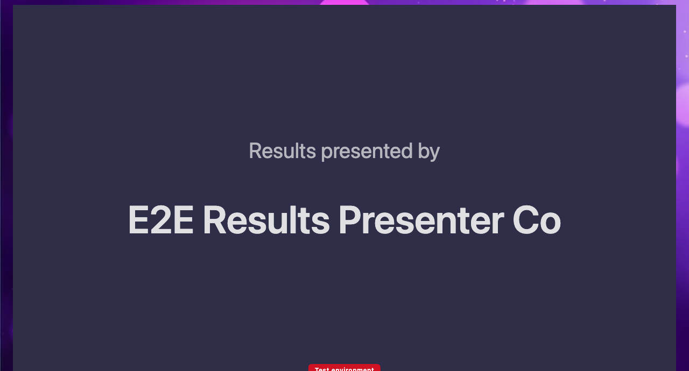

### Final intro

When a final goes live, the sponsor with the **Final intro** offer is shown in a card at the bottom of the heat screen for a few seconds, on the first dance of the final. The heat stays visible behind it. It is shown once per final, not for every dance of it, and the class sponsor follows after it.

### Break screen

The Sponsors screen loops through the event's sponsors. A sponsor with the **Break screen** offer gets a full page of its own in that loop, which runs during breaks.

### Speaker spot

The speaker plays a sponsor with the **Speaker spot** offer on the screens when it fits, for example in a break. It fills the whole screen, and afterwards the screen goes back to what it showed before. See [Playing and skipping a sponsor spot](/manager-guide/sponsor-videos/#playing-and-skipping-a-sponsor-spot).

## Before you share the sponsor page

1. Check that Stripe is connected.
2. Read the title, the description and the price of every offer.
3. Add class sponsor offers only for the classes you plan to sell.
4. Upload an offer image where it helps the sponsor understand the offer.
5. Open the sponsor page and try **Send information** on one offer, so that you know how it works at the venue.
6. Before the event day, check on the **Purchases** tab that every sponsor has a correct company name, link and logo.
