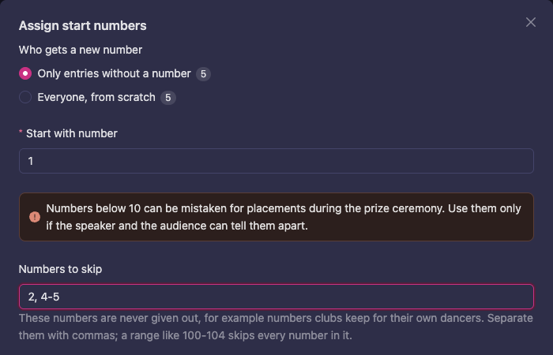

# Start numbers

For organizers and their helpers who give the participants their start numbers. Here you number one class or the whole competition, choose how the series runs, and print the numbers.

Assign start numbers after [the import](/manager-guide/entries-and-participants/#updateimport-participants) and **before** you add participants to rounds. Once a participant of the class is in a round (for the whole competition: any participant), numbering is refused with the message "Cannot delete participant - it has already been added to the competition. Please delete participants from the rounds in question first."

1. Open `Manager → Competition → Participants`.
2. Press **Assign start numbers** at the top of the page to number the whole competition, or **Assign start numbers** in the footer of a class to number that class only. The button in a class is greyed out while participants are ticked.
3. Set the options.
4. Press **Apply**.
5. Press **Print start number** at the top of the page. The print page opens in a new tab.

| Option | What it does |
|---|---|
| **Start with number** | The first number given out. 10 by default. It can be as low as 1; below 10 the dialog warns that single-digit numbers can be mistaken for placements at the prize ceremony. |
| **Start each class on an even ten** | **Enable** by default: every class after the first jumps up to the next ten. |
| **Free numbers between classes** | Numbers left unused before the next class starts. 3 by default; 0 to 100. |
| **Reuse numbers** | **Enable** by default: a dancer keeps the same number across classes. |
| **Randomize order** | **Enable** by default: the participants of a class get their numbers in a random order. |

To number the whole competition in one unbroken series, set **Start each class on an even ten** to **Disabled** and **Free numbers between classes** to 0. With **Reuse numbers** still on **Enable**, participants who already have a number keep it, so the series will not be continuous; the dialog warns about this. Delete the start numbers first, or set **Reuse numbers** to **Disabled**. The red **Delete** button in the dialog deletes the start numbers of the class, or of the whole competition.

A cancelled participant gets no start number. If it had one, numbering takes it away.

In Scrutineer (Beta), **Assign start numbers** also has **Numbers to skip**: numbers that are never given out, for example numbers a club keeps for its own dancers. Separate them with commas; a range such as `100-104` skips every number in it, so `13, 66, 100-104` leaves out 13, 66 and 100 to 104. The numbers line at the bottom of the dialog shows the result before you confirm. A participant who already has one of these numbers keeps it. If the round ten a class would start on is in the list, the class starts on the next round ten that isn't. The field is empty each time you open the dialog, so type the list again for every competition in the event. The classic Manager has no such field.

## Troubleshooting

| What you see | What it means | What to do |
|---|---|---|
| "Cannot delete participant - it has already been added to the competition. Please delete participants from the rounds in question first." when you assign start numbers | Participants are already in a round. | Assign start numbers before you add participants to rounds. For a late participant, type the **Start number** on the participant itself. |
