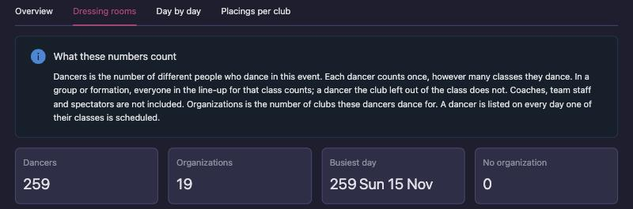
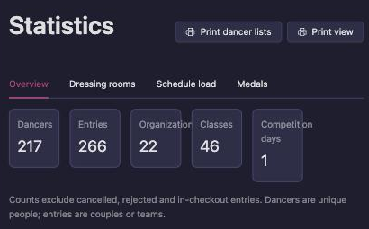
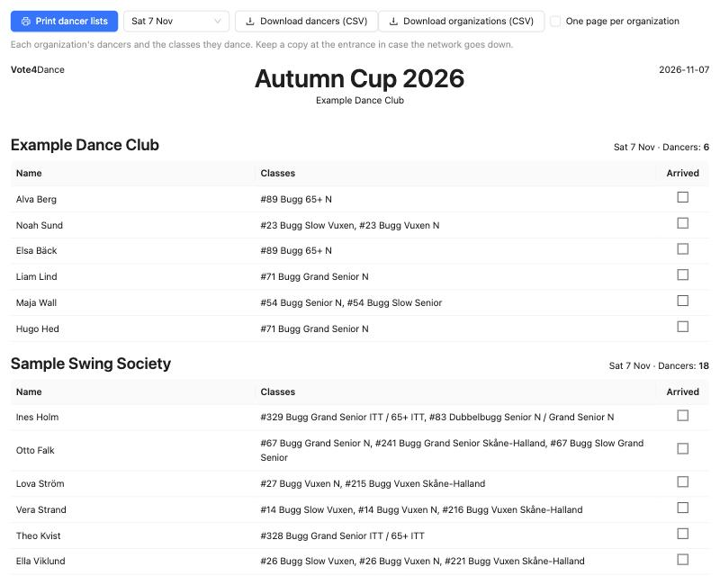

# Statistics

For organizers who need numbers about the event: for the venue, insurance, catering, the dressing rooms or the yearly report. Here you see how big the event is, how many dancers each club brings on each day, how much each day holds, and which clubs took the placements. You can also print or download a list of every club's dancers.

Open `Manager → Competition → Statistics`. It has four tabs:

| Tab | What it answers |
|---|---|
| **Overview** | How big is the event? Dancers, entries, clubs, classes and competition days. |
| **Dressing rooms** | How many people from each club are in the building on each day? |
| **Schedule load** | How much does each day hold? Entries, dancers, classes and rounds per day. |
| **Medals** | Which clubs took the placements? Places 1 to 6 per club. |

In Scrutineer (Beta) the last two tabs are named **Day by day** and **Placings per club**.

All four tabs count the **whole event**: on a multi-day event with child competitions the numbers cover every day, not the competition you opened it from. Where the competition has imported participants, the counts follow the participant lineup; before the import they follow the registrations.

**Print dancer lists** and **Print view** at the top of the page open the [dancer lists](#dancer-lists) and a paper version of the dressing rooms table.

## Overview

Five numbers for the whole event:

| Number | Meaning |
|---|---|
| **Dancers** | Different people who dance. Someone entered in four classes is one dancer. |
| **Entries** | Couples and teams. |
| **Organizations** | Clubs the dancers dance for. Dancers with no club are not counted as a club. |
| **Classes** | Classes that have at least one entry. |
| **Competition days** | Dated days of the schedule on which entries dance. |

Cancelled and rejected entries, and entries still in checkout, are left out. Before anyone has entered, the tab says "No registrations yet."

## Schedule load

Shows what each day has to take, so you can see whether one day is much heavier than another.

- The **Load per day** chart has two bars per day: **Entries** and **Rounds**.
- The table has one row per day with **Day**, **Entries**, **Dancers**, **Classes** and **Rounds**.

The days are the dated pages of the [schedule](/manager-guide/schedule/). A round counts on the day of its own schedule page, so a class with a heat on one day and the final on a later day adds to both days. Entries in classes with no scheduled round are listed under **Not scheduled**. Until something is scheduled, the tab says "Nothing scheduled yet."

## Medals

Shows places 1 to 6 per club. Medals are 1st, 2nd and 3rd places.

- The cards show **Medals**, **Organizations** and **Entries** for the whole event.
- The table has one row per club with **Organization**, **Medals**, **1st** to **6th**, and **Entries**. Clubs are ranked by 1st places, then 2nd, 3rd, 4th, 5th and 6th, so one gold outranks several bronzes.
- An entry with dancers from several clubs counts for each of them. Cancelled entries are left out.
- Clubs are named as on the event's entries, so two clubs that share a short name get their own rows.
- **Export CSV** downloads the table.

You can open the tab before the competition is closed. It then shows **Results are provisional**: placements change as rounds are confirmed, and the public results stay hidden until the competition is closed. Before any placement is recorded it says "No placements have been recorded yet."

If **Some placements have no organization** is shown, some placed entries have no club on any dancer. They count in the totals but are in no club's row.

## Dressing rooms

The report answers one question: **how many different dancers does each club bring, and on which days?** It is a headcount for planning space and dressing rooms, not an occupancy model.

### What Dancers and Organizations count

Organizers use these numbers for insurance, fire safety, the venue or city, catering and the yearly report, so this is exactly what goes in:

- **Dancers** is the number of **different people who dance** in the event. Someone entered in four classes is one dancer.
- **Everyone in a group or formation counts.** A formation of 24 brings 24 dancers. The count follows the line-up the club sent for each class: a dancer the club left out of a class does not count for it, and a replacement or an added dancer does. A couple put together on the start list, such as a Jack & Jill final couple, counts its two dancers.
- **Participants imported from a file** only have the names on the start list, at most three per entry, so a group imported from a file counts at most three dancers.
- **Coaches, team staff, judges, volunteers and spectators are not included.** Add them yourself if your insurance or venue needs the full number of people in the building.
- **Organizations** is the number of **different clubs** these dancers dance for. A club with several registration periods is still one club, so this can be lower than the number of rows on the **Organizations** tab of `Competition → Registration`, which lists a club once per registration period.

In Scrutineer (Beta) the same explanation is shown above the numbers on the **Dressing rooms** tab, under **What these numbers count**.

If a yellow box in Scrutineer (Beta) says **Dancer numbers may be off**, Vote4Dance could not read the registrations for you. The entries are then counted with everyone on their team, including dancers the club left out of a class, and an entry whose team is not known only counts the names on the start list. Ask the organizer for **Check-in** access to see the exact numbers; they give it under **Users** in the classic Manager, which Scrutineer (Beta) calls **People & access**.

### How it counts

- **A dancer is counted once.** A dancer entered in four classes is one person. Dancers in Vote4Dance are recognized by their account. A participant imported from a file is recognized by their federation id or name; when the name is exactly that of one dancer in the event's teams, it is that dancer, so they are not counted twice.
- **A dancer is listed on every day one of their classes is scheduled.** A class with a heat on Saturday and the final on Sunday puts its dancers on both days.
- **The club is the club the dancer represents in that class.** A dancer who represents two clubs in different classes appears in both club rows, but once in the total.
- Cancelled participants are left out.

### The numbers on the page

| Number | Meaning |
|---|---|
| **Dancers** (card) | Unique people across the whole event. |
| **Organizations** (card) | Number of clubs, not counting the "No organization" row. |
| **Busiest day** (card) | The headcount on the day with the most dancers, with the date. |
| **No organization** (card) | Dancers whose club is not known. They are listed in the "No organization" row. |
| **Dancers per day** (chart) | Unique dancers on each scheduled day. |
| **Dancers per organization** (chart) | The largest clubs. The table below is complete. |
| **Organization** (column) | Club name, with its short code in brackets when it has one. "No organization" collects everyone whose club is not known. |
| **Dancers** (column) | Unique people from that club across the event. |
| **Entries** (column) | Couples and teams from that club. A mixed-club couple counts once for each club. |
| One column per day | Unique dancers from that club on that day. A dash means none. |
| **Not scheduled** (column) | Dancers whose classes have no round on a dated schedule day yet. |
| **Total** (row) | Each person once. It is normally **lower than the sum of the rows**, because a dancer can appear under several clubs. This is intended, not a calculation error. |

**Export CSV** downloads the table, with the same list separator as the [dancer lists](#dancer-lists). **Print view** opens a paper version: one row per club, one column per day, no charts.

### What the report needs

The day columns come from the [**schedule**](/manager-guide/schedule/). Each schedule day is a page with a date; every round on that page belongs to that day. If the day columns are missing and everything sits under "Not scheduled":

1. Check that the rounds are placed in the schedule under a dated day (`Event → Schedule`).
   The report reads every schedule item, whether or not the schedule is published.
2. Run **Update/import participants** if the registrations have not been imported yet, so the lineup is complete.

A yellow warning above the table tells you how many entries are in classes that are not scheduled yet.

### What it does not do

- It does not split by gender or age group.
- It does not know arrival or departure times. A dancer with a 9:00 round and one with a 19:00 round count the same for that day.
- It does not use check-in. The numbers are planned presence, not who actually turned up.

If you need a gender split for allocating rooms, export the CSV and combine it with the participant list.

## Dancer lists

The dancer lists show every dancer of each club with the classes they dance, their start numbers and an empty box to tick when they arrive. Print them for the entrance, so check-in can carry on on paper if the network goes down, or hand each club its own page for its dressing room.

1. Open `Manager → Competition → Statistics` or `Manager → Competition → Check-in` and click **Print dancer lists**. The lists open in a new tab.
2. If the event has more than one day, pick a day in the list next to **Print dancer lists** to show only the dancers who dance that day. **All days** shows everyone. Classes that have no round on a dated schedule day yet are listed under **Not scheduled**.
3. Tick **One page per organization** if every club should get a page of its own to hand out. Without it, the clubs follow one another to save paper, and a club is never split over two pages.
4. Click **Print dancer lists** to print.

Each club shows its number of dancers next to its name. A dancer entered in several classes is listed once, with all their classes. The lists follow the imported participants once you have imported them, and the registrations before that, just like the [dressing rooms](#dressing-rooms) report.

### Downloading the lists

Organizers with **Manager** access also see two download buttons. Both follow the day you picked.

- **Download dancers (CSV)**: one row per dancer and class, with **Day**, **Organization**, **City**, **Email**, **Last name**, **First name**, **Date of birth**, **Class**, **Start number**, **Paid** and **Outstanding**. Use it to filter by club or class, or to send each club its dancers.
- **Download organizations (CSV)**: one row per club with **Day**, **Organization**, **City**, **Email**, **Entries**, **Dancers**, **Paid** and **Outstanding**. A couple or team counts as one entry.

**Paid** and **Outstanding** are worked out the same way as the payment at registration: the price for the dancer's number of classes in each registration period. With prices of 10, 13 and 15, a dancer in three classes has paid 15, not 30. Each dancer's amount is on their first row for that club and day, so adding up the column for a club gives the club's total, and a club can see what to ask its dancers to pay back. A class that was paid for and then cancelled is listed as **(Cancelled)** and still counts towards **Paid**.

The downloads are made from the registrations, so they include the date of birth and the amounts. A competition whose participants were only imported, without registrations in Vote4Dance, has nothing to download.

The files use the list separator that goes with your browser's language: a semicolon where numbers are written with a decimal comma, as in Belgium, the Netherlands or Sweden, and a comma elsewhere. If a file opens with everything in one column, open it in Excel with **Data → From Text/CSV** and choose the separator there.

