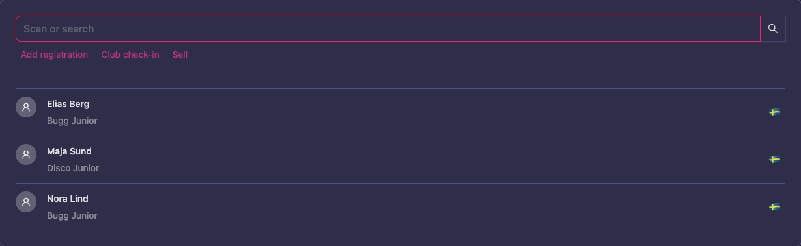
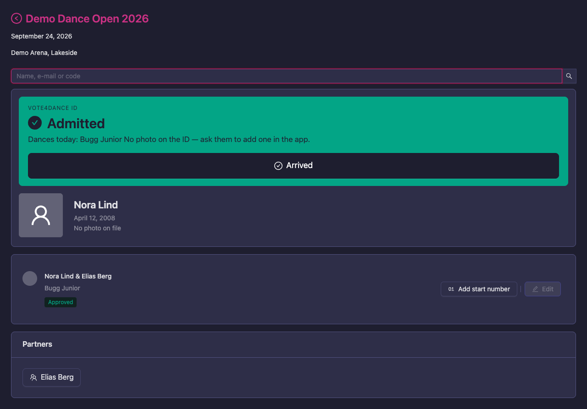
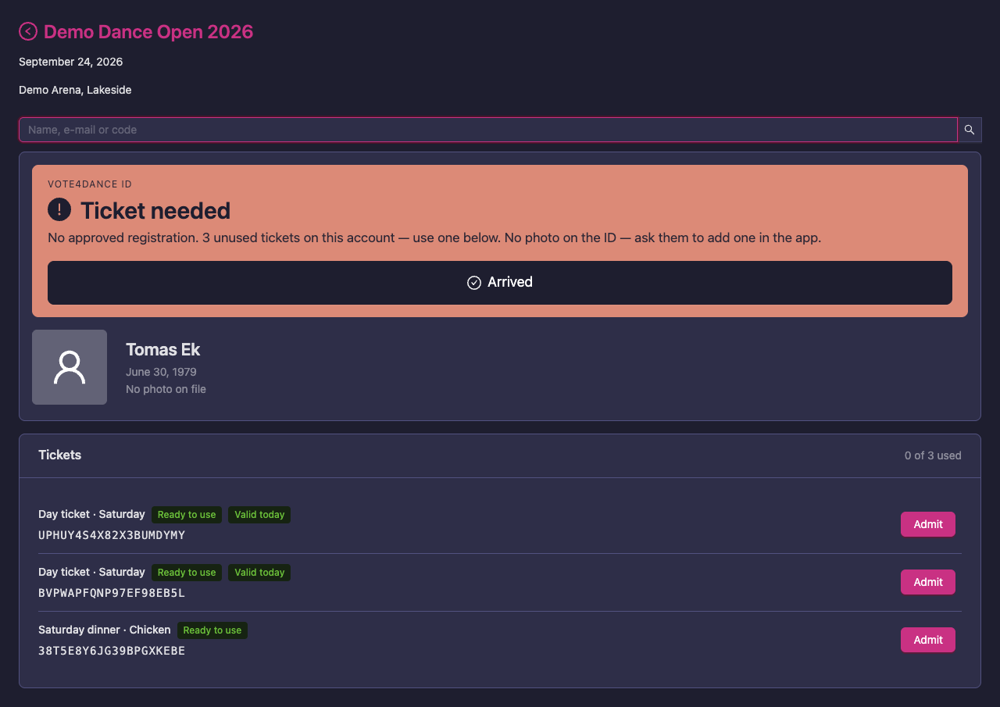
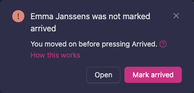
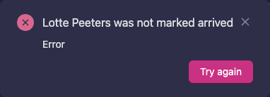
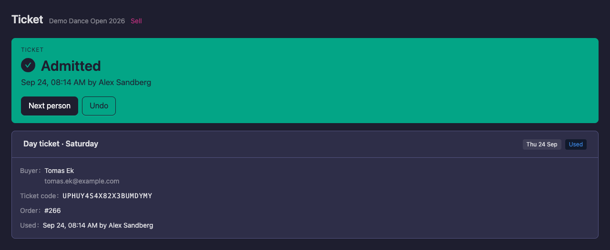
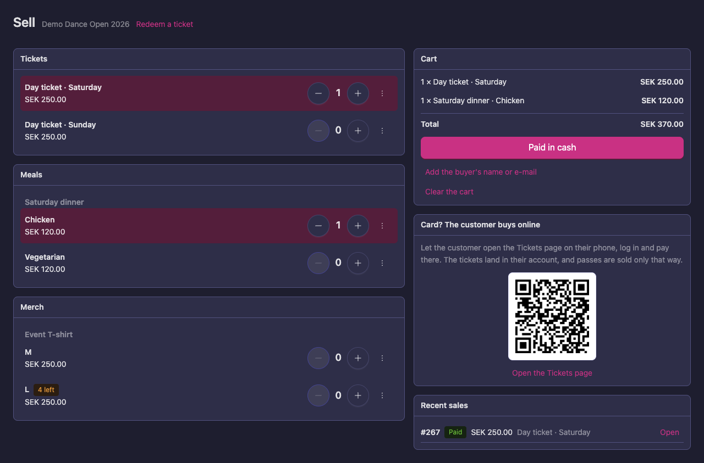
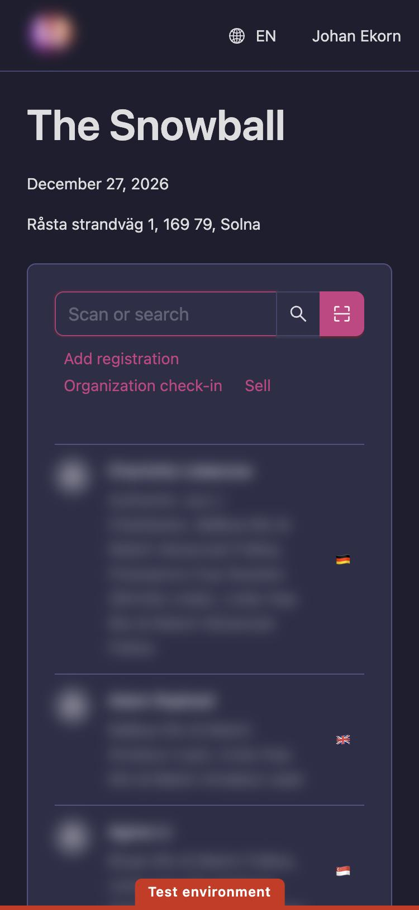

# At the door

Everybody who comes to your event shows one of two QR codes: a dancer shows their **Vote4Dance ID**, an audience member shows a **ticket**. The Check-in app reads both, tells the desk in one line whether to let the person in, and records that they arrived.

Selling the tickets is on [Shop](/manager-guide/shop/). The organization check-in, which is a different thing entirely, is on [Registration and check-in](/manager-guide/registration-checkin/).

## What the desk needs

- A **check-in station** for the event, or a user with the **Check-in** app ticked. Create stations under [Users, apps and stations](/manager-guide/users-and-stations/) before the day — a station signs in by opening its QR, with no password, and the device can scan that QR straight off the screen you opened it on.
- A phone, tablet or laptop with a camera, or a USB barcode scanner (which behaves as a keyboard).
- A dated schedule, if you sell day tickets or admit dancers only on the days they dance.

The station's sign-in survives a new tab, so a QR opened with the phone's camera app lands on the same station instead of a login screen.

## When someone arrives

For each person who comes to the desk:

1. Ask for their QR code. A dancer shows their **Vote4Dance ID**, an audience member shows a **ticket**.
2. Press **Scan** next to the box and hold the code up to the camera. With a USB scanner, scan the code. If they have no code with them, type their name, e-mail address or ticket code in the box and pick them from the list.
3. Read the band at the top of the screen that opens:
   - **A Vote4Dance ID, green *Admitted*:** press **Arrived** and let them in.
   - **A Vote4Dance ID, amber *Ticket needed*:** the line under it says why. If they have an unused ticket, press **Admit** on it under **Tickets**. If they have none, press **Sell** to sell them one, or let them buy one on their own phone.
   - **A ticket that is valid today:** it is used as soon as it opens, and the band says **Admitted**. Let them in and press **Next person**. Press **Undo** if it was the wrong code.
   - **A ticket with any other band** (**Already used**, **Wrong day**, **Cancelled**, **Not paid yet**): see [Tickets](#tickets).
4. Scan the next person. The camera keeps running, so you do not have to go back first.

## One box for everything

The event page in the Check-in app has a single box, **Scan or search**. Scan a Vote4Dance ID or a ticket into it, or type a name, an e-mail address or a ticket code. It opens the right screen for whatever it is given:

| What is scanned or typed | What happens |
|---|---|
| A Vote4Dance ID (or a pasted `/checkin/user/…` link) | Opens that person's screen |
| A ticket QR or ticket code | Opens that ticket |
| A name or an e-mail | Filters the dancer list, and searches paid orders by buyer name and e-mail underneath |

**Scan** next to the box opens the camera in the app itself, so the desk never leaves the page: the camera keeps running while you work through a person and takes the next code straight away. The phone's own camera app still works as a fallback, because every code is a plain URL.

## The person screen

The screen shows the answer first, then the detail:

1. **The band**: green *Admitted* or amber *Ticket needed*, with the reasons on one line under it — which classes they dance today, whether a ticket is needed and why (not dancing today, no approved registration, or the event admits dancers by ticket only), how many unused tickets are on their own orders, and whether the organization check-in is still pending. The **Arrived** button sits in the band, and turns into the arrival time with **Undo** once pressed.
2. **Photo, name and birth date**, so the desk can see it is the right person. Somebody with no photo shows "No photo on file" — ask them to add one in the app.
3. **Tickets**, when the person has bought anything: one row per ticket with its state and an **Admit** button.
4. **Registrations and partners** for the event, with start numbers and the organization check-in.

A scan box sits at the top of the screen and takes focus back after **Arrived**, so a desk with a scanner never has to touch the screen: the next ID or ticket opens the next person.

*An audience member with no registration: the band asks for a ticket, and the three tickets on their own order are right underneath.*

## Registrations paid at the door

When a registration period is paid manually — at the door, by Swish or in cash — the person screen tells the desk what to collect:

- Each registration carries a **Payment** tag: red while unpaid, green once paid. Registrations in a free period have no tag.
- Above the registrations, **To pay at the door** shows the amount still owed, priced the same way as online checkout (per person or per entry, with any price ladder and what has already been paid taken into account), with the payment note from the registration period underneath.
- Entries whose online checkout is in progress are left out: the dancer is paying for them by card right now, and collecting cash as well would charge them twice.
- **Payment collected** asks the desk to confirm the amount, then marks all of the person's unpaid registrations paid. The amount disappears and the tags turn green.

The amount covers the whole entry, so for a couple or a group it includes the partners' share, and scanning either dancer shows it; one payment settles it. Rejected registrations are not charged. A check-in station can mark payment as well as a staff login on the event. A station can only mark entries paid, never unmark them, and it cannot mark entries that are being paid online, rejected or cancelled; undoing a payment is for staff.

## Adding classes at the door

A dancer who wants to dance one more class can be entered at the desk. **Add classes** on the person screen (above the registrations, shown when the event has a registration period) opens the desk's registration with the dancer already filled in; the desk picks the team and the classes. Classes the desk registers are approved straight away, paid or not.

- **The class list warns but does not block.** A class whose round has started, or whose heats are drawn, says so under its name: *Already started* or *Heats are drawn*, with the note that the organizer adds late entries to the start list by hand. The desk can still register the dancer; tell the organizer so they can place the entry.
- **The review collects everything still owed.** The new classes are priced together with the dancer's entries that are still unpaid from before, and the review says how much of the amount is earlier: "Includes … still unpaid from earlier entries". **Payment collected** marks both paid; **Register without payment** registers the new classes and leaves them owed.
- If the earlier entries cannot be marked paid, the new classes are still registered and paid, and the desk goes back to the dancer with a warning; what is still owed shows on the person screen as before.
- The desk's registration does not reach the start lists by itself. On the person screen an approved entry is tagged **Not imported** once that competition's participants have been imported but this entry has not; the organizer runs **Update/import participants** again (see [Registration and check-in](/manager-guide/registration-checkin/#updateimport-participants)).

## Arrivals

**Arrived** is recorded per person and per day, so a two-day event is marked each morning; earlier days are shown as history. Each arrival records who marked it — the staff member by name, or the station.

The Manager's registration list gains an **Arrived** column once anybody has arrived, showing `n/m` members per registration with a filter for everyone, some or nobody. That is the list to watch from the office while the desk works.

Arrival is recorded for every dancer, whatever the admission policy says, and it never stops anybody: a dancer who is admitted is admitted whether or not the desk pressed the button.

### Working through a queue

When it's busy, the desk can scan the next dancer as soon as it has pressed **Arrived**. It doesn't have to wait for the screen to turn green.

1. Scan the dancer's Vote4Dance ID.
2. Press **Arrived**.
3. Scan the next dancer straight away. The arrival you just pressed is still saved, and a short message confirms it with the dancer's name, for example *Emma Janssens – arrived*.

The camera keeps reading while a dancer's screen is open. If the next code opens before you pressed **Arrived**, the desk gets a warning naming the dancer you skipped:

- **Mark arrived** marks them without going back.
- **Open** goes back to their screen.

The warning only comes for a dancer who was **Admitted**. Moving on from someone who needs a ticket, isn't on the event or has already arrived gives no warning.

If an arrival can't be saved, for example because the hall's Wi-Fi dropped for a moment, a message with the dancer's name stays on screen until you deal with it. Press **Try again** once the connection is back.

Families who show every child's ID on one phone (**My family's IDs**) work the same way: scan a child, press **Arrived**, then scan the next child.

### A dancer shows "Not on this event"

If a dancer you know is entered gets **Not on this event** when you scan their ID, type their name in the box instead; their entry will come up. This usually means they made a second Vote4Dance account and are showing that account's ID. Ask them to sign in with the email address they were registered with, so their ID works at the next event.

## Tickets

**Scanning a ticket admits on the spot.** A ticket that is valid today is used the moment its code opens, so the desk reads the answer instead of tapping for it; **Undo** sits next to it on the band for the wrong QR, and **Next person** goes back to the box. Below the band is the detail: what the ticket is, who bought it, the order it belongs to, and when it was used.

A ticket for another day is *not* used automatically — it asks first (see below). Tickets opened from a person's screen have an **Admit** button each, because the desk is choosing which one to use.

| The desk sees | What it means |
|---|---|
| **Valid — let them in** | Unused and valid today. |
| **Already used** | Used, with when and by whom. |
| **Wrong day** | The ticket admits on another day. The desk can still use it, deliberately, after confirming. |
| **Cancelled** | Voided or refunded. |
| **Not paid yet** | The buyer's checkout was never completed. |

One ticket admits one person, once per day it is valid for. Whoever shows the ticket's code gets in on it: a buyer can hand a ticket to a friend who has no account, and the code is what counts.

## Selling at the desk

The desk sells the same products as the shop. Press **Sell** under the box on the event page of the Check-in app. The desk can hand the ticket over immediately, e-mail a receipt, or put it straight onto a scanned person's account. The receipt e-mail has a language picker that starts on the language of the event's country, so a visitor from abroad can get theirs in English or another app language. Customers pay in cash, or by card on a staff member's iPhone with Tap to Pay on iPhone (see [Tap to Pay on iPhone](/manager-guide/tap-to-pay/)); a customer can also scan the QR on the page and buy on their own phone. See [Shop](/manager-guide/shop/).

## Check-in on a phone

The check-in screen fits a phone held upright. **Scan** is a camera icon beside the search box, and each person in the list shows their name with the arrived tag and country flag on the same line. When the cookie notice is showing, you can scroll the last card up above it.

## Before the day

Work through **The door** card on the Shop page: Stripe connected, admission products on sale, the schedule's days, stations created, and how many registered dancers still have no photo on their ID. Everything the desk needs is on that card.
