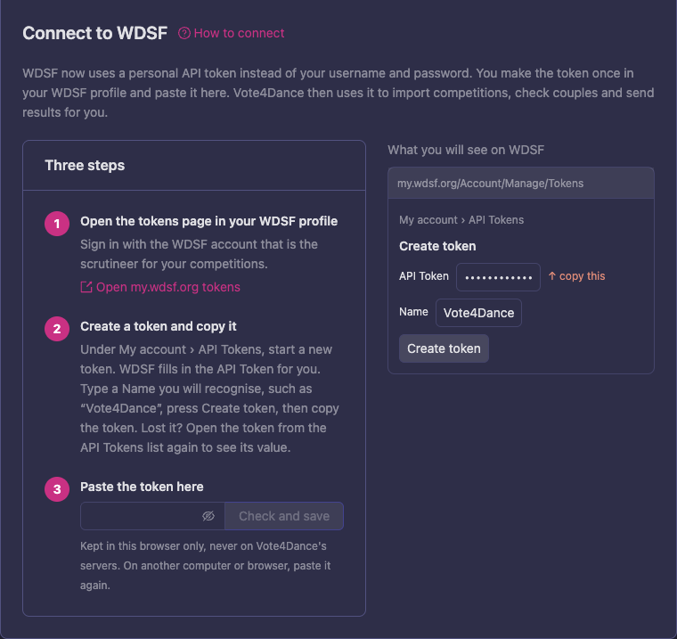
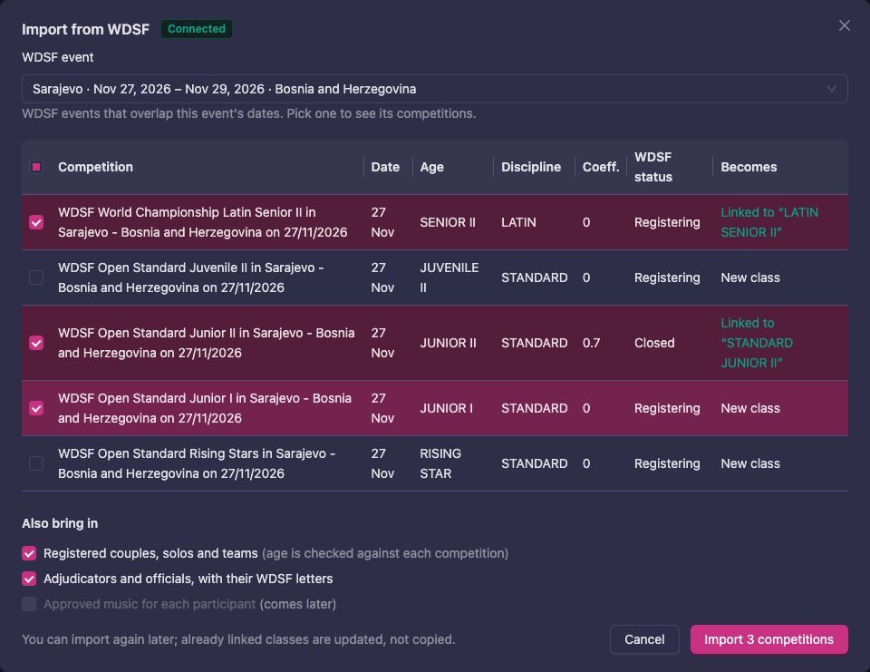
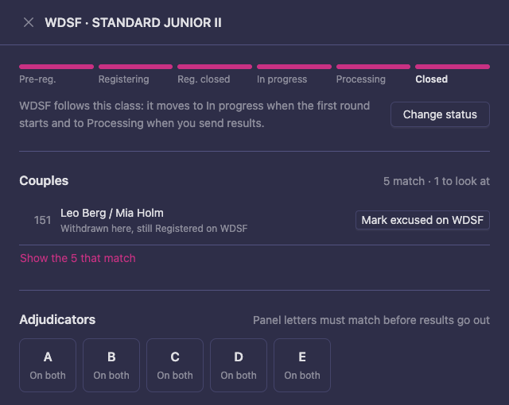
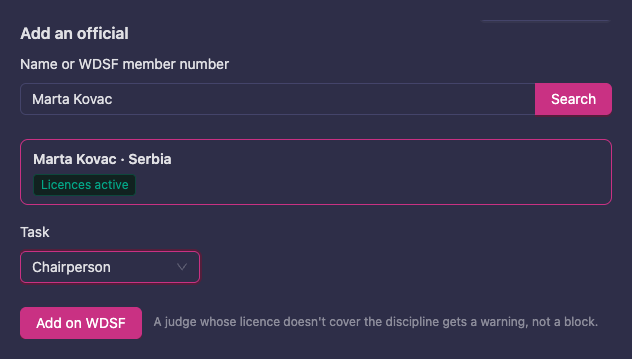
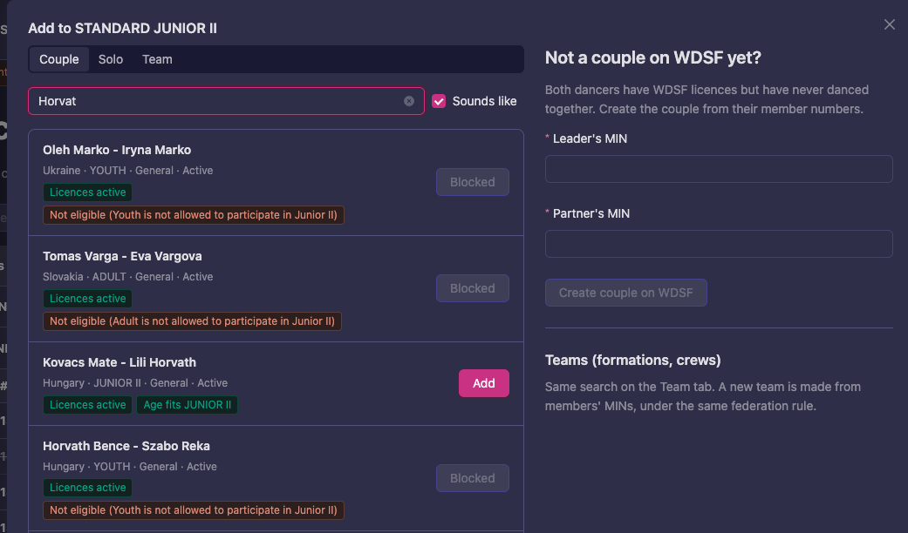
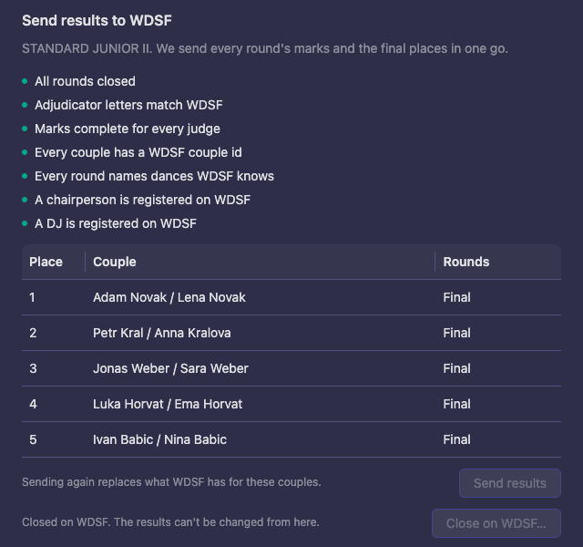

# WDSF competitions

When your event runs WDSF competitions, Vote4Dance works directly with WDSF. You import the competitions and their couples from WDSF, keep start numbers, check-in and officials in step with WDSF while you prepare and run the event, and send the results to WDSF when each class is done. Nothing has to be typed in twice.

This page is about the new Manager. Everything here appears only in an event whose federation is WDSF.

## What you need

- **A WDSF account** that is the scrutineer of your competitions on WDSF. Sending results and closing a competition need the scrutineer; WDSF decides who that is.
- **A WDSF API token** from your WDSF profile. You make it once, see [Connect to WDSF](#connect-to-wdsf).
- **Your judges' WDSF member numbers (MIN)** on their judge profiles, so Vote4Dance can match them to WDSF's adjudicators. See [Judges](/manager-guide/judges/).

## Connect to WDSF

WDSF uses a personal API token instead of your WDSF username and password. You create the token in your WDSF profile and paste it into Vote4Dance once.

1. Open the event and go to **Event details**. Near the bottom you find the **Integrations** card with **Connect to WDSF**.

   

2. Click **Open my.wdsf.org tokens**. It opens [my.wdsf.org/Account/Manage/Tokens](https://my.wdsf.org/Account/Manage/Tokens). Sign in with the WDSF account that is the scrutineer for your competitions.
3. Under **My account › API Tokens**, start a new token. WDSF fills in the **API Token** for you. Type a **Name** you will recognise, such as "Vote4Dance", and press **Create token**.
4. Copy the token.
5. Back in Vote4Dance, paste it under **Paste the token here** and click **Check and save**. Vote4Dance asks WDSF whether the token works and then shows **Connected to WDSF**, with the last four characters of the token.

The token is kept in this browser only, never on Vote4Dance's servers. On another computer or in another browser, paste it again. Signing out of Vote4Dance forgets it.

Lost the token? Open it again from the **API Tokens** list on WDSF to see its value. To stop using it, delete it there. In Vote4Dance, **Replace token** pastes a new one and **Disconnect** forgets it in this browser.

When WDSF no longer accepts the token, for example because it was deleted in your WDSF profile, Vote4Dance says **WDSF did not accept the token** and nothing is changed on WDSF. Make a new token and paste it again.

In the classic Manager, the WDSF dialog asks for the same token instead of your username and password.

## Import competitions from WDSF

Start here: the import creates a class for each WDSF competition, linked to it, and can bring in the couples and officials at the same time.

1. Go to **Classes** and click **Import from WDSF**.
2. Under **WDSF event**, pick the WDSF event. The list shows the WDSF events that overlap your event's dates.
3. Every competition of the WDSF event starts ticked. Untick the ones you don't run; the box at the top of the list unticks them all. **Becomes** says what happens to each one: **New class**, or **Linked to** a class you already have. A competition cancelled on WDSF is skipped.

   

4. Under **Also bring in**, choose what comes along:
   - **Registered couples, solos and teams**. Their age is checked against each competition.
   - **Adjudicators and officials, with their WDSF letters**.
5. Click **Import**. Vote4Dance shows how many classes were made or updated and how many participants came in.

You can import again later, for example after late registrations on WDSF. Classes that are already linked are updated, not copied. An import only brings in what WDSF owns: names, country and start numbers. Placements, check-in, withdrawals, clubs and points you set here stay as they are.

## The WDSF panel of a class

On **Classes**, click a class linked to a WDSF competition. Below its rounds you find a **WDSF** button. It opens the class's WDSF panel, where you compare the class with WDSF and fix what differs. From top to bottom:

- **Status on WDSF**: where the competition is on WDSF, from **Registering** to **Closed**.
- **Couples**: the class's entries next to WDSF's participants.
- **Adjudicators**: your panel's letters next to WDSF's.
- **Officials**: everyone WDSF has for the competition, and **Add an official**.
- **Send results to WDSF** and **Close on WDSF**.

### Status on WDSF

WDSF follows the class by itself: it moves to **In progress** when the first round starts and to **Processing** when you send results. To set another status, for example when a competition is cancelled or postponed, click **Change status**, pick the new status and confirm. The class stays here; its rounds, entries and results are not deleted.

### Couples

**Couples** shows how many entries match WDSF and how many you need to look at. Each one to look at says why and offers the fix:

| What it says | What you can do |
|---|---|
| Registered on WDSF, not in this class yet | **Add here** |
| Only here, not on WDSF yet | **Add to WDSF** |
| Only here, with no WDSF couple id to add it with | No button: the entry has no WDSF couple id. Add the couple with [Add from WDSF](#couples-start-numbers-and-check-in) and remove this entry. |
| Withdrawn here, still Registered on WDSF | Send this class's status to WDSF, for example **Mark excused on WDSF** |
| A different status here and on WDSF, such as **Present here, Registered on WDSF** | **Mark present on WDSF** (the button names the status this class has) |
| Only here. WDSF says: not eligible | WDSF will not take the couple in this competition. **Withdraw here** marks the entry withdrawn; it stays in the class. |

### Adjudicators

Each letter on your panel shows **On both**, **Only here** or **Only on WDSF**. The letters must match before the results can go out. A judge who is on your panel but not on WDSF gets an **Add A to WDSF** button (with the judge's letter); it uses the WDSF member number on the judge's profile.

### Officials

Click **Get from WDSF** to see who WDSF has for the competition, with each official's task and whether their licence covers the discipline. When WDSF keeps the panel secret until the day before the competition, the list stays empty until then.

To add someone WDSF doesn't have yet:

1. Under **Add an official**, type a name or a WDSF member number and click **Search**. A name works as "Firstname Surname".
2. Pick the person from the list. The badges show their WDSF licences.
3. Pick the **Task**: **Adjudicator**, **Chairperson**, **Scrutiny** or **DJ**. For an adjudicator, type their **Letter**.
4. Click **Add on WDSF**.

WDSF needs a **chairperson** before it moves a competition to **In progress** or **Processing**, and a **DJ** before it closes it. Each of them needs a WDSF licence for that task. Add both well before the results go out.

## Couples, start numbers and check-in

While you work on **Participants**, Vote4Dance keeps WDSF in step for the classes linked to WDSF:

- **Check in** marks the couple **Present** on WDSF, and **Withdraw** marks them **Excused**. Undoing it puts them back.
- A new **start number**, typed or assigned with **Assign start numbers**, goes to WDSF too. When WDSF refuses a number because another couple already has it there, Vote4Dance says which number is taken.
- In **Assign start numbers**, **World ranking** orders the class by WDSF's world ranking instead. **Sort by world ranking…** shows each couple's world rank and what they become, and can give the best ranked the first start numbers or spread the top couples across the first round's heats. Couples that are not on the ranking go last, in their current order.

To add a couple that registered late, click the class on **Participants** and then **Add from WDSF** below its entries:

1. Pick **Couple**, **Solo** or **Team**.
2. Type a name or a WDSF member number (MIN). With **Sounds like** ticked, names spelled a little differently are found too. The badges show each hit's licences and whether their age fits the competition; a couple that WDSF does not allow in it shows **Blocked** instead of **Add**.
3. Click **Add**. The couple is put in this class and entered in the WDSF competition.

Two dancers who have WDSF licences but have never danced together can be made a couple under **Not a couple on WDSF yet?**, from their member numbers. WDSF often allows only the dancers' national federation to create couples and teams; when it says no, ask the federation to create the couple and search again.

## Send results and close on WDSF

When a class is done, open its WDSF panel and go to **Send results to WDSF**. Vote4Dance sends every round's marks and the final places in one go.

1. Look at the checks. Each one must be green before **Send results** can be clicked:
   - **All rounds closed**
   - **Adjudicator letters match WDSF**
   - **Marks complete for every judge**
   - **Every round names dances WDSF knows**. WDSF only takes its own dance names, such as Waltz or Cha Cha Cha. A final judged as one round without dances is refused; add the dances to the round.
2. The other checks warn you before WDSF does: a couple without a WDSF couple id, no chairperson, no DJ.
3. Check the places in the table. A round WDSF can't take marks for, such as one judged on a scale or in battles, sends only the places; the panel says so.
4. Click **Send results**. Vote4Dance first marks the couples who danced as **Present** on WDSF, then sends the results.

   

5. **WDSF's answer** shows how many couples were saved, any couple that was skipped and why, and where the competition is on WDSF now. When WDSF keeps the competition where it was, the answer says why, for example a missing chairperson.

You can send again after a correction. Sending again replaces what WDSF has for these couples.

When the chairperson has signed the results, click **Close on WDSF…** and confirm. WDSF works out the world ranking points, and the results can't be changed from Vote4Dance after that. If WDSF refuses to close, its reason stays on screen, for example that no DJ is registered or that the panel has too few adjudicators.

## The timetable on WDSF

WDSF shows a public timetable of each competition. On the run sheet in **Live**, **Timetable on WDSF** has a **Keep in step with the run sheet** box. While it is ticked and the run sheet is open on a computer connected to WDSF, a round that starts late or finishes shows on WDSF's timetable within a minute. Close the tab and the WDSF timetable stops updating.

## When WDSF says no

When WDSF refuses something, Vote4Dance shows what WDSF said and what to do:

| Message | What to do |
|---|---|
| WDSF did not accept the token | Make a new token and paste it again, see [Connect to WDSF](#connect-to-wdsf). |
| Sending results and closing need the scrutineer of this competition | Ask WDSF to make you the scrutineer, or connect with the scrutineer's token. |
| Another couple in this competition has the number on WDSF | Give the couple another number. |
| WDSF starts, processes and closes a competition only once it has a chairperson | Add a chairperson under [Officials](#officials). |
| WDSF wants another official on this competition first | WDSF's message names who, often the DJ. Add them under [Officials](#officials). |
| WDSF has worked out ranking points, so results can't be changed from here | The competition is closed on WDSF. Contact WDSF to change it. |
| WDSF can't be reached | Nothing is lost. Try again in a moment. |
