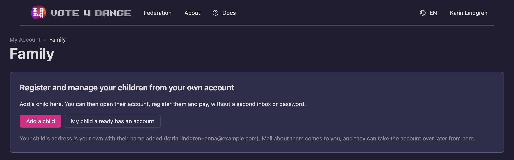
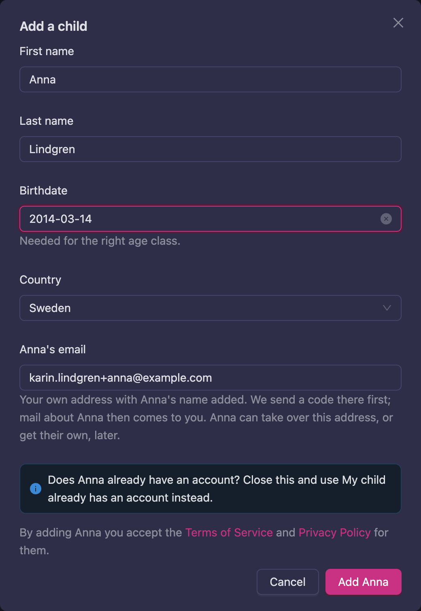
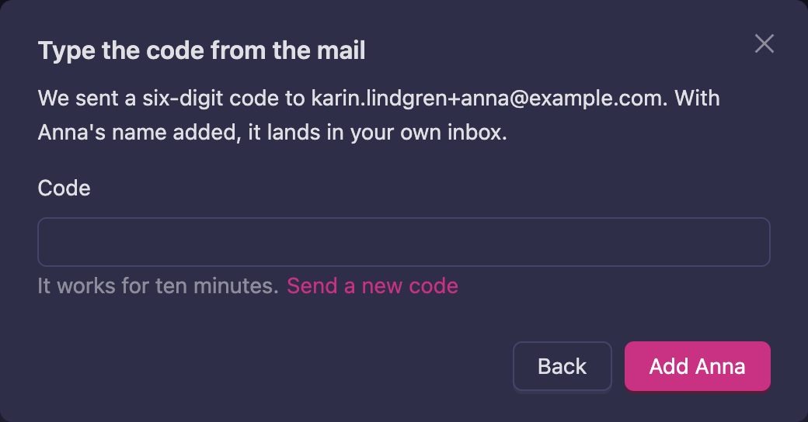
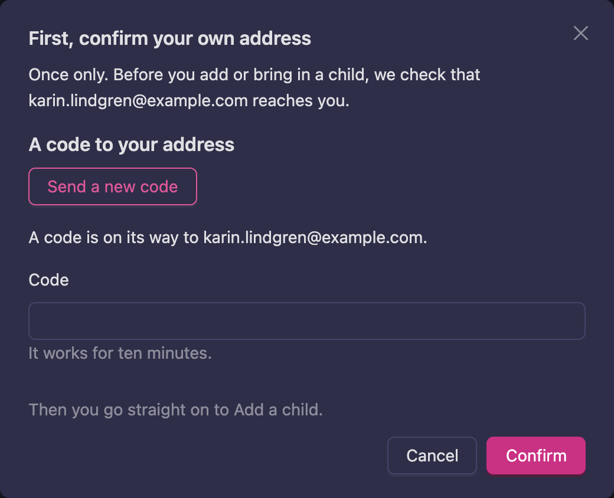
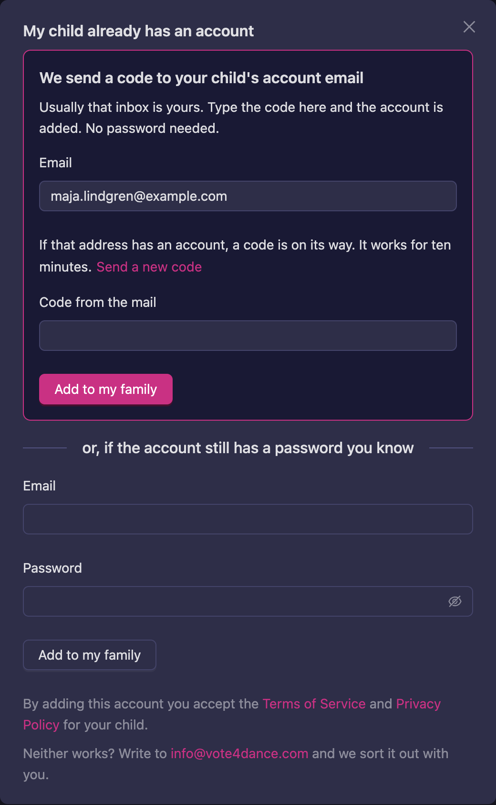
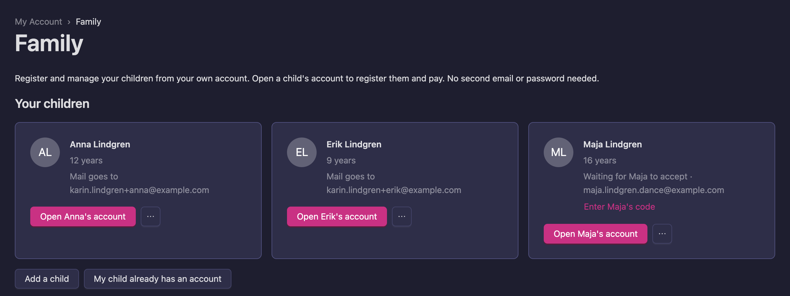
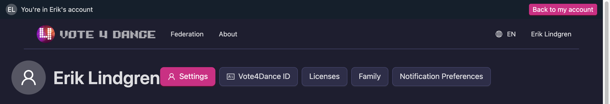
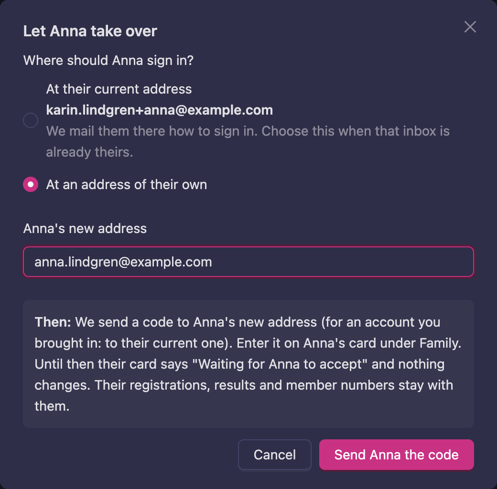
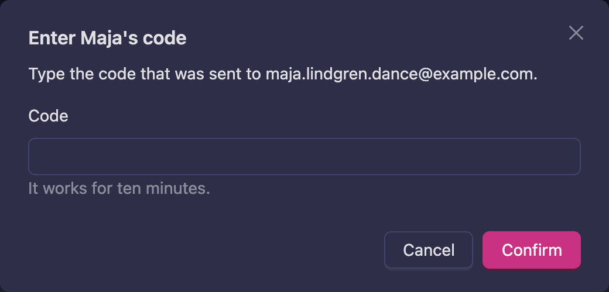
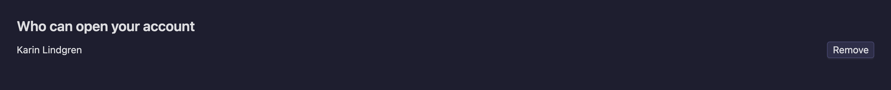

# Family

If your children dance, you can register and manage them from your own account. Add each child once
under **Family**. From then on you open their account with one click, register them and pay, with
no second inbox or password to keep track of.

**In short:** every child still has an account of their own, in their own name, with their own
results and member numbers. You just reach it from yours, and they can take it over when they are
old enough.

Family is for children under 18. An account can have up to ten children.

Buttons on this page carry your child's name. The steps below use Anna, Erik and Maja as examples.

## Where to find it

Go to **My account** and press **Family**, or choose **Family** in the menu under your name.

## Add a child

Use this when your child has no Vote4Dance account yet.

1. On the **Family** page, press **Add a child**.
2. Type your child's **First name** and **Birthdate**. The **Last name** and **Country** are filled
   in from your own account, so change them if they differ. The birthdate puts your child in the
   right age class.
3. Check the email address. Vote4Dance proposes your own address with your child's name added, for
   example `karin.lindgren+anna@example.com`. Mail to that address lands in your own inbox, so you
   do not need a new one. You can type another address instead.

   
4. Press **Add Anna**. If your own address has not been confirmed yet, you are asked to
   [confirm it](#first-confirm-your-own-address) first.
5. Open the mail and type the six-digit code. The code works for ten minutes. **Send a new code**
   sends another.

   
6. Press **Add Anna** again. Your child now shows under **Your children**, ready to open.

Nothing is created until the code is right.

If the code never arrives, your email provider may not accept addresses with a plus sign. Press
**Back** and type an address that reaches you.

## First, confirm your own address

Before you add your first child or bring in an existing account, Vote4Dance checks that your own
address reaches you. This happens once, and only if your address has not been confirmed already.

1. If your account has no birthdate, enter yours. A child's account cannot manage other children.
2. Press **Send me a code**, and type the code from the mail. It works for ten minutes.
3. Press **Confirm**. You go straight back to what you were doing, with everything you typed still
   there.

## My child already has an account

Use this when your child already has a Vote4Dance account, so their registrations, results and
member numbers stay in one place. Do not create a second account.

1. On the **Family** page, press **My child already has an account**.
2. Type the email address of your child's account and press **Send code**. Usually that inbox is
   yours.
3. Type the code from the mail and press **Add to my family**. No password is needed. The code works
   for ten minutes.

   

**If you cannot get the mail,** but know the account's password, use the second part of the dialog:
type the email address and the password and press **Add to my family**. The account's address is told
by mail that it was added to your family.

If the account has no birthdate, you are asked to enter it, because it is needed for the right age
class. If neither way works, write to [info@vote4dance.com](mailto:info@vote4dance.com).

## Your children

Each child has a card with their age, their club and where their mail goes. Press the **···** button
on a card to let your child take over or to remove them from your family.

## Open your child's account

1. Press **Open Erik's account**.
2. You are now in your child's account. A bar at the top of every page says whose account you are
   in, so you never register the wrong person by mistake.

   
3. Do what you came to do. [Register for an event](/dancer/registration-for-event/), pay, or look
   at [My registration](/dancer/my-registration/), exactly as if your child had signed in.
4. Press **Back to my account** when you are done.

Some things cannot be changed from your account, so a parent can never lock a child out: the
password, the email address, API keys and passkeys. Trying shows **Change this from the child's own
login.** You also go back to your own account to add or remove children.

## Let your child take over

When your child is old enough, they can sign in on their own. Their registrations, results and member
numbers stay with them. You stay in their family until one of you removes the link.

1. On your child's card, press **···** and choose **Let Anna take over**.
2. Choose where your child should sign in.
   - **At their current address** when that inbox is already theirs. Press **Send Anna the sign-in
     mail**. Nothing else changes.
   - **At an address of their own** to move the account to a new address. Type it and press **Send
     Anna the code**.

   
3. If you chose a new address, the code goes to that address. For an account you brought in with
   **My child already has an account**, it goes to the current address instead. The card now says
   **Waiting for Anna to accept**.
4. On the card, press **Enter Anna's code**. Type the code and press **Confirm**. The account moves
   to the new address.

   

The code works for ten minutes. If it runs out, nothing has changed and the card goes back to how it
was the next time the page loads. Start again with **Let Anna take over**.

## Remove a child from your family

1. On your child's card, press **···** and choose **Remove from my family**.
2. Press **Remove** to confirm.

Your child's account, registrations and results stay. You can add them again later with their email.

## Who can open your account

If a parent has added you to their family, you see this when you sign in with your own login and open
**Family**. To stop someone from opening your account, press **Remove** next to their name. Their own
account stays as it is.

## If something does not work

| What you see | What it means and what to do |
|---|---|
| **That code is not right.** | Check the digits against the latest mail. |
| **That code has expired. Send a new one.** | A code works for ten minutes. Send a new one. |
| **Too many wrong codes. Send a new one.** | Send a new one and type it carefully. |
| **This address already has an account. Use My child already has an account instead.** | Your child already has an account. [Bring it in](#my-child-already-has-an-account) instead of creating a second one. |
| **Adults manage their own accounts.** | Family is for children under 18. |
| **You're signed in as a child's account. Create your own first.** | You are signed in to an account with a birthdate under 18. [Create an account](/dancer/account-creation/) of your own. |
| **Wrong email or password. Use the code instead.** | Use the code at the top of the dialog. |
| **Ten children is the most one account can manage. Write to us if you need more.** | Write to [info@vote4dance.com](mailto:info@vote4dance.com). |
| **Try again in an hour.** | Too many mails or tries in a short time. Wait an hour. |
