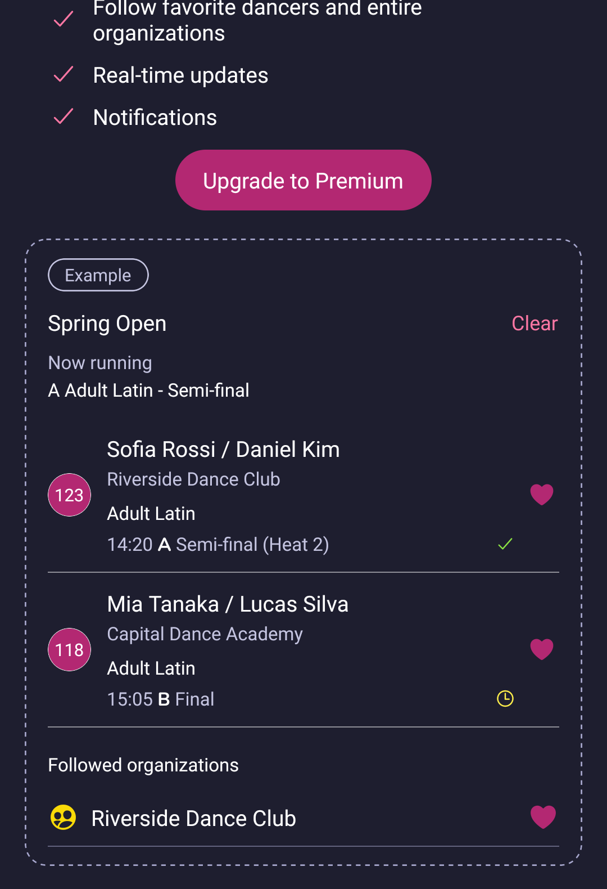
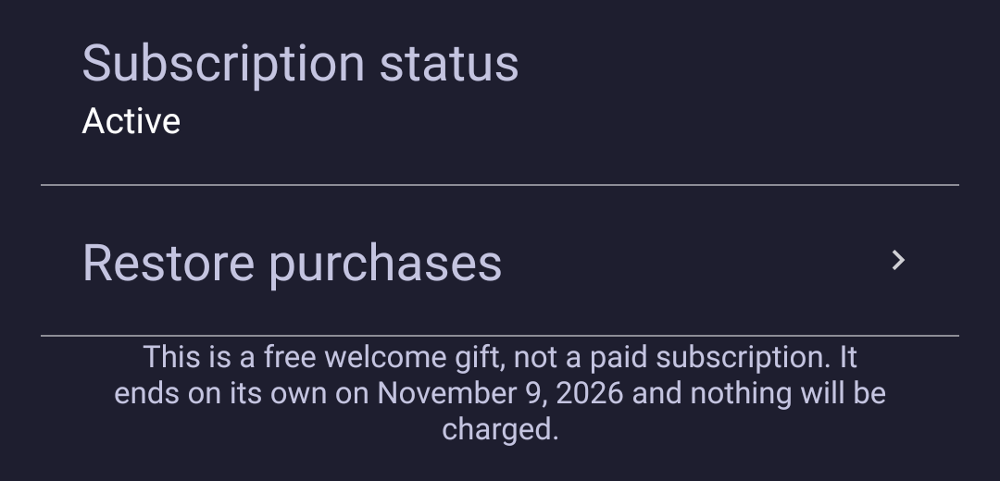
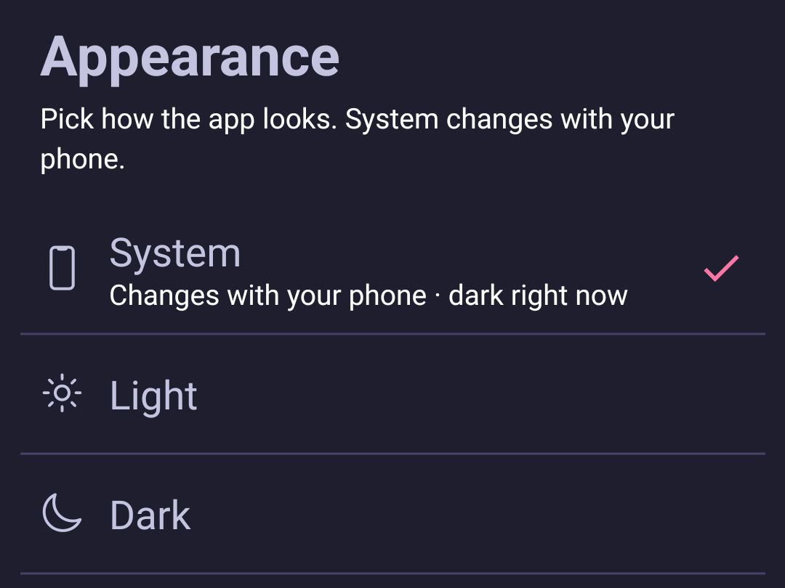
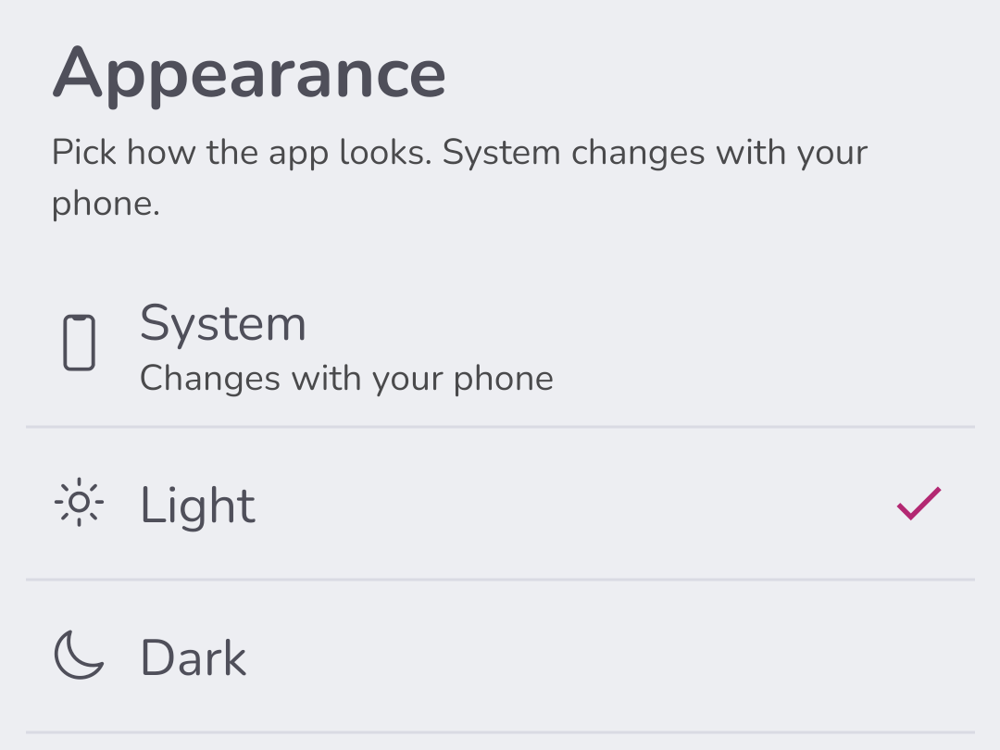

# Following results in the app

The Vote4Dance app is for what happens at the venue: seeing when you dance, following the results as they come in, and showing your ID at the entrance. Registering and paying is done on the website.

The app has three tabs at the bottom: **Competitions**, **Favorites** and **Profile**.

To see when you dance, open the competition's **Schedule** tab. [Following the schedule](/spectator/following-the-schedule/) explains what it shows.

## Find results

1. Open the **Competitions** tab and choose a competition.
2. Open the **Results** tab.
3. Pick **With results** to see only the classes whose results have been published. Pick **All** to see every class, including those that have not danced yet.
4. Tap a class to see its results.

The **Results** tab opens on **With results** as soon as at least one class has results. Before the first results are published it shows **All**, so the list is never empty because of the filter.

The pink number next to a class is how many competitors are in it, not how many results there are.

## Follow dancers and clubs with Premium

The **Favorites** tab collects the dancers and clubs you follow, grouped by competition. For each followed competitor you see the class, when they dance, and whether they got through. **Clear** removes everything you follow in that competition.

*The example card shown on the Favorites tab before you have Premium. The names are made up.*

Following dancers and clubs, real-time updates and notifications are part of Premium.

1. Open the **Favorites** tab.
2. Read what Premium gives you, and look at the example to see how followed dancers will appear.
3. Tap **Upgrade to Premium** when you want it.

The Favorites tab no longer opens the Premium offer by itself. It only opens when you tap **Upgrade to Premium**.

### Cancel Premium

1. Open the **Profile** tab and tap **Settings**.
2. Tap **Cancel subscription**.

What happens next depends on where you bought Premium:

- **In the app:** cancel it in the App Store or Play Store. Open **Subscriptions** there and remove Vote4Dance.
- **On the Vote4Dance website:** **Cancel subscription** opens your subscription in your browser, where you can change or cancel it. The App Store and Play Store do not list subscriptions bought on the website.

### If you have the free welcome gift

The free welcome gift gives you Premium for a few days without paying, and there is nothing to cancel. Only a paid subscription shows **Cancel subscription** in Settings. While you have the gift, Settings says that the gift is free and on which date it ends. The gift ends on its own on that date and nothing is charged.

When the gift has ended, tap **Upgrade to Premium** in Settings and then **Start subscription** if you want to keep Premium.

## Vote for a competitor

When the organizer has switched on audience voting, you can give a competitor up to five hearts, until that round's results are published. Voting is free. See [Hearts and Call it](/spectator/hearts-and-calls/) for calling who goes through as well.

1. In the schedule, tap **Vote** next to the competitor. The voting card opens.
2. Tap the big heart to fill the ring a little at a time, or **hold** it to fill the ring while your finger is down. Lift your finger and it stops where it is.
3. Each time the ring is full you earn a heart. The hearts at the top show how many you have given.
4. Tap **Clear** to start over, or **Save** to give your votes.

## Choose how the app looks

The app is dark unless you choose otherwise. You can make it light, or let it follow your phone.

1. Open the **Profile** tab and tap **Settings**. If your app shows a **Settings** tab instead of **Profile**, open that.
2. Tap **Appearance**.
3. Tap the one you want. The app changes straight away.
   - **System** changes with your phone. If your phone turns dark in the evening, the app does too.
   - **Light** keeps the app light, whatever your phone is set to.
   - **Dark** keeps the app dark, whatever your phone is set to.

*With System chosen, the screen shows what your phone is set to right now.*

*With Light chosen, the app stays light even when your phone is set to dark.*

Your choice is saved on this phone, so another phone you sign in on keeps its own. The Vote4Dance ID card stays dark whichever you choose.

If you don't see **System**, update the app from the App Store or Play Store.
