# My registration

Every event you are registered for has a page of its own: **My registration**. It shows what you
still have to do, every class you are in with its rounds and results, and whether your start number
has been picked up. You also pay, add a class, change class and withdraw from a class there.

In the Dancer app the same page is called **My event**. See [In the Dancer app](#in-the-dancer-app).

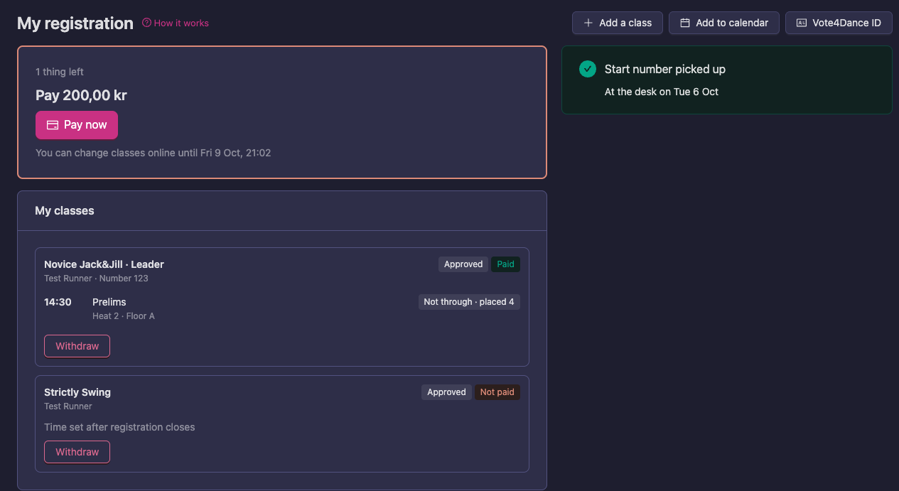

*One class still to pay, one class with its first round danced, and the start number picked up.*

## Opening it

You need to be signed in. Any of these takes you there:

- **Right after registering.** When you finish registering, or come back from paying, you land on
  the page.
- **From the event page.** When you are registered, the event's **Overview** shows how many classes
  you are in. Press **My registration** on the right.

  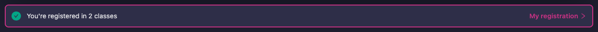

- **From the email.** The email you get after registering has a **My registration** button.
- **From your account.** Open your name at the top right → **My account**. Under **Registration**,
  press the event. See [All your events](#all-your-events).
- **On the day.** On a competition day your account opens with the event at the top, and a
  **My registration** button.

  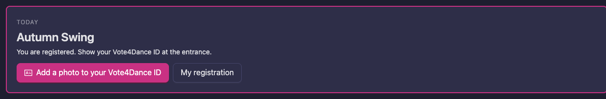

## What you still have to do

The card at the top tells you what is left, and counts it (**1 thing left**). It says one of these:

| What it says | What it means | What you do |
|---|---|---|
| **Pay** and an amount | The organizer has approved classes you have not paid for yet. | Press **Pay now** and pay by card. Everything still unpaid at the event is paid at once. Once paid, your registration is final. |
| **Pay as the organizer describes** | The organizer takes payment their own way, for example by bank transfer or at the desk. Their instructions are shown below. | Follow the instructions. |
| **Payment in progress** | You have paid by card and the payment is being confirmed. | Wait a minute: the class turns **Paid** on its own. |
| **Waiting for the organizer to approve your registration** | The organizer approves registrations by hand. | Nothing yet. If the event takes card payment, you can pay once you are approved. |
| **All set** | Nothing is left to do. | Nothing. |

When your club pays for its dancers with one invoice, the club's invoice can be listed here as well,
with its amount and a **Pay club invoice** button.

Below the card you see until when you can change your classes online (**You can change classes
online until…**). After that, changes are made at the desk.

## Your classes

**My classes** lists every class you are in at the event, on every day of it. Each class shows:

- **Who dances it**: you, or your couple or team, and your start number once it has one
  (**Number 123**).
- **Its status** (**Approved**, **Preliminary** and so on, see
  [What your status means](/dancer/registration-for-event/#what-your-status-means)) and whether it
  is **Paid** or **Not paid**.
- **Its rounds**, once the organizer has set them up and published the schedule: the time, the
  round, and your heat and floor. Before that it says **Your dance time is announced after registration closes**.
- **How it went**, round by round, as soon as the results are published: **Through**,
  **Not through · placed 4**, **Alternate 1**, **Placed 2** and so on. A round still being judged
  says **Results coming**.

Rounds after one you did not go through from are not listed: they are not yours any more.

If the event you are at started from a start list the organizer imported, instead of
registrations in Vote4Dance, your entries are found by the Federation ID on your licence, so they
are listed here too.

### The buttons at the top

- **Add a class** opens the event's registration with your competitor already picked.
- **Add to calendar** downloads your round times, to open in your phone's or computer's calendar.
- **Vote4Dance ID** shows the QR code the desk scans. See [Your Vote4Dance ID](/dancer/vote4dance-id/).

## On the day

On a competition day the page also shows:

- **Next up**: your next round that day, with the time, heat and floor, and your number.
- **Your start number**: **Start number picked up**, with when you were at the desk, or
  **Start number not picked up yet** with a **Show ID** button to show at the desk. The page only
  says this at events where the desk checks dancers in with Vote4Dance.

Results and times update on their own while the page is open.

## Changing class

If you picked the wrong class, you do not have to withdraw and register again: until registration
closes you can move your entry to another class. Your payment stays with the entry.

1. Open **My registration** for the event.
2. Press **Change class** on the class.
3. Pick the class you want to move to.
4. Press **Change class** again, or **Keep current class** to stop.

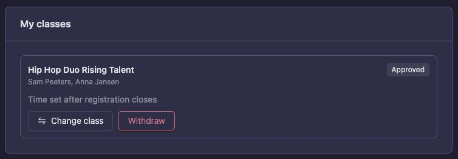

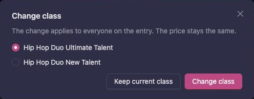

*Anna and Sam, who dance a duo, move from Rising Talent to Ultimate Talent. Both of them move.*

What you can move to:

- **Classes that open for registration together with yours.** These are the classes you see side by
  side when you register, for example the other levels or regions of the same group of classes.
  They cost the same, so nothing is charged and nothing is refunded.
- **Only classes you are allowed to dance.** A class you do not qualify for, for example because of
  your age, your level or your licence, is shown greyed out with the reason. A class where you
  already dance another level of the same category is greyed out too, when the federation allows
  only one class per category.
- **Not the classes you are already in**, and not a class you withdrew from earlier.

A duo or team moves as one: everyone on the entry moves to the new class.

The **Change class** button is missing when:

- **Registration has closed.** The class says **Registration has closed: changes only at the desk**:
  ask the organizer.
- **Your club owns the entry.** The club changes it: ask your club's coach or administrator. They
  change the class from the club's **Registration** page (see
  [Moving an entry to another class](/school-club/registration-for-event/#moving-an-entry-to-another-class)).
- **There is no other class to move to.** A class that is registered separately, with its own price,
  is not in the list: withdraw and register again instead (see
  [Withdrawing from a class](#withdrawing-from-a-class)). Nothing you paid is refunded
  automatically.
- **The organizer has already put you on the start list**, or the class has lineup changes for your
  team. The organizer changes those: ask them.

## Withdrawing from a class

1. Open **My registration** for the event.
2. Press **Withdraw** on the class.
3. Press **Withdraw** again to confirm, or **Keep it** to stop. If you have paid, the confirmation reminds you that the payment is not refunded automatically.

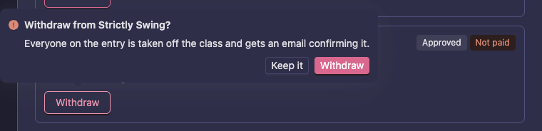

Everyone on the entry is taken off the class, and each of you gets an email confirming it.

- You can withdraw while the class's registration period is open. After it closes the class says
  **Registration has closed: changes only at the desk**: ask the organizer.
- A group or formation owned by your club is withdrawn by the club. The class then says **Your club
  manages this entry. Ask your coach to change or withdraw it.**
- **Nothing is refunded automatically.** If you paid, contact the organizer, who refunds from the
  Manager app.

### Changing who dances

Some federation classes let a registered team change its dancers, for example to replace one who is
injured. Only then does the class show **Edit lineup**, and only while registration is open. Most
classes do not allow it: ask the organizer instead.

## Your music

Some classes are danced to **your own music**. Then you upload your track yourself, and the DJ plays
it at the event. Whether a class asks for it, and how long your track may be, is set by the
federation in its rules.

You can see it before you register: on the class list, a class that dances to your own music has a
tag such as **Own music · max 1:30**. The limit is a longest length (**max 1:30**), a shortest
length (**min 2:30**) or both (**2:30–3:00**).

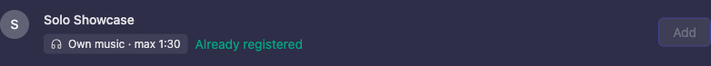

You do not have to upload when you register. After you have registered, upload from **My registration**.

### Uploading your music

1. Open **My registration** for the event. A class that asks for own music has a **Music** line under
   its status. It says **Music missing** and the limit, for example **Own music · max 1:30**, with an
   **Upload MP3** button.

   When music is missing, the card at the top says **Upload music for 2 classes** and lists the
   classes. Press **Upload music** to jump to the first one. The event page says the same when you
   are registered.

   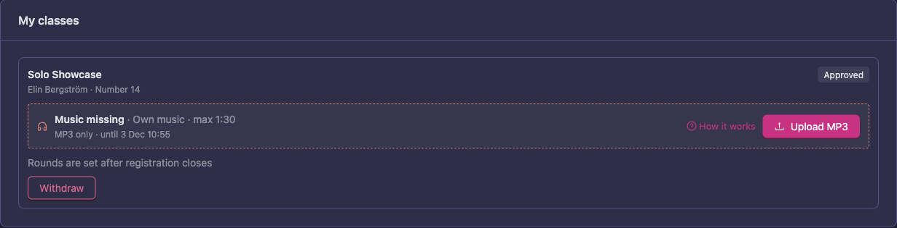

2. Press **Upload MP3** and pick the file on your phone or computer. Only MP3 files work: export
   your track as MP3 first if it is another format. A file larger than 30 MB is refused.
3. A window called **Music for** and the class opens. Your browser checks the file before anything is
   sent, and shows it under **Checked in your browser**, for example **Length 1:20 of max 1:30**.
   Under **Listen before you send it** you can play the track and make sure it is the right one.
4. Press **Upload 1:20 track** (the button shows your track's length). Press **Cancel** to stop
   without sending anything.

   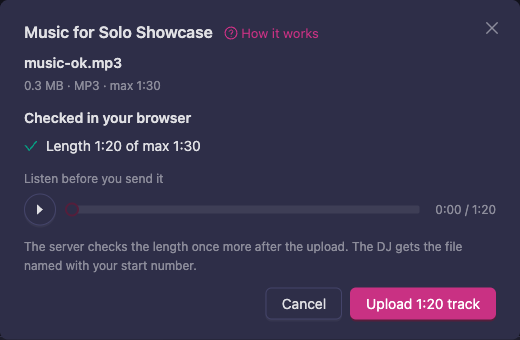

When the upload is done the line changes to **Music uploaded**, with the track's length against the
limit and the file name, for example **1:20 of max 1:30 · music-ok.mp3**, and the tag **Ready for the
DJ**. Once every class has its music, the **Upload music** reminder at the top goes away.

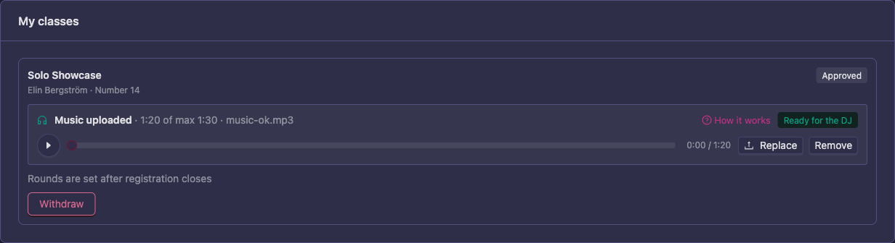

The server checks the length once more after the upload. This is why a file can still be refused
even though your browser accepted it (see [If your file is refused](#if-your-file-is-refused)).

In a class danced by a couple or a team, anyone on the entry can upload. In a class your club has
registered, the club's coaches and anyone on the roster can upload. The last upload counts.

If you were put on a team's entry by a lineup change, you see the track and can play it, but you
cannot upload: the line says **The team's dancers upload the music for this entry.**

While you are still in the middle of paying for the class, the **Upload MP3** button is not shown yet; it appears once the payment is done.

### Listening, replacing and removing

- **Listen.** Under **Music uploaded** there is a player. Press the play button to hear the file the
  DJ will get.
- **Replace.** Press **Replace** and pick a new MP3. You go through the same window as the first time.
  Your new track takes the place of the earlier one only when it passes the check: until then the
  earlier file stays.
- **Remove.** Press **Remove**, then **Remove** again to confirm, or **Cancel** to keep the file. The DJ then has no track for this entry until you upload another one, and the class
  says **Music missing** again.

### If your file is refused

Your browser tells you straight away when a file cannot be used, and you can pick another file:

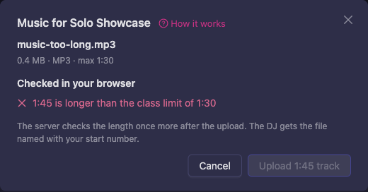

| What it says | What it means | What you do |
|---|---|---|
| **MP3 only (your file is .wav)** | The file is not an MP3. | Export the track as MP3. |
| **The file is larger than 30 MB** | The file is too big. | Export it again as a smaller MP3. |
| **1:41 is longer than the class limit of max 1:30** | The track is longer than the class allows. | Shorten the track. |
| **0:55 is shorter than the class minimum of min 2:30** | The track is shorter than the class requires. | Use a longer track. |
| **This file could not be read as an MP3** | The file is damaged or is not really an MP3. | Export it again as MP3. |

If the server refuses a file after it was sent, the line says **Not accepted:** and the reason, and
**Fix the track and upload it again.** Press **Upload MP3** again.

If the class already had a music file, nothing is lost: the line keeps **Music uploaded** and adds
why the new file was refused, with **Your earlier file from 12 Oct is still the one the DJ gets.**

### After registration closes

You can upload, replace and remove music while the class's registration period is open. The line
says until when (**MP3 only · until 3 Nov 18:00**). After that it is locked and says
**Registration has closed: to change your music, contact the organizer at** and the organizer's
contact. If the organizer has no contact listed, it says **Registration has closed: music changes
only through the organizer.** Ask the organizer: they can upload on your behalf.

### The reminder in your registration e-mail

When a class asks for your own music and you have not uploaded it yet, the registration e-mail has a box called **Upload your music**. It lists the classes and says to upload your track as MP3 on **My registration**, before the date registration closes when there is one. It also reminds you that you can listen to the track there and replace it until registration closes.

### When your club registered the entry

Your club's coaches, managers and administrators can upload the music for an entry from the club's **Registrations** list, because the dancers may not have an account. On a class that asks for own music, the entry has a **Music** button next to the cancel button. When the entry still needs its music, the button says **Upload music** and is outlined in gold. Press it to open the same window as above: upload, listen, replace or remove. See [Club admin screens](/school-club/club-admin/#registration).

### After the competition

The music is not kept for ever. Vote4Dance deletes the uploaded files automatically some days after the competition has ended, so the organizer and the DJ should download them before then. The federation decides how many days (see [Own music](/federation-rules/own-music/)); if it has not set a number, the files are kept for 8 days. After that, the entry says **The track was removed after the competition.**

## All your events

Your account lists every event you have registered for, under **Registration**:

- **Coming up**: events that have not ended yet. A tag says when something needs you:
  **To pay**, **Awaiting approval** or **Payment in progress**.
- **Past**: earlier events, by year. With many events, use **Find an event** to search by name.

Press an event to open its **My registration**. Paying and withdrawing happen there.

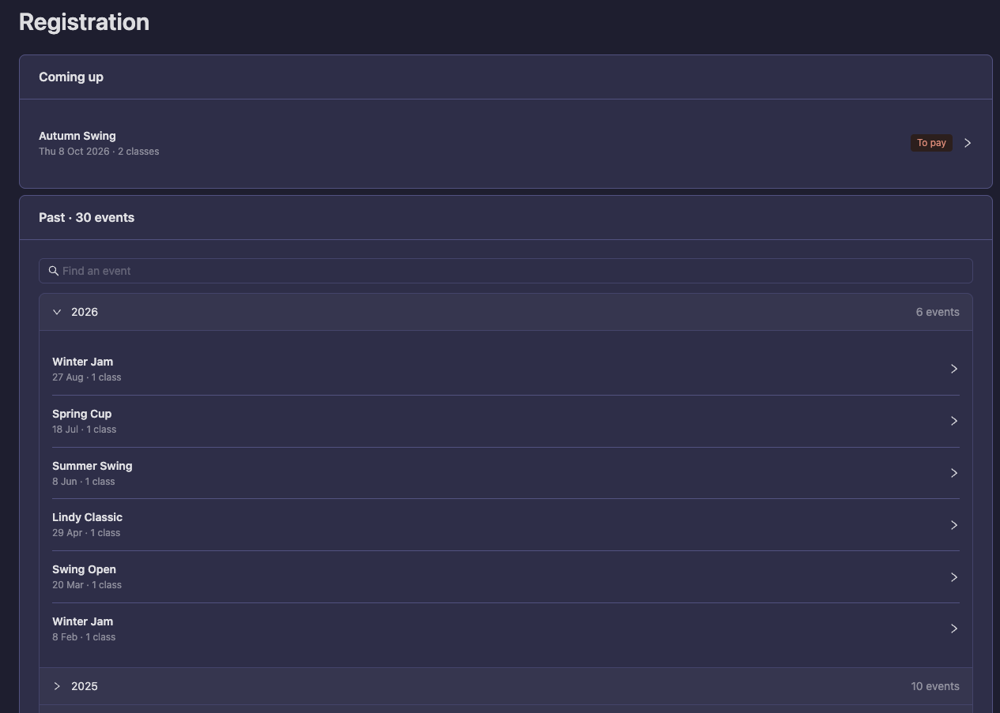

## In the Dancer app

In the app, open **Profile → Registrations** and tap an event to open **My event**. It shows the
same things to do, your Vote4Dance ID and your classes. Inside an event, the **Mine** part lists
your classes and links to **My event** with **My registration, ID and payment**.

Paying, adding a class and withdrawing open this page on the website. You may need to sign in there.

## Next step

Continue to [Results, points and rankings](/dancer/creating-and-getting-a-ranking/) to see how
competing affects your rankings.
