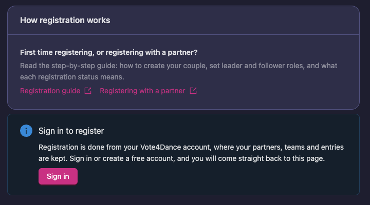
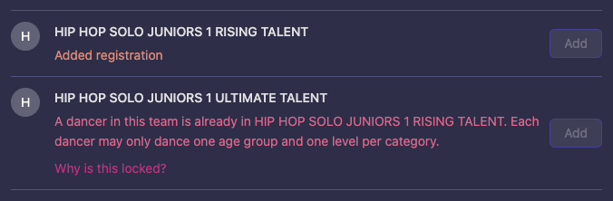
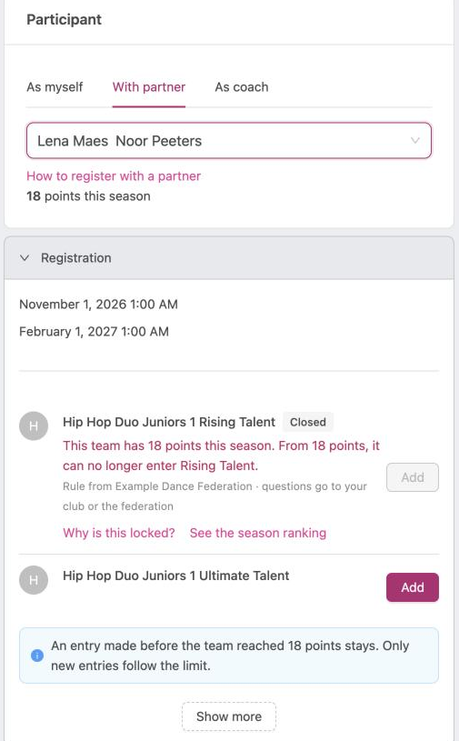

# Registering for an event

For dancers, and for parents who register a child. When you have followed the steps, you are
entered in a class at the competition, and you know how to check that you are in.

Dancing with a partner? Go to [Registering with a partner](#registering-with-a-partner).

## Registering on your own (solo)

1. Open the event on vote4dance.com and go to its **Registration** tab. If you are not signed in,
   press **Sign in or create account**. You come back to the same page.

   
2. Under **Participant**, stay on the **As myself** tab. The first time, press
   **Create competitor**: your name is already filled in, so just press **Save changes**. Next
   time you are already picked. If you have more than one competitor of your own, pick one under
   **Select competitor**.
3. Press **Add** next to each class you want to enter. You can add several. If a window asks for
   details, fill them in. The classes collect in the cart, the box called **Registration**.
4. Press **Pay now** in the cart and pay. If the event does not take payment on this page, or
   the organizer approves entries first, the button says **Send registration** instead.
5. You land on **My registration**. Look at the status of each class. **Only Approved means you
   are in.** See [What your status means](#what-your-status-means).

Good to know:

- **A competitor** is who dances: you alone, you and a partner, or a group. You set it up once
  and use it again at every event.
- **When registration is open.** The event's **Registration** tab says when it opens and closes.
  Before it opens, the tab says **Registration opens** and the date, for example
  **Registration opens 15 Sep 2026**. After it has closed, it says **Registration closed** and the
  date it closed, for example **Registration closed 1 Nov 2026**. **How registration works** is
  shown above it both times.
- **In the Vote4Dance app**, the event's **Overview** shows the same in a **Registration** card.
  Registering happens on the website: tap the card to open the event's registration there.
- **Your birth date must be on your account.** Classes often depend on age. If it is missing,
  the page says **Age missing**: press **User details** and add it.
- **Several registration periods?** If the page lists more than one, open the one you want to
  see its classes.
- **Not sure which class to enter?** Ask your club, or
  [ask the organizer](/getting-help/#reaching-the-organizer).
- **A class you cannot enter is locked**, with the reason next to it. See
  [If you cannot register](#if-you-cannot-register).

## Registering with a partner

A couple registers as **one competitor with two dancers**. You set up the couple once and use it
again for every event. The first time takes a few extra minutes. After that it is quick.

### Step 1: Agree who registers

Only one of you needs to do it. The other dancer does not register separately. Both of you
receive the confirmation and status emails.

**Whoever registers the couple pays for both of you.**

### Step 2: Create the couple

1. On the event's **Registration** tab, open **With partner**. When an event only has classes for
   couples, the page opens on this tab for you.
2. If your couple is in the list, pick it and go to Step 3. Otherwise press **Create competitors**.
3. Press **Add a partner**. Under **Search for partner with email**, type the email address of
   your partner's Vote4Dance account and press **Search**. Your partner appears in the list.
4. **Your partner has no Vote4Dance account yet?** When the search finds nobody, a
   **Create account for partner** section appears. Fill in their first and last name, country and
   language, and their birth date if you know it, and press **Create account for partner**. They
   are added to the couple straight away, so your partner does not need to sign up first. Use their
   real email address: it is where their emails go. They get a welcome email with a **Sign in**
   button, and sign in with their email address and a code sent to it. There is no password to
   choose. See [Signing in](/signing-in/).
5. Choose the couple's name: **Use participant name** (your two names) or, if it is offered,
   **Assign custom name**.
6. Press **Save changes**.

You may also see a **Dance role** field for each dancer (**Leader**, **Follower** or
**No role**). You can leave it at **No role**. Only some events need roles; if a class does, it
tells you, and you can add them then.

If you have danced together before, your couple may already exist, for example from imported
results. Use it rather than creating a new one, so your results stay together. Your competitors
are listed on your account page.

### Step 3: Pick the class and pay

1. Pick the couple under **Select competitors**.
2. Press **Add** next to the class. If a class is locked or **Add** is greyed out, read the
   reason next to it, and see [If you cannot register](#if-you-cannot-register).
3. If a window asks for details, fill them in.
4. Press **Pay now**, or **Send registration** if that is the button you see. If you are also
   entering classes on your own, add those to the same cart first.
5. Check your [status](#what-your-status-means), and tell your partner it is done. They get the
   emails too.

Classes your competitor cannot enter are hidden to keep the list short. If the list says **No
classes fit this competitor right now**, press **Show more** to see them. Each locked class says
why. For example, **This class needs a competitor with 2 people** means you have picked a solo
competitor for a couples class: open **With partner** and pick or create your couple.

### Changing a couple after registering

- **Changing who is in the couple** can create a new version of the competitor. You are warned
  before that happens.
- Some events do not allow changes after payment, or in some classes. If you cannot edit,
  [ask the organizer](/getting-help/#reaching-the-organizer).
- Once the organizer has imported the registrations into the competition, you can no longer edit
  it yourself. Ask the organizer.

## Registering in a group or formation

- **Your club registers the team.** A team with more than two dancers is created by a club, not
  by a dancer on their own. Ask your club's coach. The club's guide is
  [Registering your dancers for an event](/school-club/registration-for-event/).
- Teams your club entered you in are listed on your **My registration**, with the names of
  everyone on the team.
- A group or formation owned by a club can only be changed or withdrawn by the club.

## Registering your child

[Open their account](/dancer/family/#open-your-childs-account) first, then follow the same steps.

## Entering several classes

- **Add them all before you pay**, including a couple or duo class. One payment covers the whole
  cart.
- A class added by mistake can be removed from the cart with **×** before you pay.
- The cart stays on screen when you switch between **As myself**, **With partner** and
  **As coach**, and it is kept in the same browser for a day after your last change. Entries whose
  registration period has closed, or that are already registered, are dropped from it.
- **To add a class later**, press **Add a class** on **My registration**. It opens the event's
  registration with your competitor already picked.

## Paying

- **Pay now** pays for everything in the cart at once. Once paid, your registration is final.
- **Send registration** registers you without paying on this page:
  - If the organizer approves entries first, you pay from **My registration** once you are
    approved.
  - If the organizer takes payment their own way, for example by bank transfer, the cart shows
    the **Total**, and **My registration** shows the organizer's instructions.
- Where the event charges per dancer, a part that has already been paid is taken into account, so
  nobody pays twice.
- If you pay online and leave the checkout before paying, the registration is removed
  automatically. Nothing is left half-done; just start again.
- **Nothing is refunded automatically.** See
  [Cancelling a registration](#cancelling-a-registration).
- **The receipt comes by e-mail**, to the account that paid. See
  [Your receipt](/dancer/my-registration/#your-receipt).

What you still have to pay, and the **Pay now** button after you have registered, are on
[My registration](/dancer/my-registration/#what-you-still-have-to-do).

## What your status means

The status decides whether you are in. **Only Approved counts.**

| Status | What it means | What you do |
|---|---|---|
| **Preliminary** | Registered, but **not yet a participant**. Normal when the organizer approves by hand. | Wait, or pay if the event asks for payment. If it stays here close to the event, [ask the organizer](/getting-help/#reaching-the-organizer). |
| **Signed** | An optional step the organizer uses for their own bookkeeping. If your organization signs entries, it means your organization signed yours and the entry now waits for payment. | Nothing, unless **You pay once the entry is signed** is shown: then pay when it asks you to. |
| **Waiting for the organization** | Your club or organization has to sign your entry first. See [When your organization signs your entry](#when-your-organization-signs-your-entry). | Nothing. Your entry is not paid for yet. |
| **Declined by the organization** | Your organization did not sign the entry, so it is withdrawn. | Contact your organization. |
| **Approved** | Accepted. You are in. Automatic when an online payment completes, when the period accepts directly, or when the organizer or the check-in desk entered you. | Keep the email: it has your check-in QR code. |
| **Cancelled** | Withdrawn by you, your club or the organizer. | Register again if it was a mistake and registration is still open. |
| **Rejected** | Declined by the organizer. | [Ask the organizer](/getting-help/#reaching-the-organizer) why. |

You are emailed when the registration is created and whenever the organizer changes its status,
as long as they have emails switched on. The **Approved** email carries your personal check-in QR
code; you also have it in the app under **Profile → Vote4Dance ID** and on your account page. See
[Your Vote4Dance ID](/dancer/vote4dance-id/).

## Checking your registrations

Every event you are registered for has its own page, **My registration**. It lists every class you
are entered in, what is paid and what you still have to do. You land on it when you finish
registering, and you can open it from the event page, from the confirmation email, or from your
account: open your name at the top right → **My account**, and press the event under
**Registration**. See [My registration](/dancer/my-registration/).

In the Vote4Dance app, the same registrations are under **Profile → Registrations**.

### When the organizer handles entries

Some organizers take entries their own way, for example through a league or federation list, and
add the dancers to Vote4Dance themselves. Those starts are not registrations in Vote4Dance, so
they are not listed under your registrations, on the website or in the app. The event's
**My registration** page still finds your starts when the Federation ID on your license is the
one on the organizer's list: see [My registration](/dancer/my-registration/). In the Vote4Dance app,
such an event's **Overview** shows a **Registration** card that says **Handled by the
organizer**. Look for yourself under the event's **Competitors** tab once the organizer has
added the dancers, and [ask the organizer](/getting-help/#reaching-the-organizer) about anything
to do with your entry.

## Changing class

Registered in the wrong class? You do not have to withdraw and register again. Until registration
closes, press **Change class** on the class on **My registration** and pick the right one. Your
payment stays with the entry.

The full account, with what you can move to and when the button is missing, is in
[Changing class](/dancer/my-registration/#changing-class).

## When your organization signs your entry

Some events want your club or organization to sign the entries before they count. Then you do not
pay when you register. You see **Registration sent. Your organization signs it next, nothing is
paid yet.**, the entry shows **Waiting for the organization**, and you get an email that says the
same. If you have no organization, your entry is not held up.

The full account, with who pays and what happens if your organization declines, is in
[When your organization signs your entry](/dancer/my-registration/#when-your-organization-signs-your-entry).

## Cancelling a registration

Withdraw from a class on the event's **My registration** page: press **Withdraw** on the class and
confirm. The full account is in
[Withdrawing from a class](/dancer/my-registration/#withdrawing-from-a-class). In short:

- The registration period you registered in must still be open. After it closes,
  [ask the organizer](/getting-help/#reaching-the-organizer).
- The registration must be Preliminary, Signed or Approved.
- Withdrawing a couple withdraws it for both of you.
- A group or formation owned by a club can only be withdrawn by the club.
- The registration stays on the page as **Cancelled**.
- **Nothing is refunded automatically.** If you paid, contact the organizer.

You can delete a competitor (such as an old couple) from your account only when it has no active
registrations. Cancel those first.

## If you cannot register

To reach the organizer, see [Reaching the organizer](/getting-help/#reaching-the-organizer).

| What you see | What it means | What to do |
|---|---|---|
| **Registration opens** and a date | Registration has not opened yet. The date is the day it opens. | Come back on that day. |
| **Registration closed** and a date | Registration is over. The date is the day it closed. | Late entries are up to the organizer: ask the organizer. |
| **You must first select/create competitors to register** | Nobody is picked yet, so no classes are shown. | Pick yourself under **Select competitor**, or press **Create competitor**. With a partner, open **With partner**. |
| **Age missing** | A dancer has no birth date on their account. | Press **User details** and add your birth date. Your partner adds theirs on their own account. |
| **No classes fit this competitor right now** | Classes your competitor cannot enter are hidden to keep the list short. | Press **Show more**. The classes that do not fit are listed there, each with the reason it is locked. |
| **This class needs a competitor with 2 people** | You picked a solo competitor for a couples class. | Open **With partner** and pick your couple, or press **Create competitors** and add your partner. If your partner has no Vote4Dance account, you can create it there. |
| A class is locked, or **Add** is greyed out | A rule of the event or of the federation stops this competitor. | Read the reason next to the class. The common ones are explained in [Depends on your event](#depends-on-your-event). |
| **A dancer in this team is already in …** or **This team is already in …** | Your federation allows only one class per category at an event: one age group and one level, for each dancer (solo, duo…) or each team (groups, formations). If you are in Solo Juniors 1 Rising Talent, you cannot also enter Solo Juniors 1 Ultimate Talent or Solo Children. Other categories, such as Duo or Clipdance, are not affected. | To switch, remove the other class from your cart, or withdraw from it on **My registration**, and add the one you want. See [One class per category](#one-class-per-category). |
| **Closed** and "This team has … points this season" | Your team has too many points this season for that class level, so it moves up. | Enter the next level up instead. See [A class closed by your season points](#a-class-closed-by-your-season-points). |
| A class you expected is missing | The organizer may not offer it in this registration period. | Ask the organizer. |
| Your partner blocks the registration | Something is missing on your partner's account, such as a birth date or a license. | They fix it on their own account. |
| You are not allowed to register this competitor | Some events let only the club, or only a member of the team, register. | Ask your club to register you. |
| "This team does not belong to a club, and only club teams can enter this class." | The class only takes teams owned by a club. This team is independent, even if its dancers are club members. | A coach registers it under **As coach**: they choose the club, create the team there and register that team. See [Setting up competitors](/school-club/registration-for-event/#setting-up-competitors). |
| "Edit the lineup in the cart before registering", or the cart refuses a team entry | The rules are checked on the lineup that dances, with skipped and replacement dancers applied. | Use **Edit lineup** in the cart to skip or replace the dancer who does not fit, for example one who is too old. Your club usually does this. |
| You registered in the wrong class | You do not have to withdraw and register again. | Press **Change class** on **My registration**. See [Changing class](#changing-class). |
| None of the above | | Ask the organizer. |

## Depends on your event

**Not every event works the same way.** Each organizer sets up their own event, and events under a
federation also follow that federation's rules. The steps above work everywhere. The things below
only apply to some events. The event's registration page always shows what applies to you: a class
you cannot enter is shown as locked, with the reason. A federation can also put its own
registration help at the top of the **Registration** tab, above the Vote4Dance guide.

| Only if… | What it means for you |
|---|---|
| **…the event requires a license** | You, and your partner, need an **Active** license from the event's federation before you can enter. Pending and expired licenses do not count. See [Getting a license](/dancer/getting-a-license/). |
| **…a class requires dance roles** | Set **Leader** and **Follower** on your couple. The locked class has a button that opens the couple's roles. |
| **…only certain people may register** | Some events let only a member of the team, or only the club, register a competitor. If you are not allowed, ask your club to register you. |
| **…the event asks which club you represent** | Pick the club from your approved club memberships. If you belong to more than one club, you are asked for every class you add, since you can dance for a different club in each class; the club you picked last is already filled in. |
| **…a group or formation class only accepts club teams** | Only a team owned by a club can enter. Ask your club to register the team. |
| **…custom team names are not allowed** | Custom names are off unless the federation allows them for the class or the registration form asks for a team name. The custom name option is hidden, and your own names are used. |
| **…the event uses classes you move up through** | You can only enter the class you are in. Classes and age groups can change between seasons without you applying. See [Class transfer](/dancer/class-transfer/) and [Age transfer](/dancer/age-transfer/). |
| **…your club checks in its dancers on the day** | If the organizer uses **Organization check-in**, your club marks each of its entries as **Participating** or **Cancelled**, and signs. An entry your club marks **Cancelled** is cancelled when the organizer applies the check-in, even if you are in the hall. An entry is not cancelled just because your club has not signed. Make sure your club knows you are coming. |

### One class per category

Some federations, such as Danssport Vlaanderen, allow **only one class per category** at an
event: one age group and one level. You choose which level to dance, for example Rising Talent or
Ultimate Talent, but not both. For solos, duos and similar categories this applies to each
dancer; for groups and formations it applies to each team.

Once one of these classes is in your cart or registered, the other classes of that category are
greyed out and say which class you, or your team, are already in.

- **Each category counts on its own.** A dancer in Solo Juniors 1 Rising Talent can still dance
  Duo, Clipdance or Freestyle, in the class that fits.
- **Groups and formations:** each team may be in only one class of the category, but its dancers
  may also dance in your club's other teams, in any class.
- **To change your mind**, remove the class from your cart, or withdraw from it on
  [My registration](/dancer/my-registration/#withdrawing-from-a-class), and then add the other.

### A class closed by your season points

Some federations close a class level to a team once it has earned enough points this season. A
team in Rising Talent that reaches 18 points, for example, dances Ultimate Talent from then on.

When you pick the team, the registration page shows how many points it has this season, next to
the team picker. The points are counted on the day of the event, the same way the class list counts
them.

A class the team's points have closed stays in the list, so you can see why it is not open:

- It has a grey **Closed** tag next to its name, and the **Add** button is off.
- The reason names the level: "This team has 18 points this season. From 18 points, it can no
  longer enter Rising Talent."
- The line under it says which federation's rule it is. Questions about the rule go to your club or
  the federation.
- **See the season ranking** opens the federation's season ranking, where you can check the results
  behind the points. The link is only there when the federation publishes its season ranking.

Under the list a note says: "An entry made before the team reached 18 points stays. Only new
entries follow the limit." So a class you entered before your team reached the limit is not taken
away. Only new entries are refused.

**What to do:** enter the next level up, which is still open. If the points look wrong, ask your
club or the federation.
