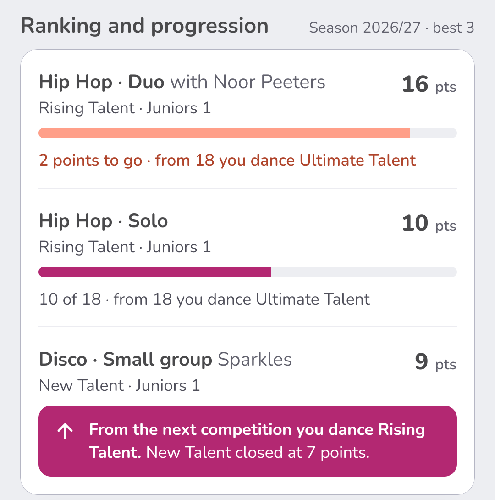
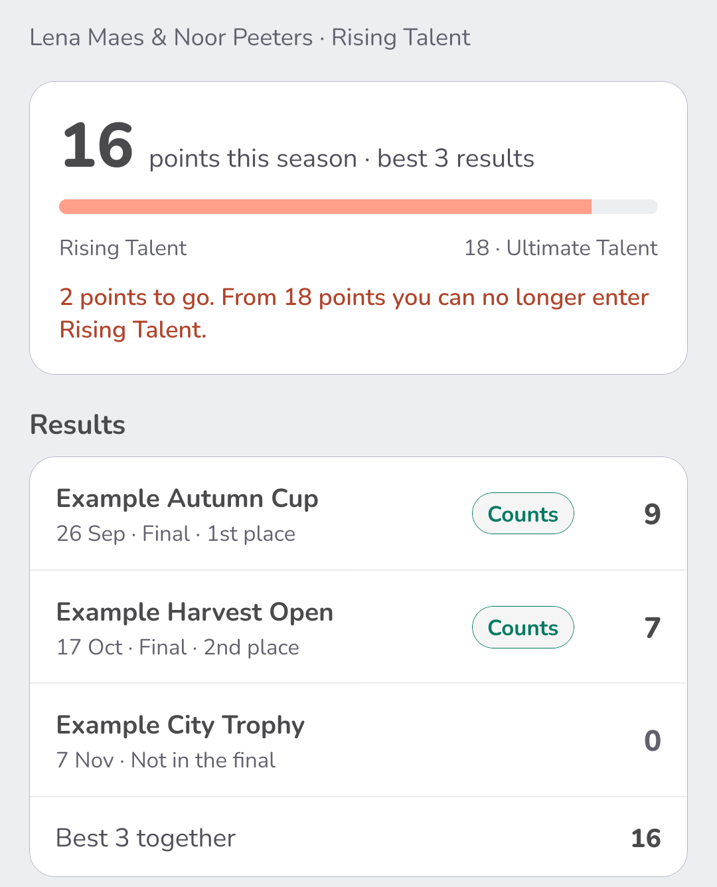
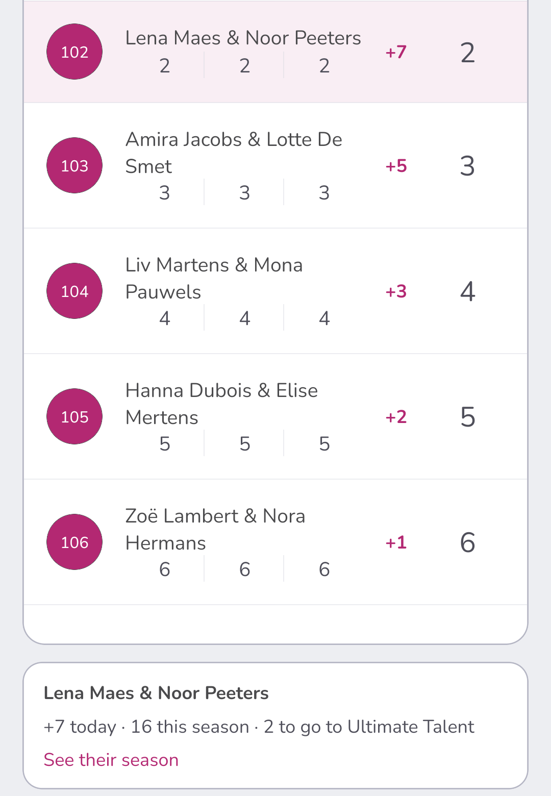
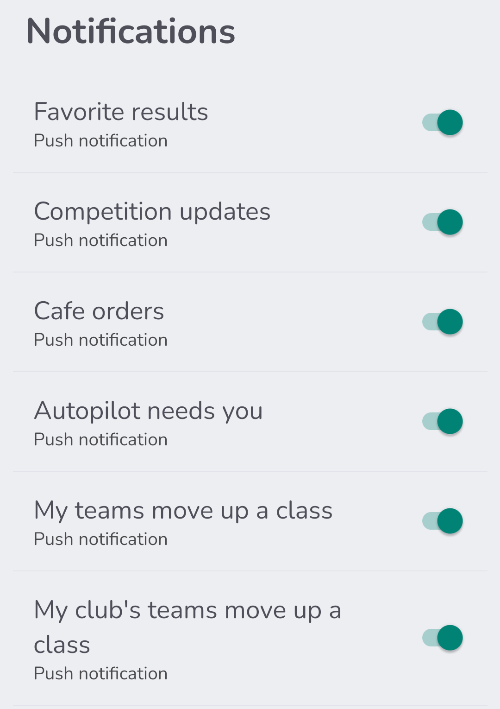

# Your season points in the app

> **Does this apply to you?** Only if your federation closes a class once a team has earned enough points in a season. Ask your federation or club if you are not sure.

In some federations a team earns points with its results, and once it has enough points in a season it can no longer enter its class and dances one level up. The Vote4Dance app shows you where each of your teams stands: how many points it has, how far it is from the next limit, and which results the points come from. When a team reaches a limit, you get a message.

How the federation sets the limits is on [Closing a class at points](/federation/class-point-limits/).

Season points are not the same as promotion points. Promotion points are added when the organizer closes a competition, and move a couple up when it reaches the points limit of its class: see [Results, points and rankings](/dancer/creating-and-getting-a-ranking/). A federation can use one, both or neither.

## See where your teams stand

1. Open the **Profile** tab.
2. Tap **View your public profile**.
3. On **Overview**, scroll to **Ranking and progression**.

Each row is one team in one discipline and category, for example **Hip Hop · Duo** with your partner's name. Under it you see the class level and age group, and on the right the team's points this season. At the top, **Season 2026/27 · best 3** tells you which season it is and how many of the team's best results count.

The bar under each row fills towards the next limit. The line under the bar says what it means:

| What you see | What it means |
|---|---|
| **10 of 18 · from 18 you dance Ultimate Talent** | The team has 10 points. At 18 it moves up to Ultimate Talent. |
| **2 points to go · from 18 you dance Ultimate Talent** | The team is close to the limit. |
| **From the next competition you dance Rising Talent.** New Talent closed at 7 points. | The team has reached the limit. From its next competition it dances the level above. |

A team's own screen, under **Teams**, shows the same card for that team.

If you also dance in a federation that moves dancers up at a points total, such as a West Coast Swing registry, that row shows under **Other federation**. It reads, for example, **May move up to Intermediate · moves up at 16 points**: you may already enter the higher level, and at 16 points you must.

## See the results behind the points

Tap a row to open the team's season.

1. At the top you see the team's points, the bar, and how far it is to the limit, for example **2 points to go. From 18 points you can no longer enter Rising Talent.**
2. Under **Results** each competition is listed with its date, how far the team got (for example **Final · 2nd place**, or **Not in the final**) and the points it earned.
3. Results marked **Counts** are the ones added up. When only the best results count, the others have no mark.
4. **Best 3 together** at the bottom is the team's total.

Good to know:

- Points from a competition count once its results are public. That is when the organizer closes the competition, or earlier if the organizer publishes results while the competition runs. The app says "Points from a competition count once its results are published."
- A new partner starts again at 0.
- Everyone starts again at 0 when a new season begins, unless your federation's points never expire.

## Points in the class results

When you open a class's results in the app, each team's place is followed by the points it earned there, for example **+7**. The points only show for classes that give season points.

The teams you dance in, your children's teams and the teams you follow are highlighted. Teams you follow are marked **followed**. Under the list, each of those teams has a line such as **+7 today · 16 this season · 2 to go to Ultimate Talent**. Tap **See their season** to open the team's season.

## When a team moves up

When a competition's results are public and one of your teams has reached a limit, you get a message on your phone, for example:

> **Your duo moves up to Ultimate Talent**
> Lena & Noor now have 18 points. From the next competition you dance Ultimate Talent in Hip Hop Duo.

- Every dancer in the team gets it, and so do the parents who manage a dancer's account in a [family](/dancer/family/).
- The club's coaches get one message for all the club's teams that moved up at that competition, for example **2 of your teams move up**.
- You get it once for each limit a team reaches. A team with a new partner gets it again when the new team reaches a limit.
- Tap the message to open the team's season.

Entries you made before the team reached the limit stay. Only new entries follow the limit.

## Turn the messages off

In the app:

1. Open the **Profile** tab and tap **Settings**.
2. Tap **Notifications**.
3. Switch off **My teams move up a class** to stop the messages about your own and your children's teams.
4. Coaches: switch off **My club's teams move up a class** to stop the club's messages.

On the website, open **My account** and choose **Notification Preferences**. The same two switches are there.

## Who can see your points

- You, your partner and your team always see the team's points.
- Parents who manage a dancer's account see them too.
- Your club's coaches and managers see the points of the club's dancers.
- The federation sees every team's points.
- Anyone else sees them only when the federation publishes its season ranking, and then only from results that are already published.

## If something looks wrong

| What you see | What to do |
|---|---|
| A result is missing | The competition's results are not public yet. They are at the latest when the organizer closes the competition, which can be some days after the event. Points count from then on. |
| The points do not match what you expected | Tap the row and check which results count. If a result is wrong, ask your federation. |
| You cannot find **Ranking and progression** | You need to be signed in, and your federation needs to use season points. |
