# Registering your dancers for an event

For club administrators and coaches. When you have followed the steps, your club's competitors
are entered in their classes, and you can follow, pay and change every entry from one list.

**You need the club's Coach role or higher.** Members cannot register on the club's behalf.

## Register a competitor

1. Open the event on vote4dance.com and go to its **Registration** tab. Sign in if you are asked
   to.
2. Under **Participant**, open the **As coach** tab.
3. In **Search organization**, choose your club.
4. In **Select competitors**, choose who you are registering. Not in the list yet? Press
   **Create competitors** at the bottom of the list. See
   [Setting up competitors](#setting-up-competitors).
5. Press **Add** next to each class. The class list shows whether the competitor may enter each
   class, and the reason if it may not. If a window asks for details, fill them in.
6. Do steps 4 and 5 again for every competitor. Everything collects in the cart, the box called
   **Registration**.
7. Press **Pay now** in the cart and pay. If the event does not take payment on this page, or
   the organizer approves entries first, the button says **Send registration** instead.
8. You land on your club's **Registration** list, with the event open. Check the status of each
   entry. **Only Approved entries dance.**

Dancers can also register themselves. Those entries show up in the club's list too. The dancers'
own guide is [Registering for an event](/dancer/registration-for-event/). Send it to members who
register themselves.

## How it fits together

| What | Where | Who |
|---|---|---|
| **Competitors** (couples, groups, formations) | `Organization → Administration → Competitors` | Coach and up |
| **New registrations** | The event's own registration page | Coach and up, or the dancers themselves |
| **Your club's entries, payment and cancelling** | `Organization → Administration → Registration` | Coach and up |
| **Confirming who dances on the day** | **Organization check-in**, when the organizer opens it | The person the club has agreed on, for example the team leader |

## Setting up competitors

A competitor is what you register: a couple, a group or a formation. You set it up once and use
it again at every event.

You can create one while you register, with **Create competitors** under **As coach**, or
beforehand on the **Competitors** screen (`Organization → Administration → Competitors`).

- **Couples** can be created by the dancers themselves, or by you. A couple is normally
  independent, not owned by the club. If you give it a custom name when creating it, you can
  choose to make the club its owner.
- **Solo dancers** create their own competitor. You cannot create one for a member:
  **Create competitors** needs at least two dancers before you can save. The member opens the
  event's **Registration** tab, stays on **As myself**, presses **Create competitor** and then
  **Save changes**. See
  [Registering on your own](/dancer/registration-for-event/#registering-on-your-own-solo). A
  parent does it from the child's account.
- **A member's solo competitor is in your list.** Once it exists and the member's membership in
  your club is approved, it shows under **Select competitors** on **As coach**, like the couples
  of your members, and you can register it. It is left out when the event has no open class for
  one dancer, or when those classes may only be registered by the dancers themselves.
- **Groups and formations** are created by the club. Keep **Owned by organization** ticked: a
  group must be owned by the club. Only the club's coaches, managers and administrators can then
  change or cancel it.
- To add a dancer, use **Search by name or email**: it finds your club's members.
- A dancer who has no account yet can be added by typing their email address and creating an
  account for them.
- Set **Dance role** (leader or follower) for couples and trios. Some federations require it at
  registration.

See [Competitors](/school-club/club-admin/#competitors) for every field.

## Checking each dancer is ready

Before registration closes, for every dancer you enter:

- their license is **Active**, if the federation requires one. See
  [Getting a license](/school-club/getting-a-license/).
- their birth date is on their account.
- the class is right for this season. Age groups and classes can change between seasons. See
  [Class and age moves](/school-club/class-transfer/).
- if the event asks which club the dancer represents, they have an approved membership in your
  club.

## Fitting a team's lineup to a class

A team does not have to dance with everyone on it. Where the class allows lineup changes, you can
skip or replace dancers for one competition:

- A group with backup dancers can skip them for this competition to fit a class.
- A class that a lineup change can fix, such as a dancer who is too old, is offered with the hint
  "Edit the lineup in the cart before registering". In the cart, a refused entry says why and has
  an **Edit lineup** button.
- A replacement dancer takes over the dance role of the dancer they replace.
- A skipped dancer is not part of the entry: they get no confirmation e-mail or check-in QR code
  for it, the check-in desk does not let them in as dancing in it, and it is not listed for them.
  A replacement dancer gets all of these instead. A dancer you skip is not charged for the class.

**The rules are checked on the lineup that dances**, with the team's skipped and replacement
dancers applied. This covers the federation's rules and licenses and the organizer's own class
and period rules (age, team size, dance roles). They are checked again when the registration is
sent, not only on the page.

The organizer's staff and check-in stations can still register a team outside the organizer's
class and period rules.

## Following up and paying

`Organization → Administration → Registration` lists your club's entries per event, with status
and payment.

- **Only Approved entries dance.** Preliminary means the organizer has not accepted it yet.
- **To sign** lists entries your members registered that wait for your signature. See [Signing your members' entries](#signing-your-members-entries).
- **Get cost** shows the price. **Pay now** pays online, when the event takes online payment.
  Once paid, the registration is final. With manual payment you see the amount and the
  organizer's payment details instead.
- When the club pays, the payment is billed to the club, and the club gets a receipt and an invoice.
  Find your paid invoices under **View invoice**.
- The receipt or invoice the club gets after paying has one line per team or dancer. Each line
  names the team, its dancers and its classes, so you can match every amount to a team.
- **Edit lineup** changes the dancers while the period is open. Some events lock the lineup once
  paid. The new lineup is checked against the federation rules again. Where the federation counts your
  club's dancers, a swap is free and an extra dancer is paid for: see
  [Changing a group's lineup after paying](#changing-a-groups-lineup-after-paying).
- **Change class**, the swap icon next to **Edit lineup**, moves an entry to another class while the
  period is open. See [Moving an entry to another class](#moving-an-entry-to-another-class).

See [Registration](/school-club/club-admin/#registration) for every column and button.

### Signing your members' entries

Some events ask the organization to sign the entries its dancers register themselves. When the organizer has switched this on, a dancer's entry waits for your organization: it does not count, and nothing is paid, until a coach, manager or administrator signs it. You can also have the organization pay all the signed entries together, in one payment.

Open `Organization → Administration → Registration` and the event's card. The top of the list shows **To sign (n)** with every entry that waits for you: the class, the dancers, when they registered and the price. The card also says when to sign by: **Sign before registration closes on …**. The organizer may also send you an email reminder to sign.

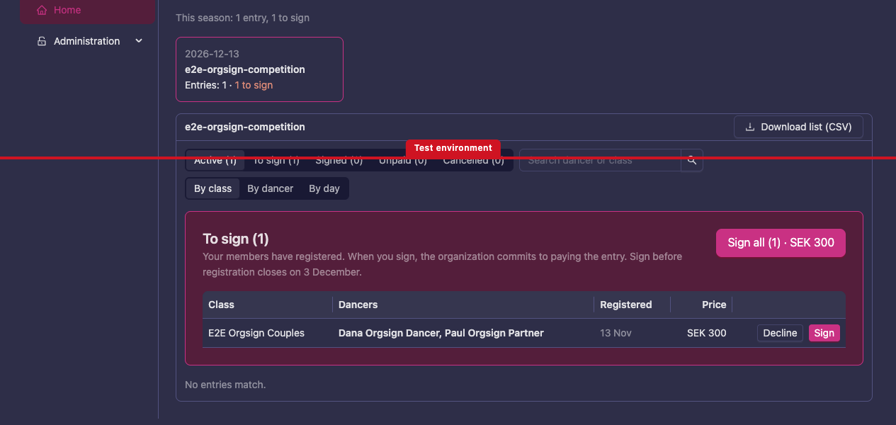

**Sign one entry or all of them**

1. Check the class and the dancers on the row.
2. Press **Sign** to sign that entry, or **Decline** to refuse it.
3. To sign everything at once, press **Sign all (n)**. The button shows the total when the event takes payment.
4. In the confirmation, for example **Sign 1 entry?**, read what the organization commits to, and press **Sign** (**Sign 1** for a single entry). **Cancel** stops.

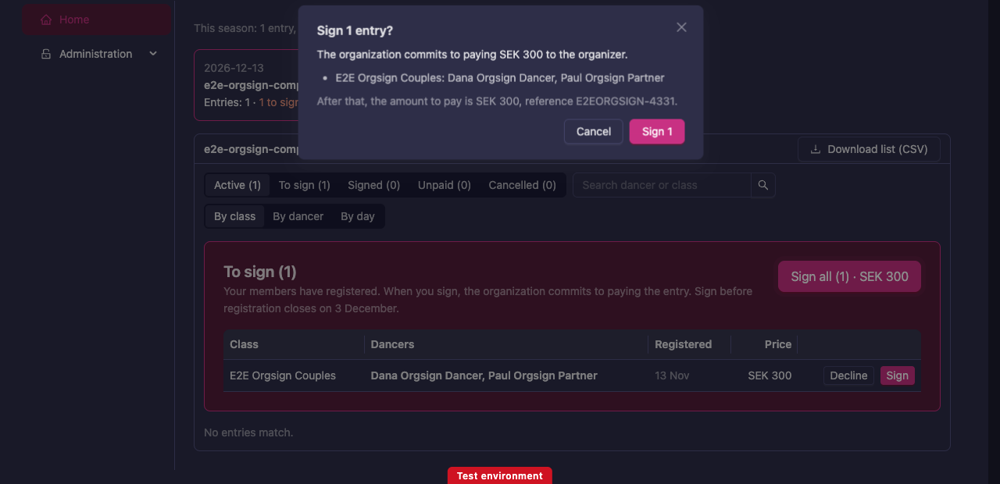

**Decline an entry.** Press **Decline** and confirm **Decline the entry in …?**. The entry is withdrawn, and its dancers get an email asking them to contact the organization. It moves to **Declined** at the bottom of the list, tagged **Declined by the organization**. Declining cannot be undone from here: if it was a mistake, the dancers register again, and you sign the new entry. An entry that is already paid cannot be declined, because the organizer has the money: ask the organizer to withdraw it and refund the payment.

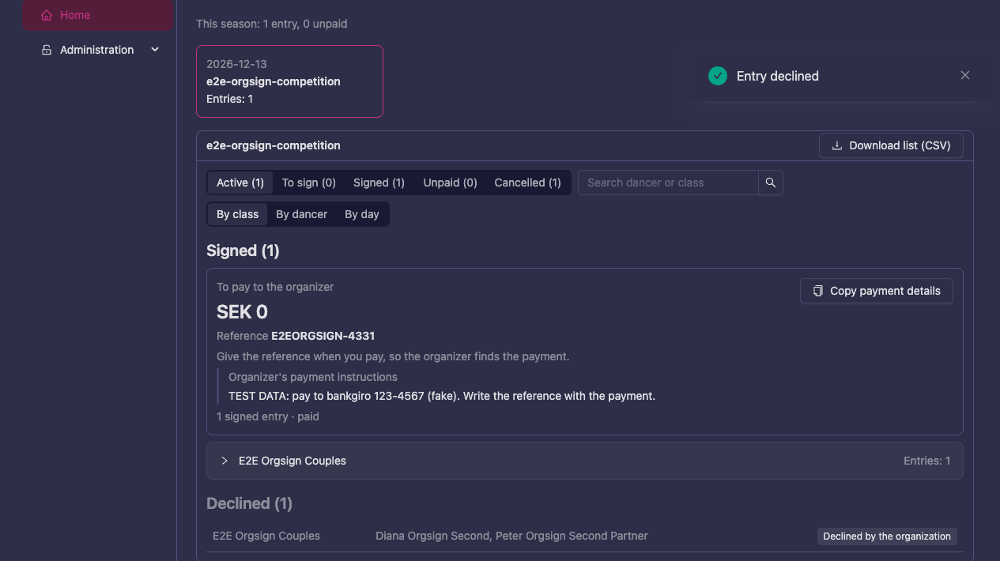

**What happens next depends on how the organizer takes payment.** The text above the list says which:

- **Online payment, the organization pays:** the button is **Sign and pay** with the amount. You pay by card in the next step. A receipt and an invoice are sent to the organization. Payment alone approves the signed entries. Afterwards the list says how many signed entries are paid by card.
- **Manual payment, the organization pays:** after you sign, **Signed** shows a payment card with **To pay to the organizer**, the amount, a **Reference** (your organization's short name and the event number) and the **Organizer's payment instructions**. Pay the organizer as described and give the reference, so the organizer finds the payment. Press **Copy payment details** to copy the amount, reference and instructions. The card keeps count: for example **1 signed entry · SEK 0 paid so far**. The organizer marks you as paid when the money has arrived, and the entries become **Approved**.
- **Each dancer pays:** you only sign. The page says **The dancers pay themselves once you have signed.**

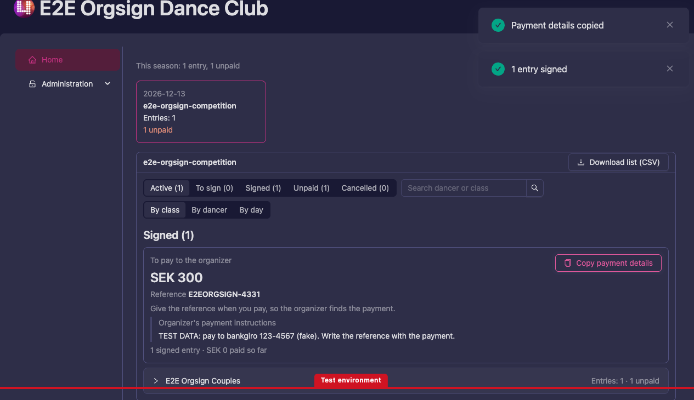

When a dancer registers with no organization, nothing waits for you. Those dancers skip signing and pay themselves.

### Moving an entry to another class

If a dancer or team is in the wrong class, you do not have to cancel and register again: until
registration closes you can move the entry to another class.

1. Open `Organization → Administration → Registration` and click the event's card.
2. Find the entry and press **Change class**, the swap icon next to **Edit lineup**.
3. Pick the class to move to.
4. Press **Change class** again, or **Keep current class** to stop.

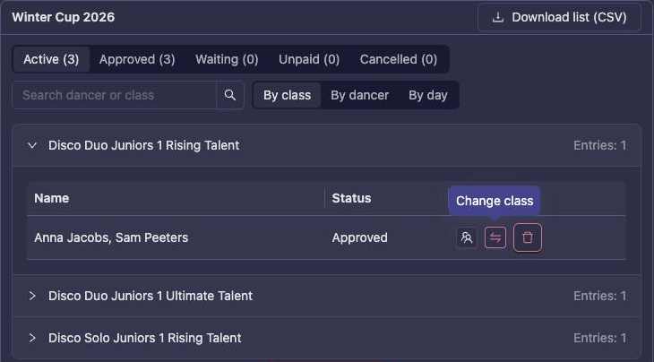

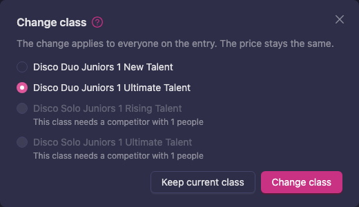

*Anna and Sam's duo moves from Rising Talent to Ultimate Talent, and both of them move. The solo
classes are greyed out: a duo cannot dance them.*

What you can move to:

- **Classes that open for registration together with the entry's class**, for example the other
  levels of the same group of classes. They cost the same, so nothing is charged and nothing is
  refunded. The entry keeps its status and its payment.
- **Only classes the entry may dance.** The new class's rules are checked as for a new
  registration: age, level, license and team size. A class the entry does not qualify for is greyed
  out with the reason.
- **Not a class the team is already in.**
- **Not a class only the competitors themselves may register**, unless your club owns the team. It
  is greyed out; the competitors can move there from **My registration**.

Everyone on the entry moves to the new class.

The **Change class** button is missing when:

- **Registration has closed.** Ask the organizer.
- **The organizer has already put the entry on the start list**, or the entry has lineup changes
  for its class, for example a skipped or replaced dancer. Ask the organizer.
- **There is no other class to move to.** A class that is registered separately, with its own
  price, is not offered: cancel the entry and register again instead. Cancelling does not refund
  anything.
- **The entry's class may only be registered by the competitors themselves**, and your club does not
  own the team. The competitors change it from **My registration**.

## Cancelling

Cancel from the **Registration** list while the entry's registration period is open, and the entry
is Preliminary, Signed or Approved. A club-owned competitor can only be cancelled by the club's
coaches, managers and administrators. After the period closes,
[ask the organizer](/getting-help/#reaching-the-organizer).

1. Press the cancel button on the entry.
2. Check the class named in **Withdraw from …?** and press **Withdraw**, or **Keep it** to stop.

Everyone on the entry gets an email confirming it. Cancelling does not refund anything: if the
entry is paid, the confirmation says so, and the organizer decides on refunds and makes them from
Manager.

## Confirming who dances on the day

Some organizers use **Organization check-in**. Your club then tells the organizer which of its
entries dance, and signs. Agree beforehand who in the club does it.

The person who does it signs in with their own Vote4Dance account. When the club's entries were
registered through Vote4Dance, that account must be tied to the club in this competition:

- a dancer on one of the club's entries,
- an approved member of the club, or
- the person who registered the entries.

Next to each club, the list shows who signed and when, and the organizer also sees the phone
number that person typed.

1. Open the event on vote4dance.com while the organizer's check-in window is open. On the event's
   **Overview**, under **Check-in**, it says **Checkin is open**. Press the **Check-in** button
   there.
2. Open your club in the list.
3. For each entry, press **Participating** or **Cancelled**. On a phone these are a check mark and
   a cross. **Cancelled** asks you for a reason. **Mark all** sets every entry to
   **Participating**.
4. Press **Sign**, type your phone number, and press **Sign** again. **Sign** only works when
   every entry has a status.

What happens when the organizer applies the check-in:

- **Entries you marked Cancelled and signed for are cancelled**, even if the dancers are in the
  hall.
- Entries you marked **Participating** are not changed.
- **If your club has not signed, applying the check-in does not cancel its entries.** An entry
  whose dancers come from two clubs is still cancelled if the other club marks it **Cancelled**
  and signs.

Sign in good time anyway: the organizer and the check-in desk see which clubs have signed.

Marked the wrong entry? While the check-in window is open and the organizer has not applied the
check-in, press **Unlock**, change it and sign again. After that, talk to the organizer.

## If something is wrong

To reach the organizer, see [Reaching the organizer](/getting-help/#reaching-the-organizer).

| What you see | What it means | What to do |
|---|---|---|
| Your club is not in **Search organization** | The list only has clubs where you are an approved coach, manager or administrator. | Ask an administrator of your club for the Coach role. See [Permissions](/school-club/club-admin/#permissions). |
| A competitor is not in **Select competitors** | The list only has your club's competitors whose size fits a class that is open for registration. | Check the team size the classes ask for, or press **Create competitors**. |
| A solo dancer is not in **Select competitors** | The member has no solo competitor yet, their membership in your club is not approved, or the event has no open class for one dancer that a club may register. | Ask the member to create their competitor under **As myself**: see [Setting up competitors](#setting-up-competitors). Approve the membership under **Members**. |
| A class is missing or locked for a competitor | A rule stops this competitor: license, age, dance role or team size. A class the team is too big for is not shown. | Read the reason in the class list. |
| "Edit the lineup in the cart before registering" | A lineup change can make the team fit the class. | Add the class, then use **Edit lineup** in the cart to skip or replace the dancers who do not fit. |
| A dancer's license is Pending | Pending does not count. | See [Getting a license](/school-club/getting-a-license/). |
| "Independent competitors can have at most 2 members" | A team with more than two dancers must be owned by a club. | Create the group with **Owned by organization** ticked. |
| "This team does not belong to a club, and only club teams can enter this class." | The team is independent, even if its dancers are club members. | Under **As coach**, choose your club, create the team there with **Owned by organization** ticked (see [Setting up competitors](#setting-up-competitors)) and register that team. |
| **A dancer in this team is already in …** | Your federation lets each dancer dance one class per category (solo, duo…): one age group and one level. One of the team's dancers is already in another class of that category, registered or in the cart. The same check applies when you add a dancer to a registered team or bring one in with **Edit lineup**. | Enter the dancer in one class of the category only. See [One class per category](/dancer/registration-for-event/#one-class-per-category). |
| **This team is already in …** | Your federation lets each group or formation dance one class per category. The team is already in another class of that category; its dancers may still dance in your other teams, in any class. | To switch, remove or withdraw the other class first. |
| An entry is in the wrong class | You do not have to cancel and register again. | Press **Change class** on the entry while the period is open, and pick the right class. If the class you want is not offered, it is registered separately: cancel the entry and register again. After registration closes, ask the organizer. See [Moving an entry to another class](#moving-an-entry-to-another-class). |
| The lineup must change after registering | You can change it yourself while the period is open. | **Edit lineup** while the period is open. After that, ask the organizer. If the federation counts your club's dancers, a swap is free and a new dancer is paid for: see [Changing a group's lineup after paying](#changing-a-groups-lineup-after-paying). |
| A member says the entry is **Waiting for the organization** | The organizer has your club sign the entries its members register. | Open the event on your **Registration** list and sign it under **To sign**. See [Signing your members' entries](#signing-your-members-entries). |
| "This account is not tied to this organization in this competition, so it cannot check it in…" when you press **Participating**, **Cancelled**, **Sign** or **Unlock** | Your account is not a dancer on one of the club's entries, an approved member of the club or the person who registered the entries. | Sign in with such an account, or ask the check-in desk to check the club in. See [Confirming who dances on the day](#confirming-who-dances-on-the-day). |
| An entry was cancelled on the day | It was marked **Cancelled** at Organization check-in and signed for, or the organizer cancelled it. | Talk to the organizer straight away. See [Confirming who dances on the day](#confirming-who-dances-on-the-day). |

## Rules that depend on your federation

The class list always shows what applies to the competitor you picked. These rules only exist
under some federations:

- **Who may register.** Some federations only let the club register a competitor, or only a
  member of the team. The class list says so.
- **Team size.** Classes the team is too big for under the federation's rules stay hidden: the
  team's size decides whether it is a small group or a formation.
- **One class per category.** Some federations let a dancer, or a team, dance only one class of a
  category at an event. See
  [One class per category](/dancer/registration-for-event/#one-class-per-category).
- **Lineup changes after paying.** Some federations count your club's dancers instead of charging
  for every change. See the section below.

### Changing a group's lineup after paying

Some federations let a club change the dancers of a small group or formation without paying again,
as long as the club does not have more dancers than it has paid for. Your federation's rules say
whether this applies. It works for club-owned teams in a registration period where each dancer pays
once, however many classes they dance in.

What this means for your club:

- **Until registration closes, you can swap dancers for free.** Change who dances in a paid group,
  and nothing is charged as long as your club's number of different dancers in that period stays at
  or below the number you have paid for.
- **A paid place stays with your club.** If a dancer leaves, you get no refund, but the place is
  yours and can go to another dancer later, in the same group or another one.
- **A new dancer above that number is paid for.** You pay the period's price for each extra dancer,
  and the lineup is saved when the payment has come through.
- **It only covers changes to groups that are already registered.** A new group pays as usual.
- **After registration closes, your club can no longer change the lineup.** Ask the organizer. The
  organizer can make the change, and the place you paid for stays with your club.

*Example:* your club has paid for 4 dancers in the period: Crazy Stars with Rosa and Noor, and
Bright Lights with Sam and Lena. Replacing Rosa with Olivia is free: your club still has 4
different dancers. Adding Mila to Crazy Stars would make 5, so you pay for one more dancer. Replace
Rosa with Mila instead, and it is free again.

To change a lineup:

1. Open `Organization → Administration → Registration` and click the event's card.
2. Find the entry and press **Edit lineup**.
3. Use **Skip** to leave a dancer out, **Replace** to swap a dancer for another member, or
   **Add dancer** to bring in one more. **Add dancer** only shows when your federation's rule is on.

   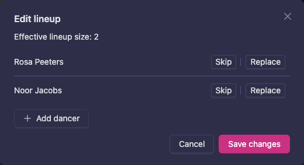

4. After **Add dancer**, **Pick a dancer to add** lists your club's approved members. Choose one.

   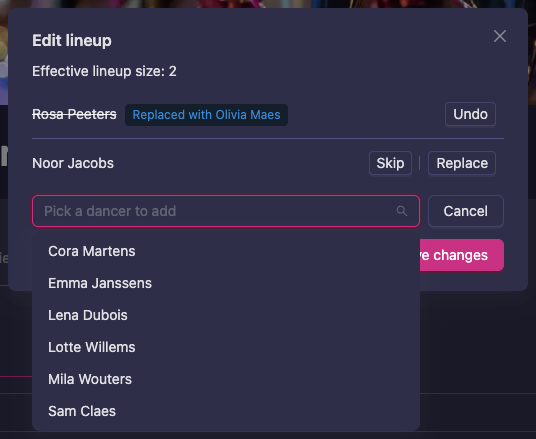

   The dancer is marked **Added**. A replaced dancer shows **Replaced with** and the new name. Press
   **Undo** next to a change to take it back.

   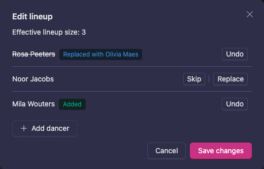

5. Press **Save changes**. If your club stays at or below the dancers it has paid for, the lineup is
   saved and you are done.
6. If the change takes your club above that number, a pop-up **Pay for 1 new dancer** opens. It
   says how many dancers your club will have, how many it has paid for, who is new, and the price.
   Check it and press the pay button, which shows the amount, for example **Pay EUR 10.00**. You
   pay by card or another method Stripe offers. If the organizer put in a dancer your club has not
   paid for yet, the pop-up includes that dancer too.

   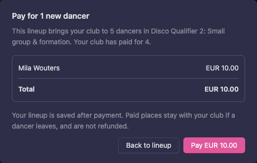

7. When you are back, **Lineup saved** confirms the payment and the dancers who are now in the
   lineup. Press **Done**.

   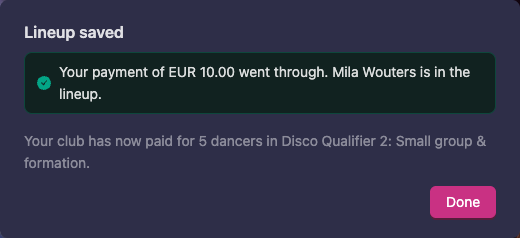

If you press **Back to lineup** in the pop-up, nothing is paid and nothing is saved.

**If you cancel the payment.** Leave Stripe's page without paying and you come back to **Edit
lineup** with the changes you were making and the note "Payment cancelled". Your saved lineup has
not changed. Press **Save changes** to try again, or **Cancel** to leave it as it was.

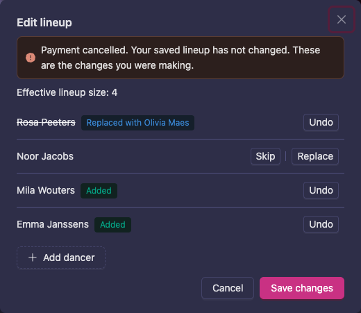

**If the payment takes longer.** Some payment methods take a few days. You see "Your payment is on
its way": your lineup has not changed yet, but the place stays with your club. When the payment has
come through, open **Edit lineup** and save the same changes again. It costs nothing more. If you
see "Please make your lineup change again", open **Edit lineup** and make the changes once more.
If your payment went through, it costs nothing extra.

**If registration closes while you pay.** You see "Registration closed while you paid". The payment
went through, but the lineup is not changed. Contact the organizer and name the dancers. The
organizer can make the change, and your club keeps the place you paid for.
