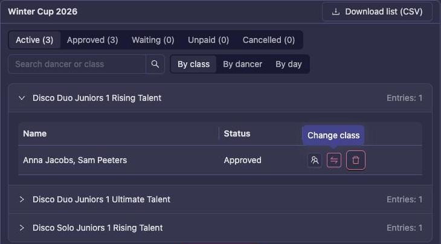
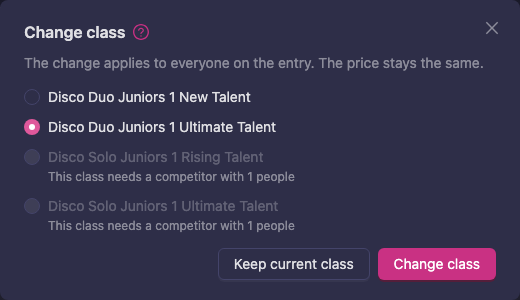

# Registering your club's dancers for an event

A club can register its own competitors, pay for them, and follow every entry from one list.
Dancers can also register themselves; those entries show up in the club's list too.

**You need the club's Coach role or higher.** Members cannot register on the club's behalf.

## How it fits together

| What | Where | Who |
|---|---|---|
| **Competitors** (couples, groups, formations) | `Organization → Administration → Competitors` | Coach and up |
| **New registrations** | The event's own registration page | Coach and up, or the dancers themselves |
| **Your club's entries, payment and cancelling** | `Organization → Administration → Registration` | Coach and up |
| **Confirming who dances on the day** | **Organization check-in**, when the organizer opens it | The club |

## Step 1: Set up the competitors

A competitor is what you register: a couple, a group or a formation.

- **Couples** can be created by the dancers themselves, or by you on the **Competitors** screen.
  A couple is normally independent, not owned by the club. If you give it a custom name when
  creating it, you can choose to make the club its owner.
- **Groups and formations** are created on the **Competitors** screen. Keep **Owned by
  organization** ticked: a group must be owned by the club. Only the club's coaches, managers and
  administrators can then change or cancel it.
- A dancer who has no account yet can be added by typing their email address and creating an
  account for them.
- Set **Dance role** (leader or follower) for couples and trios. Some federations require it at
  registration.

See [Competitors](/school-club/club-admin/#competitors) for every field.

## Step 2: Check each dancer is ready

Before registration closes, for every dancer you enter:

- their licence is **Active**, if the federation requires one. See
  [Getting a license](/school-club/getting-a-license/).
- their birth date is on their account.
- the class is right for this season. Age groups and classes can change between seasons. See
  [Age transfer](/school-club/age-transfer/) and [Class transfer](/school-club/class-transfer/).
- if the event asks which club the dancer represents, they have an approved membership in your
  club.

## Step 3: Register

Open the event's registration page and pick the competitor and the class. The class list shows
whether each competitor may enter, and the reason if it may not.

Some federations only let the club register a competitor, or only a member of the team. The class
list says so.

**The rules are checked on the lineup that dances**, with the team's skipped and replacement
dancers applied. This covers the federation's class rules and licences and the organizer's own class
and period rules (age, team size, dance roles), and they are checked again when the registration is
sent, not only on the page. So:

- A group with backup dancers can skip them for this competition to fit a class.
- A class that a lineup change can fix, such as a dancer who is too old, is offered with the hint
  "Edit the lineup in the cart before registering", where the class allows lineup changes. In the
  cart, a refused entry says why and has an **Edit lineup** button.
- A replacement dancer takes over the dance role of the dancer they replace.
- A skipped dancer is not part of the entry: they get no confirmation e-mail or check-in QR code
  for it, the check-in desk does not let them in as dancing in it, and it is not listed for them.
  A replacement dancer gets all of these instead. A dancer you skip is not charged for the class.
- Classes the team is too big for under the federation's rules stay hidden: the team's size decides
  whether it is a small group or a formation.

The organizer's staff and check-in stations can still register a team outside the organizer's
class and period rules.

The dancers' own guide is [Registering for an event](/dancer/registration-for-event/). Send it
to members who register themselves.

## Step 4: Follow up and pay

`Organization → Administration → Registration` lists your club's entries per event, with status
and payment.

- **Only Approved entries dance.** Preliminary means the organizer has not accepted it yet.
- **Get cost** shows the price. **Pay now** pays online, when the event takes online payment.
  Once paid, the registration is final. With manual payment you see the amount and the
  organizer's payment details instead.
- If the organizer invoices the club, the invoice appears under **Pay your registrations**.
- The receipt or invoice the club gets after paying has one line per team or dancer. Each line
  names the team, its dancers and its classes, so you can match every amount to a team.
- **Edit lineup** changes the dancers while the period is open. Some events lock the lineup once
  paid. The new lineup is checked against the class rules again.
- **Change class**, the swap icon next to **Edit lineup**, moves an entry to another class while the
  period is open. See [Moving an entry to another class](#moving-an-entry-to-another-class).

See [Registration](/school-club/club-admin/#registration) for every column and button.

### Moving an entry to another class

If a dancer or team is in the wrong class, you do not have to cancel and register again: until
registration closes you can move the entry to another class.

1. Open `Organization → Administration → Registration` and click the event's card.
2. Find the entry and press **Change class**, the swap icon next to **Edit lineup**.
3. Pick the class to move to.
4. Press **Change class** again, or **Keep current class** to stop.

*Anna and Sam's duo moves from Rising Talent to Ultimate Talent, and both of them move. The solo
classes are greyed out: a duo cannot dance them.*

What you can move to:

- **Classes that open for registration together with the entry's class**, for example the other
  levels of the same group of classes. They cost the same, so nothing is charged and nothing is
  refunded. The entry keeps its status and its payment.
- **Only classes the entry may dance.** The new class's rules are checked as for a new
  registration: age, level, licence and team size. A class the entry does not qualify for is greyed
  out with the reason.
- **Not a class the team is already in.**
- **Not a class only the competitors themselves may register**, unless your club owns the team. It
  is greyed out; the competitors can move there from **My registration**.

Everyone on the entry moves to the new class.

The **Change class** button is missing when:

- **Registration has closed.** Ask the organizer.
- **The organizer has already put the entry on the start list**, or the entry has lineup changes
  for its class, for example a skipped or replaced dancer. Ask the organizer.
- **There is no other class to move to.** A class that is registered separately, with its own
  price, is not offered: cancel the entry and register again instead. Cancelling does not refund
  anything.
- **The entry's class may only be registered by the competitors themselves**, and your club does not
  own the team. The competitors change it from **My registration**.

## Step 5: Confirm your roster on the day

The organizer opens an **Organization check-in** window, and the club confirms which of its teams dance and
signs. **Teams the club has not confirmed are cancelled** when the organizer applies the check-in,
even if the dancers are in the hall. Agree beforehand who in the club does it.

## Cancelling

Cancel from the **Registration** list while the entry's registration period is open, and the entry
is Preliminary, Signed or Approved. A club-owned competitor can only be cancelled by the club's
coaches, managers and administrators. After the period closes, ask the organizer.

1. Press the cancel button on the entry.
2. Check the class named in **Withdraw from …?** and press **Withdraw**, or **Keep it** to stop.

Everyone on the entry gets an email confirming it. Cancelling does not refund anything: if the
entry is paid, the confirmation says so, and the organizer decides on refunds and makes them from
Manager.

## Common problems

| Problem | Fix |
|---|---|
| A class is missing or locked for a competitor | Read the reason in the class list: licence, age, dance role or team size. A class the team is too big for is not shown. |
| A class says "Edit the lineup in the cart before registering" | Add it, then use **Edit lineup** in the cart to skip or replace the dancers who do not fit. |
| A dancer's licence is Pending | Pending does not count. See [Getting a license](/school-club/getting-a-license/). |
| "Independent competitors can have at most 2 members" | Create the group on the **Competitors** screen with **Owned by organization** ticked. |
| A group class is locked with "This team does not belong to a club, and only club teams can enter this class." | The team is independent, even if its dancers are club members. Under **As coach**, choose your club, create the team there with **Owned by organization** ticked (see [Step 1](#step-1-set-up-the-competitors)) and register that team. |
| A class says **A dancer in this team is already in …** | Your federation lets each dancer dance one class per category (solo, duo…): one age group and one level. One of the team's dancers is already in another class of that category, registered or in the cart. The same check applies when you add a dancer to a registered team or bring one in with **Edit lineup**. See [One class per category](/dancer/registration-for-event/#one-class-per-category). |
| A class says **This team is already in …** | Your federation lets each group or formation dance one class per category. The team is already in another class of that category; its dancers may still dance in your other teams, in any class. To switch, remove or withdraw the other class first. |
| Wrong class | Press **Change class** on the entry while the period is open, and pick the right class. If the class you want is not offered, it is registered separately: cancel the entry and register again. After registration closes, ask the organizer. See [Moving an entry to another class](#moving-an-entry-to-another-class). |
| The lineup must change after registering | **Edit lineup** while the period is open. After that, ask the organizer. |
| An entry was cancelled on the day | The club did not confirm it at check-in. Talk to the organizer. |

## Next step

Continue to [Results, points and rankings](/school-club/creating-and-getting-a-ranking/).
