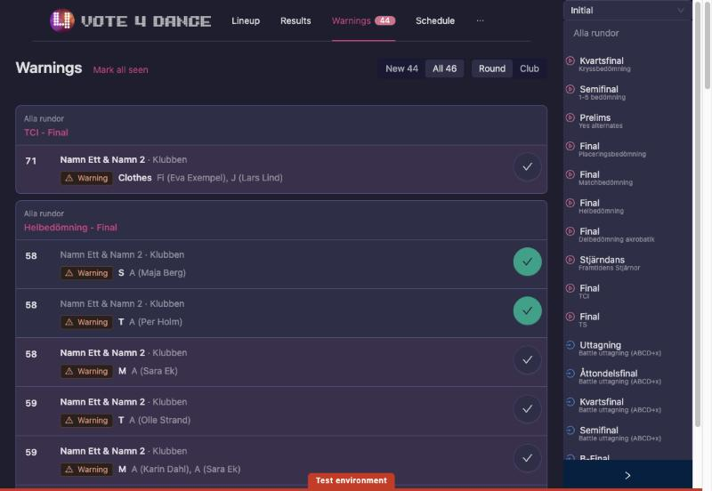
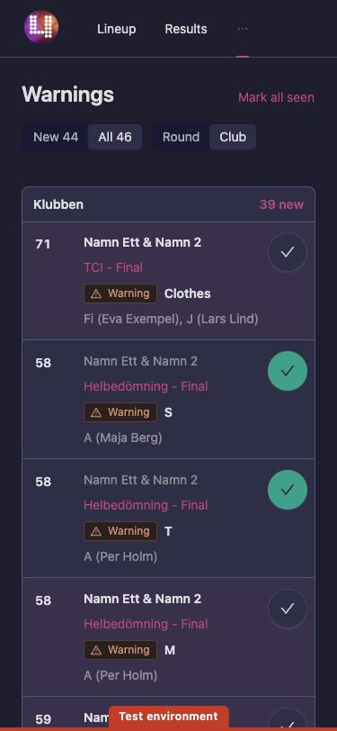
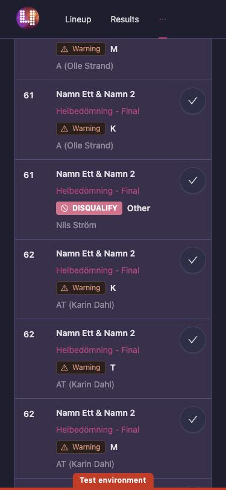
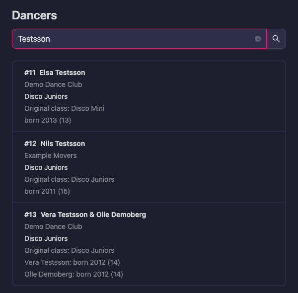
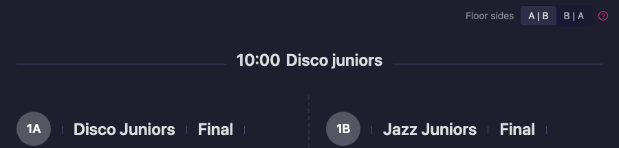

# Scrutineer

**You are a scrutineer if** you are responsible for the integrity of the judging and the results:
the chief scrutineer at an event, the chairperson of adjudicators, or a federation observer.

To work at an event, somebody with Manager on it has to add you. See
[Getting event access](/scrutineer/registration-for-event/).

## Your app is Supervisor

In Swedish it is called **Kontrollant**. Somebody has to tick **Supervisor** for you under
`Manager → Event → Users` — see [Users, apps and stations](/manager-guide/users-and-stations/).

What it gives you, and what it deliberately does not:

| Supervisor can | Supervisor cannot |
|---|---|
| See the results of rounds that are **not yet published** — which is the whole point: you review before the audience sees anything | Change the setup. Classes, rounds, judges and panels are the organizer's, in Manager |
| See each judge's marks per round, and each participant's **Offset from Average** as a chart, so a judge who is out of line with the panel is visible at a glance | Enter or alter a judge's marks |
| Switch to a **By component** view where the round is judged on components, show all participants, and show the name column | |
| Show **trainee scores**, which are entered but do not affect the result | |
| Follow judging live: *Judging in progress*, *Judges are done* per heat | |
| Filter to one floor, follow the schedule, and push things to the screens with **Show on screen** | |
| See every warning the judges give during the whole event in one list, **Warnings**, and keep track of which ones you have dealt with | |
| Look up any dancer by name or start number under **Dancers**, with their age, original class and rounds | |

**Supervisor cannot publish results.** Publishing is done from the Speaker console or from
Manager. If you are the one who publishes, you also need **Speaker** or **Manager** ticked.
Agree before the event who presses it, and what you want to have checked first.

## Warnings from the judges

During the competition a judge can give a dancer or couple a warning, for example for clothing,
a lift or the music. **Warnings** in the Supervisor app lists all of them, from every round and
every day of the event, so you can follow up with the team leaders without opening round after
round. The list updates by itself as the judges send new warnings.

1. Open **Warnings** in the Supervisor menu. The number next to it is how many warnings you have
   not seen yet on the floor you have chosen.
2. Each row shows the start number, the dancer or couple and their club, the warning and its
   reason, and which judges gave it. When several judges give the same warning, it shows once with
   all their names. Under the name you see the entry's **Original class** and each dancer's year of
   birth with the age they turn this year, for example "born 2012 (14)", so you can check an age
   warning without looking the dancer up.
3. Choose how to read the list:
   - **New** shows only the warnings you have not seen yet; **All** shows every warning.
   - **Round** groups the warnings by round, newest first, under the day and the block of the
     schedule. The round's name opens its results.
   - **Club** groups them by club, with the clubs that have new warnings first, which is handy
     when you go and find a team leader.
   - At an event over several days, pick a day. While the event is running, today is chosen
     for you.
4. When you have dealt with a warning, press the round tick on its row. The row turns grey and the
   tick green. Press it again to mark the warning as new again.
5. **Mark all seen** marks every warning in the list as seen. Press **Undo** if you did not mean
   to. When new warnings come in, **Mark all seen** comes back in its place.

A disqualification stands out from a warning: it has a filled label with a stop sign.

What you have seen is remembered on your phone or computer only. Another scrutineer, or you on
another device, starts with all warnings as new. Two tabs or windows on the same computer share
what you have ticked.

## Looking up a dancer

When you need to check a dancer, most often their age or the class they really belong in, look
them up instead of searching the start lists.

1. Open **Dancers** in the Supervisor menu.
2. Type a name, or part of one, or a start number.

   
3. Each entry that matches shows its start number, the dancers and their club, the class they
   dance in, their **Original class** and each dancer's year of birth with the age they turn this
   year. A withdrawn entry is marked **Withdrawn**.
4. Press an entry to see that dancer's classes and rounds day by day, with the time, the floor and
   their heats. **Back to the search** takes you back.

The **Original class** is the class the entry was made in. It differs from the class danced when
classes have been combined, for example two age groups dancing together.

## A split floor, seen from your seat

When a floor is split into halves, such as A and B, the rounds that dance at the same time are
shown side by side on **Lineup** and **Results**, in the order A, B. If you sit on the other side
of the floor, B is on your left: choose **B | A** under **Floor sides** at the top of the page.
The choice is remembered on your phone or computer, so every scrutineer can pick the side they
sit on. **Floor sides** only shows when a split floor is on the page.

## Judge types, which is your vocabulary

Every judge on a panel has a type, and the type decides what their marks do:

| Type | What it means |
|---|---|
| **Judge** | Scores participants in assigned classes; counts toward placements. |
| **Chief judge (in)** | Included in skating/placement: counts in the ranking math, and can be used to break ties. |
| **Chief judge (out)** | Excluded from skating/placement: does not affect the ranking math, but can still be used to break ties. |
| **Trainee judge** | A practice role. Enters scores that do not affect results. |
| **Audience** | Scores from public audience voting; counts toward final placements. |
| **Not judging** | No judging duties assigned. |

If a panel looks wrong in the results, check the types before you doubt the arithmetic.

## What to watch on the day

Manager warns the desk at two moments that concern you directly:

- **Closing a round** — "Warning! All judges have not submitted their results!!"
- **Confirming a round** — "Warning! Some participants share a placement.", and, if no
  advancement has been set, "No targets have been set from the round result."

And **Problems** in Manager runs the structural checks continuously: start-number conflicts,
license conflicts, rounds without judges, group classes with no judges, participants scheduled in
two overlapping rounds at once, finals with participants marked through, leader/follower classes
without exactly one partner class, and the federation-specific rules (DSF, WDSF). Clear it before
the doors open.

## Before results and rankings are final

You do not operate rankings. They follow from the results you have reviewed, in this order:

1. **You review before publication.** Supervisor shows rounds that are not yet published, so
   this is your window.
2. **The organizer publishes the round.**
3. **The organizer closes the competition.** For a federation event, closing identifies each
   couple from its person numbers, registers class memberships, adds the promotion points and
   moves couples that reach their class's limit up a class. See
   [Promotion points](/federation/progression/).
4. **The federation's ranking workflow processes the event.**

Check two things before the competition is closed, because both end up in the rankings:

- **Person numbers.** A wrong person number creates a duplicate couple, with the points split
  between the two.
- **Club tags.** A wrong club tag creates a duplicate club.

If results are corrected after the competition is closed, the organizer sets it to **Closed**
again. That runs the processing again safely.

When the published outcome must differ from the results, that is the federation's decision, not
one for the event day. It is done with
[Manual workflows](/federation-rankings/manual-workflows/). Every manual change records a
reason: write one that another person can check a season later.

## Age and class questions at an event

You do not decide age groups, and you do not move couples between classes. The federation's
rules do, and registration checks them: a dancer or couple that does not fit a class's age group
cannot register for it, and a couple can only register for the class it is in. So a participant
who looks wrong at an event is usually a data problem, not a rule problem.

- Age is counted by **birth year**, for the year the season ends, not by birthday. A federation
  with no season start set counts for the year of the competition.
- For a couple or group, the federation's rules decide whose age counts: for example the oldest
  member, or every member. See [Age category rules](/federation-rules/age-category-rules/).
- At the start of each season the federation moves competitors up an age group in one batch. See
  [Age moves](/federation/age-moves/).
- A couple moves up a class when its promotion points reach the class's limit. The points are
  added up when the organizer closes the competition, so a couple's class can change after an
  event closes, not during it. See [Promotion points](/federation/progression/).

If a participant looks wrong for their age group or class:

1. **Before the event:** tell the organizer. They can correct the registration, or the dancer
   can cancel and register again while the period is open.
2. **On the day:** decide with the organizer, and the federation's representative if there is
   one, before the class starts. Do not change results afterwards to fix an entry problem.
3. **After the event:** age groups and class memberships belong to the federation. Report it to
   them, with the participant, the class and the dancers' birth years. The federation can move a
   couple by hand, and every change records a reason.

## Licenses for officials

Your license and your access to an event are separate. An organizer can give you Supervisor on
an event while your license is still pending, and a valid license gives you no access to an
event until somebody adds you to it.

Ask your federation whether it requires a license for officials. If it does:

1. **Find the right item.** Each of a federation's license items has a **Category**: Dancer,
   Judge, Coach, Organizer, **Scrutineer**, Supervisor, Music or Other. The item you need is one
   in the Scrutineer category, but your federation may also put you under Judge or Supervisor.
   Ask them.
2. **Look for it under that federation in `Account → Licenses`.** If nothing appears, the item
   probably expects your club or the federation to apply. Officials' licenses are often issued
   by the federation directly, which shows on the license as **Applied via: Federation admin**.
3. **Pay if it is priced, and wait for approval.**
   [Getting a license](/dancer/getting-a-license/) describes the application and what can hold
   it up.
4. **Confirm that it reads Active, not Pending,** before you accept an assignment.

Check whether your license has a season:

- **A license with no season is a lifetime license.** It does not expire and needs no renewal.
  Officials' licenses are often this kind. If you stop officiating, ask the federation to cancel
  or suspend it if that matters to them.
- **A season license is not renewed in place.** You apply again for the new season, by the same
  route, and approval and any payment are needed again. Check that you apply for the right
  season. The old license stays in your history and turns **Expired** when its validity ends.

## Your account, your club and your access

- **Use one personal account, never a shared one.** Access is given per event to a person, and
  the log of who did what follows the account. Use the name the federation and organizers know
  you by, and tell the organizers which email address the account uses: they find you by name
  or email.
- **A club is not how you get event access.** Club membership is about representation and
  licenses. Working an event means being added under `Manager → Event → Users` with
  **Supervisor** ticked, every time. Many scrutineers belong to no club. If you do join one,
  **Member** is enough to be represented and to hold a club-linked license; scrutineering needs
  no admin rights in the club.
- **Access does not lapse by itself.** When you stop working an event, ask the organizer to
  remove you. An old Supervisor tick keeps showing you unpublished marks.
- **Keep your account if you stop officiating.** Your history as an official is attached to it,
  and a second account later splits it.

## Related pages

- [Users, apps and stations](/manager-guide/users-and-stations/): how you get Supervisor access
- [Live operations](/manager-guide/live-operations/): the event-day runbook you are overseeing
- [Classes, rounds and judges](/organizer/classes-rounds-judges/): the formats that change the normal flow
- [Manual Workflows](/federation-rankings/manual-workflows/): federation-approved exceptions to a published outcome
