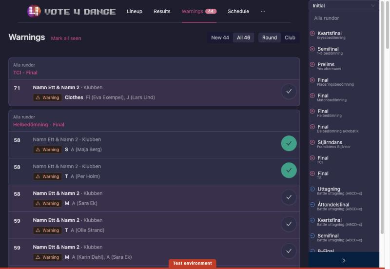
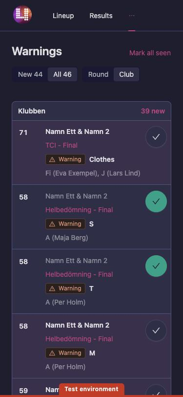
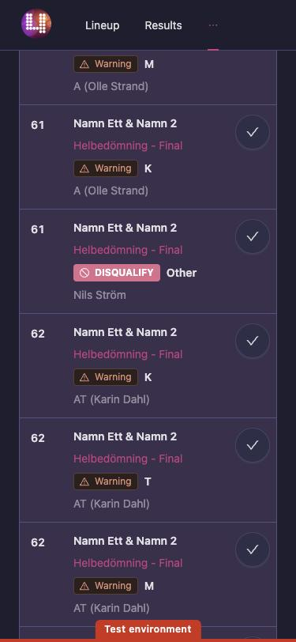
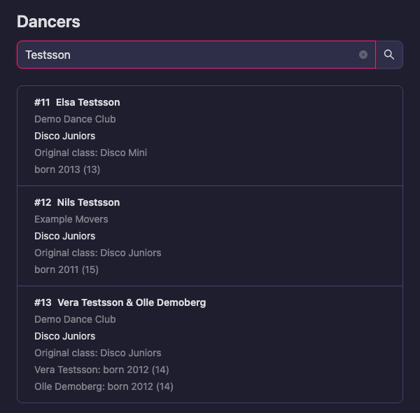
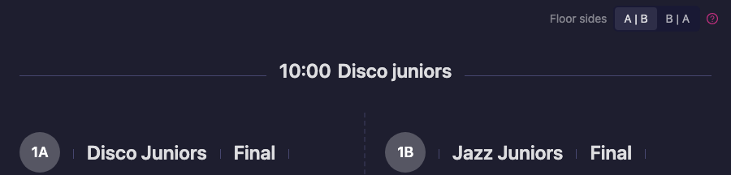

# Scrutineer

**You are a scrutineer if** you are responsible for the integrity of the judging and the results:
the chief scrutineer at an event, the chairperson of adjudicators, or a federation observer.

## Your app is Supervisor

In Swedish it is called **Kontrollant**. Somebody has to tick **Supervisor** for you under
`Manager → Event → Users` — see [Users, apps and stations](/manager-guide/users-and-stations/).

What it gives you, and what it deliberately does not:

| Supervisor can | Supervisor cannot |
|---|---|
| See the results of rounds that are **not yet published** — which is the whole point: you review before the audience sees anything | Change the setup. Classes, rounds, judges and panels are the organizer's, in Manager |
| See each judge's marks per round, and each participant's **Offset from Average** as a chart, so a judge who is out of line with the panel is visible at a glance | Enter or alter a judge's marks |
| Switch to a **By component** view where the round is judged on components, show all participants, and show the name column | |
| Show **trainee scores**, which are entered but do not affect the result | |
| Follow judging live: *Judging in progress*, *Judges are done* per heat | |
| Filter to one floor, follow the schedule, and push things to the screens with **Show on screen** | |
| See every warning the judges give during the whole event in one list, **Warnings**, and keep track of which ones you have dealt with | |
| Look up any dancer by name or start number under **Dancers**, with their age, original class and rounds | |

**Supervisor cannot publish results.** Publishing is done from the Speaker console or from
Manager. If you are the one who publishes, you also need **Speaker** or **Manager** ticked.
Agree before the event who presses it, and what you want to have checked first.

## Warnings from the judges

During the competition a judge can give a dancer or couple a warning, for example for clothing,
a lift or the music. **Warnings** in the Supervisor app lists all of them, from every round and
every day of the event, so you can follow up with the team leaders without opening round after
round. The list updates by itself as the judges send new warnings.

1. Open **Warnings** in the Supervisor menu. The number next to it is how many warnings you have
   not seen yet on the floor you have chosen.
2. Each row shows the start number, the dancer or couple and their club, the warning and its
   reason, and which judges gave it. When several judges give the same warning, it shows once with
   all their names. Under the name you see the entry's **Original class** and each dancer's year of
   birth with the age they turn this year, for example "born 2012 (14)", so you can check an age
   warning without looking the dancer up.
3. Choose how to read the list:
   - **New** shows only the warnings you have not seen yet; **All** shows every warning.
   - **Round** groups the warnings by round, newest first, under the day and the block of the
     schedule. The round's name opens its results.
   - **Club** groups them by club, with the clubs that have new warnings first, which is handy
     when you go and find a team leader.
   - At an event over several days, pick a day. While the event is running, today is chosen
     for you.
4. When you have dealt with a warning, press the round tick on its row. The row turns grey and the
   tick green. Press it again to mark the warning as new again.
5. **Mark all seen** marks every warning in the list as seen. Press **Undo** if you did not mean
   to. When new warnings come in, **Mark all seen** comes back in its place.

A disqualification stands out from a warning: it has a filled label with a stop sign.

What you have seen is remembered on your phone or computer only. Another scrutineer, or you on
another device, starts with all warnings as new. Two tabs or windows on the same computer share
what you have ticked.

## Looking up a dancer

When you need to check a dancer, most often their age or the class they really belong in, look
them up instead of searching the start lists.

1. Open **Dancers** in the Supervisor menu.
2. Type a name, or part of one, or a start number.

   
3. Each entry that matches shows its start number, the dancers and their club, the class they
   dance in, their **Original class** and each dancer's year of birth with the age they turn this
   year. A withdrawn entry is marked **Withdrawn**.
4. Press an entry to see that dancer's classes and rounds day by day, with the time, the floor and
   their heats. **Back to the search** takes you back.

The **Original class** is the class the entry was made in. It differs from the class danced when
classes have been combined, for example two age groups dancing together.

## A split floor, seen from your seat

When a floor is split into halves, such as A and B, the rounds that dance at the same time are
shown side by side on **Lineup** and **Results**, in the order A, B. If you sit on the other side
of the floor, B is on your left: choose **B | A** under **Floor sides** at the top of the page.
The choice is remembered on your phone or computer, so every scrutineer can pick the side they
sit on. **Floor sides** only shows when a split floor is on the page.

## Judge types, which is your vocabulary

Every judge on a panel has a type, and the type decides what their marks do:

| Type | What it means |
|---|---|
| **Judge** | Scores participants in assigned classes; counts toward placements. |
| **Chief judge (in)** | Included in skating/placement: counts in the ranking math, and can be used to break ties. |
| **Chief judge (out)** | Excluded from skating/placement: does not affect the ranking math, but can still be used to break ties. |
| **Trainee judge** | A practice role. Enters scores that do not affect results. |
| **Audience** | Scores from public audience voting; counts toward final placements. |
| **Not judging** | No judging duties assigned. |

If a panel looks wrong in the results, check the types before you doubt the arithmetic.

## What to watch on the day

Manager warns the desk at two moments that concern you directly:

- **Closing a round** — "Warning! All judges have not submitted their results!!"
- **Confirming a round** — "Warning! Some participants share a placement.", and, if no
  advancement has been set, "No targets have been set from the round result."

And **Problems** in Manager runs the structural checks continuously: start-number conflicts,
license conflicts, rounds without judges, group classes with no judges, participants scheduled in
two overlapping rounds at once, finals with participants marked through, leader/follower classes
without exactly one partner class, and the federation-specific rules (DSF, WDSF). Clear it before
the doors open.

## Scrutineer steps

1. [Account creation](/scrutineer/account-creation/)
2. [Getting a license](/scrutineer/getting-a-license/)
3. [Applying for a school/club](/scrutineer/applying-for-a-school-club/)
4. [Federation status through school/club](/scrutineer/federation-status/)
5. [Event assignment](/scrutineer/registration-for-event/)
6. [Creating and getting rankings](/scrutineer/creating-and-getting-a-ranking/)
7. [Age transfer impacts](/scrutineer/age-transfer/)
8. [Class transfer impacts](/scrutineer/class-transfer/)
9. [Renew license](/scrutineer/renew-license/)
10. [Retiring from active duty](/scrutineer/retiring/)

## Dedicated feature sections

1. [Users, apps and stations](/manager-guide/users-and-stations/) — how you get Supervisor access
2. [Live operations](/manager-guide/live-operations/) — the event-day runbook you are overseeing
3. [Manager Guide](/manager-guide/) — the operational event workflow
4. [Special formats](/special-formats/) — when the format changes the normal flow
5. [Manual Workflows](/federation-rankings/manual-workflows/) — only for federation-approved exceptions to a published outcome

**Not sure if you're a scrutineer?** Start with [Finding Your Role](/understanding-vote4dance/finding-your-role/).
