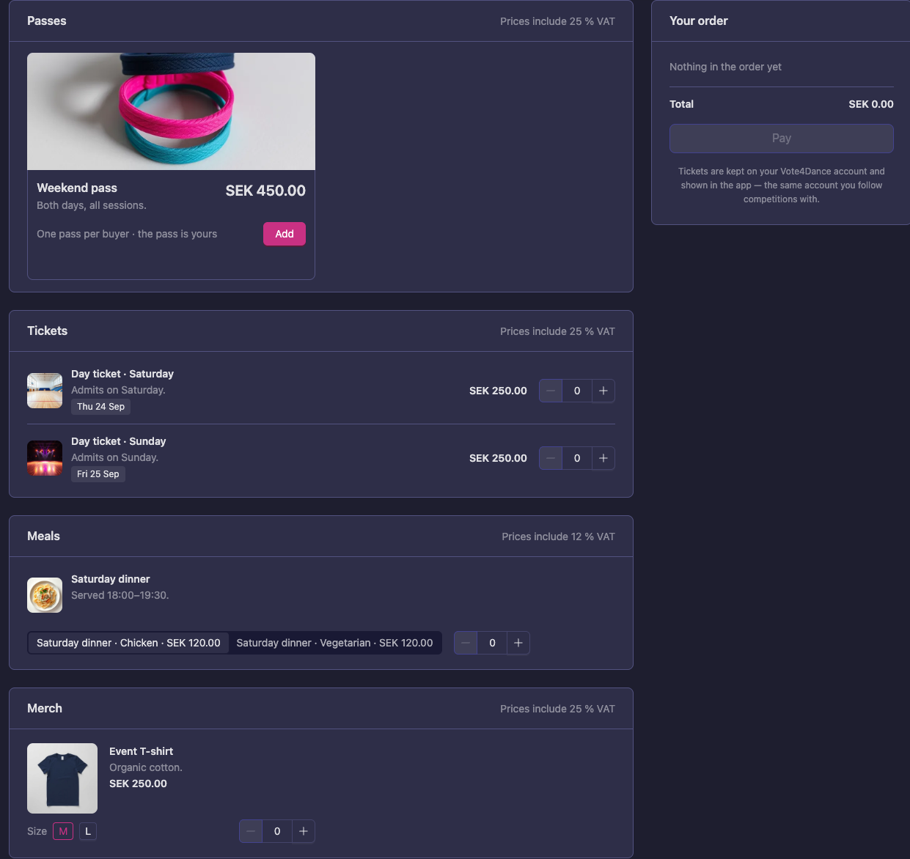
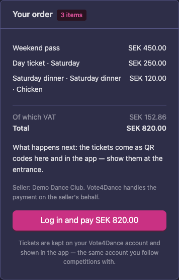
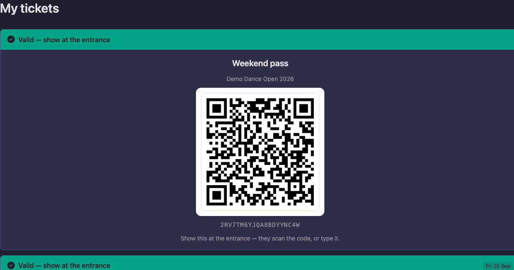

# Buying tickets

## Find the event

Open the event from the start page or the organizer's link, and pick the **Tickets** tab. If the tab is not there, the organizer does not sell tickets through Vote4Dance for that event.

What is on sale is grouped as passes, day tickets, meals, tables and merch. Each line shows the price including VAT, how many are left when the organizer set a limit, and until when it is on sale. Sizes and variants — a T-shirt size, a vegetarian meal — sit together under one heading.

## Choose and pay

Add what you want; the order sums up as you go.

1. Sign in, or create a free account. When you are not signed in, the button under **Your order** reads **Log in and pay** with the total: press it and sign in. The tickets are kept on the account, so this is how you get them back on any device. You cannot buy on the website without an account. At the event, the organizer's desk can sell you a ticket without one.
2. Check the e-mail address the tickets and receipt should go to. It is suggested from your account and you can change it.
3. Pay by card. The payment goes to the **organizer**, not to Vote4Dance; the seller's name is on the order and on the receipt.

Your order is held for 30 minutes while you pay. If you close the page mid-payment, the order waits on the Tickets page and updates itself as soon as the payment goes through.

## Your tickets

Once paid, each ticket becomes its own QR code, in three places:

- the event's **Tickets** page, under **Your tickets**
- the app, under **Profile → My tickets**
- the e-mail you got when you paid

At the entrance, show the QR. One ticket admits one person, once per day it is valid for. Staff scan it, or type the code under it.

**You can pass a ticket on.** Whoever holds the code can use it, so a ticket for a friend without an account is simply forwarded to them: send them the QR code or the code written under it. The ticket is not moved to their account. It stays in your order, under **Your tickets** and in your app, and there is no way to transfer it to another account. Do not send the same ticket to two people: it admits one person.

## Meals, tables and merch

The same codes are used for anything else you bought. Show the code at the counter and the staff hand it over; the ticket is then marked as used so it cannot be used twice.

## Day tickets

At an event that runs over more than one day, a day ticket admits on the day it says and no other. The ticket carries its day, and the desk is told when a ticket is for another day.

## Refunds and questions

Refunds, changes and questions about an order go to the **organizer** — they sold you the ticket, and their contact details are on the order. Vote4Dance handles the payment on their behalf and does not refund on their behalf.

## Do dancers need a ticket?

Usually not: a dancer's registration admits them, and they show their [Vote4Dance ID](/dancer/vote4dance-id/) instead. Some organizers ask dancers for a ticket on the days they do not dance — the Tickets page of the event says so when they do.
